# Design: distributed, agentic retrieval over FiQA

## 1. Problem statement

I built a retrieval system over BEIR FiQA: 57,638 personal-finance forum answers, with 5,500 train, 500 dev and 648 test
questions, each labelled with the passages that answer it. The system has three layers:

- Part A: three retrieval strategies (BM25, dense, hybrid) with an evaluation harness, ablations and a failure analysis.
- Part B: a sharded service (one router, three shards) that accepts live writes and can switch its embedding model
  with no downtime.
- Part C: a single LLM agent and a multi-agent system that use the search service as a tool, and a measured decision
  on when each one is worth its cost.

I tuned everything on dev and ran the test split once, at the end, for the configuration I chose.

## 2. Requirements

**Functional**

| area | requirement | what I built |
|---|---|---|
| A1 | BM25, two dense models, a hybrid; a CLI | own BM25, all-MiniLM-L6-v2 and bge-small-en-v1.5, hybrid linear fusion; `python src/search.py --query ... --top-k 10 --strategy hybrid` |
| A2 | nDCG@10, Recall@10, MRR, p50/p95, peak RAM, stratified recall, cold vs warm | `src/eval.py` writes `results/bench.json` |
| A3 | at least one real ablation | fusion method x weight sweep, cross-encoder rerank depth sweep, dense model, local vs global IDF |
| A4 | three analysed failures | `results/failures.md` |
| B1 | ≥ 3 shards, router, ≤ 1% quality gap, timeouts, 1 vs N shard latency | 3 shards, scatter-gather router, 0.0% gap, 0.5 s timeout with partial results |
| B2 | idempotent versioned upsert/delete, consistent indexes, a tested freshness guarantee | versions + tombstones + WAL; sync mode (searchable on the next query) and async mode (searchable within 1 s) |
| B3 | zero-downtime model migration with cutover and rollback | dual-write + background backfill, `make migrate`, `make cutover`, `make rollback`; 2,045 queries, 0 failed |
| C1 | 100 compound questions with half-tracked gold | `data/compound_dev.jsonl` + `data/build_compound.py` |
| C2 | single agent, one search tool, ≤ 3 steps | `src/agent/single_agent.py` |
| C3 | orchestrator + ≥ 2 sub-agent roles, shared slots, budgets, partial failure, skip when simple | `src/agent/orchestrator.py`: planner, workers, verifier |
| C4 | compare baseline, single, multi on plain and compound sets; routing policy; ship calls | `scripts/agent_eval.py`, `results/agent_eval.json` |

**Non-functional**

| constraint | target | my chosen configuration |
|---|---|---|
| hardware | CPU only, at index and serve time | CPU only |
| latency | p95 ≤ 50 ms through the router, after warmup | 40.5 ms |
| memory | ≤ 2 GB RAM per shard process | 723 MB peak (compose also sets `mem_limit: 2g`) |
| data hygiene | tune on dev, test once | test run once, recorded in `results/runs/FINAL-test-hybrid-linear-minilm.json` |
| reproducibility | `docker compose up` brings up the service and eval | Dockerfile + compose; quality numbers are identical in Docker (nDCG@10 0.4190) |
| code size | about 2,000 lines, excluding tests and data loaders | 2,004 logical lines in `src/` (`python scripts/count_loc.py`) |

## 3. Guesstimates

Simple numbers I used to size the system before building it, next to what I later measured.

| quantity | quick math | measured |
|---|---|---|
| vectors per model | 57.6K passages x 384 dims x 4 bytes ≈ 88 MB | `emb_minilm.npy` 84 MiB on disk |
| docs per shard | 57.6K / 3 ≈ 19.2K | 19,167 / 19,254 / 19,217 |
| RAM per shard | model weights + Python (~650 MB) + vectors (~30 MB) + BM25 (~20 MB) + text (~15 MB) | 723 MB peak, so the model dominates |
| query time | encode the query (~8 ms) + search a third of the corpus (a few ms) + two HTTP round trips | 28.6 ms p50 through 3 shards |
| write cost | one embedding per passage (~25 ms) per maintained model | sync mode: 128 ms ack p50 under 8 concurrent writers |
| agent cost | prompt = instructions + results so far; about 0.1K to 3.4K tokens per question | 130 (multi, plain) to 3,380 (single, compound) tokens |

## 4. Infrastructure architecture

Everything runs on one machine with `docker compose up -d`. One image (`fiqa-retrieval:latest`) runs every container.

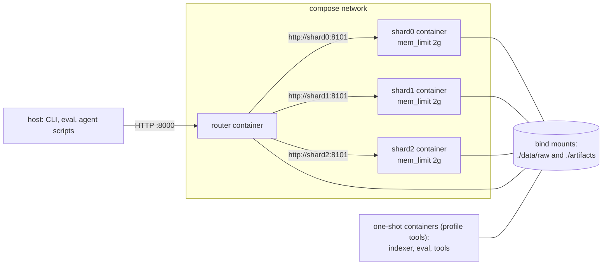

| container | command | notes |
|---|---|---|
| `shard0`, `shard1`, `shard2` | `python -m src.service.shard_server` | `SHARD_ID` 0 to 2, `N_SHARDS=3`, port 8101 inside the network, `APPLY_MODE` sync (default) or async, state in `artifacts/docker/shardN`, healthcheck on `/health`, `mem_limit: 2g` |
| `router` | `python -m scripts.api_docs` (the router app from `src.service.router`, plus example requests on `/docs`) | published on port 8000, `SHARD_URLS` lists the three shards, `SHARD_TIMEOUT_S=0.5`, state in `artifacts/docker/router_state.json`, starts after all shards are healthy |
| `indexer` | download FiQA, then `python -m src.index.build_index` | run once; writes the embedding caches to `artifacts/` |
| `eval` | `python -m src.eval --mode service --url http://router:8000 ...` | dev eval through the router |
| `tools` | any command, e.g. `python src/search.py --url http://router:8000 ...` | has `ROUTER_URL` set and `.env` mounted read-only for the agent eval |

Each service runs 4 torch threads. The same layout also runs as plain local processes (`python -m src.service.cluster
--shards 3`: router on 8000, shards on 8101 to 8103), which I used for tests and benchmarks.

## 5. Component architecture

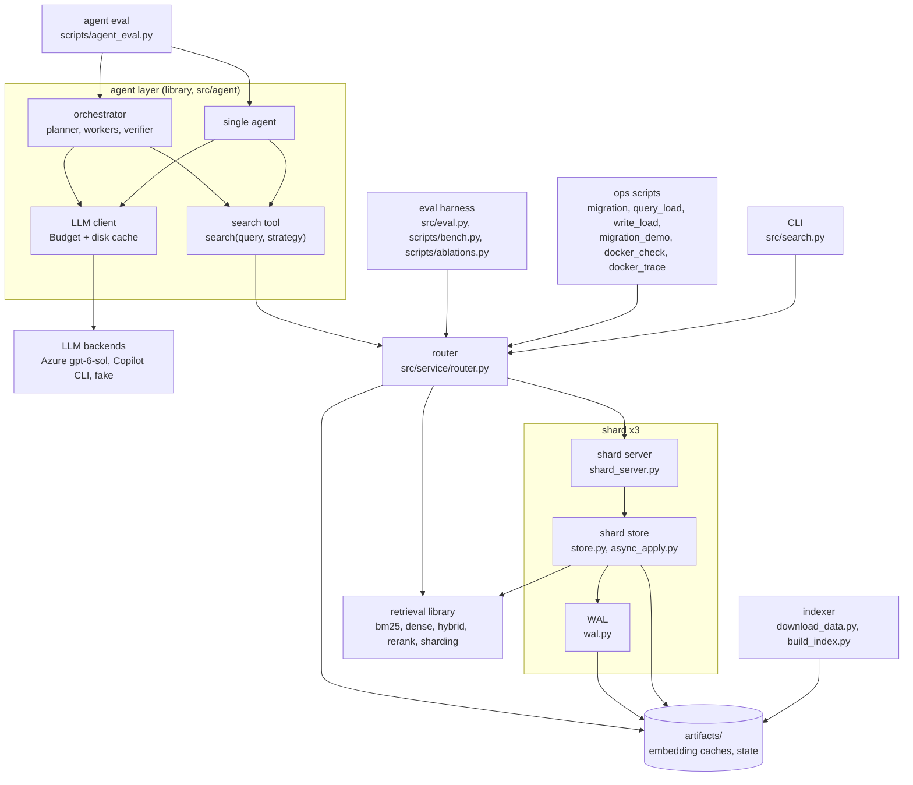

| component | code | runs as | responsibility |
|---|---|---|---|
| CLI | `src/search.py` | command | sends one `/search` request, prints ranked passages with scores |
| router | `src/service/router.py` | FastAPI service | embeds the query once, gathers global BM25 statistics, fans out, merges, fuses; routes writes to the owner shard; drives migration; keeps `active_model` |
| shard server + store | `src/service/shard_server.py`, `store.py` | FastAPI service, one per shard | owns a slice of the corpus: BM25 index, one dense index per model, doc store, versions; applies writes under a read/write lock |
| async applier | `src/service/async_apply.py` | thread inside a shard (async mode only) | queue, parallel embedding, back-pressure, background apply |
| WAL | `src/service/wal.py` | file per shard | durable log of writes, replayed on restart |
| retrieval library | `src/retrieval/bm25.py`, `dense.py`, `hybrid.py`, `rerank.py`, `src/index/sharding.py` | imported code | scoring, fusion, optional cross-encoder rerank, `crc32(doc_id) % N` ownership |
| indexer | `scripts/download_data.py`, `src/index/build_index.py` | one-shot job | downloads FiQA, embeds the corpus once per model into `artifacts/emb_*.npy` |
| eval harness | `src/eval.py`, `scripts/bench.py`, `scripts/ablations.py` | one-shot jobs | metrics, latency, memory, sweeps into `results/` |
| agent layer | `src/agent/` | library run by `scripts/agent_eval.py` | single agent, orchestrator with planner, workers and verifier, the search tool, prompts |
| LLM client and backends | `src/agent/llm.py` | library + external API | one `complete()` interface over fake, Copilot CLI and Azure; token budget; disk cache |
| ops scripts | `scripts/migration.py`, `query_load.py`, `write_load.py`, `migration_demo.py`, `docker_check.py`, `docker_trace.py` | commands | migration steps, load during migration, write load, Docker checks |

## 6. Deep dives

### 6.1 Retrieval (A1)

BM25 scores a passage by how many rare query words it contains, with diminishing returns for repeats and a penalty for
long passages. Dense retrieval embeds the query and every passage as 384-number vectors and ranks by cosine similarity,
so it matches meaning ("betting against a stock" finds "short selling"). Hybrid combines both lists.

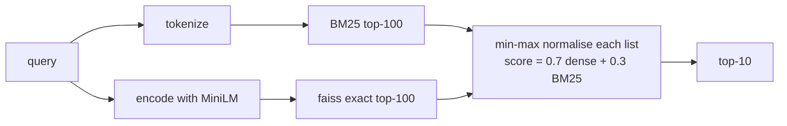

| I chose | because | alternative | why I didn't use it |
|---|---|---|---|
| my own BM25 on scipy sparse matrices (CSC for search, CSR for deletes, a delta segment for new docs, a tombstone mask) | I needed add/delete for live writes and per-term statistics for global IDF across shards | `rank_bm25`, Pyserini/Lucene | `rank_bm25` has no updates or stats API; Lucene would hide the sharding and update logic the spec asks for |
| all-MiniLM-L6-v2 as the primary dense model | 0.388 nDCG at 18.8 ms p50; leaves room under 50 ms after HTTP | bge-small-en-v1.5 | +0.010 nDCG dense but +12 ms per query, and the gain disappears in hybrid (0.4155 vs 0.4190) |
| bge-small-en-v1.5 as the second model (migration target) | same 384 dimensions, a real "newer model" story; its query prefix lives in the model registry | all-mpnet-base-v2, bge-base | 768 dimensions and roughly 3x the encode cost on CPU |
| faiss `IndexIDMap2(IndexFlatIP)` | exact search is allowed at this size; inner product on unit vectors is cosine; `remove_ids` supports deletes | HNSW, IVF | approximate search would cost recall for no needed speed (search is ~1 to 3 ms per shard) |
| linear fusion, α = 0.7 on dense, min-max normalised, depth 100 | best dev nDCG of everything I tried (0.4190) | RRF (k = 60) | equal-weight RRF scored 0.3733, below dense alone, because BM25 is much weaker on FiQA |
| no reranker in the chosen point | the cross-encoder made quality worse and cost 339 ms | cross-encoder rerank | see 6.3 |

Results (dev, single node, in-process):

| strategy | nDCG@10 | R@10 | MRR@10 | p50 / p95 ms |
|---|---|---|---|---|
| BM25 | 0.2642 | 0.3135 | 0.3222 | 1.2 / 2.0 |
| dense MiniLM | 0.3881 | 0.4665 | 0.4532 | 18.8 / 20.8 |
| dense bge-small | 0.3981 | 0.4681 | 0.4773 | 30.6 / 34.2 |
| hybrid RRF, MiniLM | 0.3733 | 0.4420 | 0.4485 | 22.1 / 39.9 |
| hybrid linear α = 0.7, MiniLM (chosen) | 0.4190 | 0.4914 | 0.4872 | 20.7 / 24.5 |
| hybrid linear α = 0.7, bge-small | 0.4155 | 0.4856 | 0.4953 | 35.3 / 40.3 |

### 6.2 Evaluation harness (A2)

`src/eval.py` runs a strategy over the 500 dev questions and records quality, latency and memory. `scripts/bench.py`
runs every configuration in its own process, so the "cold" numbers are real.

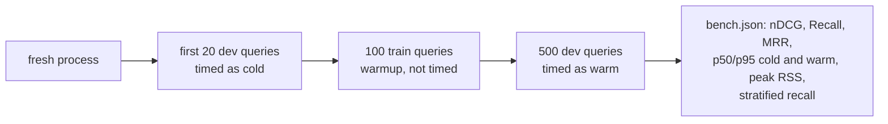

| I chose | because | alternative | why I didn't use it |
|---|---|---|---|
| my own metric code (`src/metrics.py`), unit-tested | I wanted to know exactly what each metric computes | pytrec_eval only | harder to read and debug; I compared against it instead |
| warmup on train queries | no dev query is seen before it is timed | warmup on dev | the first 100 dev queries would be measured warm and cached |
| nearest-rank p50/p95 | always a real measured value | interpolated percentiles | invents a value nobody measured |
| peak RSS from the OS | that is what the 2 GB limit means | tracemalloc | misses torch and faiss native memory |

Stratified Recall@10 for the chosen configuration (dev):

| slice | n | Recall@10 |
|---|---|---|
| short queries (< 5 words) | 13 | 0.385 |
| medium (5 to 15 words) | 403 | 0.491 |
| long (> 15 words) | 84 | 0.510 |
| a gold passage is in the 10% longest docs | 185 | 0.464 |
| no gold passage in the 10% longest docs | 315 | 0.508 |

Long gold passages are harder because the encoder reads only the first 256 tokens. The gap is 0.083 for dense MiniLM
alone (0.414 vs 0.497), about zero for BM25 (0.310 vs 0.315) and 0.044 for hybrid.

Cold vs warm: 29.5 / 33.0 ms cold vs 28.6 / 40.5 ms warm (p50 / p95) for the chosen configuration through 3 shards. The
delta is near zero because the router and shards load the models and run one warmup encode at startup, the vectors are
copied into RAM at load time, and the HTTP client keeps connections open. Startup is what the warmup hides: loading the
model takes 1.5 s and the first encode in a fresh process takes 19 ms instead of 8 ms. Warm p95 can be higher than cold
p95 because 500 samples catch more tail events than 20.

### 6.3 Ablations (A3)

I varied one thing at a time on dev and kept everything else at the chosen configuration.

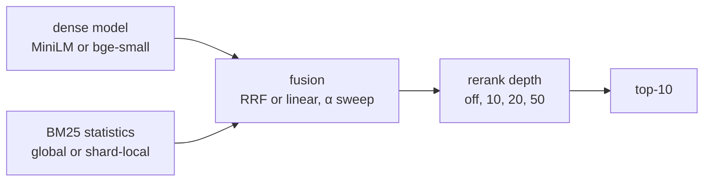

Fusion method and weight (MiniLM, dev nDCG@10; α is the dense weight):

| α | 0.1 | 0.3 | 0.5 | 0.6 | 0.7 | 0.8 | 0.9 |
|---|---|---|---|---|---|---|---|
| linear | 0.2871 | 0.3360 | 0.4022 | 0.4179 | **0.4190** | 0.4064 | 0.4005 |
| RRF | | | 0.3733 | 0.3865 | 0.3953 | 0.4038 | 0.4062 |

bge-small has the same shape (linear peaks at 0.4155 at α = 0.7; RRF tops out at 0.4082 at α = 0.9).

Cross-encoder rerank (`cross-encoder/ms-marco-MiniLM-L-6-v2` on top of the chosen hybrid):

| rerank depth | nDCG@10 | R@10 | MRR@10 | p50 / p95 ms |
|---|---|---|---|---|
| off | 0.4190 | 0.4914 | 0.4872 | 20.7 / 24.5 |
| 10 | 0.4058 | 0.4914 | 0.4688 | 338.6 / 366.8 |
| 20 | 0.3964 | 0.4829 | 0.4634 | 621.0 / 634.6 |
| 50 | 0.3771 | 0.4633 | 0.4444 | 1246.3 / 1366.6 |

BM25 statistics through 3 shards: global (DFS phase) 0.2642 at 10.7 ms p50; shard-local 0.2653 at 6.8 ms p50.

What I concluded:
- Linear fusion beats RRF here because the two retrievers are far apart in quality (0.264 vs 0.388). RRF's equal vote
  lets the weaker one drag the ranking down; a dense-heavy weight fixes it.
- The reranker gets worse the deeper it goes. It was trained on short MS MARCO web snippets, FiQA answers are long
  forum posts it truncates at 256 tokens, and the first stage is already decent. At ~30 ms per pair on this CPU it would
  also break the latency budget.
- bge-small is better alone and not better in hybrid, because BM25 already supplies the lexical signal it adds.
- Shard-local IDF gives the same quality within noise and saves one round trip. I kept global statistics because they
  make the sharded system exactly equal to single node and stay correct when shards are skewed.

### 6.4 Failure analysis (A4)

161 of the 500 dev queries have Recall@10 = 0 for the chosen configuration. I analysed three of them in `results/failures.md`
(query text, top-5 with scores, gold rank and score, diagnosis, fix).

| case | query | what went wrong | fix I would try |
|---|---|---|---|
| 1 (qid 4746) | "Personal finance in EFU and NAFA" | gold is BM25 #1 but absent from dense; with α = 0.7 its fused score caps at 0.300 | a query-adaptive α when a query has a very rare term; on dev it moved nDCG only 0.4190 → 0.4206, so I didn't adopt it |
| 2 (qid 4029) | "Family suggests my first real estate. Advice?" | two gold passages are long; the encoder never reads the part that answers the question | index overlapping 150-word chunks and score a doc by its best chunk; cosine to the query rose 0.464 → 0.548 for one gold doc |
| 3 (qid 7490) | "Clarify on some Stocks Terminology" | the query is a post title; the real question (trading volume) was in the post body | send title + body as the query, or let an agent ask a clarifying question; report this class separately |

In 58 of the 161 failures neither retriever had any gold passage in its top 100, so fusion or reranking could not help.

### 6.5 Router: sharding and scatter-gather (B1)

The router owns the query path. Each shard holds one third of the corpus and answers for its slice only.

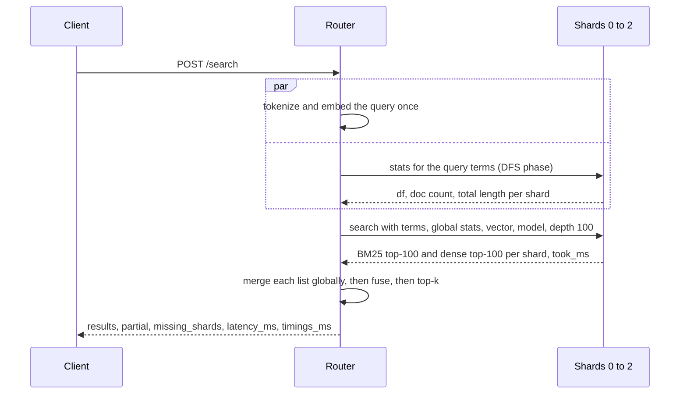

| I chose | because | alternative | why I didn't use it |
|---|---|---|---|
| `crc32(doc_id) % 3` | stable across processes and languages | Python `hash()` | salted per process, so writes and reads would disagree on the owner |
| a DFS phase: the router sums df, doc count and length from all shards | BM25 then uses global IDF, so sharded scores equal single-node scores | shard-local statistics | 0.2653 vs 0.2642, same within noise but not exact, and wrong for skewed shards |
| shards return top-100 per component, router merges globally, then fuses | min-max and RRF depend on the whole list, so fusing per shard crowns each shard's local winner | fuse on each shard, merge fused lists | changes the ranking depending on how docs are spread |
| embed the query once at the router and send the vector | saves two extra encodes per query | each shard encodes | 3x the CPU for the most expensive step |
| 0.5 s timeout per shard call, policy `partial` by default | an answer from 2 of 3 shards is more useful than an error for search | policy `fail` (also implemented) | a single slow shard would fail every query |

How the caller knows an answer is partial: the response has `partial: true` and `missing_shards: [i]`. With
`FAILURE_POLICY=fail` the router answers HTTP 503 with the missing shards instead.

Results (dev, through the router):

| configuration | nDCG@10 | p50 / p95 ms | peak RSS |
|---|---|---|---|
| single node, in-process | 0.4190 | 20.7 / 24.5 | 812 MB |
| router + 1 shard | 0.4190 | 23.4 / 26.3 | 775 MB |
| router + 3 shards | 0.4190 | 28.6 / 40.5 | 723 MB per shard |

BM25, dense and hybrid all match single node to four decimals (0.0% difference). Every `/search` reply includes
`timings_ms`; in a real-corpus run the parts were roughly: stats round trip ~15 ms, query-encode overhang 0 to 15 ms,
slowest shard's own compute ~4 to 5 ms, network and queueing ~8 to 12 ms, merge and fuse under 1 ms.

### 6.6 Shard write path (B2)

Every write carries `(doc_id, version)`. A shard applies it only if the version is newer than what it has, so a replay
or a late older write is a no-op, and a delete leaves a tombstone so an older upsert can't bring the doc back. The write
goes to a write-ahead log before it is acknowledged. I built two modes, chosen per shard with `APPLY_MODE`.

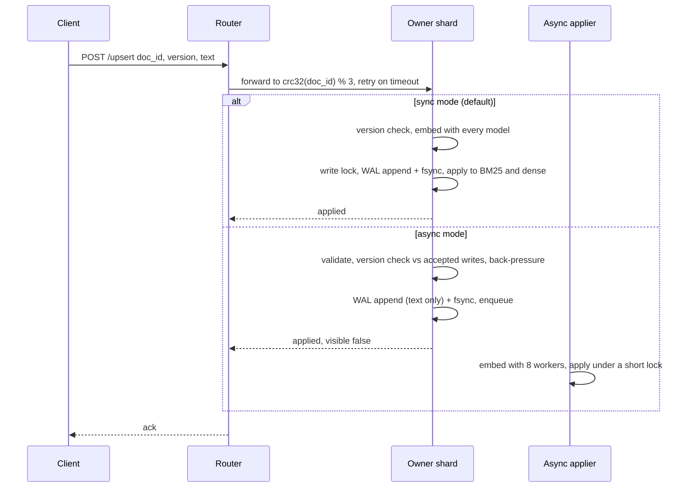

| I chose | because | alternative | why I didn't use it |
|---|---|---|---|
| client-supplied versions, apply only if newer | makes retries and replays safe; the router can retry on timeout | last-writer-wins by arrival | a late older write would overwrite a newer one |
| tombstones for deletes | a delayed older upsert can't resurrect a deleted doc | remove the entry | forgets that the doc was deleted at version v |
| WAL with fsync before the ack; replay on restart | an acknowledged write survives a crash | in-memory only | a crash loses acked writes |
| one read/write lock per shard over docs, versions, BM25 and every dense index | readers see a write fully or not at all | separate locks per index | a reader could see a doc in BM25 but not in dense |
| embed outside the lock, re-check the version inside | embedding takes ~25 ms; inside the lock it would block every search | embed inside the lock | readers wait for every write |
| sync as default | simplest guarantee: searchable on the next query | async only | 1.6x write throughput but a visible lag of up to ~0.6 s |
| async with back-pressure | throughput for write-heavy feeds while keeping a bound | async without back-pressure | the queue grows and the lag has no bound under load |
| crash-only recovery: an exception during apply marks the shard unhealthy; restart replays base + WAL | one simple, tested recovery path | try to repair in place | many partial states to reason about |

What a reader sees if a write fails halfway: the old version. A crash before the WAL append means the write never
happened and was never acked. A crash after the append is applied on restart by WAL replay. A torn last WAL line is
truncated when the log reopens (it was never acked). An exception inside apply makes the shard answer 503, the router
reports it in `missing_shards`, and a restart recovers it.

Freshness guarantees and their tests:
- sync: searchable by the first query issued after the ack.
  `tests/test_integration_service.py::test_freshness_write_searchable_immediately_after_ack` runs 3 shard processes and
  the router over HTTP, for every strategy, with no sleeps or retries.
- async: searchable within 1 s of the ack. `tests/test_integration_async.py::test_acked_write_is_searchable_within_one_second`
  polls until the doc is visible and asserts the lag. `POST /admin/flush` waits until every queued write is applied.

Results under heavy writes (`results/write_load.json`: real corpus, 3 shards, 8 writers and 2 readers, 30 s):

| | sync | async |
|---|---|---|
| writes acked per second | 57.8 | 94.2 |
| ack p50 / p95 ms | 128 / 181 | 78 / 120 |
| visible lag p95 / max ms | 0 / 0 | 466 / 583 |
| search p50 under this load | 131 ms | 184 ms |

### 6.7 Model migration (B3)

I build the new model's index next to the old one, keep both up to date, switch reads with a flag, and keep the old one
until I'm sure.

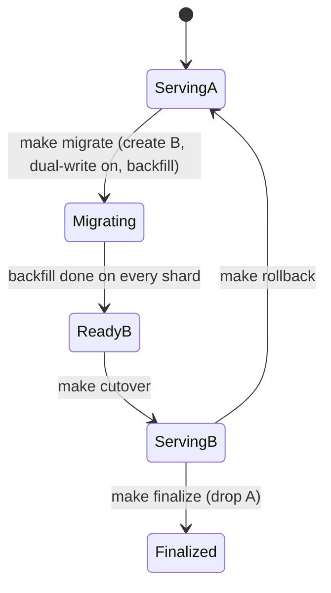

| I chose | because | alternative | why I didn't use it |
|---|---|---|---|
| turn on dual-write in the same lock acquisition as the backfill snapshot | no write can fall between "snapshot taken" and "dual-write on" | start dual-write after the snapshot | writes in that gap would be missing from B |
| backfill in 256-doc batches with an optional throttle, skipping docs whose version changed | searches keep running between batches; never overwrite a newer vector | one big rebuild under the lock | blocks searches for the whole build |
| reuse cached vectors when the text hash matches (`--reencode` forces a full re-embed) | the cutover demo runs in seconds instead of ~18 minutes | always re-embed | the same work, much slower |
| router-level `active_model` flag, read once per request, persisted to `router_state.json` | in-flight requests finish on the model they started with; restarts keep the decision | per-shard flags | shards could disagree mid-switch |
| refuse cutover unless every shard reports the new index ready | never serve queries against a half-built index | trust the operator | one mistake means bad results |

Demo (`results/migration_demo.json`): 4 query threads and 1 writer through migrate, backfill, cutover and rollback:
**2,045 queries, 0 failed**. The 116 docs written during the run were found by both models, and per-shard index sizes
matched for both models. I would roll back on a quality canary drop, a latency SLO breach (bge-small costs about 12 ms
more per query here) or errors on the new path.

### 6.8 Compound question set (C1)

`data/build_compound.py` (seed 42) samples 200 dev questions, embeds them with MiniLM, and pairs each with a random
unpaired partner whose cosine similarity is below 0.25, falling back to the least similar partner when none qualifies.
The halves end up on different topics: mean pair cosine 0.088, maximum 0.346. Each pair was rewritten
into one natural question by an LLM from the two question texts only. Gold labels are the union of both halves' qrels,
each tagged with the half it belongs to. I hand-checked ten of the rewrites (`data/compound_review_sheet.md`): all ten
read as one natural question and kept both halves' intents, so none needed a fix.

| I chose | because | alternative | why I didn't use it |
|---|---|---|---|
| a cosine threshold of 0.25 between halves | same-topic pairs would be answered by one search | random pairs | some pairs would be near-duplicates |
| rewrite from the question texts only | no words from gold passages leak into the query | let the rewriter see the passages | inflates recall |
| keep the half of every gold passage | needed for Coverage@10 | a flat gold list | can't tell if both halves were answered |

### 6.9 Single agent (C2)

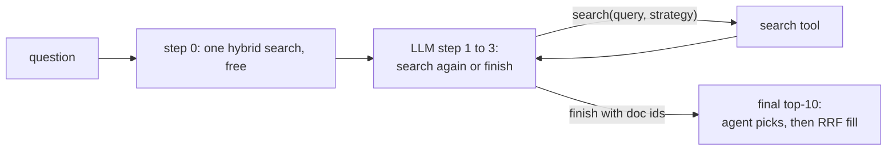

The agent starts from one hybrid search, then gets at most 3 LLM steps. Each step returns JSON: either another
`search(query, strategy)` or `finish` with the doc ids it picks. The final list is its picks, then an RRF fill over
everything it searched. Budget: 3 calls and 12K tokens. Results are passed as 200-character snippets.

| I chose | because | alternative | why I didn't use it |
|---|---|---|---|
| a free step 0 | the first decision is grounded in real results | let the LLM write the first query | one more call for little gain |
| my own loop with a JSON action protocol (native function tools on Azure) | the task spec rules out agent frameworks; one loop works for every backend | LangGraph and similar | not allowed |
| 200-character snippets | keeps prompts small; tokens grow with every step | full passages | input tokens would explode |

### 6.10 Multi-agent system (C3)

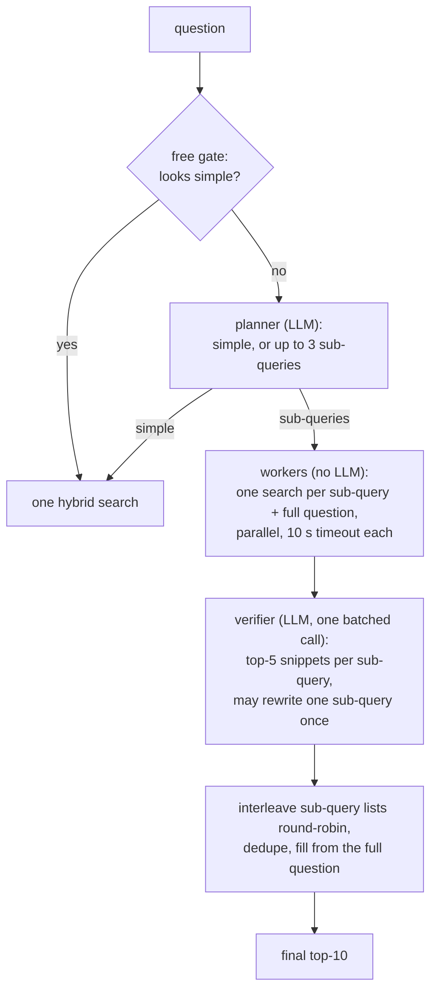

The orchestrator is plain code. It owns one `Budget` per user question (3 LLM calls, 8K tokens, reserved before each
call), the timeouts and the 10 slots.

| I chose | because | alternative | why I didn't use it |
|---|---|---|---|
| planner role | splitting a question needs language understanding | regex splitting only | misses real compound questions |
| workers without an LLM | the planner already wrote good sub-queries; search is free | one LLM agent per worker | more calls and tokens for no gain |
| verifier role, one batched call | catches a sub-query that drifted off topic | no verifier | drifted sub-queries fill slots with junk |
| orchestrator in code | budgets, timeouts and slots must be deterministic and testable | an LLM orchestrator | unpredictable call counts and cost |
| round-robin slot interleave (about 5 + 5 for two halves) | scores from different sub-queries aren't comparable; interleaving guarantees both halves get slots | merge by score | one half can take all 10 slots |
| a free word and punctuation gate before the planner | most plain questions never reach the LLM | always call the planner | an LLM call for every question |

Partial failure: if a worker fails or times out, its list is dropped and the others fill the slots; a planner or
verifier error falls back to "simple" or "all relevant"; if every worker fails, the orchestrator runs one direct search.
`tests/test_agents.py::test_orchestrator_partial_failure_still_returns_results` shows it.

### 6.11 Agent evaluation and routing (C4)

I compared the non-agentic hybrid search (baseline), the single agent and the multi-agent system on 100 plain dev
questions (seed 42) and the 100 compound questions, with Azure AI Foundry `gpt-6-sol`, reasoning effort low.

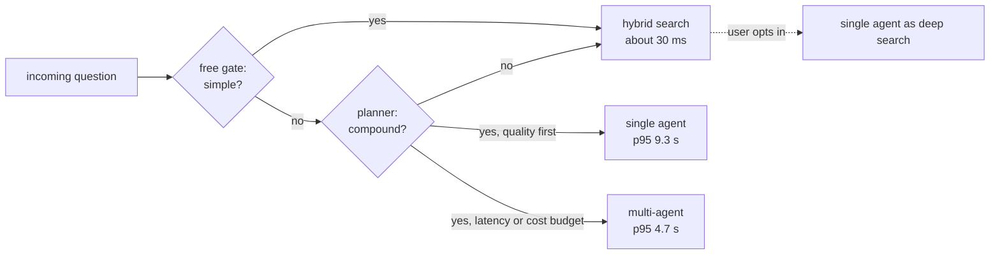

| set | system | R@10 | MRR@10 | Cov@10 | LLM calls / q | tokens / q | $ / q | p50 / p95 s |
|---|---|---|---|---|---|---|---|---|
| plain | baseline | 0.502 | 0.485 | - | 0 | 0 | 0 | 0.06 / 0.08 |
| plain | single | 0.547 | 0.642 | - | 1.96 | 2,118 | 0.0025 | 4.09 / 7.27 |
| plain | multi | 0.481 | 0.466 | - | 0.51 | 130 | 0.0002 | 0.03 / 3.59 |
| compound | baseline | 0.204 | 0.365 | 0.10 | 0 | 0 | 0 | 0.08 / 0.10 |
| compound | single | 0.400 | 0.609 | 0.40 | 2.70 | 3,380 | 0.0039 | 5.75 / 9.28 |
| compound | multi | 0.355 | 0.518 | 0.32 | 2.00 | 925 | 0.0013 | 3.40 / 4.75 |

Coverage@10 is the share of compound questions with at least one gold passage from each half in the top 10. Dollar
figures use placeholder prices of $1 / $4 per 1M input / output tokens, because I didn't have the real gpt-6-sol rates.

What the traces showed:
- The single agent's last step is effectively an LLM rerank of what it has seen. With gpt-6-sol that helped: on plain
  questions recall improved on 7 and got worse on 0, and the first relevant hit moved up on 30 (down on 3).
- With the free dev model (claude-haiku-4.5 through the Copilot CLI) the same step hurt (plain MRR 0.485 → 0.432), and
  single and multi tied on compound (R@10 0.327 vs 0.335). The best architecture changed with the model.
- The multi-agent's whole plain-set loss comes from 7 questions the planner split by mistake (their recall fell
  0.824 → 0.514); the other 93 equal the baseline exactly. Its LLM never ranks, so a stronger model barely helps it.
- Single minus multi on compound, per question: R@10 +0.045 (bootstrap 95% CI +0.007 to +0.085), Coverage +0.08 (CI
  +0.01 to +0.15). Real, but small at n = 100.

| path | ship? | why |
|---|---|---|
| non-agentic hybrid | yes, the default for plain questions | ~30 ms, free, and agents don't beat it by enough to justify 4 s |
| single agent | yes: for compound questions when quality matters, and as an opt-in "deep search" for plain ones | best recall and coverage (R@10 0.400, Cov 0.40), at p95 9.3 s and 3,380 tokens |
| multi-agent | yes: for compound questions under a latency or cost budget | R@10 0.355, Cov 0.32 at p95 4.7 s and about a quarter of the tokens |

## 7. API design

### Router (`src/service/router.py`, port 8000)

| endpoint | method | called by | request | response | errors |
|---|---|---|---|---|---|
| `/search` | POST | CLI, eval, agent tool, load scripts | `query`, `k` (10), `strategy` (`bm25`, `dense`, `hybrid`), `fusion`, `alpha`, `include_text`, `rerank_k` (0) | `results` [`doc_id`, `score`, `text` if requested], `partial`, `missing_shards`, `model`, `strategy`, `latency_ms`, `timings_ms` | 503 with `missing_shards` when shards fail under the `fail` policy; 409 for an unknown strategy |
| `/upsert` | POST | writers, ingestion scripts | `doc_id`, `version`, `text` | owner shard's reply: `applied`, `doc_id`, `version`, `shard` (async mode adds `visible: false`, `mode`), plus `attempts`; or `applied: false, reason: stale_or_duplicate, current_version` | 422 if `text` is empty; 503 if the owner shard fails after retries |
| `/delete` | POST | writers | `doc_id`, `version` | same shape as `/upsert` | 503 as above |
| `/health` | GET | compose healthcheck, cluster.py | none | `ok`, `active_model`, `n_shards` (router process only) | none |
| `/admin/status` | GET | ops, migration script | none | `active_model`, `previous_model`, per-shard health, `missing_shards` | none |
| `/admin/flush` | POST | tests, load scripts | `timeout` (10 s) | `drained`, `missing_shards` (instant in sync mode) | none |
| `/admin/migrate` | POST | `make migrate` | `model`, `reencode`, `throttle_s` | `target`, per-shard start status | 503 / 409 |
| `/admin/cutover` | POST | `make cutover` | `model` | `active_model`, `previous_model` | 409 if the model isn't ready on every shard |
| `/admin/rollback` | POST | `make rollback` | none | `active_model`, `previous_model` | 409 if there is nothing to roll back to |
| `/admin/finalize` | POST | `make finalize` | `model` | `dropped`, per-shard result, `missing_shards` | 409 if asked to drop the active model |

Shard readiness and progress per model are visible in `/admin/status` through each shard's health.

### Shard (`src/service/shard_server.py`, port 8101 in Docker, 8101 to 8103 locally)

The router is the only caller. Besides `GET /health`, every call is `POST /{op}`:

| op | request | response |
|---|---|---|
| `stats` | `terms` | this shard's `n_docs`, `total_len`, `df` per term |
| `search` | `terms`, `k`, optional global `stats`, `vector`, `model` | `bm25` and `dense` lists of [doc_id, score], `shard`, `took_ms` |
| `docs` | `ids` | {doc_id: text} for the ids this shard owns |
| `upsert` / `delete` | `doc_id`, `version`, `text` | `applied` true or false with a reason |
| `flush` | `timeout` | `drained` |
| `build_model` | `model`, `reencode`, `throttle_s` | `status`, `n_docs` or `ready` |
| `drop_model` | `model` | `dropped` |
| `health` | none | `shard_id`, `healthy`, `n_docs`, per-model `ready` / `progress` / `n`, `counters`, `apply_mode`, async stats, RSS |

### Internal interfaces

| interface | where | contract |
|---|---|---|
| agent search tool | `src/agent/tools.py` | `search(query, strategy)` returns the top-10 hits with `doc_id`, `score` and a 200-character `text` snippet; an unknown strategy falls back to `hybrid` |
| LLM client | `src/agent/llm.py` | `complete(system, user, max_output_tokens, ...)` returns the text, input and output tokens, latency and whether it was cached; when a `Budget` is passed it reserves the worst case before calling; responses are cached on disk by prompt hash |

## 8. Database design

I didn't use a database. Each shard keeps its data in memory and persists only what it needs to recover.

| data | how it is stored today | where |
|---|---|---|
| passage text | Python dict doc_id → text | shard memory, loaded from `data/raw` |
| versions and tombstones | dict doc_id → (version, deleted) | shard memory, rebuilt from the WAL |
| BM25 index | scipy CSC matrix (term columns, for search) and CSR (doc rows, for deletes) for the base corpus, a dict delta segment for new docs, an `alive` mask for deletes | shard memory |
| dense index | one faiss `IndexIDMap2(IndexFlatIP)` per model, float32 unit vectors | shard memory |
| embedding cache | `emb_<model>.npy` (57,638 x 384 float32) + `.meta.json` (model, max_seq_length, dim, doc id per row, text hash per row) | `artifacts/` |
| write log | `wal.jsonl`: one JSON line per write (`op`, `doc_id`, `version`, `text`, vectors per model in base64 in sync mode) | per-shard state dir |
| maintained models | `models.json`, e.g. ["bge-small", "minilm"] | per-shard state dir |
| router state | `router_state.json`: `active_model`, `previous_model` | `artifacts/` |

If I moved this to a real database (not built), I'd keep the same logical model:

| table / collection | fields | notes |
|---|---|---|
| `passages` | doc_id (key), version, deleted, text, updated_at | the source of truth; version check as a conditional update |
| `embeddings_<model>` | doc_id, version, vector(384) | one collection per model makes blue/green migration a matter of building a second collection |
| lexical index | inverted index on `passages.text` (search engine or full-text index) | needs global term statistics across partitions |
| `router_state` | active_model, previous_model | small replicated config |

The database's own log and replication would replace my WAL and crash recovery. Partitioning by `crc32(doc_id)` would
stay. I'd still want the database to expose per-term statistics and per-partition top-k lists, or the merge-then-fuse
and global-IDF guarantees would be lost.

## 9. Scaling to the next 100M passages

| layer | change | why the current approach won't scale |
|---|---|---|
| vector index | IVF-PQ (48-byte codes, nlist around 65K) or HNSW on large-memory nodes; re-score the top candidates with full vectors | flat float32 is 100M x 384 x 4 B = 153.6 GB, at least 77 shards of 2 GB for vectors alone; IVF-PQ is about 4.8 GB |
| lexical index | compressed postings and WAND / block-max scoring | ~6.5B postings ≈ 52 GB uncompressed, and my BM25 builds an O(N) score array per query |
| passage text | object store or disk, fetch only the final top-k | ~77 GB of text (768 bytes per passage on average) |
| embedding | GPUs for indexing | 57,638 passages took 567 s on 32 CPU cores, so 100M would take about 11 days |
| sharding | consistent hashing or range partitions, more shards | `% N` moves almost every doc when N changes |
| router | replicas, hedged requests, a cached global-df table | waiting for the slowest of 50+ shards dominates p95; the DFS round trip grows with N |
| writes and storage | WAL snapshots and truncation, tombstone cleanup, group commit | replay time grows without bound; tombstones are never removed |
| model migration | dual-write lasting hours or days, throttled re-embedding | a full re-embed of 100M is a long job |
| agents | route only compound questions to agents, cache LLM calls | per-question cost and latency scale with traffic |

## 10. Pitfalls in the current design

| where it fails | effect today |
|---|---|
| one router, no replicas | the router is a single point of failure; a dead shard means partial results until it restarts |
| every shard loads the embedding model | most of each shard's 723 MB is the model, not the data |
| WAL is never truncated, tombstones are never removed | restart time and memory grow with the write history |
| BM25 delta segment is never compacted | new docs are scored one posting at a time |
| client-supplied versions | correctness depends on clients sending increasing versions |
| async mode | a search can return the previous version for up to about 0.6 s after the ack; overload slows writers |
| modulo sharding | changing the shard count needs a full re-shard |
| dense encoder truncates at 256 tokens | long gold passages are found less often (0.464 vs 0.508 Recall@10) |
| planner splits some plain questions | those 7 lost recall (0.824 → 0.514) |
| a failed worker's half loses its slots | the surviving sub-query fills all 10 slots |
| agent quality depends on the model | the haiku and gpt-6-sol runs led to different routing decisions |

## 11. Results

### Benchmark table (dev, 500 questions)

| configuration | mode | nDCG@10 | R@10 | MRR@10 | warm p50 / p95 ms | cold p50 / p95 ms | peak RSS MB |
|---|---|---|---|---|---|---|---|
| BM25 | single node | 0.2642 | 0.3135 | 0.3222 | 1.2 / 2.0 | 1.2 / 1.9 | 511 |
| dense all-MiniLM-L6-v2 | single node | 0.3881 | 0.4665 | 0.4532 | 18.8 / 20.8 | 19.1 / 21.2 | 806 |
| dense bge-small-en-v1.5 | single node | 0.3981 | 0.4681 | 0.4773 | 30.6 / 34.2 | 30.2 / 34.2 | 851 |
| hybrid RRF, MiniLM | single node | 0.3733 | 0.4420 | 0.4485 | 22.1 / 39.9 | 21.7 / 24.3 | 812 |
| hybrid linear α = 0.7, MiniLM | single node | 0.4190 | 0.4914 | 0.4872 | 20.7 / 24.5 | 20.1 / 23.3 | 812 |
| hybrid linear α = 0.7, bge-small | single node | 0.4155 | 0.4856 | 0.4953 | 35.3 / 40.3 | 36.3 / 42.0 | 854 |
| + cross-encoder rerank@10 | single node | 0.4058 | 0.4914 | 0.4688 | 338.6 / 366.8 | | |
| BM25 | router + 3 shards | 0.2642 | 0.3135 | 0.3222 | 10.7 / 11.5 | 10.9 / 12.1 | 722 per shard |
| BM25, shard-local IDF | router + 3 shards | 0.2653 | 0.3142 | 0.3226 | 6.8 / 7.4 | 7.1 / 8.1 | 722 per shard |
| dense MiniLM | router + 3 shards | 0.3881 | 0.4665 | 0.4532 | 22.2 / 27.0 | 22.8 / 24.3 | 723 per shard |
| **hybrid linear α = 0.7 (chosen)** | **router + 3 shards** | **0.4190** | **0.4914** | **0.4872** | **28.6 / 40.5** | 29.5 / 33.0 | **723 per shard** |
| hybrid linear α = 0.7 in Docker | router + 3 shards | 0.4190 | 0.4914 | 0.4872 | 30.4 / 34.1 | 30.5 / 34.2 | about 505 MiB per container |
| hybrid linear α = 0.7 | router + 1 shard | 0.4190 | 0.4914 | 0.4872 | 23.4 / 26.3 | 22.9 / 25.1 | 775 |

Single-node rows run in-process; service rows are measured by the client end to end through the router's HTTP API.

### Test split (run once)

| configuration | nDCG@10 | R@10 | MRR@10 | p50 / p95 ms |
|---|---|---|---|---|
| hybrid linear α = 0.7, MiniLM, 648 test questions | 0.3968 | 0.4658 | 0.4788 | 21.5 / 24.9 |

nDCG drops from 0.419 on dev to 0.397 on test, which is the expected optimism from tuning α on dev. The stratified
pattern is the same as on dev: gold in the longest docs 0.443 (n = 246) vs 0.480 for the rest.

### Other results

| what | result |
|---|---|
| sharded vs single node | identical to four decimals for BM25, dense and hybrid |
| live writes | sync 57.8 writes/s with lag 0; async 94.2 writes/s with lag p95 466 ms, max 583 ms |
| migration under load | 2,045 queries, 0 failed; 116 writes during the run found by both models |
| agents (gpt-6-sol) | compound R@10: baseline 0.204, single 0.400, multi 0.355 |
| LLM spend | about 655K tokens for the whole agent eval, $0.79 at placeholder prices; the dry-run estimate was $0.47 because it replays a simpler scripted policy |

### Counterintuitive finding: sharding made latency worse

I expected three shards to be faster, since each searches a third of the corpus. I measured 1 shard at 23.4 / 26.3 ms and
3 shards at 28.6 / 40.5 ms (p50 / p95), with the same quality. At 19K docs per shard the actual search takes 1 to 3 ms
(BM25 over all 57K docs is 1.2 ms), so there is little to parallelise. Sharding adds a second round trip (the DFS phase),
three HTTP calls per phase, and a wait for the slowest of three shards, which shows up mostly in p95. At this size
sharding buys capacity and failure isolation, not speed.

### Approaches that didn't pan out

| approach | expected | observed | why I think it failed |
|---|---|---|---|
| cross-encoder rerank | +2 to 5 nDCG | 0.406 (k = 10), 0.396 (k = 20), 0.377 (k = 50) vs 0.419; 339 ms p50 at k = 10 | trained on short web snippets; FiQA answers are long and get truncated; the first stage leaves little to fix |
| standard RRF | the usual hybrid gain | 0.373, below dense alone (0.388) | it gives a much weaker retriever an equal vote |
| bge-small as the dense model | the better benchmark model wins | +0.010 dense, -0.0035 in hybrid, +12 ms per query | BM25 already supplies what bge-small adds |
| first async write mode | faster than sync | 47 writes/s vs 58, lag up to 1.3 s | one applier thread embedded serially, and batching doesn't save time on CPU (25.6 ms per doc alone vs 31.5 ms in batches of 8); fixed with 8 parallel single-doc workers |

## 12. Questions and answers

| question | answer |
|---|---|
| Chosen operating point, and why | hybrid linear fusion, α = 0.7, BM25 + all-MiniLM-L6-v2, depth 100, no reranker, router + 3 shards: best dev nDCG (0.4190) that meets every constraint (p95 40.5 ms, 723 MB per shard, CPU only) |
| Benchmark table | section 11: 13 configurations plus the single test run |
| Cold vs warm delta | near zero (29.5 / 33.0 vs 28.6 / 40.5 ms) because models load and warm up at startup; the hidden costs are 1.5 s model load and a 19 ms first encode |
| Stratified metrics | short 0.385, medium 0.491, long 0.510; gold in the 10% longest docs 0.464 vs 0.508 |
| Ablation and its deltas | fusion sweep (linear peaks at α = 0.7; RRF 0.373 to 0.406); rerank depth (every depth worse, 339 to 1,246 ms); bge-small vs MiniLM; local vs global IDF |
| Three failures | qid 4746 (rare acronyms, fusion weight), 4029 (long passages truncated), 7490 (title-only query); details in `results/failures.md` |
| Does sharding match single node within 1%? | yes, 0.0% for every strategy, on the first run, because of global IDF, top-100 per shard and merge-then-fuse |
| What happens when a shard is slow or down? | 0.5 s timeout; default `partial` returns the other shards' results with `partial: true` and `missing_shards`; `fail` returns 503 |
| 1 vs N shard latency | 23.4 / 26.3 ms vs 28.6 / 40.5 ms (p50 / p95) |
| Idempotency | `(doc_id, version)`, apply only if newer; deletes leave tombstones; replays and older writes are no-ops |
| What can a reader see if a write fails halfway, and recovery | the old version, never a half-applied write (one lock over both indexes); WAL replay on restart, torn tail truncated, crash-only restart on apply errors |
| Freshness guarantee and its test | sync: searchable by the first query after the ack (`test_freshness_write_searchable_immediately_after_ack`); async: within 1 s (`test_acked_write_is_searchable_within_one_second`) |
| How migration works | dual-write + throttled backfill, cutover by a router flag only when every shard is ready, instant rollback, finalize drops the old index; `make migrate`, `make cutover`, `make rollback` |
| Failed queries during migration | 0 of 2,045 |
| When I would roll back | quality canary drop, latency SLO breach, or errors on the new path |
| Sub-agent roles and why | planner (splitting needs language understanding), workers without an LLM (search is free), verifier (catches drifted sub-queries); orchestrator in code for deterministic budgets |
| How sub-agents share 10 slots | round-robin interleave across sub-query lists with dedupe, then fill from the full question |
| Guardrails | one budget per question: 3 LLM calls and 8K tokens (multi), 3 calls and 12K tokens (single), reserved before each call |
| Partial failure | a failed worker's list is dropped, errors fall back to a direct search; covered by a test |
| Skipping decomposition | a free gate plus the planner kept 93 of 100 plain questions on one search |
| Agent quality, cost and latency | section 6.11 table |
| Routing policy | simple → hybrid search; compound → single agent for quality, multi-agent under a latency or cost budget; single agent as opt-in deep search |
| Ship / don't ship | ship all three paths, each for its own traffic (section 6.11) |
| LLM, temperature and spend | Azure AI Foundry `gpt-6-sol`, reasoning effort low (no temperature parameter on this reasoning model), about 655K tokens, $0.79 at placeholder prices |
| Counterintuitive finding | sharding made latency worse (section 11) |
| Approaches that didn't pan out | cross-encoder rerank, standard RRF, bge-small, first async version (section 11) |
| Scaling to 100M | section 9 |
| Production concerns | replicas with hedged reads; caches for query embeddings, global df and popular queries; batching and quantising the encoder; per-phase latency, partial rate, WAL size and an nDCG canary as monitoring |
| Test split | run once for the chosen configuration: nDCG@10 0.3968, R@10 0.4658, MRR 0.4788 |
| Measuring machine | in the README, section "Measured on" |
| Code size | 2,004 logical lines in `src/` excluding the data loader |

## 13. Next steps

The eight I'd do first are below. The longer list, task by task (other parameters, datasets, models, update types,
failure points, LLMs and non-LLM alternatives), is in [docs/design/EXTENSIONS.md](docs/design/EXTENSIONS.md).

1. Replicas per shard with hedged reads, so one slow or dead shard doesn't hurt p95 or completeness.
2. A cached global-df table at the router to drop the DFS round trip (about 4 ms).
3. WAL snapshots with truncation, tombstone cleanup and BM25 compaction.
4. Chunked passage indexing with best-chunk scoring for long answers.
5. Stop false planner splits: require two independent information needs and sub-query results that overlap by less than half.
6. Multi-agent retrieval followed by one rerank call by the strong model, to get the single agent's ordering at the multi-agent's latency.
7. Reserve about 3 slots for the full question when a worker fails.
8. Fine-tune the dense model on FiQA train, and batch or quantise the query encoder.

---
Reproducibility: quality metrics come from `results/bench.json`, `results/ablation_*.json`, `results/write_load.json`,
`results/migration_demo.json` and `results/agent_eval.json`, and Docker reproduces the chosen configuration's quality
exactly. Agent results depend on the LLM; every response is cached on disk, so a rerun with the same cache is identical.

AI and LLM use: the agent results use Azure AI Foundry `gpt-6-sol` (spend above), development runs used
claude-haiku-4.5 through the GitHub Copilot CLI and a scripted fake LLM, the compound questions were rewritten by an LLM
from the two question texts, and I used an AI coding assistant while building the project.
