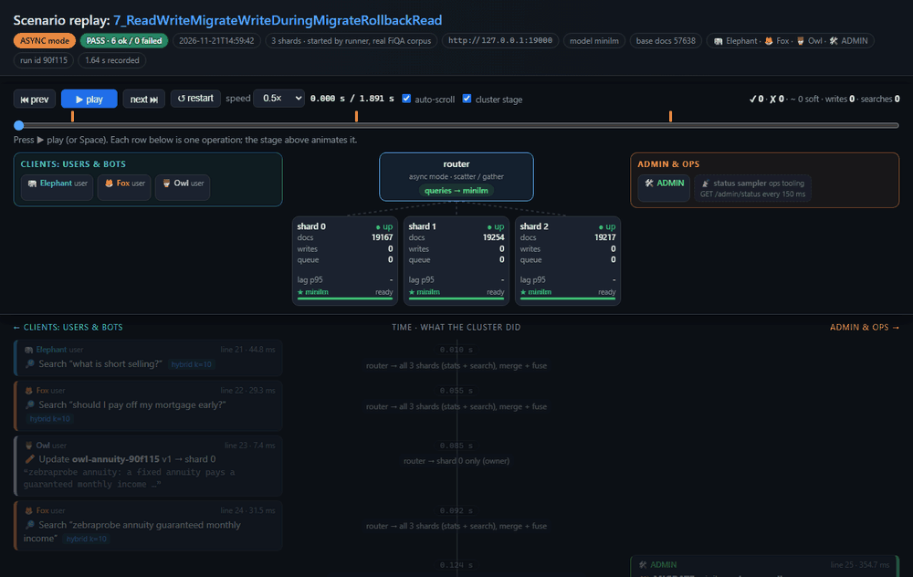
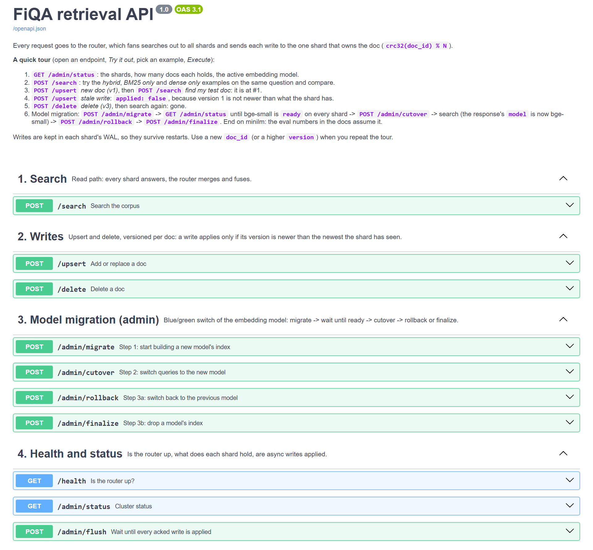
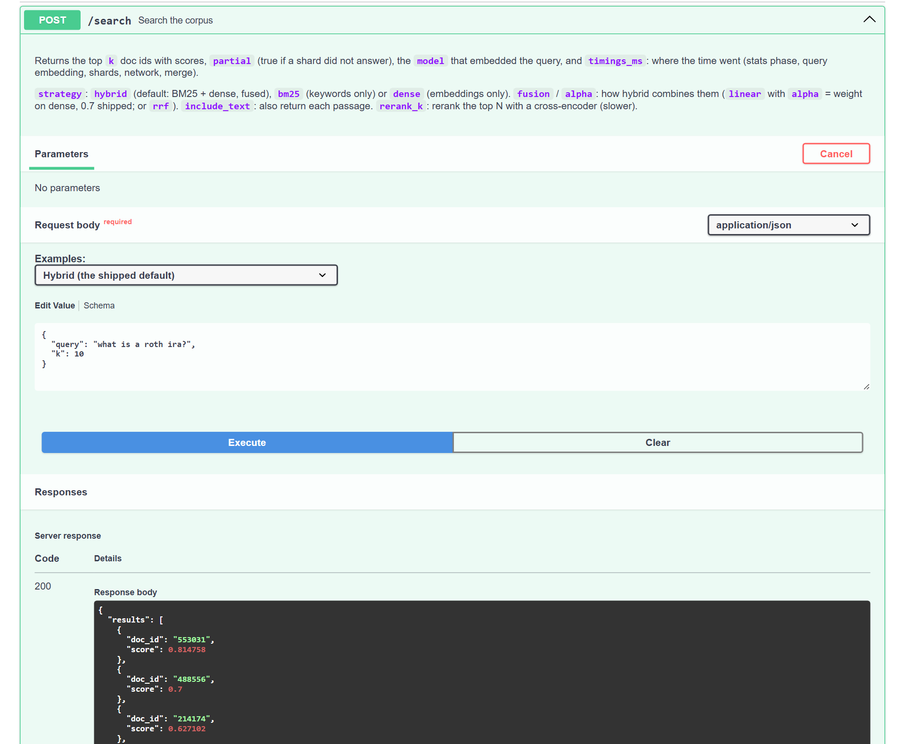
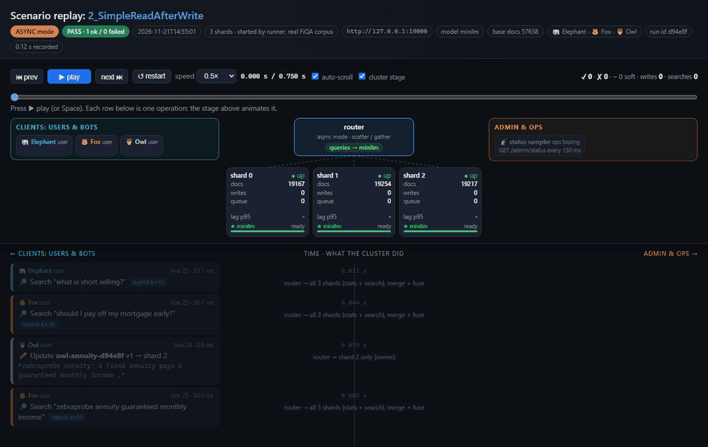
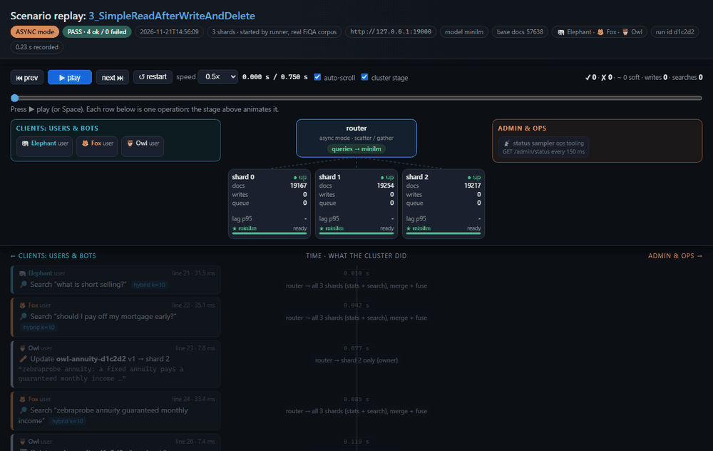
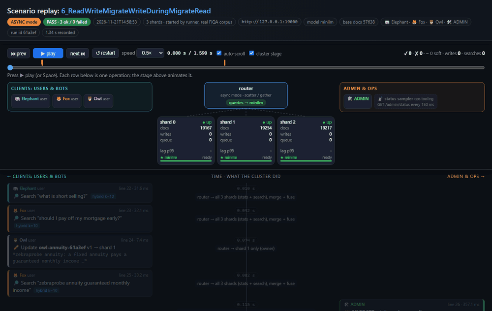
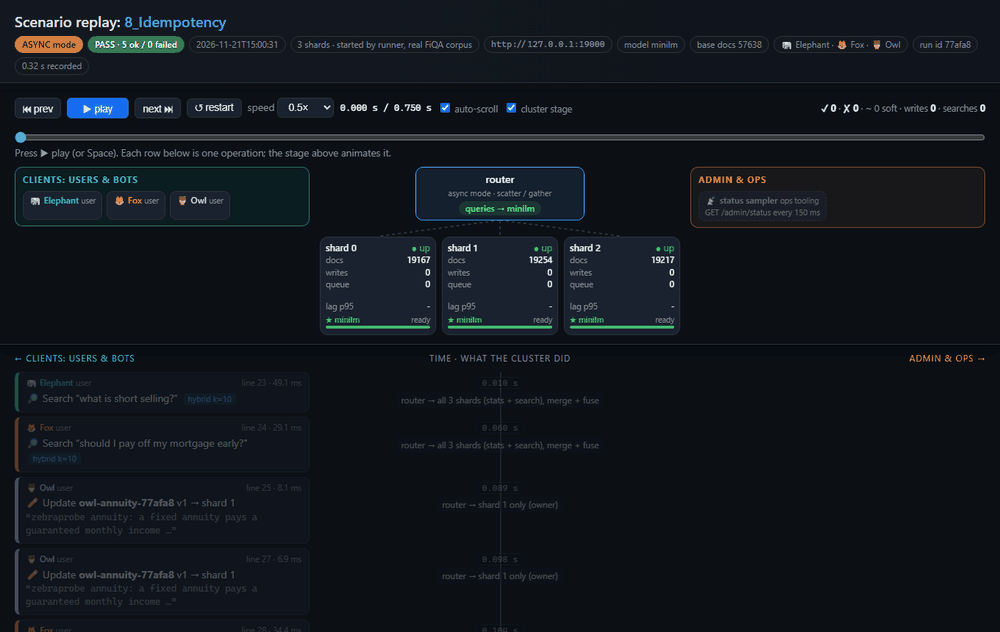
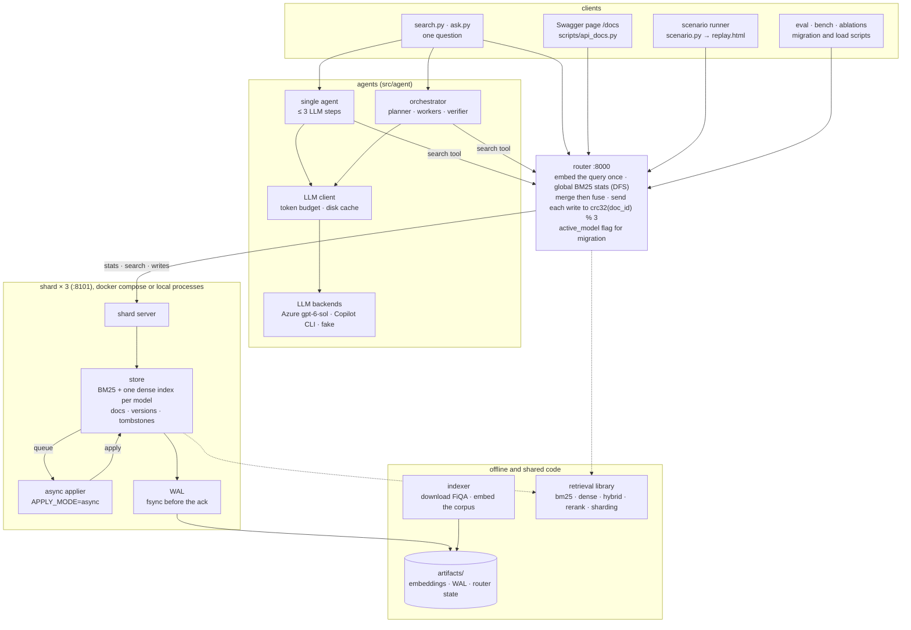

# FiQA distributed + agentic retrieval

I built a retrieval system over BEIR/FiQA (57,638 finance Q&A passages). Part A is BM25, dense and hybrid retrieval with
an evaluation harness, ablations and failure analysis. Part B is a sharded service (router + 3 shards) with live,
idempotent writes and zero-downtime embedding-model migration. Part C is a hand-written single agent and multi-agent
orchestrator on top, evaluated on plain and compound questions.

The tasks and constraints are in [FIQA_RETRIEVAL_TASKS.md](FIQA_RETRIEVAL_TASKS.md). Design, results and trade-offs are
in [DESIGN.md](DESIGN.md), also as a [Word document](docs/design/DESIGN.docx) and
[slides](docs/design/DESIGN.pptx).



*A recorded run on the real corpus (router + 3 shards, async writes): searches and writes keep working while the
embedding model is migrated from MiniLM to bge-small, cut over, and rolled back. The router's model chip and the star on each shard
show which index answers.*

## See it run

Every endpoint can be called from the browser at http://localhost:8000/docs, with ready-made examples.

| the API page | a live call |
|---|---|
|  |  |
| Search, writes, model migration and status, each with a short explanation and a quick tour. | Pick an example, press Execute, and read the ranked FiQA passages that came back. |

Every scenario run also writes an animated `replay.html`: clients, the router and the three shards on a stage, with
one animation per operation and a timeline of what each request did. The GIFs below are recorded from four of the
[eight simple scenarios](scenarios/SimpleScenarios/README.md) on the full cluster in async mode. The HTML replays are in
[docs/assets/replays/](docs/assets/replays/) and `scenarios/SimpleScenarios/results/`; GitHub doesn't render HTML, so
download one and open it in a browser.

| read after write | write, then delete |
|---|---|
|  |  |
| Owl adds a doc. In async mode it is queued on its owner shard and applied in the background, and Fox's next search finds it. | Owl deletes its doc. The delete leaves a tombstone, and Fox's later searches no longer return it. |

| writes during a migration | idempotent writes |
|---|---|
|  |  |
| Elephant writes while bge-small is being built, so the doc goes to both indexes; after the cutover bge-small answers. One search sent right after an async ack missed a doc, and the replay flags it as a soft miss. | Replaying the same `(doc_id, version)` or sending an older version changes nothing: three writes in this run are no-ops. |

## Architecture

Clients and agents talk to the router over HTTP. The router fans every search out to all shards and sends each write to
the one shard that owns the doc. The infrastructure, request paths and every component are in DESIGN.md sections 4 to 6.



## Headline numbers (dev split, full table in DESIGN.md)

| config (through the router, 3 shards) | nDCG@10 | R@10 | MRR@10 | p50 / p95 | peak RSS / shard |
|---|---|---|---|---|---|
| BM25 | 0.264 | 0.314 | 0.322 | 10.7 / 11.5 ms | 722 MB |
| dense MiniLM | 0.388 | 0.467 | 0.453 | 22.2 / 27.0 ms | 723 MB |
| hybrid linear α=0.7 (chosen) | 0.419 | 0.491 | 0.487 | 28.6 / 40.5 ms | 723 MB |

The sharded service gives exactly the single-node quality (0.0% difference) for every strategy.

Live writes have two modes (`APPLY_MODE`), measured on the real corpus with 8 writers and 2 readers
(`results/write_load.json`). In sync mode (the default) a write is searchable on the very next query, at 58 writes/s.
In async mode I get 94 writes/s, and a write is searchable within 1 s (measured max 583 ms).

Agents (Azure `gpt-6-sol`, 100 plain + 100 compound dev questions, `results/agent_eval.json`): on compound questions,
Recall@10 goes from 0.204 with one search to 0.400 with the single agent (p95 9.3 s) and 0.355 with the multi-agent
(p95 4.7 s, ~¼ of the tokens). Plain questions stay on plain search by default. The whole eval cost $0.79 at
placeholder prices. Details in DESIGN.md §6.11.

## Setup

From a fresh clone, with only Docker installed: `./scripts/bootstrap.sh` (Linux/macOS) or `.\scripts\bootstrap.ps1`
(Windows). It builds the image, fetches the data and embedding caches, starts the 4 containers and checks them.
Options and troubleshooting are in [DEPLOY.md](DEPLOY.md). Every API can be called from the browser at http://localhost:8000/docs, with
ready-made examples (`python -m scripts.api_docs --local` gives the same page without Docker). To try everything by
hand, step by step with the numbers to expect, follow [docs/guides/manual_tests_windows.md](docs/guides/manual_tests_windows.md) or
[docs/guides/manual_tests_mac.md](docs/guides/manual_tests_mac.md). Their whole Docker section also runs as one command,
`.\scripts\docker_tour.ps1` or `./scripts/docker_tour.sh`: it checks every step, writes a report with a replay per step,
and puts the stack back exactly as it found it.

### Docker by hand (no local Python)

```bash
docker compose build                       # corporate PyPI mirror? add --build-arg PIP_INDEX_URL=...
docker compose run --rm indexer            # download FiQA + embed corpus (~30 min CPU), once
#   or unzip the pre-built artifact zip (make package-index) into ./artifacts to skip embedding
docker compose up -d                       # router on http://localhost:8000 (+ 3 shards, 2 GB limit each)
#   APPLY_MODE=async docker compose up -d  # same stack with async writes (default: sync)
docker compose run --rm tools python src/search.py --url http://router:8000 --query "what is short selling?"
docker compose run --rm eval               # dev eval through the router (ours: nDCG@10 0.4190, p50/p95 30.4/34.1 ms)
```

### Local Python 3.11+

```bash
python -m venv .venv && . .venv/bin/activate          # Windows: .venv\Scripts\activate
pip install torch --index-url https://download.pytorch.org/whl/cpu   # CPU-only torch (Linux)
pip install -r requirements.txt
python scripts/download_data.py
python -m src.index.build_index                        # embedding caches -> artifacts/ (~30 min CPU)
python -m src.service.cluster --shards 3               # router :8000 + shards :8101-8103 (stop Docker first: same port)
python src/search.py --query "what is short selling?" --top-k 10 --strategy hybrid
```

## Make targets

`make` is optional. Every target in the [Makefile](Makefile) is a one-line Python command, so on Windows I copy the
command and run it directly.

| target | what it does |
|---|---|
| `make test` | the pytest suite (unit, integration, doctests) |
| `make bench` | the full benchmark matrix → `results/bench.json` |
| `make ablations` | fusion sweeps + rerank sweep |
| `make failures` | failure candidates → `results/failure_candidates.json` |
| `make migrate` / `cutover` / `rollback` / `finalize` | B3 against the running router (`make load` in another terminal) |
| `make migration-demo` | migrate → cutover → rollback under live queries + writes, with a report |
| `make compound` | rebuild `data/compound_dev.jsonl` |
| `make agent-dry-run` | token/$ estimate for the Azure agent eval (free) |
| `make agent-eval` | the Azure agent evaluation; costs money and needs `.env` |
| `make agent-eval-dev` | free dev run on the GitHub Copilot CLI backend |
| `make test-final` | the single test-split run of the chosen configuration |

## Scenario runner

`scripts/scenario.py` plays a small JSONL script of writes, searches, migrations and shard crashes against a live
cluster (sync or async), checks the expectations and writes an animated HTML replay:

```bash
python scripts/scenario.py scenarios/ComplexScenarios/freshness_demo.jsonl --start-cluster --tiny --mode async
```

A quicker way to write one is a CSV with one line per operation, `actor, operation, text, t_ms[, doc_id]`; copy
[scenarios/SimpleScenarios/simple_template.csv](scenarios/SimpleScenarios/simple_template.csv), which uses every operation, and add `--open` to see
the replay. Eight ready-made ones, from a plain read to a migration with a rollback and an idempotency check, are in
[scenarios/SimpleScenarios/](scenarios/SimpleScenarios/README.md), with my runs on four clusters. The formats and the
scenario catalog are in [docs/guides/scenarios.md](docs/guides/scenarios.md). For a single question,
`python scripts/ask.py "what is a roth ira?" --strategy hybrid` (or `bm25`, `dense`, `single`, `multi`).

## LLM configuration (Part C)

Copy `.env.example` to `.env` and fill in `AZURE_OPENAI_ENDPOINT` (Foundry project `/openai/v1/` URL),
`AZURE_OPENAI_DEPLOYMENT` and `AZURE_OPENAI_API_KEY`. `.env` is gitignored, and `tests/test_no_secrets.py` fails if a
key-like string is ever committed. The default backend is the free `fake`. The `azure` backend needs
`--confirm-spend` and is capped by `--max-usd`.

## Repo map

```
src/            search.py (CLI) · eval.py · metrics.py · config.py · beir_data.py · util.py
  retrieval/    bm25.py · dense.py · hybrid.py · rerank.py
  index/        build_index.py (embedding cache) · sharding.py
  service/      router.py · shard_server.py · store.py · async_apply.py (async write mode) · wal.py · cluster.py
  agent/        llm.py · tools.py · prompts.py · single_agent.py · orchestrator.py · fake_policies.py
data/           build_compound.py · compound_dev.jsonl · compound_rewrites.json · compound_review_sheet.md
scripts/        ask.py (one question) · api_docs.py (API page with examples) · bench.py · ablations.py · failure_cases.py · migration.py · query_load.py · migration_demo.py · agent_eval.py · scenario.py (+ replay_html.py, run_simple_scenarios.py)
                write_load.py (sync vs async) · docker_check.py · docker_trace.py · bootstrap.sh / bootstrap.ps1
scenarios/      SimpleScenarios/ (8 CSV stories + template + recorded results) · ComplexScenarios/ (JSONL: freshness, migration, shard failure, ...)
tests/          unit, in-process and multi-process integration tests
results/        bench.json · runs/ (incl. the one TEST run) · ablation_*.json · migration_demo.json · write_load.json · agent_eval*.json · failures.md
examples/       small standalone scripts
FIQA_RETRIEVAL_TASKS.md  the task spec: parts A-C, constraints, deliverables
AGENTS.md       how to set up, test and work in the repo (for coding agents)
docs/           topics/ (00-16, one concept each) · from_zero/ (the whole system from scratch) · walkthroughs/ (eval, Part A/B results) · guides/ (scenarios, manual tests) · faq/ (concepts, this project) · design/ (DESIGN.docx, DESIGN.pptx) · assets/
```

## Measured on

AMD EPYC 7763 (16 physical / 32 logical cores visible), 128 GB RAM, Windows 11, Python 3.13, CPU only.
Latency depends on the hardware. Quality metrics do not.
