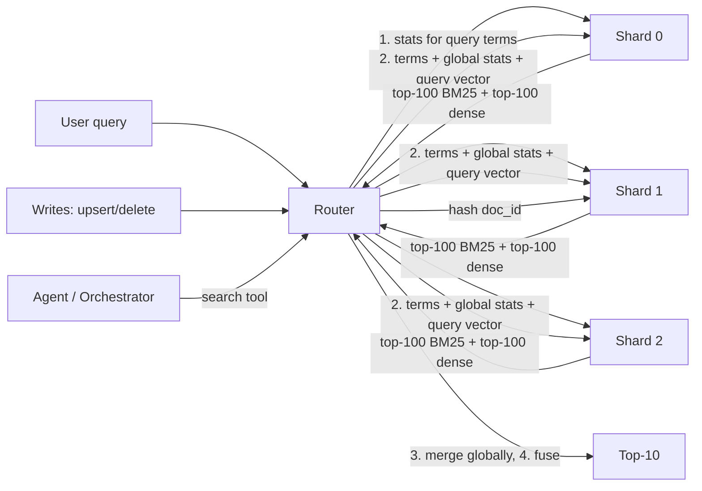
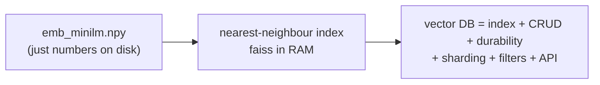

# 00 · RAG and retrieval primer: the map before the territory

> **Read first.** This page gives you the vocabulary and the big picture. Every later doc zooms
> into one box of the diagram below. Terms in *italics* are defined in [GLOSSARY.md](GLOSSARY.md).

## 1. Intuition

You have 57,638 answers from a personal-finance forum (FiQA). A user asks *"what is short
selling?"*. **Retrieval** = find the handful of passages that answer it, fast. **RAG**
(retrieval-augmented generation) = hand those passages to an LLM so it can write a grounded
answer. This repo builds the retrieval half seriously, and then uses LLM *agents* to drive
retrieval for questions that a single search can't answer well.

Analogy: a library.
- **BM25** is the card catalogue: it matches the exact words you typed.
- **Dense retrieval** is a librarian who understands what you *mean* ("betting against stocks" → the shorting shelf).
- **Hybrid** asks both and merges their answers.
- **Sharding** splits the library across three buildings. Someone (the *router*) must ask all three and merge the results.
- **Agents** are research assistants: they rephrase your question, split it into parts and check the results.

## 2. The mechanics in one picture



Each shard has a **BM25 index** (words), a **dense index** (vectors), a doc store and a **WAL**
(write-ahead log). Every piece is in `src/`:

| Box | Code | Doc |
|---|---|---|
| tokenizer + BM25 | `src/retrieval/bm25.py` | [01](01_lexical_retrieval_bm25.md) |
| embeddings + vector index | `src/retrieval/dense.py` | [02](02_dense_retrieval.md), [03](03_vector_indexes.md) |
| metrics | `src/metrics.py` | [04](04_ir_metrics.md) |
| fusion | `src/retrieval/hybrid.py` | [05](05_hybrid_fusion.md) |
| reranker | `src/retrieval/rerank.py` | [06](06_reranking.md) |
| eval harness | `src/eval.py` | [07](07_benchmarking_latency_memory.md) |
| router / shard | `src/service/router.py`, `shard_server.py`, `store.py` | [08](08_sharding_scatter_gather.md) |
| writes, WAL | `src/service/store.py`, `wal.py` | [09](09_live_updates_consistency.md) |
| model migration | `ShardStore.start_build`, `Router.cutover` | [10](10_model_migration.md) |
| LLM + agents | `src/agent/*` | [11](11_llm_tool_calling.md)–[14](14_agent_evaluation_cost.md) |

## 3. The dataset: BEIR / FiQA

| split | queries | judged-relevant pairs | per query |
|---|---|---|---|
| train | 5,500 | 14,166 | 2.58 |
| dev | 500 | 1,238 | 2.48 |
| test | 648 | 1,706 | 2.63 |

Corpus: 57,638 passages; median 90 words, p90 270, max 2,973 (`python -m src.beir_data`).
*Qrels* list which passages are relevant to each query. Everything else counts as non-relevant,
even if a human would call it a fine answer. That is a big source of "false failures" (see
`results/failures.md`).

**Rule we follow:** tune on **dev** only, and touch **test** exactly once, at the end. `src/eval.py` refuses
`--split test` without `--final-test-run`. If you tune on test, your reported number is a lie
about how the system would do on new queries.

## 4. How this repo implements the big picture

1. Offline: `python -m src.index.build_index` embeds the corpus once per model (≈10 min MiniLM,
   ≈18 min bge-small on 32 cores) into `artifacts/`.
2. Each shard process loads its slice (`crc32(doc_id) % 3`), builds BM25 in seconds and
   copies its vectors from the cache.
3. The router fans out, merges and fuses ([08](08_sharding_scatter_gather.md)).
4. Agents call the router through one tool: `search(query, strategy)`.

### 4.1 Embeddings vs a vector database (and why we didn't use one)

A common confusion: *"we created embeddings, so we have a vector DB"*. Not quite. **Embeddings are data**; a
**vector database is software around that data**. It's the same difference as between a CSV file and Postgres.

- **Embedding** = a list of numbers for one passage. Here that is 384 floats, unit length.
- **Our embeddings file** = `artifacts/emb_minilm.npy`: a 57,638 × 384 float32 matrix (≈ 88 MB) plus a `.meta.json` that
  says which doc id is in which row. You can load it and compute dot products, but it can't answer a query by itself.
  It can't take a new document safely, delete one, or survive a crash halfway through a write.
- **Vector DB** = everything needed to *use* those vectors as a live service. Examples: Qdrant, Milvus, Weaviate, pgvector
  (a Postgres extension), Elasticsearch/OpenSearch, Azure AI Search, Pinecone.



What a vector DB gives you, and where this repo builds each piece by hand:

| Vector-DB feature | What it means | Our hand-built version |
|---|---|---|
| Storage | keep vectors and their ids on disk | `artifacts/emb_*.npy` + `.meta.json` (`src/index/build_index.py`) |
| Nearest-neighbour index | find the closest vectors fast (exact or approximate) | faiss `IndexIDMap2(IndexFlatIP)` in RAM (`src/retrieval/dense.py`), exact search |
| Insert / update / delete | change data while queries keep running | versioned upserts, `remove_ids`, tombstones (`src/service/store.py`) |
| Durability | an acknowledged write survives a crash | write-ahead log + replay on restart (`src/service/wal.py`) |
| Sharding + scatter-gather | split data across machines, merge the results | `crc32(doc_id) % 3` shards + router (`src/service/router.py`) |
| Several models at once | serve one embedding model while building the next | indexes keyed by `model_id`, blue/green cutover ([10](10_model_migration.md)) |
| Network API | query and write over HTTP | FastAPI `/search`, `/upsert`, `/delete` |
| Metadata filters | e.g. "only docs from 2020" | not built (FiQA has no metadata worth filtering on) |

So the router plus 3 shards **is a small hand-made vector DB**, with a BM25 index added next to the vectors.

**Why we didn't use a real one:**
1. **The assignment requires it.** Sharding and live updates must be built and explained, not hidden inside a product.
2. **Learning.** Bugs like *local IDF* under sharding ([08](08_sharding_scatter_gather.md)) or "fusing before merging"
   are invisible when a product does the work for you.
3. **Hybrid search needed control.** We compute global BM25 statistics and merge per-shard lists *before* fusing.
   Many vector DBs offer hybrid search, but their fusion rules are fixed or hidden.

**In production you'd normally use one.** You'd get replication, backups, approximate indexes (HNSW/IVF-PQ, see
[03](03_vector_indexes.md) and [15](15_scaling_to_100M.md)), monitoring and years of bug fixes. The value of this repo is
that you know what such a system does underneath, and so you can judge one, size it and debug it.

## 5. Run it

```bash
python -m src.service.cluster --shards 3            # terminal 1: router + 3 shards
python src/search.py --query "what is short selling?" --top-k 5   # terminal 2
```

## 6. Pitfalls / interview questions

- *"Why not use a vector DB?"* The assignment forbids hiding sharding/updates, and building them
  yourself is the point. In production, use one, and know what it does for you (§4.1 maps each
  vector-DB feature to the code that implements it here).
- *"Aren't our embeddings the vector DB?"* No: the `.npy` file is data. Search, writes, durability
  and sharding come from the faiss index, store, WAL and router around it (§4.1).
- *"Is retrieval quality the same as answer quality?"* No. We measure whether gold passages are in
  the top 10, not whether an LLM writes a good answer from them.

## 7. Exercises

1. (Concept) List three reasons a correct passage could be scored as a "miss" on FiQA.
2. (Predict) Will BM25 or dense do better on the query "1099-B box 1e"? Why?
3. (Do) Run `python -m src.beir_data`. What fraction of passages have > 270 words?
4. (Do) Start the cluster and run the same query with each `--strategy`. Note the differences.

Solutions: [solutions/00_rag_primer.md](solutions/00_rag_primer.md)

## 8. Further reading

- Thakur et al., *BEIR: A Heterogeneous Benchmark for Zero-shot IR* (2021)
- Lewis et al., *Retrieval-Augmented Generation for Knowledge-Intensive NLP* (2020)
- Manning, Raghavan, Schütze, *Introduction to Information Retrieval*, ch. 1–2 (free online)
