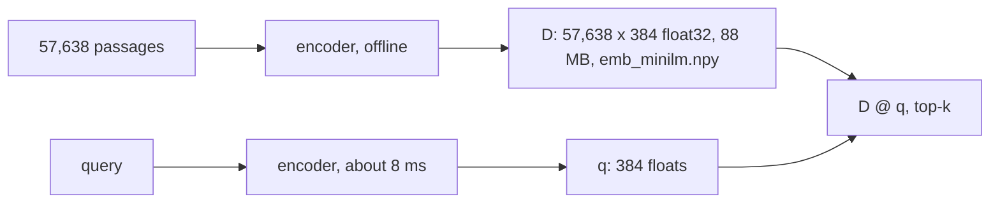

# 02 · Dense retrieval: sentence embeddings

Code: `src/retrieval/dense.py`, `src/config.py::MODELS`, `src/index/build_index.py`.

## How it works

A *bi-encoder* turns text into a point in 384-dimensional space so that texts with similar meaning land close
together. I L2-normalise every vector, v = f(x)/‖f(x)‖, so cosine similarity is a dot product, v_q · v_d ∈ [−1, 1].
Retrieval is the top-k of `D @ v_q`, where D is the N × 384 matrix of passage vectors.

An example with MiniLM: "gambling on equities dropping" shares no stem with my test passages, so BM25 finds nothing,
yet dense ranks "Betting that a share price will fall is called shorting..." first (cos 0.490).
cos("pay off my mortgage", "repay the home loan early") = 0.474, vs 0.170 for "roth ira withdrawal rules". Nobody
wrote synonym rules; contrastive training on huge numbers of question/answer and paraphrase pairs taught the model.



## The two models

| model | params | query prefix | dev nDCG@10 | dev R@10 | query p50 (single node) |
|---|---|---|---|---|---|
| all-MiniLM-L6-v2 (primary) | 22M, 6 layers | none | 0.3881 | 0.4665 | 18.8 ms |
| bge-small-en-v1.5 (migration target) | 33M, 12 layers | "Represent this sentence for searching relevant passages: " | 0.3981 | 0.4681 | 30.6 ms |

I made MiniLM primary although bge-small is +0.010 nDCG: its 12 layers make query encoding 30.6 vs 18.8 ms, which eats
most of the 50 ms budget once the router's fan-out is added, and in hybrid the gap disappears (0.419 vs 0.416). See
[16](16_ablations.md).

## How I implemented it

- `ModelSpec` pins everything that changes a vector: the HF name, `max_seq_length = 256` and the query prefix (BGE's
  goes on queries only). Passages beyond about 190 words are truncated, so an answer at the end of a long post is
  invisible to the model, a known failure in `results/failures.md`.
- `Embedder` is SentenceTransformer + prefix + normalisation. `HashEmbedder` is a feature-hashing stand-in so tests
  run offline.
- `build_index.py` caches vectors with their id order and a text hash per row, so a shard reuses a cached vector only
  if the passage text is unchanged. A query from model A against vectors from model B returns garbage with no error,
  which is why migration ([10](10_model_migration.md)) tracks the model per index.

## Results

Dense MiniLM beats BM25 by +0.124 nDCG@10 (0.388 vs 0.264) at 16× the latency (18.8 vs 1.2 ms, `results/bench.json`).
`scripts/microbench.py` splits the cost: query encoder 8.2 ms, faiss flat search over 57K vectors 5.3 ms, Python glue
the rest. Published MTEB FiQA test numbers are MiniLM 0.369 and bge-small 0.403, in line with my dev numbers. I did not
fine-tune on FiQA train; it was out of scope.

```bash
python -m src.index.build_index --models minilm bge-small
python -m src.eval --strategy dense --name dense-minilm
```

Reference: Reimers & Gurevych, *Sentence-BERT* (2019).
