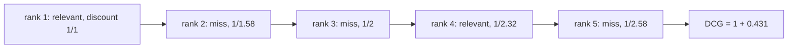

# 04 · IR metrics: nDCG@10, Recall@10, MRR, Coverage@10

Code: `src/metrics.py`. Tests: `tests/test_metrics.py`.

## What each metric asks

| metric | question about one ranked list | formula (single query, then averaged) |
|---|---|---|
| Recall@k | of everything relevant, how much made the top k? | \|top-k ∩ R\| / \|R\| |
| MRR@k | how far down is the first good answer? | 1/rank₁ if rank₁ ≤ k, else 0 |
| nDCG@k | is the good stuff near the top? | DCG@k / IDCG@k, with DCG@k = Σᵢ₌₁ᵏ (2^{relᵢ} − 1)/log₂(i+1) |
| Coverage@k | for a two-part question, did I find something for both parts? | 𝟙[top-k ∩ R_a ≠ ∅ ∧ top-k ∩ R_b ≠ ∅] |

For RAG I care most about Recall@10, because the LLM reads all 10 passages and can ignore some junk. Coverage@10 is
my own metric for the compound questions in Part C.

A worked example with k = 5: relevant = {g1, g2}, ranked = [x, x, x, g1, g2]. Recall = 2/2 = 1.0, MRR = 1/4 = 0.25,
DCG = 1/log₂5 + 1/log₂6 = 0.431 + 0.387 = 0.818, IDCG = 1 + 1/log₂3 = 1.631, so nDCG = 0.501. With ranked =
[g1, x, x, x, x] I get Recall 0.5, MRR 1.0, nDCG 0.613: higher nDCG and MRR, lower recall. The metrics measure
different things, so they can disagree.

## How I implemented it

- Pure Python, about 60 lines, each function with a doctest.
- IDCG uses all judged-relevant docs. Using only the retrieved ones is a common bug that inflates nDCG.
- Duplicates are removed before scoring. Queries without relevant docs are skipped and `n` is reported.
- `src/eval.py` also reports Recall@10 stratified by query length and by whether the gold passage is among the 10%
  longest docs, always with group sizes.

FiQA's qrels are sparse, so unjudged passages count as misses even when they are good answers, and every system looks
worse than it is. nDCG also depends on how many relevant docs each query has, so I don't compare it across datasets.

## Results

Stratified Recall@10 for my chosen config (hybrid-linear-minilm, dev, `results/bench.json`):

| stratum | Recall@10 | n |
|---|---|---|
| short query (< 5 words) | 0.385 | 13 |
| medium (5 to 15) | 0.491 | 403 |
| long (> 15) | 0.510 | 84 |
| gold in 10% longest docs | 0.464 | 185 |
| gold not in longest | 0.508 | 315 |

Short queries look hardest because they give both retrievers little context, but n = 13 is too small to trust. Long
gold passages are harder mostly for dense, which truncates at 256 tokens: dense MiniLM alone gets 0.414 on them vs
0.497 on the rest, while BM25 is nearly flat (0.310 vs 0.315). The per-config breakdown is in [16](16_ablations.md).

Reference: Järvelin & Kekäläinen, *Cumulated gain-based evaluation of IR techniques* (2002).
