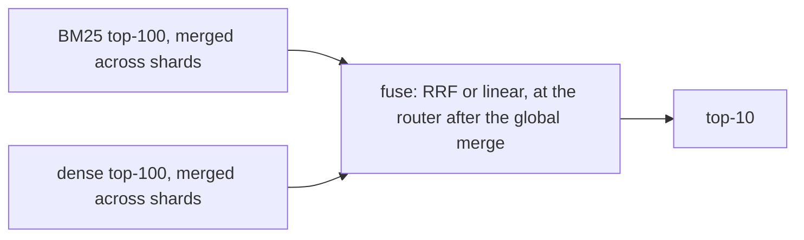

# 05 · Hybrid retrieval: fusing BM25 and dense

Code: `src/retrieval/hybrid.py`. Results: `results/ablation_fusion_*.json`. Sweeps: [16](16_ablations.md).

## Why fuse, and how

BM25 misses paraphrases. Dense misses exact rare terms (tickers, form numbers, names) and can drift to passages that
are on topic but wrong. A passage that both rank high is strong evidence, so I fuse the two lists.

- RRF (rank-based): score(d) = Σ_lists w_i/(k + rank_i(d)), k = 60. Only ranks count, so score scales don't matter.
- Linear (score-based): min-max normalise each list, s' = (s − min)/(max − min), then
  score(d) = α·dense'(d) + (1 − α)·bm25'(d). It keeps score magnitudes but needs α tuned.

Example: BM25 returns [A 18.2, B 11.0, C 10.7, D 2.1] and dense returns [C 0.83, E 0.81, A 0.52, B 0.50]. A raw sum
gives A 18.72, C 11.53, B 11.50, D 2.1, E 0.81: BM25's scale swamps cosine and dense's #2 ends last. RRF gives A
(BM25 #1, dense #3) and C (BM25 #3, dense #1) the same 1/61 + 1/63 = 0.0323, so they tie. Linear at α = 0.5 normalises
to bm25' = [A 1, B 0.55, C 0.53, D 0] and dense' = [C 1, E 0.94, A 0.06, B 0], giving C 0.77, A 0.53, E 0.47: it sees
that dense puts C and E far above A and B.



## How I implemented it

- `rrf(lists, k, weights)`, `minmax`, `linear` and `fuse(method, alpha)`, with ties broken on doc id.
- In `fuse`, α is always the dense weight: linear uses α and 1 − α, RRF uses list weights (1 − α, α). RRF at α = 0.5
  is textbook RRF. A list whose scores are all equal is mapped to 1.0 instead of dividing by zero.
- Each list is 100 deep (`config.CANDIDATE_DEPTH`); a doc missing from one list gets 0 from it.
- Fusion runs at the router on the globally merged lists. Fusing per shard is wrong for linear fusion because min-max
  would use each shard's own min and max ([08](08_sharding_scatter_gather.md)).

## Results: dev sweep, MiniLM (`results/ablation_fusion_minilm.json`)

| method | α (dense weight) | nDCG@10 | R@10 | MRR@10 |
|---|---|---|---|---|
| dense only | n/a | 0.3881 | 0.4665 | 0.4532 |
| BM25 only | n/a | 0.2642 | 0.3135 | 0.3222 |
| RRF | 0.5 (standard) | 0.3733 | 0.4420 | 0.4485 |
| RRF | 0.9 | 0.4062 | 0.4812 | 0.4794 |
| linear | 0.5 | 0.4022 | 0.4672 | 0.4730 |
| linear | 0.7 (chosen) | 0.4190 | 0.4914 | 0.4872 |
| linear | 0.9 | 0.4005 | 0.4720 | 0.4694 |

I expected textbook RRF to give a free gain; it scored 0.373, below dense alone. With BM25 12 points behind, giving it
an equal vote adds noise. Linear at α = 0.7 encodes the quality gap in α, keeps a close cosine race close, and gains
+0.031 nDCG (+8% relative) over dense. bge-small has the same shape, best at linear 0.7 (0.4155). The full sweep and my
reasoning are in [16](16_ablations.md). α was tuned on dev and these are dev numbers, so they are optimistic; the single
test run is in [DESIGN.md](../DESIGN.md).

```bash
python scripts/ablations.py --model minilm      # the fusion sweep on dev
```

References: Cormack et al., *Reciprocal Rank Fusion* (SIGIR 2009); Bruch et al., *An Analysis of Fusion Functions for
Hybrid Retrieval* (2022).
