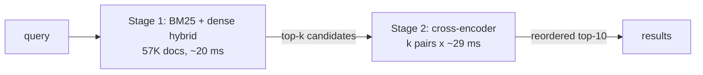

# 06 · Reranking: a second, slower, smarter opinion

> Prerequisites: [02 dense retrieval](02_dense_retrieval.md), [05 hybrid fusion](05_hybrid_fusion.md).
> Terms: [bi-encoder, cross-encoder, two-stage retrieval](GLOSSARY.md).

## 1. Intuition

Hiring analogy: a recruiter skims 57,000 CVs with keyword filters and a quick "vibe" match (first stage:
BM25 + dense), then an interviewer reads the top 20 **carefully, side by side with the job description**
(second stage: the reranker). The interviewer is much better per candidate, but far too slow to read everyone.

- **Bi-encoder** (our MiniLM/BGE): embeds query and passage *separately*. Passage vectors can be computed
  once, offline, so search is just a dot product. However, the query never "sees" the passage.
- **Cross-encoder**: feeds `[CLS] query [SEP] passage [SEP]` into one transformer. Every query token
  attends to every passage token, so it can notice that "*not* tax deductible" contradicts the question.
  Nothing can be precomputed: **one full forward pass per (query, passage) pair**.

## 2. The math / mechanics

Bi-encoder: `score(q, d) = <E(q), E(d)>`, with E(d) precomputed. Cost per query is 1 encode + an index lookup.

Cross-encoder: `score(q, d) = w · CLS( Transformer([q ; d]) )`, an unbounded logit (not a probability).
Cost per query = k encodes of length |q| + |d|.

**Worked numbers (measured on this machine, 4 threads):**
- One pair (≈ 256 tokens) ≈ **29 ms** on CPU.
- Rerank top-10 → ≈ 10 × 29 ≈ 290 ms, plus the 20 ms first stage → **measured p50 339 ms**.
- Top-20 → ≈ 580 + 20 → **measured 621 ms**. Linear in k, exactly as the formula predicts.
- Reranking the whole corpus would be 57,638 × 29 ms ≈ **28 minutes per query**. That is why it is never the first stage.

Self-attention is O(L²) in sequence length L, so a 512-token pair costs ~4× a 256-token pair. Long FiQA answers hurt twice.

## 3. Diagram



Key property: **stage 2 can only reorder what stage 1 found.** Recall@k of stage 1 is the ceiling.

## 4. How this repo implements it

- `src/retrieval/rerank.py`: `get_reranker()` lazily loads `cross-encoder/ms-marco-MiniLM-L-6-v2` once
  (thread-safe); `rerank(query, candidates, texts)` scores pairs in batches of 32 and sorts by logit.
  Ties break on doc id so runs are deterministic.
- `src/service/router.py`: the `rerank_k` search parameter. The router fetches texts for the top-k from the
  shards (`fetch`) and reranks centrally. Off by default.
- `scripts/ablations.py --rerank --ks 10,20,50` runs the sweep and writes `results/ablation_rerank_minilm.json`.
- Rejected options: reranking per shard (each shard would see only its own candidates, which is the same
  bug class as fusing per shard; see [ADR 0003](adr/0003-merge-then-fuse.md)); mixing CE logits with fused scores (different scales).

## 5. Run the toy

```powershell
python examples/09_bi_vs_cross_encoder.py
```
It ranks the toy docs with both models and prints the time per doc for each. Read it this way: the bi-encoder
time is dominated by *document* encoding that real systems do offline, while the cross-encoder time is all online.

## 6. Observe it in the real system (dev, MiniLM hybrid linear α=0.7 as stage 1)

| rerank depth k | nDCG@10 | R@10 | p50 | p95 |
|---|---|---|---|---|
| none | 0.4190 | 0.4914 | 20.7 ms | 24.5 ms |
| 10 | 0.4058 | 0.4914 | 338.6 ms | 366.8 ms |
| 20 | 0.3964 | 0.4829 | 621.0 ms | 634.6 ms |
| 50 | 0.3771 | 0.4633 | 1246.3 ms | 1366.6 ms |

**A negative result, and an important one.** The reranker *hurts* here:
- At k = 10, R@10 is unchanged *by construction* (same 10 docs), yet nDCG falls, so the CE orders them worse.
- Deeper k lets the CE promote docs from ranks 11–k above true answers, so recall falls too.
- Why: ms-marco-MiniLM was trained on short Bing passages and web queries. FiQA answers are long, opinionated
  forum posts truncated to 256 tokens, which is a domain shift. "Stronger model" is a prior, not a law: **always measure.**
- What could fix it: a finance-tuned or larger reranker (bge-reranker-base), score interpolation
  `λ·CE + (1−λ)·fused` after normalizing both, or chunk-level max scoring for long answers.

```powershell
python scripts/ablations.py --rerank --ks 10   # 500 dev queries x ~0.34 s = ~3 min (overwrites the results file)
```

## 7. Pitfalls and interview questions

- *Pitfall*: comparing reranker quality without keeping stage 1 fixed. Different candidates, different ceiling.
- *Pitfall*: treating logits as probabilities, or adding them to BM25/cosine scores.
- *Pitfall*: calling `asyncio.run` or loading the model per query. We hit both: a 9 GB memory leak from per-call
  event loops (fixed with a persistent loop), and multi-second first queries without the lazy singleton.
- Q: "Why not use the cross-encoder for everything?" A: there's no precomputable representation; the cost is O(N) model passes per query.
- Q: "Your reranker made things worse. Ship it?" A: no. It's +300 ms for −0.013 nDCG. Off by default, and the reason is documented.
- Q: "How would you make reranking affordable?" A: smaller k, ONNX/int8, GPU batching, distillation into the bi-encoder, or caching per hot query.

## 8. Exercises (solutions: [solutions/06_reranking.md](solutions/06_reranking.md))

1. *(concept)* Why does rerank depth trade recall against cost, and when does extra depth stop helping?
2. *(concept)* Why can't a cross-encoder be used to index the corpus?
3. *(predict)* In toy 09, does batching pairs make per-pair time go up or down? Why?
4. *(predict)* At k = 10, explain without running anything why R@10 is identical to "no rerank" but MRR can change.
5. *(modify)* Add `--interp λ` to the ablation: min-max normalize CE scores and fused scores over the top-k, rank by
   `λ·CE + (1−λ)·fused`. Predict the result at λ = 0 and λ = 1 before running.

## 9. Further reading

- Nogueira & Cho, *Passage Re-ranking with BERT* (2019): the original monoBERT reranker.
- Reimers & Gurevych, *Sentence-BERT* (2019): the bi-encoder side.
- Thakur et al., *BEIR* (2021): BM25 + CE is strong zero-shot on many sets, but not uniformly. Check the FiQA row.
- sentence-transformers docs: "Retrieve & Re-Rank".
