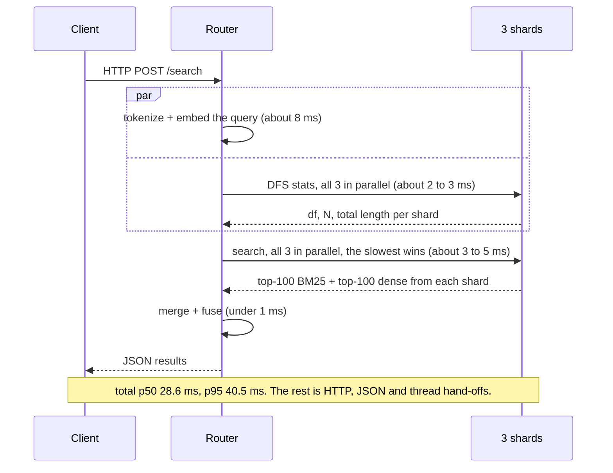

# 07 · Benchmarking: latency percentiles, cold vs warm, memory

Code: `src/eval.py`, `scripts/bench.py`, `src/util.py`. Output: `results/bench.json`.

## What I measure

- p50 / p95: sort the latencies, and pN is the value N% of requests are faster than. I use the nearest-rank method
  (`src/util.py::percentile`), always on raw samples.
- Cold: the first 20 queries of a fresh process. Warm: all 500 dev queries after a 100-query warmup on train queries,
  so no dev query is seen before it is timed.
- Peak RSS: the OS high-water mark of resident memory (Windows `peak_wset`, Linux `ru_maxrss`).

What one timed query includes in service mode:



## How I set it up

- `scripts/bench.py` runs each configuration in its own process, so "cold" is real, and restarts the cluster for each
  service configuration.
- Torch is pinned to 4 intra-op threads per process. Four processes each using 32 threads on 32 cores would thrash.
- The client measures latency end to end, so service mode includes HTTP to the router, which is what the 50 ms
  constraint refers to. Server-side timers would miss queueing, serialization and network.
- Machine: AMD EPYC 7763 (16 physical / 32 logical cores visible), 128 GB RAM, Windows 11, Python 3.13.
- I check the machine is idle first. My first dense run (p95 92 ms) overlapped the bge-small embedding job and I
  discarded it.

## Results (`results/bench.json`, dev)

| config | warm p50 / p95 (ms) | cold p50 / p95 (ms) | peak RSS (MB) |
|---|---|---|---|
| bm25 (local) | 1.2 / 2.0 | 1.2 / 1.9 | 511 (process) |
| dense-minilm (local) | 18.8 / 20.8 | 19.1 / 21.2 | 806 |
| hybrid-linear-minilm (local) | 20.7 / 24.5 | 20.1 / 23.3 | 812 |
| svc3 hybrid-linear-minilm (router + 3 shards) | 28.6 / 40.5 | 29.5 / 33.0 | 723 per shard |
| svc1 hybrid-linear-minilm (router + 1 shard) | 23.4 / 26.3 | 22.9 / 25.1 | 775 |

Cold is about the same as warm. I removed the cold costs on purpose: the router loads the model and runs a warmup
encode at startup (`on_event("startup")`), vectors are copied into RAM instead of lazily mmapped, and the httpx client
keeps connections alive. `results/microbench.json` shows what the warmup hides: model load 1.5 s, and the first encode
in a fresh process costs 19 ms vs 8 ms afterwards. Without the startup hook the first user query would pay about 1.5 s.
Warm p95 is sometimes higher than cold p95 because 500 samples catch more tail events (GC, OS scheduling) than 20
samples do, and p95 of 20 samples is just the 19th value.

1 shard is faster than 3 shards. Per-shard compute at this corpus size is about 1 to 3 ms, so splitting it saves
little, while the 3-way fan-out adds the DFS round trip and waits on the slowest of 3 shards (tail amplification).
See [08](08_sharding_scatter_gather.md) and DESIGN.md.

My load test (`scripts/query_load.py`) is closed-loop: it sends the next query after the previous one returns. That
under-reports latency under overload (coordinated omission), so I use it to show zero failures and not for capacity
planning.

```bash
python scripts/bench.py                 # everything (about 20 to 30 min on 32 cores)
python scripts/bench.py --only local    # single-node configs only
python scripts/microbench.py            # encode / faiss / BM25 timings, model load
```

Reference: Dean & Barroso, *The Tail at Scale* (CACM 2013).
