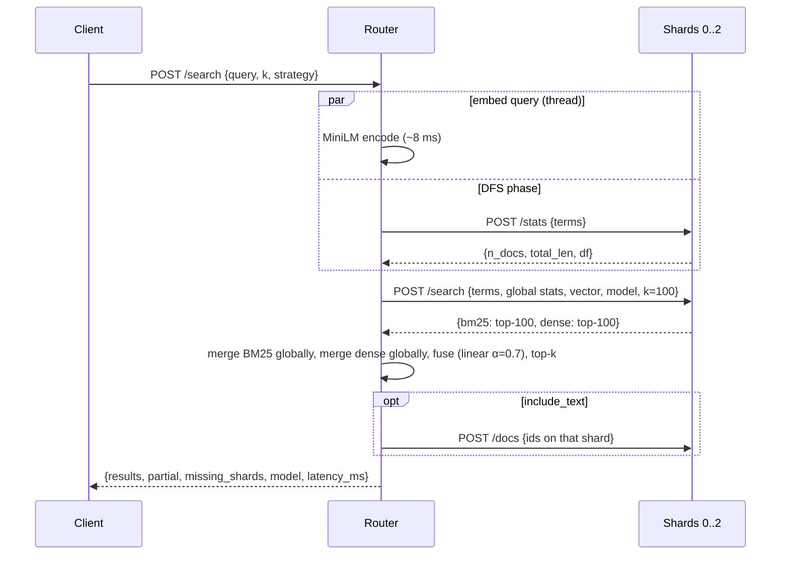

# 08 · Sharding and scatter-gather

**Code:** `src/service/router.py`, `src/service/shard_server.py`, `src/index/sharding.py` · **Toys:** 12, 13, 14, 15

## 1. Intuition

Split the corpus across N independent processes (*shards*). Each shard owns ~1/N of the docs
and a complete mini search engine for them. A *router* asks every shard ("scatter"), collects their
answers ("gather"), merges and returns the global top-k. This scales data size and write
throughput horizontally. Every query still touches every shard.

## 2. The mechanics: three correctness rules

1. **Each shard must return enough candidates.** If the router wants the global top-D, each shard
   returns its local top-D. Any doc in the global top-D is in its own shard's top-D, so the union
   contains the answer (proof: a doc outranked by D others on its own shard is outranked by them globally).
2. **Scores must be comparable across shards.**
   - Dense: the same model and normalised vectors, so cosine is absolute. ✔ for free.
   - BM25: IDF and avgdl depend on *corpus* statistics. Shard-local stats make the same doc score
     differently on different shards (toy 12). Fix: the **DFS phase**. The router gathers N, total length
     and df(query terms) from all shards, sums them and sends **global stats** with the query.
3. **Fusion happens after the global merge** (toy 13, [ADR 0003](adr/0003-merge-then-fuse.md)).

## 3. Diagram: one hybrid query



## 4. How this repo implements it

- **Partitioning**: `crc32(doc_id) % N`. Stable across processes (never Python's salted `hash()`).
  Balance: 19,167 / 19,254 / 19,217 docs across the 3 shards (sum 57,638).
- **Router embeds the query once** and ships the vector, instead of having every shard re-encode it (3× CPU).
- **Timeouts** on every shard call (`SHARD_TIMEOUT_S = 0.5`). Failure policy `partial` (default)
  returns what arrived and sets `partial: true, missing_shards: [i]`. `fail` returns HTTP 503.
  [ADR 0006](adr/0006-partial-results.md).
- **Same code for single-node and sharded**: `Router` + `LocalShardClient` (in-process) vs
  `HttpShardClient`. The single-node baseline is literally "1 shard, no HTTP".
- Shards only differ by env vars (`SHARD_ID`, `N_SHARDS`, `PORT`, `STATE_DIR`).

## 5. Run the toys

```bash
python examples/12_sharded_idf_bug.py       # same text, different BM25 score per shard -> DFS fix
python examples/13_merge_then_fuse.py       # wrong order of fusion and merge
python examples/14_scatter_gather_timeouts.py   # asyncio fan-out, slow + dead shard
python examples/15_hash_partitioning.py     # modulo vs consistent hashing on resharding
```

## 6. Observe it in the real system (`results/bench.json`)

**Correctness (B1 requirement: within 1% relative of single node):**

| strategy | single node nDCG@10 | 3 shards nDCG@10 | Δ |
|---|---|---|---|
| BM25 | 0.2642 | 0.2642 | 0.0% |
| dense (MiniLM) | 0.3881 | 0.3881 | 0.0% |
| hybrid linear α=0.7 | 0.4190 | 0.4190 | 0.0% |

Exactly equal (also R@10 and MRR), as the three rules predict. It matched the first time, because
the rules were designed in, but `tests/test_store.py::test_sharded_router_equals_single_node` guards it.

**What the DFS phase buys:** with shard-local BM25 stats (Elasticsearch's default
`query_then_fetch`), nDCG@10 = 0.2653 vs 0.2642 with global stats. Quality is *the same within noise*,
because hash sharding over 19K docs/shard gives nearly identical df ratios on every shard. It's 4 ms
faster (6.8 vs 10.7 ms p50, one round trip saved). We still keep DFS, because (a) it makes results exactly
reproducible and equal to single-node, which the 1% requirement asks for, and (b) local IDF error grows with
skewed shards (topic-based sharding, small shards, recent-docs shards). The trade-off is stated, not hidden.

**Latency: 1 shard vs 3 shards (hybrid, through the router):** p50 23.4 → 28.6 ms, p95 26.3 → 40.5 ms.
Sharding made it *slower*. See [07](07_benchmarking_latency_memory.md) and DESIGN.md §8.

## 7. Pitfalls and interview questions

- Python `hash()` for routing (salted per process) → writes land on the wrong shard.
- Returning only the top-k (not top-D) per shard to the hybrid fuser → the global list is too shallow.
- Retrying non-idempotent writes after a timeout → duplicates. Ours are idempotent ([09](09_live_updates_consistency.md)).
- *Q: How does tail latency scale with shard count?* p(query slow) = 1 − (1 − p)^N. With p = 1% and N = 100,
  that's 63%. Mitigations: hedged requests, replicas, timeouts with partial results.

## 8. Exercises

1. (Concept) Prove rule 1 (local top-D ⊇ global top-D ∩ shard).
2. (Predict) With 30 shards on this laptop, what happens to p95? To memory per shard?
3. (Do) Drill 1 in [DRILLS.md](DRILLS.md): run with 4 shards and re-check the 1% rule.
4. (Do) Cache global df at the router for 5 s instead of a DFS round trip per query. What do you lose?

Solutions: [solutions/08_sharding.md](solutions/08_sharding.md)

## 9. Further reading

- Elasticsearch docs: `search_type=dfs_query_then_fetch`
- Dean & Barroso, *The Tail at Scale* (2013)
- Kleppmann, *Designing Data-Intensive Applications*, ch. 6 (partitioning)
