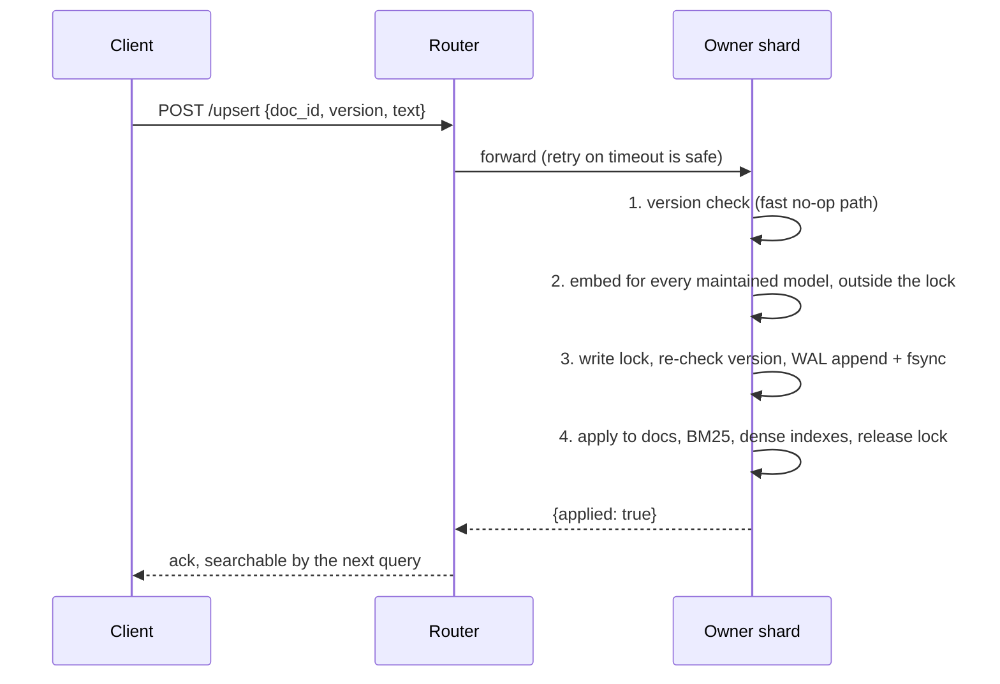
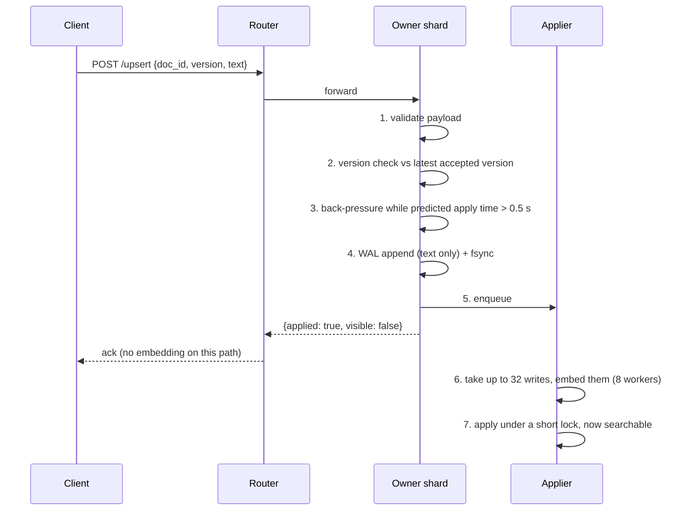

# 09 · Live updates: idempotency, consistency, freshness, recovery

Code: `src/service/store.py` (`_write`, `_apply`, `load`), `src/service/wal.py`, `src/service/async_apply.py`.
Tests: `tests/test_store.py`, `tests/test_integration_service.py`, `tests/test_integration_async.py`.

Documents change while people search. Each shard has to handle retried writes, out-of-order versions, readers during a
write, crashes mid-write, and the question of when an acked write becomes searchable. That last one is where my two write
modes differ.

## Versions, WAL and lock

Every write carries `(doc_id, version)`, and I apply it only if `version > stored_version`. Equal is a replay, smaller is
stale; both are no-ops. A delete leaves a tombstone so a late, older upsert cannot resurrect the doc. I trust the
client's version (like Elasticsearch `version_type=external`), since wall-clock versions break under clock skew.

Before acking, I append the write to a WAL and `fsync` it. A restart loads the base corpus and replays the log with the
same version check, so replaying twice is harmless. A read-write lock makes a writer exclusive while it updates docs,
versions, BM25 and every dense index. I embed outside the lock (about 25 ms per model for MiniLM would block all readers)
and re-check the version inside.

## Two write modes

Each shard picks one with `APPLY_MODE=sync|async` (default `sync`):

| | sync | async |
|---|---|---|
| order of steps | embed, WAL, apply, ack | validate, WAL, ack, then embed and apply in the background |
| ack means | durable and searchable | durable, not yet searchable (`"visible": false`) |
| WAL record holds | text + embedding vectors | text only |
| version check against | applied versions | accepted versions (queued writes count) |
| who embeds | each request's own thread | one applier thread + 8 embed workers, 1 doc per call |
| freshness promise | the first search after the ack finds it | searchable within 1 s of the ack |
| protects the promise by | nothing needed | back-pressure: delay the ack while predicted apply time > 0.5 s |
| code | `ShardStore._write` / `_apply` | `AsyncApplier` in `src/service/async_apply.py` |





Async needs three extra rules. Versions are checked against accepted writes: if v2 is queued and v1 arrives, a check
against the applied v0 would let v1 overwrite v2 later (`test_async_versions_compare_with_accepted_not_applied`).
Nothing may fail after the ack, so I validate first; empty text gets a 422. And back-pressure predicts each new write's
wait (docs queued ahead ÷ 8 workers × measured time per round, plus the batch in flight) and holds the ack if it exceeds
0.5 s, leaving the other half second as headroom. My first version only watched the oldest write's age and missed fast
bursts.

I expected batching to make async fast. On this CPU, embedding 8 passages per call cost 31.5 ms per passage against 25.6
ms one at a time, because short passages are padded to the longest. Async wins by moving embedding off the ack path and
running 8 single-doc calls in parallel.

## Failures and guarantees

| failure point | what a reader sees | recovery |
|---|---|---|
| crash before WAL append | old version, no ack | client retries (idempotent) |
| crash after WAL append | old version until restart | WAL replay (at-least-once + idempotent) |
| async: crash after ack, before apply | old version until restart | replay re-embeds the text-only record |
| torn last WAL line | old version | truncated on reopen (never acked) |
| exception inside apply | shard unhealthy, 503, listed in `missing_shards` | crash-only restart from base + WAL; async would need a dead-letter queue |
| reader during a write | before or after, never in between | RW lock |

The torn line was a real bug. My first WAL skipped it during replay but left it in the file, so the next record was
appended onto it (`{"op":"ups{"op":"upsert",...}`) and that write vanished on the following restart.
`WAL._truncate_torn_tail` now cuts the file back to the last newline on open, and I test recovery twice in a row.

Sync guarantees that a write is searchable by the first query after its ack
(`test_freshness_write_searchable_immediately_after_ack`: 3 shard processes over HTTP, every strategy, no sleeps).
Async guarantees searchable within 1 s (`test_acked_write_is_searchable_within_one_second`, and
`test_async_backpressure_keeps_visible_lag_under_one_second` for a burst); `POST /admin/flush` gives read-your-writes.
Operations on one document are totally ordered; there are no multi-document transactions.

## Under heavy write load (`results/write_load.json`)

Real corpus, 3 shards, 8 writers + 2 readers, 30 s per mode:

| | sync | async |
|---|---|---|
| writes acked / s | 57.8 | 94.2 |
| ack ms p50 / p95 | 128 / 181 | 78 / 120 |
| visible lag ms p95 / max | 0 / 0 | 466 / 583 |
| search ms p50 under load | 131 | 184 |

Async acked 1.6× the writes and kept lag under the 1 s promise, but searches slowed because shards spent CPU embedding
the extra writes. Sync stays my default because users see their own edit on the next search. Async suits write-heavy
feeds, the same trade Elasticsearch makes with its 1 s refresh.

The scenario replays show a different number that is easy to mistake for the lag: when a search was sent after the
write's ack. A search sent 3 s after the ack that finds the doc only proves it was visible by then. The lag itself is
what `wait_visible` measures (every probe in my scenario runs saw the doc on its first poll, 9.8 to 95 ms, which is one search round trip) and what the table above reports under load; the
numbers are in [scenarios.md](scenarios.md#freshness-what-the-numbers-mean).

```bash
pytest -q tests/test_integration_service.py   # sync: idempotency, freshness, crash recovery, partial results
pytest -q tests/test_integration_async.py     # async: visible within 1 s, accepted-version checks, hard kill, migration
python -m scripts.write_load --mode both --duration 30
python -m src.service.cluster --shards 3                    # sync (default)
APPLY_MODE=async python -m src.service.cluster --shards 3   # async  (PowerShell: $env:APPLY_MODE='async'; python -m ...)
APPLY_MODE=async docker compose up -d                       # same switch in Docker
```

The crash tests hard-kill shard 1, check for `partial: true, missing_shards: [1]`, restart it and find the acked write
again (in async mode, one that was acked but not yet applied). `GET /admin/status` shows each shard's `apply_mode` and,
in async mode, queue length and lag.

Not built: WAL snapshots and truncation (the log grows forever) and tombstone GC.
