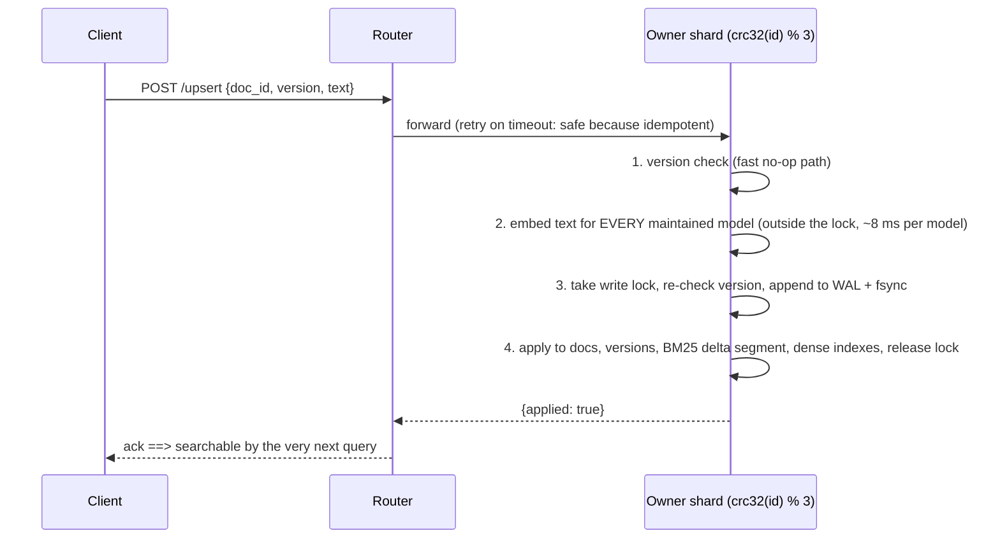

# 09 · Live updates: idempotency, consistency, freshness, recovery

**Code:** `src/service/store.py` (`_write`, `_apply`, `load`), `src/service/wal.py` · **Toys:** 16, 17, 18
**Tests:** `tests/test_store.py`, `tests/test_integration_service.py`

## 1. Intuition

Documents change while people search. Four questions:
1. **Idempotency**: if a client retries a write (it never saw the ack), does the system apply it twice?
2. **Ordering**: if v3 arrives before v2, does v2 overwrite v3?
3. **Consistency**: can a reader see a doc in BM25 but not in the dense index?
4. **Durability and recovery**: if the process dies mid-write, what survives?

## 2. The mechanics

- Every write carries `(doc_id, version)`. Apply only if `version > stored_version`. Equal = replay =
  no-op, smaller = stale = no-op. **Deletes** store a *tombstone* `(version, deleted=True)` so a late,
  older upsert cannot resurrect the doc.
- **WAL**: append the write (including its embedding vectors) to a log and `fsync` *before* mutating
  memory. Restart = load base corpus + replay the log. Replay applies the same version check, so
  replaying twice is harmless.
- **RW lock**: readers share; a writer is exclusive while it updates docs + versions + BM25 + every dense index.

## 3. Diagram: the write path



## 4. Guarantees and what can go wrong

| failure point | what a reader sees | recovery |
|---|---|---|
| crash before WAL append | old version (write never happened; no ack) | client retries; idempotent |
| crash after WAL append, before/while applying | old version until restart | restart replays WAL → new version (it may never have been acked, which is fine: at-least-once + idempotent) |
| torn half-written WAL line | old version | replay skips it (it was never acked) |
| exception inside apply (bug) | shard marks itself **unhealthy** → 503 → router reports it in `missing_shards` | restart (crash-only design): base + WAL |
| reader during a write | before OR after, **never in between** (RW lock) | n/a |

**Freshness guarantee:** *a write is searchable by the first query issued after its ack* (synchronous
apply, so lag = 0 after the ack). The write itself costs one embedding per maintained model (~15–30 ms).
Proven end to end by `tests/test_integration_service.py::test_freshness_write_searchable_immediately_after_ack`
(3 shard processes + router over HTTP, every strategy, no sleeps or retries, asserted < 1 s per write+3 searches).

## 5. Run the toys

```bash
python examples/16_idempotent_versioned_writes.py   # replays, out-of-order, tombstones
python examples/17_wal_crash_recovery.py            # torn write, restart, replay
python examples/18_freshness.py                     # sync vs async apply
```

## 6. Observe it in the real system

```bash
pytest -q tests/test_integration_service.py   # idempotency, freshness, crash recovery, partial results
```
The crash test hard-kills shard 1 (no graceful shutdown), checks that queries return `partial: true,
missing_shards: [1]`, restarts it, and finds the acknowledged write again via WAL replay.

## 7. Pitfalls and interview questions

- **Embedding inside the lock** blocks all readers for ~8 ms+ per write (per model). We compute outside, then
  re-check the version inside (another writer may have won the race).
- **Version source**: we trust the client's version (like Elasticsearch `version_type=external`).
  Wall-clock versions break under clock skew. A per-doc counter at the owner shard is the alternative.
- **WAL growth**: the log is never truncated here. Production needs snapshots + truncation ([DRILLS](DRILLS.md) drill 6).
- **Tombstone GC**: tombstones live forever here. They can be dropped once older than the max replay/redelivery window.
- *Q: Is this linearizable?* Per document on a single shard, yes (one lock, total order). Across documents
  there are no multi-doc transactions.

## 8. Exercises

1. (Concept) Why must the delete be a tombstone and not a plain removal?
2. (Predict) Two clients upsert the same doc with the same version and different text. What happens? Is it OK?
3. (Do) Switch to async apply (queue + background thread). Which test fails, and how would you rewrite the guarantee?
4. (Do) Implement WAL snapshotting: dump state every 1,000 writes, truncate the log, recover from snapshot + tail.

Solutions: [solutions/09_live_updates.md](solutions/09_live_updates.md)

## 9. Further reading

- Kleppmann, *DDIA*, ch. 3 (WAL, LSM), ch. 7 (transactions), ch. 11 (idempotence)
- Candea & Fox, *Crash-Only Software* (2003)
- Elasticsearch docs: "Optimistic concurrency control", "refresh interval"
