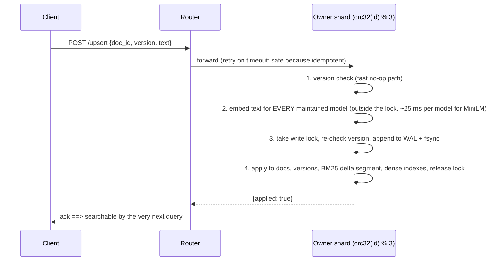
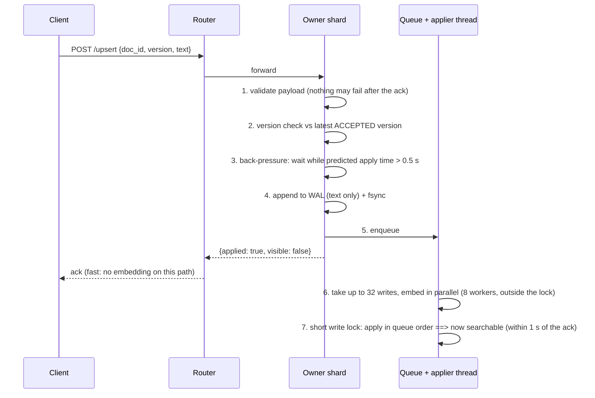

# 09 · Live updates: idempotency, consistency, freshness, recovery

**Code:** `src/service/store.py` (`_write`, `_apply`, `load`), `src/service/wal.py`, `src/service/async_apply.py` (async mode)
· **Toys:** 16, 17, 18 · **ADRs:** [0007](adr/0007-sync-apply-wal.md) (sync), [0013](adr/0013-async-apply-mode.md) (async)
**Tests:** `tests/test_store.py`, `tests/test_integration_service.py` (sync), `tests/test_integration_async.py` (async)

## 1. Intuition

Documents change while people search. Five questions:
1. **Idempotency**: if a client retries a write (it never saw the ack), does the system apply it twice?
2. **Ordering**: if v3 arrives before v2, does v2 overwrite v3?
3. **Consistency**: can a reader see a doc in BM25 but not in the dense index?
4. **Durability and recovery**: if the process dies mid-write, what survives?
5. **Freshness**: after the ack, *when* does a search find the new text? Right away, or a little later?

Question 5 is where the two write modes differ. Analogy: a restaurant order.
- **Sync** = the waiter stands at the kitchen until your dish is cooked, then says "done". Slow to answer, but "done"
  really means done.
- **Async** = the waiter writes your order on the ticket rail (durable), says "got it" and leaves; the kitchen cooks it
  within a promised time. Faster answers and more orders per hour, but "got it" ≠ "on your table yet".

## 2. The mechanics

- Every write carries `(doc_id, version)`. Apply only if `version > stored_version`. Equal = replay =
  no-op, smaller = stale = no-op. **Deletes** store a *tombstone* `(version, deleted=True)` so a late,
  older upsert cannot resurrect the doc.
- **WAL**: append the write to a log and `fsync` *before* acknowledging it. Restart = load base corpus + replay
  the log. Replay applies the same version check, so replaying twice is harmless.
- **RW lock**: readers share; a writer is exclusive while it updates docs + versions + BM25 + every dense index.

**Two write modes, chosen per shard process with `APPLY_MODE=sync|async` (default `sync`):**

| | **sync** (ADR 0007) | **async** (ADR 0013) |
|---|---|---|
| order of steps | embed → WAL → apply → **ack** | validate → WAL → **ack** → (background) embed → apply |
| ack means | durable **and searchable** | durable, **not yet searchable** (`"visible": false` in the reply) |
| WAL record holds | text + embedding vectors | text only (vectors don't exist yet) |
| version check against | applied versions | **accepted** versions (queued writes count) |
| who embeds | each request's own thread, in parallel | one applier thread + a pool of 8 embed workers, 1 doc per call |
| freshness promise | the first search after the ack finds it | searchable **within 1 s** of the ack |
| protects the promise by | nothing needed | **back-pressure**: delay the ack while the predicted apply time > 0.5 s |
| code | `ShardStore._write` / `_apply` | `src/service/async_apply.py` (`AsyncApplier`) |

## 3. Diagrams: the two write paths

**Sync (default):**



**Async (`APPLY_MODE=async`):**



**Back-pressure, in one sentence:** the shard predicts how long a new write would wait in the queue (docs queued
ahead ÷ 8 workers × measured time per round, plus the batch in flight). If that exceeds 0.5 s, the ack waits.
So under overload, clients slow down instead of freshness silently getting worse. The remaining 0.5 s of the
1 s promise is headroom for prediction error.

## 4. Guarantees and what can go wrong

| failure point | what a reader sees | recovery |
|---|---|---|
| crash before WAL append | old version (write never happened; no ack) | client retries; idempotent |
| crash after WAL append, before/while applying | old version until restart | restart replays WAL → new version (it may never have been acked, which is fine: at-least-once + idempotent) |
| **async:** crash after the ack, before the background apply | old version until restart | restart replays the WAL. The record has no vectors, so replay **re-embeds** it (restart is slower after a burst) |
| torn half-written WAL line | old version | truncated on reopen (it was never acked); see the pitfall below |
| exception inside apply (bug) | shard marks itself **unhealthy** → 503 → router reports it in `missing_shards` | restart (crash-only design): base + WAL. In async mode the write was already acked, so production would add a dead-letter queue |
| reader during a write | before OR after, **never in between** (RW lock) | n/a |

**Freshness guarantees:**
- **Sync:** *a write is searchable by the first query issued after its ack* (lag = 0 after the ack). The write
  itself costs one embedding per maintained model (~25 ms for MiniLM). Proven end to end by
  `tests/test_integration_service.py::test_freshness_write_searchable_immediately_after_ack` (3 shard processes +
  router over HTTP, every strategy, no sleeps or retries, asserted < 1 s per write+3 searches).
- **Async:** *a write is searchable within 1 s of its ack.* Proven by
  `tests/test_integration_async.py::test_acked_write_is_searchable_within_one_second` (polls until visible and
  asserts the bound) and `tests/test_store.py::test_async_backpressure_keeps_visible_lag_under_one_second` (a burst).
  Need read-your-writes in async mode? Call `POST /admin/flush`, which returns once every queued write is applied.

**Measured under heavy write load** (`scripts/write_load.py`, real corpus, 3 shards, 8 writers + 2 readers, 30 s;
`results/write_load.json`):

| | sync | async |
|---|---|---|
| writes acked / s | 57.8 | **94.2** (1.6×) |
| ack ms p50 / p95 | 128 / 181 | **78 / 120** |
| visible lag ms p95 / max | **0 / 0** | 466 / 583 (promise: < 1,000) |
| search ms p50 under load | **131** | 184 (shards spend more CPU embedding the extra writes) |

**Which to use?** Sync when a user must see their own edit on the next search (the simplest guarantee).
Async when write throughput matters and "within a second" is acceptable. This is the trade-off most real search
engines make (Elasticsearch: write to the translog, ack, make it searchable at the next *refresh*, by default 1 s).

## 5. Run the toys

```bash
python examples/16_idempotent_versioned_writes.py   # replays, out-of-order, tombstones
python examples/17_wal_crash_recovery.py            # torn write, restart, replay
python examples/18_freshness.py                     # sync vs async apply
```

## 6. Observe it in the real system

```bash
pytest -q tests/test_integration_service.py   # sync: idempotency, freshness, crash recovery, partial results
pytest -q tests/test_integration_async.py     # async: visible within 1 s, accepted-version checks, hard kill, migration
python -m scripts.write_load --mode both --duration 30   # sync vs async under heavy writes -> results/write_load.json
```
The sync crash test hard-kills shard 1 (no graceful shutdown), checks that queries return `partial: true,
missing_shards: [1]`, restarts it, and finds the acknowledged write again via WAL replay. The async version does
the same for writes that were acked but **not yet applied** when the process died.

Run the cluster yourself in either mode:
```bash
python -m src.service.cluster --shards 3                    # sync (default)
APPLY_MODE=async python -m src.service.cluster --shards 3   # async  (PowerShell: $env:APPLY_MODE='async'; python -m ...)
APPLY_MODE=async docker compose up -d                       # same switch in Docker
```
`GET /admin/status` shows each shard's `apply_mode`; in async mode it also shows the queue length, lag and batch timings.

## 7. Pitfalls and interview questions

- **Embedding inside the lock** blocks all readers for ~25 ms per write (per model, MiniLM). We compute outside, then
  re-check the version inside (another writer may have won the race). Async does the same: embed outside, apply under
  one short lock.
- **Version source**: we trust the client's version (like Elasticsearch `version_type=external`).
  Wall-clock versions break under clock skew. A per-doc counter at the owner shard is the alternative.
- **Async: compare versions with *accepted* writes, not applied ones.** If v2 is still queued, an incoming v1
  would pass a check against the applied version (v0) and then overwrite v2 when applied
  (`test_async_versions_compare_with_accepted_not_applied`).
- **Async: nothing may fail after the ack.** Validate everything first (empty text, missing fields). That's
  why both modes now reject empty text, and the router answers 422 instead of retrying.
- **Async without back-pressure** = an unbounded queue, so "visible within 1 s" silently becomes "within a minute"
  under load. Our first back-pressure only looked at the oldest write's age and missed fast bursts; the fix
  predicts each new write's wait.
- **"Batching makes async fast" is false on CPU.** Embedding 8 passages in one call cost *more* per passage (31.5 ms)
  than one at a time (25.6 ms), because short passages get padded to the longest. Async wins by taking embedding off
  the ack path and running 8 single-doc calls in parallel, not by batching (ADR 0013).
- **WAL growth**: the log is never truncated here. Production needs snapshots + truncation ([DRILLS](DRILLS.md) drill 6).
- **Torn tail + append = lost write (a bug we shipped, then fixed).** A crash mid-append leaves half a line.
  Our first version only *skipped* it during replay, but the reopened file kept the fragment, so the next record was
  appended onto it: `{"op":"ups{"op":"upsert",...}`. That merged line fails to parse on the *next* restart, so a write
  acked after recovery disappears. The fix is to truncate the file back to the last newline on open (`WAL._truncate_torn_tail`).
  Lesson: test recovery **twice in a row** (crash → recover → write → restart), not once.
- **Tombstone GC**: tombstones live forever here. They can be dropped once older than the max replay/redelivery window.
- *Q: Is this linearizable?* Per document on a single shard, yes (one lock, total order). Across documents
  there are no multi-doc transactions. In async mode a search may return the *previous* version for up to 1 s after
  the ack, so reads are not linearizable unless you call `/admin/flush` first.
- *Q: Sync or async?* Sync if users must see their own edit on the next search; async for write-heavy feeds where
  "within a second" is fine. Async gave 1.6× the write throughput but made searches ~40% slower under that load.

## 8. Exercises

1. (Concept) Why must the delete be a tombstone and not a plain removal?
2. (Predict) Two clients upsert the same doc with the same version and different text. What happens? Is it OK?
3. (Do) Start the cluster with `APPLY_MODE=async` and run `tests/test_integration_service.py` against it in your head:
   which sync test's assertion would fail, and how does `test_acked_write_is_searchable_within_one_second` rewrite
   the guarantee? (Then read `src/service/async_apply.py` to check.)
4. (Do) Implement WAL snapshotting: dump state every 1,000 writes, truncate the log, recover from snapshot + tail.

Solutions: [solutions/09_live_updates.md](solutions/09_live_updates.md)

## 9. Further reading

- Kleppmann, *DDIA*, ch. 3 (WAL, LSM), ch. 7 (transactions), ch. 11 (idempotence)
- Candea & Fox, *Crash-Only Software* (2003)
- Elasticsearch docs: "Optimistic concurrency control", "refresh interval"
