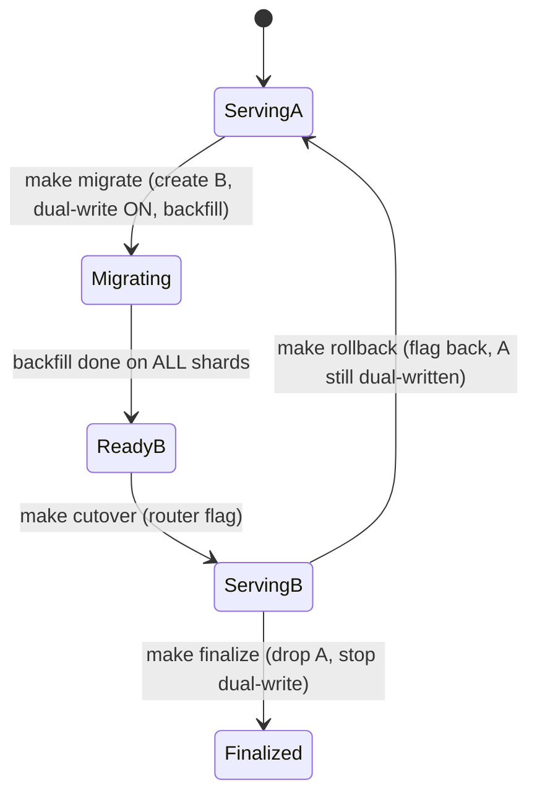
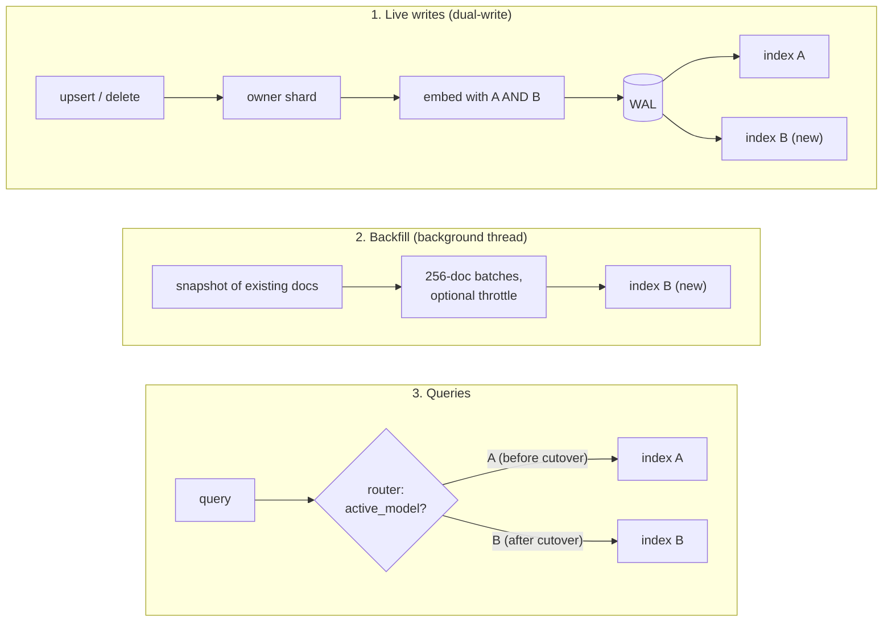

# 10 · Zero-downtime embedding model migration (blue/green)

**Code:** `ShardStore.start_build/_backfill/drop_model`, `Router.migrate/cutover/rollback/finalize`,
`scripts/migration.py`, `scripts/query_load.py`, `scripts/migration_demo.py` · **Toy:** 19

## 1. Intuition

You want to switch every stored vector from model A (MiniLM) to model B (bge-small) while users are
searching and documents are being written. You can't stop the world, and you can't mix models (a
B-query against A-docs is garbage). So you build B **next to** A, keep both fed with new writes, flip a
switch when B is complete, and keep A warm in case you need to flip back.

## 2. The mechanics: a state machine



Key invariants:
1. **Dual-write starts at the same instant the B index is created** (under the write lock). No write
   can slip between "snapshot taken" and "dual-write on".
2. **Backfill never overwrites a newer vector.** It inserts doc d only if d is still at the snapshot
   version *and* not already in B. Otherwise the dual-write already put the newer vector there.
3. **Cutover requires readiness everywhere**: the router asks every shard and refuses if any is not ready.
4. **A request uses one model end to end**: the router reads `active_model` once per request.
   Both indexes exist during the flip, so in-flight requests still succeed.
5. The router state (`active_model`, `previous_model`) is persisted, so a router restart keeps the decision.

## 3. Diagram: during migration

Three flows run at the same time while index B is being built:



In words:
1. **Writes:** every new or changed doc is embedded with **both** models, logged in the WAL and added to both indexes.
   So B never misses a recent write.
2. **Backfill:** a background thread copies all *existing* docs into B, 256 at a time, with an optional pause between
   batches so searches stay fast. It skips any doc a newer write has already put there (invariant 2).
3. **Queries:** the router reads `active_model` once per request. Before cutover it sends queries to A, afterwards
   to B. `rollback` just flips the flag back, because A was kept up to date the whole time.

## 4. How this repo implements it

- `start_build(model, reencode, throttle_s)`: creates the index, persists `models.json`, starts the
  backfill thread. `reencode=False` reuses the offline cache for unchanged passages (text hash
  match). `reencode=True` re-embeds everything (what a genuinely new model costs: ≈18 min for bge-small
  on 32 cores, ~3× that on 4 threads/shard). `throttle_s` rate-limits the backfill to protect serving latency.
- Shard restart mid-migration: `models.json` lists both models, so `load()` rebuilds both
  (cache + WAL vectors; WAL records lacking a vector for B are embedded on replay).
- `make migrate` → `scripts/migration.py migrate --wait`, `make cutover`, `make rollback`, `make finalize`.
- **Works in both write modes.** In async mode (`APPLY_MODE=async`, [09](09_live_updates_consistency.md)) the
  background applier does the dual-write: it embeds each queued write for every maintained model. Tested by
  `tests/test_integration_async.py::test_migration_under_async_writes` (writes keep flowing through
  migrate → cutover → rollback; docs written during the build are found by the new model) and
  `tests/test_store.py::test_async_migration_with_concurrent_writes_covers_every_doc`.

## 5. Run the toy

```bash
python examples/19_blue_green_migration.py      # dual-write + the backfill race, in-process
python scripts/migration_demo.py                # the real thing: 3 shards, live load + writes
```

## 6. Observe it in the real system (`results/migration_demo.json`)

Fresh 3-shard cluster; 4 query threads + 1 writer (2 upserts/s) for the whole run:

| t (s) | event |
|---|---|
| 0 | load starts, serving minilm |
| 15 | `migrate bge-small` (throttle 0.2 s/batch) |
| 32 | backfill complete on all shards (~17 s, cache reused) |
| 47 | `cutover` → responses report `model: bge-small` |
| 62 | `rollback` → back to `minilm` |
| 77 | load stopped |

- **2,045 queries, 0 failed** (no HTTP error, no partial result, no empty result); 1,711 served by minilm and 334 by bge-small.
- **116 docs written during the run, all retrievable by BOTH models' dense indexes**, and per-shard index
  sizes are identical for both models (e.g. shard 0: 19,206 docs, 19,206 minilm vectors, 19,206 bge-small vectors).
  These are the sizes *after* the demo's writes: 57,638 loaded + 116 written = 57,754 docs, so each shard is a bit
  larger than its fresh 19,167 / 19,254 / 19,217.
- Under this load p50 ≈ 140 ms. That's 4 concurrent clients + writes (each write embeds with 2 models)
  sharing one router process and 4 torch threads per process. It is a *load* test, not the serial
  latency benchmark of [07](07_benchmarking_latency_memory.md).

## 7. When to roll back

- Online quality drops (click-through, answer acceptance) or offline canary set nDCG drops beyond noise.
- Latency/SLO regression (bge-small is +12 ms/query on our CPU).
- Errors from the new model path (OOM, tokenizer issue).

Rollback is instant **until `finalize`**. After that you must rebuild A. Keep the old index until the
new one has survived a full traffic cycle.

## 8. Pitfalls and interview questions

- Starting dual-write *after* snapshotting → writes in the gap never reach B.
- Backfill overwriting a dual-written newer vector → stale embedding forever (tested in `test_store.py`).
- Cutting over before *every* shard is ready → queries on lagging shards return B-garbage or errors.
- Forgetting the query-side model: the router must load B's query encoder *before* cutover (we warm it in `migrate`).
- *Q: Cost?* Memory doubles for vectors during migration (+28 MB per shard per model, trivial here; at 100M docs it's huge),
  write latency roughly doubles (two embeddings), and the backfill competes for CPU.

## 9. Exercises

1. (Concept) Why must dual-write and snapshot happen under the same lock acquisition?
2. (Predict) What happens if you `finalize minilm` while serving minilm? (Read `Router.finalize`.)
3. (Do) Run the demo with `--reencode --throttle 0`. What happens to query latency during the backfill?
4. (Do) Add a canary: before cutover, run 50 dev queries on both models and refuse cutover if B is worse.

Solutions: [solutions/10_migration.md](solutions/10_migration.md)

## 10. Further reading

- Martin Fowler, *BlueGreenDeployment* · Stripe engineering, *Online migrations at scale*
- Vespa / Elasticsearch docs: reindex with aliases (the same idea: build new, switch alias)
