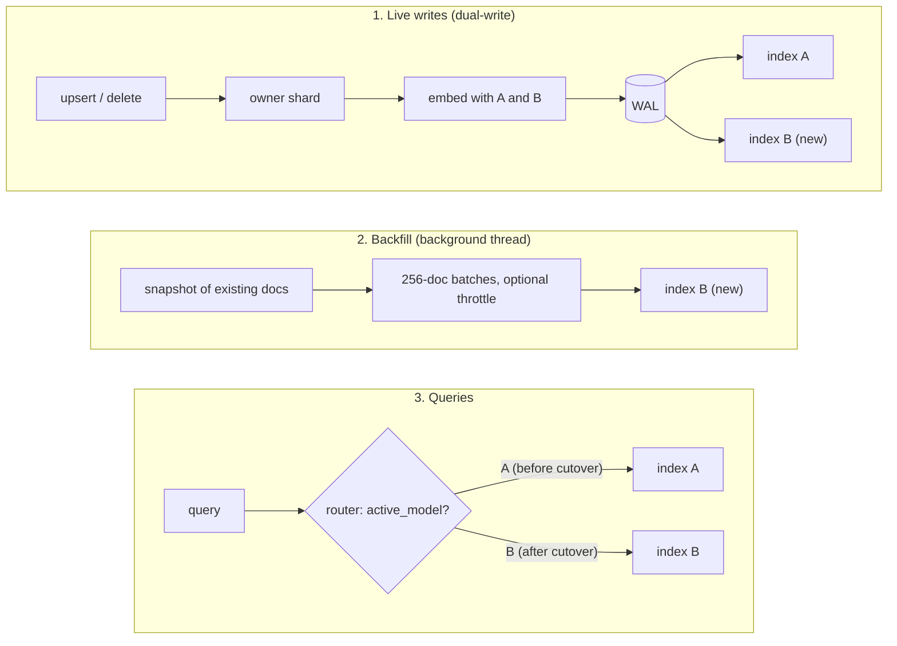

# 10 · Zero-downtime embedding model migration (blue/green)

Code: `ShardStore.start_build/_backfill/drop_model`, `Router.migrate/cutover/rollback/finalize`, `scripts/migration.py`,
`scripts/query_load.py`, `scripts/migration_demo.py`

I wanted to move every stored vector from MiniLM (A) to bge-small (B) while people search and write. A B query against
A docs returns garbage, so models can't be mixed. I build B next to A, feed both with new writes, flip a switch when B is
complete, and keep A current so I can flip back.

## Invariants

1. Dual-write starts in the same lock acquisition that creates B and snapshots the doc list, so no write falls in a gap.
2. The backfill inserts a doc only if it is still at the snapshot version and not already in B, so it never overwrites a
   newer dual-written vector (tested in `test_store.py`).
3. Cutover requires every shard to report B ready, and the router warms B's query encoder first.
4. The router reads `active_model` once per request, so in-flight requests finish on the model they started with.
5. `active_model` and `previous_model` are persisted (`router_state.json`), so a router restart keeps the decision.

## How I built it

`start_build(model, reencode, throttle_s)` creates the index, persists `models.json` and starts the backfill thread.
`reencode=False` reuses the offline embedding cache when the text hash matches; `reencode=True` re-embeds everything,
which is what a new model really costs (≈18 min for bge-small on 32 cores). `throttle_s` pauses between batches to
protect serving latency. A shard that restarts mid-migration finds both models in `models.json` and rebuilds both from
the cache and WAL, embedding any WAL record that lacks a B vector. `make migrate`, `cutover`, `rollback` and `finalize`
call `scripts/migration.py`.

It also works in async write mode ([09](09_live_updates_consistency.md)): the background applier embeds each queued
write for every maintained model. `tests/test_integration_async.py::test_migration_under_async_writes` and
`tests/test_store.py::test_async_migration_with_concurrent_writes_covers_every_doc` cover it.

The cost: vector memory doubles during migration (+28 MB per shard per model here, a lot at 100M docs), write latency
roughly doubles, and the backfill competes for CPU.

## Demo (`python scripts/migration_demo.py`, `results/migration_demo.json`)

A fresh 3-shard cluster with 4 query threads and 1 writer (2 upserts/s) throughout:

| t (s) | event |
|---|---|
| 0 | load starts, serving minilm |
| 15 | `migrate bge-small` (throttle 0.2 s/batch) |
| 32 | backfill complete on all shards (~17 s, cache reused) |
| 47 | `cutover`, responses report `model: bge-small` |
| 62 | `rollback` to `minilm` |
| 77 | load stopped |

2,045 queries ran with 0 failures (no HTTP error, partial or empty result): 1,711 served by minilm, 334 by bge-small. All
116 docs written during the run were retrievable by both dense indexes, and per-shard index sizes matched for both models
(shard 0: 19,206 docs and 19,206 vectors each; 57,638 + 116 = 57,754 docs in total). p50 under this load was about
140 ms, a load figure, not the serial benchmark of [07](07_benchmarking_latency_memory.md).

I would roll back on a quality drop (online signals or an offline canary nDCG), a latency regression (bge-small costs +12
ms per query on my CPU), or errors on the new path. Rollback is instant until `finalize`, so I keep the old index until
the new one survives a full traffic cycle.
