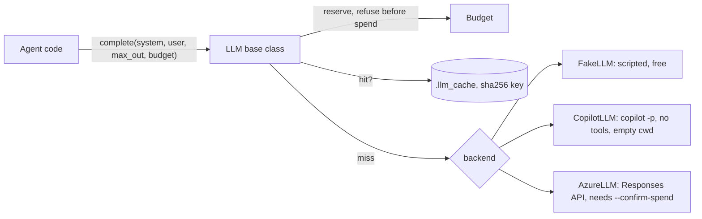

# 11 · LLM tool calling, from first principles

Code: `src/agent/llm.py`, `src/agent/tools.py`, `src/agent/prompts.py`

An LLM only produces text. For tool use I tell it in the prompt which tools exist and the exact JSON to request one. My
code parses the reply, runs the tool and pastes the result into the next prompt, until the model finishes.

```
system: "Tools: search(query, strategy). Reply with ONE JSON object: {...}"
user:   "Question: ...\nSearch 1 ('hybrid'): <results>"
model:  '{"action": "search", "query": "mortgage prepayment return", "strategy": "hybrid"}'
code:   parse_json → validate → tool(...) → append observation → call model again
```

Native function calling (OpenAI `tools=[...]`, Anthropic `tool_use`) is the same loop with the schema enforced
server-side. I use plain JSON text so one code path works for all three backends and every step is visible
([ADR 0008](adr/0008-json-action-protocol.md)). The assignment forbids frameworks such as LangChain for the loops.



## How I built it

`LLM.complete()` reserves budget for the worst case (prompt estimate + `max_output_tokens`), checks the cache
(`.llm_cache/<backend>/<sha256>.json`), then times the call and counts tokens. Cache hits report the original tokens, so
cost reflects the system and not my reruns, and reruns are deterministic and free. `parse_json()` pulls JSON out of code
fences and surrounding chatter with a brace scanner.

I never trust tool arguments: an unknown strategy becomes `"hybrid"`, doc ids are kept only if the agent saw them, and
garbage output falls back to the fused ranking. Every prompt starts with `ROLE: <name>`, shows the literal JSON format
and states hard limits.

| backend | what it is |
|---|---|
| `fake` | deterministic heuristic policies (`fake_policies.py`), for tests and cost estimates |
| `copilot` | GitHub Copilot CLI (claude-haiku-4.5) in prompt mode (`-p -s --available-tools --no-custom-instructions --disable-builtin-mcps`) in an empty temp dir, so it can't touch the repo; my free dev backend |
| `azure` | Foundry gpt-6-sol via `client.responses.create(model, instructions, input, max_output_tokens, reasoning)`, reasoning effort `low`, key only from `.env`; the final numbers |

The final results are in `results/agent_eval.json` (gpt-6-sol), with the haiku dev run as a comparison
([14](14_agent_evaluation_cost.md)). Each query there has a `trace` under `per_query` with the planner decision, the
actions and the errors.

Reasoning models bill hidden thinking as output tokens, so `max_output_tokens` has to cover it. A retrieved passage can
carry a prompt injection, but my only tool is read-only search, so tool output can never trigger a side effect.

Reference: Yao et al., *ReAct: Synergizing Reasoning and Acting in Language Models* (2022).
