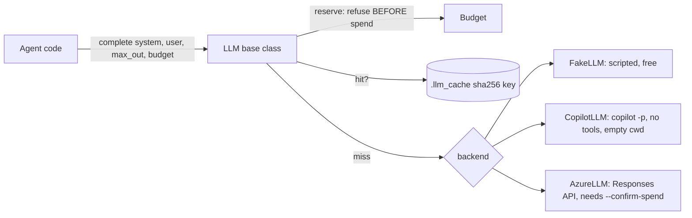

# 11 · LLM tool calling, from first principles

**Code:** `src/agent/llm.py`, `src/agent/tools.py`, `src/agent/prompts.py` · **Toys:** 20, 26

## 1. Intuition

An LLM only produces text. "Tool use" = we tell it, in text, which tools exist and the exact format
to request one. It replies with a request (e.g. JSON). **Our code** parses it, runs the tool, and pastes
the result back into the next prompt. Repeat until it says "done". Nothing more is needed.

## 2. The mechanics

```
system: "Tools: search(query, strategy). Reply with ONE JSON object: {...}"
user:   "Question: ...\nSearch 1 ('hybrid'): <results>"
model:  '{"action": "search", "query": "mortgage prepayment return", "strategy": "hybrid"}'
code:   parse_json → validate → tool(...) → append observation → call model again
```

"Native" function calling (OpenAI `tools=[...]`, Anthropic `tool_use`) is the same loop, with the
schema enforced server-side and the call returned in a structured field. We use plain JSON text so
**one code path** works across all three backends (fake, Copilot CLI, Azure) and is fully visible.
[ADR 0008](adr/0008-json-action-protocol.md).

## 3. Diagram: the LLM layer



## 4. How this repo implements it

- `LLM.complete()`: budget reservation (worst case = prompt estimate + max_output_tokens), cache lookup,
  timing and token accounting. Cache hits still report original tokens, so cost reflects the *system*.
- `parse_json()`: tolerant extraction (code fences, chatter before/after, escaped quotes) with a
  proper brace scanner. Doctest + unit test.
- **Never trust tool arguments**: unknown strategy → "hybrid"; returned doc ids are kept only if the
  agent actually saw them; garbage output → fall back to the fused ranking.
- **Backends.** `fake`: deterministic heuristic policies (`fake_policies.py`). `copilot`: the GitHub
  Copilot CLI in prompt mode (`-p -s --available-tools --no-custom-instructions --disable-builtin-mcps`),
  run in an empty temp dir, so it's a plain text model that can't touch the repo. `azure`: the Foundry
  deployment via `client.responses.create(model, instructions, input, max_output_tokens, reasoning)`. The
  key comes only from `.env` and is never logged.
- Prompts start with `ROLE: <name>`, show the literal JSON format, and state hard limits.

## 5. Run the toys

```bash
python examples/20_tool_calling_loop.py   # the loop with a scripted model, every turn printed
python examples/26_cost_accounting.py     # token -> $ arithmetic, why transcripts grow
```

## 6. Observe it in the real system

`python scripts/agent_eval.py --backend fake --limit 5` and open `results/agent_eval_dev_fake.json →
per_query`: every query has a `trace` with the planner decision, the actions and the errors.

## 7. Pitfalls and interview questions

- **Prompt injection via tool results**: a retrieved passage saying "ignore previous instructions…" lands
  in the prompt. Mitigations: delimit observations, never let tool output choose tools with side effects.
  Our only tool is read-only search, which limits the blast radius.
- **Non-determinism**: even temperature 0 isn't bit-exact across API versions. The cache makes *our* reruns deterministic.
- **Reasoning tokens**: reasoning models bill hidden "thinking" as output tokens, so `max_output_tokens` must cover them.
- *Q: Why not LangChain/LangGraph?* The assignment forbids it for loops, and the loop is 40 lines. A
  framework would hide exactly the parts the debrief asks about.

## 8. Exercises

1. (Concept) What is the difference between JSON-mode, structured outputs and function calling?
2. (Predict) What does `parse_json('{"a": "}"}')` return? Why is a naive regex wrong?
3. (Do) Add an `AzureLLM` option that uses native `tools=[...]`. Keep the JSON path as the fallback.
4. (Do) Add a second tool, `get_passage(doc_id)`. When would an agent use it? Does it help on FiQA?

Solutions: [solutions/11_tool_calling.md](solutions/11_tool_calling.md)

## 9. Further reading

- Yao et al., *ReAct: Synergizing Reasoning and Acting in Language Models* (2022)
- Schick et al., *Toolformer* (2023)
- OpenAI Responses API docs: function calling, structured outputs
- Simon Willison, *Prompt injection* series
