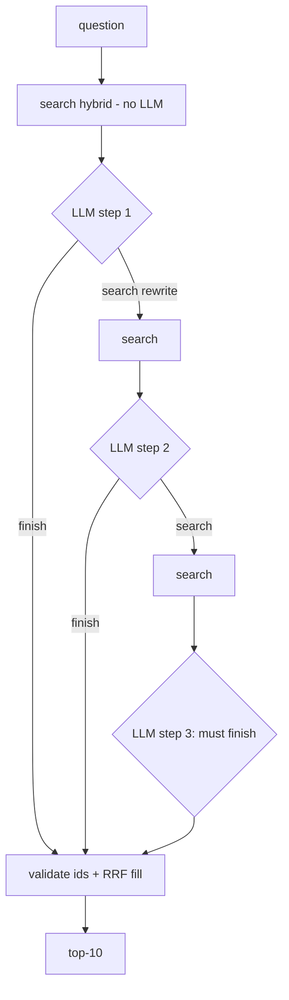

# 12 · The single agent

**Code:** `src/agent/single_agent.py`, `src/agent/prompts.py::SINGLE_AGENT` · **Toys:** 20, 21 · **Tests:** `tests/test_agents.py`

## 1. Intuition

A plain search sends the question once. An agent can look at the results, notice that half the
question is unanswered or the results drifted off-topic, **rewrite** the query, and search again.
Then it picks the best 10 passages from everything it saw.

## 2. The mechanics: the loop

```
step 0 (free):  results₁ = search(question, "hybrid")                  # ground the first decision
step 1..3:      action = LLM(SYSTEM, question + all results so far)     # exactly 1 LLM call per step
                search  → results_n = search(action.query, action.strategy)   (if steps remain)
                finish  → chosen ids (validated against "seen")
                last step → the prompt says "you MUST finish"
final top-10 = chosen ids  ++  RRF(results₁, results₂, …) fill, deduplicated
```

## 3. Diagram



## 4. How this repo implements it, and why

| choice | alternative | why |
|---|---|---|
| search *before* the first LLM call | let the LLM write the first query | saves 1 call on easy queries; the LLM decides with evidence |
| cap = 3 LLM calls (assignment) | – | – |
| model returns doc ids | model returns only "done" | lets the LLM act as a light reranker, but ids are **validated** |
| RRF fill over all searches | concatenate lists | balanced across rewrites; with 2 searches it interleaves the halves |
| any error → stop and use what we have | raise | an agent must degrade, not 500 |

Snippets shown to the model: 200 chars × 10 hits per search (~550 tokens per search).

## 5. Run the toys

```bash
python examples/20_tool_calling_loop.py
python examples/21_query_rewrite_agent.py     # the real run_single_agent with a scripted model
```

## 6. Observe it in the real system

`results/agent_eval_dev_copilot.json` (free dev backend, haiku) and `results/agent_eval.json` (Azure gpt-6-sol, your run).
DESIGN.md §7 tabulates both. On Azure the single agent was the best system on quality: plain R@10 0.547 / MRR 0.642 (baseline
0.502 / 0.485), compound R@10 0.400 / Coverage 0.40, at 2–3 calls, 2–3.4K tokens and a 4–6 s p50 per query.
Look at `per_query[...].trace` to see the actual rewrites.

## 7. Pitfalls and interview questions

- **Transcript growth**: step n re-sends n result blocks, so tokens grow ~quadratically with steps (toy 26).
- **LLM-as-reranker on 200-char snippets** can *hurt or help*, depending on the model. With claude-haiku-4.5 it hurt plain
  MRR (0.485 → 0.432), because it judged on less text than the retriever saw. With gpt-6-sol it helped a lot (0.485 → 0.642,
  0 recall losses on 100 plain queries). Always measure with the model you'll ship.
- **Over-searching**: models like to "be thorough". Each extra search costs latency and tokens; the
  prompt says to search again only if part of the question is missing.
- *Q: How would you make it cheaper?* Smaller model for the decision, shorter snippets, skip the LLM
  entirely when the first-search top score is high (confidence gating).

## 8. Exercises

1. (Concept) Why does step 0 not count as one of the 3 steps? Is that within the assignment's rules? Argue.
2. (Predict) On plain FiQA queries, will the agent beat plain hybrid? Check your prediction in DESIGN.md.
3. (Do) Make the agent finish with `doc_ids: []` always (pure RRF). Compare recall and MRR vs letting it choose.
4. (Do) Add confidence gating: skip the LLM if top-1 hybrid score > τ. Tune τ on dev.

Solutions: [solutions/12_single_agent.md](solutions/12_single_agent.md)

## 9. Further reading

- Yao et al., *ReAct* (2022) · Ma et al., *Query Rewriting for Retrieval-Augmented LLMs* (2023)
- Anthropic, *Building effective agents* (2024): workflows vs agents
