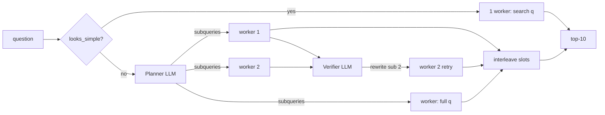

# 13 · Multi-agent orchestration

Code: `src/agent/orchestrator.py`. Tests: `tests/test_agents.py`

Compound questions ("how does shorting work, and should I prepay my mortgage?") need two different searches; one search
over the whole question finds one half or neither. So I split the work into roles. A planner decides whether and how to
split, workers search each sub-query in parallel, a verifier checks each sub-query's results and may ask for one
re-search, and an orchestrator in plain code enforces budgets, timeouts and the 10 result slots.

```
budget = Budget(max_llm_calls=3, max_tokens=8000)              # shared by every agent for THIS query
if looks_simple(q):  subs = [q]                                # free gate: 0 LLM calls
else:                subs = planner(q)  (or [q] if it says simple, fails or over budget)
lists = parallel_workers(subs + [q if decomposed])  with per-worker timeout
if decomposed: fixes = verifier(top-5 snippets per sub)  → re-search those subs once
top10 = interleave(sub lists) then fill from the full-question list
```



## Why these roles ([ADR 0009](adr/0009-agent-roles.md))

| role | LLM? | why it exists | why I didn't merge it |
|---|---|---|---|
| Orchestrator | no | budgets, timeouts and slots must be deterministic and testable | an LLM orchestrator costs calls and can loop |
| Planner | yes | decomposition needs language understanding | decomposing inside the single agent means a bigger prompt and worse decisions |
| Workers | no | the planner already wrote the queries; parallel latency is the max of the searches | an LLM per worker adds a call per sub-query |
| Verifier | yes | catches a sub-query that retrieved off-topic results | one batched call is cheaper than per-worker checks |

`looks_simple()` (≤ 12 words, no conjunction, comma or second "?") skips the planner for free, and the planner can
still answer "simple". The planner prompt demands standalone sub-queries, since "how is it taxed?" retrieves garbage.
For the slots ([ADR 0010](adr/0010-slot-allocation.md)) I interleave the sub-query lists round-robin, dedupe, then fill
from the full-question list. Scores from different sub-queries are not comparable, and a score merge let the easier half
take all 10 slots.

Guardrails: `Budget.reserve()` refuses a call before spending if the worst case could break the call or token cap. A
planner error means "simple", a verifier error skips verification, and a failed or timed-out worker (10 s each) is
dropped and recorded in `errors`; if all fail, I run one direct search. `test_orchestrator_partial_failure_still_returns_results`
has one worker raise and one sleep 2 s against a 0.5 s timeout, and still gets 10 results in under 1.9 s. Python threads
can't be killed, so the real deadline lives in the tool's HTTP timeout.

## Results

Final run on Azure gpt-6-sol (`results/agent_eval.json`):

| set | system | R@10 | MRR@10 | Cov@10 | calls/q | tokens/q | p50 / p95 s |
|---|---|---|---|---|---|---|---|
| plain | baseline | 0.502 | 0.485 | - | 0 | 0 | 0.06 / 0.08 |
| plain | multi | 0.481 | 0.466 | - | 0.51 | 130 | 0.03 / 3.59 |
| compound | baseline | 0.204 | 0.365 | 0.10 | 0 | 0 | 0.08 / 0.10 |
| compound | single | 0.400 | 0.609 | 0.40 | 2.70 | 3,380 | 5.75 / 9.28 |
| compound | multi | 0.355 | 0.518 | 0.32 | 2.00 | 925 | 3.40 / 4.75 |

On plain queries the gate kept 56 simple and the planner 37 more. It split 7, and on those recall fell from 0.824 to
0.514, which is the whole plain loss. On compound queries it decomposed all 100 and the verifier rewrote a sub-query in 16.

I expected multi-agent to win on compound questions. With gpt-6-sol the single agent did (R@10 0.400 vs 0.355, Coverage
0.40 vs 0.32), because its last step is an LLM rerank and a strong model reranks well, while the multi-agent's LLM only
splits and checks. Multi still wins on cost and tail latency: 925 vs 3,380 tokens, p95 4.75 vs 9.28 s. In the free haiku
dev run (`results/agent_eval_dev_copilot.json`) the two tied on compound (multi R@10 0.335 / Cov 0.26, single 0.327 / 0.29).

So I route compound questions to multi-agent under a tight latency or cost budget and to the single agent when quality
matters; simple questions, most of FiQA, go to plain hybrid (DESIGN.md §6.11).

Not built: a stricter split rule for the 7 false decompositions, and reserving about 3 slots for the full-question list
when a worker fails (today the surviving sub-query fills every slot).
