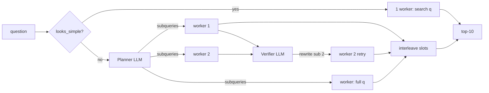

# 13 · Multi-agent orchestration

**Code:** `src/agent/orchestrator.py` · **Toys:** 22, 23, 24, 25 · **Tests:** `tests/test_agents.py`

## 1. Intuition

Compound questions ("how does shorting work, *and* should I prepay my mortgage?") need two
different searches. One search over the whole question finds passages about one half, or about
neither. Splitting the work into roles helps:
- a **planner** decides whether and how to split,
- **retrieval workers** run each sub-query in parallel,
- a **verifier** checks that each sub-query's results are on-topic and requests one re-search if not,
- an **orchestrator** (plain code) enforces budgets, timeouts and the final 10 slots.

## 2. The mechanics

```
budget = Budget(max_llm_calls=3, max_tokens=8000)              # shared by every agent for THIS query
if looks_simple(q):  subs = [q]                                # free gate: 0 LLM calls
else:                subs = planner(q)  (or [q] if it says simple, fails or over budget)
lists = parallel_workers(subs + [q if decomposed])  with per-worker timeout
if decomposed: fixes = verifier(top-5 snippets per sub)  → re-search those subs once
top10 = interleave(sub lists) then fill from the full-question list
```

## 3. Diagram



## 4. Why these roles ([ADR 0009](adr/0009-agent-roles.md))

| role | LLM? | why it exists | why not merged |
|---|---|---|---|
| Orchestrator | no | budgets, timeouts and slot allocation must be **deterministic and testable** | an LLM orchestrator costs calls and can loop |
| Planner | yes | decomposition needs language understanding | the single agent has to decompose *while* reading results: a bigger prompt, worse decisions |
| Workers | no | the planner already wrote good queries; search is a tool call. Parallel = latency ≈ max, not sum | an LLM per worker = +1 call per sub-query for little gain |
| Verifier | yes | catches the main failure: a sub-query that retrieved off-topic results | one *batched* call for all subs, cheaper than per-worker self-checks |

**Don't over-orchestrate.** `looks_simple()` (≤ 12 words, no conjunction/comma/second "?") skips
the planner for free, and the planner can still answer "simple". Toy 22 prints how often each fires
on the plain vs compound sets.

**Sharing the 10 slots** ([ADR 0010](adr/0010-slot-allocation.md), toy 25): round-robin interleave of
the sub-query lists (A1, B1, A2, B2, …), dedupe, then fill from the full-question list. Scores from different
sub-queries are not comparable, so a score merge lets the "easy" half take all 10 slots and Coverage@10 drops.

## 5. Guardrails and partial failure

- `Budget.reserve()` refuses a call *before* spending if it could exceed the call cap or the token cap
  (worst case = prompt + max_output_tokens). Thread-safe.
- Planner error/garbage → treat as simple. Verifier error/over budget → skip verification.
  Worker exception or timeout → drop that list and record it in `errors`. All workers failed → one
  direct search of the question.
- Proven by `test_orchestrator_partial_failure_still_returns_results` (one worker raises, one sleeps 2 s
  with a 0.5 s timeout: the answer arrives in < 1.9 s with 10 results and both errors reported).

## 6. Run the toys

```bash
python examples/22_planner_decompose.py   python examples/23_budget_guardrails.py
python examples/24_partial_failure.py     python examples/25_slot_allocation.py
```

## 7. Pitfalls and interview questions

- Threads can't be killed: a timed-out worker keeps running. Push deadlines into the tool (HTTP timeout).
- Sub-queries that aren't standalone ("how is *it* taxed?") retrieve garbage, so the planner prompt demands standalone queries.
- The verifier judges 200-char snippets. It can be fooled, and it only gets one retry.
- *Q: When is multi-agent NOT worth it?* Simple questions (most FiQA queries): it adds latency and cost for no recall gain. Hence the routing policy in DESIGN.md.
- *Q: Is multi-agent always better than one agent on compound questions?* No; it depends on the model. With haiku they tied
  (R@10 0.335 vs 0.327). With gpt-6-sol the single agent won (0.400 vs 0.355, Coverage 0.40 vs 0.32), because its final
  step is an LLM rerank and a strong model reranks well, while multi's LLM never ranks. Multi still wins on cost and tail
  latency: 925 vs 3,380 tokens per question, p95 4.7 s vs 9.3 s (DESIGN.md §7).

## 8. Exercises

1. (Concept) Why is the orchestrator not an LLM? Give two failure modes an LLM orchestrator adds.
2. (Predict) With 3 sub-queries, how many slots does each get? What happens to Recall@10 on 2-part questions if the planner over-splits into 3?
3. (Do) Make the verifier optional per query: call it only if a worker's top-1 score is below τ.
4. (Do) Replace the interleave with "interleave, then cross-encoder rerank the top 10". Measure Coverage@10 and MRR.

Solutions: [solutions/13_multi_agent.md](solutions/13_multi_agent.md)

## 9. Further reading

- Anthropic, *How we built our multi-agent research system* (2025): orchestrator-worker, token costs
- Khattab et al., *DSPy* / *Baleen* (multi-hop retrieval)
- Press et al., *Self-Ask* (decomposition)
