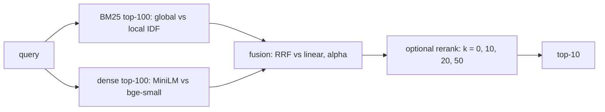

# 16 · Ablations: what I varied and what I learned

An ablation changes one part of the system while everything else stays fixed, then measures what that one change does
to quality and latency. I ran them to choose my operating point, and I tuned only on the dev split (500 queries); the
test split was run once, after every choice was frozen.

The configuration I chose: hybrid retrieval with BM25 + all-MiniLM-L6-v2, linear min-max fusion with α = 0.7, candidate
depth 100 per list, global BM25 statistics, and no reranker. Each section below shows which ablation supports which
part of that choice.



## 1. Fusion method and α

What I varied: the fusion rule (RRF or linear) and α, the weight on dense, for both dense models.

Why: BM25 and dense are far apart in quality (0.2642 vs 0.3881 nDCG@10 for MiniLM), and I wanted to know how much
say the weaker retriever should get.

α means something different in each rule (`src/retrieval/hybrid.py::fuse`):

- RRF: α is a list weight. score(d) = (1 − α)/(60 + rank_bm25(d)) + α/(60 + rank_dense(d)). Only ranks count, and
  α = 0.5 ranks exactly like textbook unweighted RRF.
- Linear: α is the dense weight after min-max normalising each list to [0, 1]. score(d) = α·dense'(d) + (1 − α)·bm25'(d).

`results/ablation_fusion_minilm.json`:

| method | alpha_dense | ndcg@10 | recall@10 | mrr@10 |
|---|---|---|---|---|
| rrf | 0.5 | 0.3733 | 0.442 | 0.4485 |
| rrf | 0.6 | 0.3865 | 0.4595 | 0.4608 |
| rrf | 0.7 | 0.3953 | 0.4768 | 0.4647 |
| rrf | 0.8 | 0.4038 | 0.479 | 0.474 |
| rrf | 0.9 | 0.4062 | 0.4812 | 0.4794 |
| linear | 0.1 | 0.2871 | 0.3386 | 0.3486 |
| linear | 0.3 | 0.336 | 0.3872 | 0.4083 |
| linear | 0.5 | 0.4022 | 0.4672 | 0.473 |
| linear | 0.6 | 0.4179 | 0.4879 | 0.4884 |
| linear | 0.7 | 0.419 | 0.4914 | 0.4872 |
| linear | 0.8 | 0.4064 | 0.4771 | 0.4753 |
| linear | 0.9 | 0.4005 | 0.472 | 0.4694 |

`results/ablation_fusion_bge-small.json`:

| method | alpha_dense | ndcg@10 | recall@10 | mrr@10 |
|---|---|---|---|---|
| rrf | 0.5 | 0.3699 | 0.4359 | 0.4471 |
| rrf | 0.6 | 0.3843 | 0.4611 | 0.4601 |
| rrf | 0.7 | 0.3943 | 0.469 | 0.4735 |
| rrf | 0.8 | 0.4056 | 0.4798 | 0.487 |
| rrf | 0.9 | 0.4082 | 0.475 | 0.4936 |
| linear | 0.1 | 0.2875 | 0.3367 | 0.3507 |
| linear | 0.3 | 0.3339 | 0.3857 | 0.4097 |
| linear | 0.5 | 0.3931 | 0.4597 | 0.4746 |
| linear | 0.6 | 0.4108 | 0.4795 | 0.4948 |
| linear | 0.7 | 0.4155 | 0.4856 | 0.4953 |
| linear | 0.8 | 0.4083 | 0.4744 | 0.492 |
| linear | 0.9 | 0.4038 | 0.4709 | 0.485 |

What I concluded: linear at α = 0.7 is the best row for both models (0.419 MiniLM, 0.4155 bge-small), so I made it the
default ([ADR 0012](adr/0012-linear-fusion-default.md)). Textbook RRF (α = 0.5) scored below dense alone, 0.3733 vs
0.3881, and RRF kept improving as I shifted weight to dense, still ending below linear at its best (0.4062 at α = 0.9).

My explanation: RRF gives each list's rank 1 to 4 almost the same credit (1/61 to 1/64), so it can't tell a close
cosine race from a clear winner, and at equal weights the much weaker BM25 list gets as many votes as dense. Linear
keeps score magnitudes and lets α encode the quality gap. The curve also shows that BM25 still adds something: linear
rises from 0.4005 at α = 0.9 to 0.419 at α = 0.7, then falls quickly once BM25 dominates (0.336 at α = 0.3). The peak
sits at the same α for both models, which made me more confident that 0.7 is not a fluke of one model. It was still
picked on dev, so the dev numbers are optimistic; on test the chosen config scored 0.3968.

## 2. Reranking depth

What I varied: a cross-encoder (`cross-encoder/ms-marco-MiniLM-L-6-v2`) reranking the top k of the first stage, with
k ∈ {10, 20, 50}. The first stage stayed fixed at MiniLM, linear fusion, α = 0.7.

Why: two-stage retrieval with a cross-encoder is the standard way to buy quality with latency, and I wanted to know if
FiQA was worth the cost.

`results/ablation_rerank_minilm.json` (`first_stage`: fusion linear, alpha 0.7):

| rerank_k | ndcg@10 | recall@10 | mrr@10 | p50_ms | p95_ms |
|---|---|---|---|---|---|
| 10 | 0.4058 | 0.4914 | 0.4688 | 338.6 | 366.8 |
| 20 | 0.3964 | 0.4829 | 0.4634 | 621.0 | 634.6 |
| 50 | 0.3771 | 0.4633 | 0.4444 | 1246.3 | 1366.6 |

Without reranking the same first stage scores 0.419 / 0.4914 / 0.4872 at 20.73 / 24.54 ms
(`results/bench.json → hybrid-linear-minilm`).

What I concluded: no reranker. Every depth lowered nDCG, deeper was worse, and even k = 10 is far past the 50 ms
budget.

My explanation: at k = 10 recall is identical by construction (the same 10 docs), so the lower nDCG means the
cross-encoder orders them worse than fusion did. With deeper k it pulls docs from ranks 11 to k above true answers, so
recall drops as well. The model was trained on short MS MARCO web passages, while FiQA answers are long forum posts cut
to 256 tokens. Latency grows linearly with k, at about 29 ms per pair on this CPU. More in [06](06_reranking.md).

## 3. Dense model: MiniLM vs bge-small

What I varied: the embedding model, alone and inside the chosen hybrid (linear, α = 0.7).

Why: bge-small-en-v1.5 is the stronger model on MTEB, but it has 12 layers to MiniLM's 6.

`results/bench.json` (single node, dev):

| config | ndcg@10 | recall@10 | mrr@10 | warm p50_ms | warm p95_ms |
|---|---|---|---|---|---|
| dense-minilm | 0.3881 | 0.4665 | 0.4532 | 18.82 | 20.81 |
| dense-bge-small | 0.3981 | 0.4681 | 0.4773 | 30.62 | 34.15 |
| hybrid-linear-minilm | 0.419 | 0.4914 | 0.4872 | 20.73 | 24.54 |
| hybrid-linear-bge-small | 0.4155 | 0.4856 | 0.4953 | 35.26 | 40.31 |

What I concluded: MiniLM. bge-small wins by +0.010 nDCG on its own, but inside the hybrid it is 0.0035 lower and about
15 ms slower at p50. Through the router, my chosen config already has a p95 of 40.5 ms against a 50 ms budget.

My explanation: much of what bge-small adds over MiniLM is lexical precision, and BM25 already supplies that in the
hybrid. bge-small does have the better MRR in both rows, so it puts a first good answer higher more often; I traded that
for latency. It stays in the system as the migration target ([10](10_model_migration.md)).

## 4. Global vs shard-local BM25 statistics

What I varied: whether the router runs the DFS phase that sums df, N and total length across shards before searching
(global IDF), or each shard scores with its own statistics (local IDF). Both runs are 3 shards through the router.

Why: the DFS phase is an extra round trip on every query, so I wanted to see what it buys.

`results/bench.json`:

| config | ndcg@10 | recall@10 | mrr@10 | warm p50_ms | warm p95_ms |
|---|---|---|---|---|---|
| svc3-bm25 (global) | 0.2642 | 0.3135 | 0.3222 | 10.69 | 11.51 |
| svc3-bm25-localidf | 0.2653 | 0.3142 | 0.3226 | 6.75 | 7.41 |

`scripts/bench.py` switches this run to local stats with the `BM25_STATS=local` environment variable, so the `config`
block stored in the JSON still shows the CLI default `"bm25_stats": "global"`.

What I concluded: I kept global statistics, at about 4 ms of p50.

My explanation: I hash-partition by `crc32(doc_id)`, so each shard is a random third of the corpus and its local df is
close to a third of the global df. The IDFs come out nearly the same, and the 0.0011 nDCG difference is noise. I still
pay for DFS because it makes the sharded system score exactly like a single node (0.0% difference, against a 1%
requirement), and it stays correct if shards ever become skewed ([ADR 0004](adr/0004-dfs-global-stats.md)).

## 5. Stratified recall: query length and long gold passages

What I varied: nothing new. `src/eval.py` splits Recall@10 of each config by query length and by whether the gold
passage is among the 10% longest docs, so I can see where each retriever fails.

`results/bench.json`, Recall@10 (n per group in the header):

| config | short < 5 (13) | medium 5 to 15 (403) | long > 15 (84) | gold in longest 10% (185) | gold not longest (315) |
|---|---|---|---|---|---|
| bm25 | 0.2308 | 0.3159 | 0.3148 | 0.3104 | 0.3153 |
| dense-minilm | 0.4231 | 0.4705 | 0.4543 | 0.414 | 0.4974 |
| dense-bge-small | 0.3846 | 0.4604 | 0.518 | 0.4215 | 0.4955 |
| hybrid-rrf-minilm | 0.3077 | 0.4428 | 0.4589 | 0.4197 | 0.4551 |
| hybrid-linear-minilm | 0.3846 | 0.4911 | 0.5096 | 0.4636 | 0.5078 |
| hybrid-linear-bge-small | 0.3077 | 0.4793 | 0.5432 | 0.4471 | 0.5082 |

What I concluded: long gold passages are mainly a dense problem. Dense MiniLM loses 8 points on them (0.414 vs 0.4974)
while BM25 is nearly flat (0.3104 vs 0.3153), and linear fusion recovers part of the gap (0.4636). bge-small is clearly
better on long queries (0.5432 vs 0.5096 in hybrid), but those are 84 of 500 queries and medium queries, 403 of 500,
favour MiniLM. The short-query group has 13 queries, too few to read anything into.

My explanation: the dense models truncate passages at 256 tokens, so the answer at the end of a long post is
invisible to them, while BM25 sees every token.

## How to reproduce

```bash
make ablations
# which runs:
python scripts/ablations.py --model minilm               # results/ablation_fusion_minilm.json
python scripts/ablations.py --model bge-small            # results/ablation_fusion_bge-small.json
python scripts/ablations.py --model minilm --rerank      # results/ablation_rerank_minilm.json (k = 10,20,50)

make bench                                               # python scripts/bench.py -> results/bench.json
```

The fusion sweep retrieves the BM25 top-100 and dense top-100 once per dev query and recomputes every fusion variant
offline, which gives the same lists the router would fuse at a fraction of the cost. The rerank sweep runs real
searches through a single-node router and times each one.
