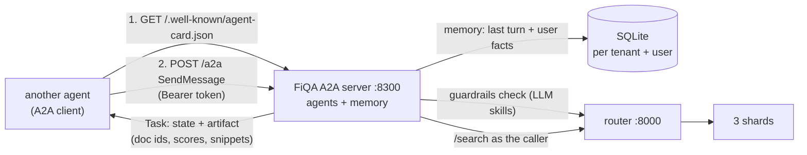

# A2A and agent memory

This page covers two additions on top of the agents:

1. **A2A (Agent2Agent protocol 1.0).** The FiQA agents run as an A2A server. Any agent that speaks A2A can find
   them from an agent card, send them a question as a task, and read the passages back. I also wrote a client,
   and a coordinator agent that splits compound questions and delegates each part over A2A.
2. **Agent memory.** The agents remember the turns of a conversation (short-term) and facts about the user
   (long-term). Memory follows the same privacy rules as the retrieval service: identified users only, PII
   redacted before it is stored, per-user isolation, an expiry date, and an API to read and delete it.

The concepts, with toy examples you can run, are in
[docs/topics/20_a2a_and_memory.md](../topics/20_a2a_and_memory.md). Code: `src/a2a/` (protocol, server, client)
and `src/agent/memory.py`.



## Contents

- [Quick start](#quick-start)
- [1. The A2A server](#1-the-a2a-server)
- [2. Calling it](#2-calling-it)
- [3. Memory](#3-memory)
- [4. Results](#4-results)
- [5. How it is checked](#5-how-it-is-checked)
- [6. Pitfalls and what I would do next](#6-pitfalls-and-what-i-would-do-next)

## Quick start

With the stack running (`docker compose up -d`):

| I want to | command |
|---|---|
| start the A2A server (fake LLM, free) | `python -m src.a2a.server --router http://localhost:8000` (port 8300) |
| start it with Azure for the LLM skills | add `--backend azure --confirm-spend` |
| read the agent card | `curl localhost:8300/.well-known/agent-card.json` or `python -m src.a2a.client --card` |
| ask a question | `python -m src.a2a.client "what is a roth ira?"` (skill `retrieve`) |
| ask with an LLM agent | `python -m src.a2a.client "should I pay off my mortgage early?" --skill single` |
| continue a conversation | add `--context <the contextId the first answer printed>` |
| tell it a fact about me | `python -m src.a2a.client --remember "I live in Canada" --token $(python -m scripts.mint_token alice)` |
| see / delete my memory | `curl -H "Authorization: Bearer $TOKEN" localhost:8300/memory`, `curl -X DELETE ...` |
| run the end-to-end demo | `python scripts/a2a_demo.py` (starts its own A2A server) |
| measure memory | `python scripts/memory_eval.py` (`--confirm-spend --llm-rewrite` for the LLM variant) |

Server options and environment:

| option / variable | default | what it sets |
|---|---|---|
| `--router` / `ROUTER_URL` | `http://localhost:8000` | the retrieval service the agents search |
| `--port`, `--host` | 8300, 127.0.0.1 | where the A2A server listens |
| `--public-url` | `http://<host>:<port>` | the URL written into the agent card (set it behind a proxy) |
| `--backend` | `fake` | LLM for `single`, `multi`, `cascade`: `none`, `fake`, `copilot`, `azure` |
| `--memory-db` / `MEMORY_DB` | `a2a_memory.sqlite` | the memory file; `off` disables memory, `:memory:` keeps it in RAM |
| `MEMORY_TTL_DAYS` | 30 | how long a memory entry lives |
| `A2A_AGENT_URL`, `FIQA_TOKEN` | `http://localhost:8300`, none | defaults for the client |

## 1. The A2A server

`src/a2a/server.py` is a separate FastAPI service in front of the router. The router stays a retrieval API, and
the A2A server owns the LLM, the agents and their memory. It searches by calling the router's `/search` with the
caller's bearer token, so the tenant filter, PII redaction, guardrails and audit of
[SECURITY.md](../topics/17_security.md) apply to the agents unchanged.

**The agent card** (`GET /.well-known/agent-card.json`) names one interface, JSON-RPC at `/a2a` with protocol
version 1.0, a Bearer security scheme, and four skills:

| skill | what runs | LLM calls |
|---|---|---|
| `retrieve` (default) | hybrid search of the question | 0 |
| `single` | the single agent ([12_single_agent.md](../topics/12_single_agent.md)) | 1 to 3 |
| `multi` | planner, parallel workers, verifier ([13](../topics/13_multi_agent_orchestration.md)) | 0 to 2 (simple questions skip the planner) |
| `cascade` | cheap tier, escalating to the single agent ([LLM_OPTIMIZATIONS.md](LLM_OPTIMIZATIONS.md)) | 1 to 4 |

The card has `Cache-Control: max-age=300` and an `ETag`; a client that sends `If-None-Match` gets 304.

**JSON-RPC methods** (POST `/a2a`, header `A2A-Version: 1.0`):

| method | what it does |
|---|---|
| `SendMessage` | starts a task for the message's text. `metadata`: `skill`, `k` (1 to 50), `memory` (false opts out). `configuration.returnImmediately: true` returns at once in state WORKING; otherwise it waits for the result |
| `GetTask` | the task by id, with `historyLength` messages of history |
| `ListTasks` | the caller's tasks, filtered by `contextId` and `status`, paged with `pageSize` / `pageToken` |
| `CancelTask` | cancels a task that has not finished; a finished task answers -32002 |
| `SendStreamingMessage`, `SubscribeToTask`, `GetExtendedAgentCard` | -32004 (the card says streaming is off) |
| push-notification methods | -32003 |

**A task, step by step.**

1. The server identifies the caller from the token. With no token the caller is anonymous: it works, but gets no
   memory.
2. Memory stores any fact in the message ("I live in Canada"). It then builds the query to search: the last turn of
   the same `contextId` if the question is a follow-up, plus the user's country fact.
3. For LLM skills, the router's guardrails check the question first. A refused question becomes
   `TASK_STATE_REJECTED` and the LLM never sees it.
4. The skill runs. The task gets one artifact, `passages`, with a JSON part
   (`{"doc_ids": [...], "hits": [{"doc_id", "score", "snippet"}]}`) and a one-line text part. The task's
   `metadata` holds what memory changed (`memory.query_searched`, `turn_used`, `facts_used`), the LLM calls,
   the estimated cost and the latency.
5. Memory stores the turn, PII-redacted, under the task's `contextId`.

Errors from the router become task states: 401 is `TASK_STATE_AUTH_REQUIRED`; 403 and 429 are `TASK_STATE_REJECTED`;
anything else is `TASK_STATE_FAILED`, with the reason in the status message.

**Ownership.** A task belongs to the caller who created it (`tenant/user`, or `anonymous`). For anyone else,
`GetTask` and `CancelTask` answer -32001 "Task not found", exactly like a missing id, so the error doesn't reveal
that the task exists (spec section 3.3.2).

## 2. Calling it

With the client (it reads the card first and uses the interface the card names):

```python
from src.a2a.client import A2AClient, doc_ids

c = A2AClient("http://localhost:8300", token=None)            # token: scripts/mint_token.py, for memory
print(c.skills)                                               # ['retrieve', 'single', 'multi', 'cascade']
task = c.send("what is a roth ira?", skill="retrieve", k=5)
print(task["status"]["state"], doc_ids(task))                 # TASK_STATE_COMPLETED [...]
follow = c.send("can I withdraw from it early?", context_id=task["contextId"])
t = c.send("should I pay off my mortgage early?", skill="single", wait=False)   # returns at once
t = c.wait(t["id"])                                           # polls GetTask until it is done
```

Or raw JSON-RPC:

```bash
curl -X POST localhost:8300/a2a -H "Content-Type: application/json" -H "A2A-Version: 1.0" -d '{
  "jsonrpc": "2.0", "id": 1, "method": "SendMessage",
  "params": {"message": {"messageId": "m1", "role": "ROLE_USER",
                         "parts": [{"text": "what is a roth ira?"}], "metadata": {"skill": "retrieve", "k": 3}}}}'
```

The answer is `{"jsonrpc": "2.0", "id": 1, "result": {"task": {...}}}`: `id`, `contextId`,
`status.state = "TASK_STATE_COMPLETED"`, `artifacts[0].parts[0].data.doc_ids`, the message in `history`, and
`metadata`. Without the `A2A-Version` header the server answers -32009: the spec says a missing header means
version 0.3, which this server doesn't speak.

## 3. Memory

`src/agent/memory.py` keeps two kinds of entries in one SQLite table, keyed by tenant and user:

| kind | what | written when | used for |
|---|---|---|---|
| `turn` | a question the user asked, with the doc ids it got, under its `contextId` | a task completes | a follow-up in the same conversation is searched together with the last turn |
| `fact` | something about the user, e.g. "I live in Canada" | the message says it ("I live in", "I'm from", "I moved to", ...), the client sends `remember`, or `POST /memory` | the country is added to every search that doesn't already name it |

**When is a question a follow-up?** `needs_context` looks for words that point back (it, that, they, their, one,
each, ...) or an opening like "what about". On the generated follow-ups below it flagged 97%. Only the last turn is
used, and only for the search: the LLM still sees the question as asked plus the search results.

**Privacy rules.**

- Only identified callers have memory. An anonymous caller has nobody to attribute memory to, and nobody who could
  ask to see or delete it.
- Text is PII-redacted before it is stored: "my email is jane.doe@example.com" is kept as "my email is [EMAIL]".
- Every read filters on (tenant, user); no query crosses users.
- Entries expire after `MEMORY_TTL_DAYS` (30) and are purged on the next write.
- A new country fact replaces the old one (people move).
- `memory: false` in a message's metadata turns memory off for that message.

**The memory API** (REST on the A2A server; A2A itself has no memory API). Each call needs the user's token and
only ever touches that user's entries:

| request | what it does |
|---|---|
| `GET /memory` | everything kept about me, oldest first |
| `POST /memory {"text": "I live in Canada"}` | remember a fact |
| `DELETE /memory/{id}` | forget one entry |
| `DELETE /memory` | forget everything |

## 4. Results

### Delegation over A2A

`scripts/a2a_demo.py` (`results/a2a_demo.json`) runs a coordinator agent over the 100 compound questions. For each
question it sends the whole question as one A2A task, then splits it with the rule-based splitter
(`fake_policies.split_question`), sends each part as its own task in the same `contextId`, and fuses the parts'
results with reciprocal rank fusion. All tasks use the `retrieve` skill, so no LLM is involved.

| | Coverage@10 on the compound set |
|---|---|
| whole question, one task | 0.11 |
| split by the coordinator, one task per part (2.14 parts on average) | **0.34** |
| for comparison: the single agent / multi-agent in-process (`results/agent_eval.json`) | 0.40 / 0.32 |

314 A2A tasks took 21.1 s against the Docker router: about 67 ms a task, of which the router's search with passage
text is about 80 ms at p50 when measured on its own. (My first version made a new HTTP client per task and took
137 s; reusing one client per token fixed it.)

The rest of the demo, on the live stack:

- alice says "I live in Canada. What is the best account to save for retirement?"; her follow-up "can I take money
  out of it early?" is searched together with that question; in a new conversation "how are capital gains taxed?"
  is searched as "how are capital gains taxed? Canada";
- bob's `GetTask` on alice's task answers "Task not found", and his search of the same question has nothing added;
- `GET /memory` shows alice 4 entries (1 fact, 3 turns), and `DELETE /memory` removes all 4.

An Azure run through A2A (`results/a2a_llm_check.json`): the `cascade` skill completed "what is a roth ira?" with
4 LLM calls, $0.003. With the router's `guard_harmful` toggle set to `block`, the `single` skill answered a
structuring question with `TASK_STATE_REJECTED` "refused by the guardrails (structuring); no LLM call was made".

### Conversation memory: follow-up questions

`scripts/memory_eval.py` (`results/memory_eval.json`). Azure split each of the 100 plain dev questions into a first
message that sets the topic and a follow-up that only makes sense after it (`data/followups_plain.jsonl`), e.g.

> Q: Why is gold not a good investment?
> first: "I'm thinking about investing in gold."  follow-up: "Why might it not be a good investment?"

Together the two ask the original question, so its relevance labels still apply. Hybrid search, minilm-ft:

| what is searched | R@10 | nDCG@10 |
|---|---|---|
| the original question (upper bound) | 0.491 | 0.429 |
| the follow-up alone (no memory) | 0.103 | 0.089 |
| memory rule: last turn + follow-up when `needs_context` fires | 0.439 | 0.401 |
| always prepend the last turn | 0.444 | 0.407 |
| an LLM rewrites the follow-up into a standalone query (1 call) | 0.455 | 0.410 |

Without memory a follow-up loses four fifths of its recall. The free rule recovers most of it; the LLM rewrite
gains another 0.016 R@10 for one LLM call per follow-up. The rule's first version missed "one", "their" and "each"
and flagged 92% (R@10 0.421); adding them took it to 97% and 0.439.

### User memory: a country fact

Ten generic questions ("what retirement account should I open?", "how are capital gains taxed?", ...) for a user
whose memory says "I live in <country>". The measure is the share of the top 10 passages that mention the country
(its name or words such as RRSP, ISA, rupee, superannuation). It shows whether the results moved toward the
country, not whether they answer better; there are no labels for that.

| country | without the fact | with the fact |
|---|---|---|
| Canada | 8% | 54% |
| UK | 9% | 70% |
| India | 2% | 35% |
| Australia | 1% | 25% |

For "how do I file my income taxes?" with "I live in India", the top 3 change from US Form 1040 answers to "Since
you are living in India and earning income not from salary, you must file your tax return under ITR4..." and two
posts about Indian residents and US returns. It doesn't always help at the top: for "what retirement account should
I open?" with Canada, the top 4 hardly change, and the Canadian posts come in further down.

## 5. How it is checked

| what | where |
|---|---|
| card fields, ETag and 304; a retrieve task with its artifact; JSON-RPC errors (version, unknown method, bad params, bad JSON, batches, streaming, push); invalid token = 401 | `tests/test_a2a.py` |
| task ownership (bob and anonymous see "Task not found"); returnImmediately then poll; cancel, and a cancel that wins over a finishing task; a finished task can't take a new message; contextId mismatch | `tests/test_a2a.py` |
| LLM skill completes; guardrails refuse before any LLM call or search; no LLM configured = FAILED; router 401 / 403 / 429 / 500 = AUTH_REQUIRED / REJECTED / REJECTED / FAILED; concurrent tasks keep their own results | `tests/test_a2a.py` |
| memory: follow-up and fact change the search; bob and anonymous get nothing of alice's; per-message opt-out; export is redacted; forget one and all; expiry; a new country replaces the old; no identity, no memory | `tests/test_a2a.py`, doctests in `src/agent/memory.py` |
| A2A JSON shapes, client request shape | doctests in `src/a2a/protocol.py`, `src/a2a/client.py` |
| on the live stack and the real corpus | `scripts/a2a_demo.py`, `scripts/memory_eval.py` |

## 6. Pitfalls and what I would do next

- **Tasks live in the server's memory.** A restart loses them; production would keep them in a database, as memory
  already is.
- **No streaming or push notifications.** A long `multi` task can only be polled. SSE (`SendStreamingMessage`) is
  the next step for agents that take seconds.
- **The country rule is narrow.** Four countries and a regex. An LLM could extract facts of any kind (age, risk
  appetite, employer plan), with the same redaction and deletion rules; each new kind of fact needs its own check
  that it improves results.
- **Memory changes the search, not the question.** The LLM skills see the question as asked. Passing the facts
  into the prompt as well is easy, and is also where a stale or wrong memory would do the most harm.
- **The agent card is not signed.** A2A allows a JWS signature on the card, so a client can check it came from the
  claimed provider. Worth adding once the agent is reachable from outside one machine.
- **The A2A server is not in docker-compose.** It runs on the host next to the Docker router. A compose service
  under a profile would make it part of `docker compose up` without changing the default stack.
