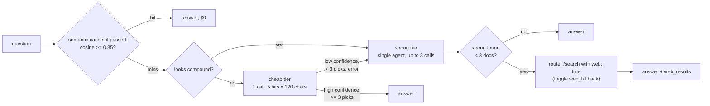

# LLM cost optimizations and the web fallback

The agents in Part C pay for every question with LLM tokens. This page covers four things I added to pay less, and one
for questions the corpus can't answer:

1. a **model cascade**: a cheap tier answers first, and only the questions it is unsure about go to the strong tier;
2. a **semantic cache**: a question that means the same as an earlier one gets the earlier answer, with no LLM call;
3. a **web search fallback**: when the corpus has nothing good, the router also asks Wikipedia;
4. **context trimming** in the cheap tier, and reporting of the provider's **prompt caching**.

Each section says how to use it, what I measured, and what I learned. The concepts, with toy examples, are in
[docs/topics/18_llm_cost_and_fallback.md](../topics/18_llm_cost_and_fallback.md). The web fallback is also a security
decision (the question leaves the system), so it has a toggle like the ones in [SECURITY.md](SECURITY.md).



## Contents

- [Quick start](#quick-start)
- [1. Model cascade](#1-model-cascade)
- [2. Semantic cache](#2-semantic-cache)
- [3. Web search fallback](#3-web-search-fallback)
- [4. Context trimming and prompt caching](#4-context-trimming-and-prompt-caching)
- [5. How it is checked](#5-how-it-is-checked)
- [6. Pitfalls and what I would do next](#6-pitfalls-and-what-i-would-do-next)

## Quick start

| I want to | command |
|---|---|
| ask one question through the cascade | `python scripts/ask.py "what is a roth ira?" --strategy cascade --backend azure --confirm-spend` |
| the same, with the web fallback | add `--url http://localhost:8000` and switch the toggle on (next row) |
| switch the web fallback on | `curl -H "Authorization: Bearer $(python -m scripts.mint_token admin)" -X POST localhost:8000/admin/security -H "Content-Type: application/json" -d '{"web_fallback": "on"}'` |
| evaluate the cascade (both tiers on every question) | `python scripts/agent_eval.py --backend azure --confirm-spend --systems cascade --cascade-shadow --out results/agent_eval_cascade.json` |
| compare escalation rules offline, no LLM calls | `python scripts/cascade_policies.py` |
| calibrate the semantic cache | `python scripts/semantic_cache_eval.py --confirm-spend` (the spend is 100 paraphrase calls, once) |
| measure the web fallback on the stack | `python scripts/web_fallback_eval.py` (restores the toggles) |
| try it in the browser | `http://localhost:8000/docs`, tour step 12 |

Environment variables:

| variable | default | what it sets |
|---|---|---|
| `CASCADE_CHEAP_BACKEND` | the `--backend` value | the cheap tier's LLM backend (`azure`, `copilot`, `fake`) |
| `CASCADE_CHEAP_DEPLOYMENT` | `AZURE_OPENAI_DEPLOYMENT` | the cheap tier's Azure deployment, e.g. a mini model |
| `CASCADE_CHEAP_PRICE_IN` / `_OUT` | $1 / $4 per 1M tokens | the cheap tier's prices, for the cost columns |
| `CASCADE_STRONG_PRICE_IN` / `_OUT` | $1 / $4 per 1M tokens | the strong tier's prices |
| `SEMANTIC_CACHE_MIN` | 0.85 | the cosine a cached question needs to count as a hit |
| `WEB_SEARCH_PROVIDER` | `wikipedia` | `wikipedia` (free, no key) or `fake` (tests, no network) |
| `WEB_FALLBACK_MIN` | the `guard_scope` threshold of the active model (0.4421 for minilm-ft) | best dense score below which the corpus counts as "no good answer" |

## 1. Model cascade

### What it does

Most questions are easy, and paying the strong configuration's price for each of them wastes money. The cascade
(`src/agent/cascade.py`) runs up to two tiers:

| tier | what it is | LLM calls |
|---|---|---|
| cheap | one call, no extra searches. It reads the question's hybrid top 5 with 120-character snippets, and its prompt (`SINGLE_AGENT_CHEAP`) also asks for a confidence, `high` or `low` | 1 |
| strong | the single agent exactly as before: top 10, 200-character snippets, up to 3 steps. The prompt is byte-identical to the single agent's, so its answers replay from the LLM disk cache | 1 to 3 |

Before the cheap tier runs, a free check (`looks_simple`, the same one the orchestrator uses) sends questions that
look compound straight to the strong tier. After it runs, the cascade escalates on the cheapest signal that fires:
`error`, `no finish`, `low confidence`, or `too few picks` (fewer than 3 valid ids). A wrong "keep" loses quality and
a wrong "escalate" only costs one strong run, so every rule leans toward escalating.

### How to use it

```
$ python scripts/ask.py "how do I fix a flat bicycle tire" --strategy cascade --backend azure --confirm-spend --url http://localhost:8000

tier cheap  (gpt-6-sol): 1 LLM call(s), 435 in + 45 out tokens, $0.00061, escalated: low confidence
tier strong (gpt-6-sol): 2 LLM call(s), 1896 in + 116 out tokens, $0.00236

final top 10 (3 searches, 8.7 s, total $0.00298):
 1. doc 122234: Wayshopy - Tech Mech Mechanical Vehicle Jack has Small compact design ...
 ...
the corpus has little on this question; from the web (wikipedia, sent: 'how do I fix a flat bicycle tire'):
   - Bicycle tire: A bicycle tire (tyre in Commonwealth English) is a tire that fits on the wheel of a bicycle ...
```

The same run on "what is a roth ira?" stops after the cheap tier (`kept`, 1 call, $0.00069). On "what is a 529 to
Roth IRA rollover" the cheap tier says `low confidence`, and the strong tier finds 10 relevant passages, so the web
is not asked.

In code, `run_cascade(question, cheap, strong, tool, cache=None, tenant=None, route_compound=True, shadow=False)`
returns an `AgentResult` whose `trace` has one entry per tier: tokens, dollars, picked ids and the escalation reason.
`default_tiers(cheap_llm, strong_llm)` builds the two tiers and `cascade_llms(backend, confirm)` reads the
`CASCADE_CHEAP_*` variables. `--no-route` in `agent_eval.py` switches the compound routing off.

To make the cheap tier really cheap, point it at a cheaper deployment and give both tiers their prices:

```bash
CASCADE_CHEAP_DEPLOYMENT=<a mini deployment> CASCADE_CHEAP_PRICE_IN=0.15 CASCADE_CHEAP_PRICE_OUT=0.6 \
  python scripts/ask.py "what is a roth ira?" --strategy cascade --backend azure --confirm-spend
```

I only have one Azure deployment (gpt-6-sol), so every number below has the same model in both tiers. The cheap
tier is cheaper only because it reads fewer tokens and makes one call.

### Results

Plain is the 100-question dev sample, compound the 100 compound questions; the strong-only row is the single agent
from `results/agent_eval.json`. Prices are the placeholder $1 / $4 per 1M tokens.

| | plain R@10 | plain $/q | compound R@10 | compound Cov@10 | compound $/q |
|---|---|---|---|---|---|
| strong only (single agent) | 0.547 | 0.00251 | 0.400 | 0.40 | 0.00393 |
| cascade v1 | 0.532 | 0.0044 | 0.373 | 0.34 | 0.0058 |
| cascade v2 (shipped) | 0.546 | 0.00240 | 0.400 | 0.40 | 0.00390 |

**Version 1 cost more than no cascade.** Its cheap tier was the single agent with trimmed context, allowed to search
again. With less to read it did search again: on 80 of the 100 plain questions it made 3 calls, about 1,676 tokens a
question. Its self-reported confidence was strict, so 74% of plain and 76% of compound questions escalated anyway,
and those paid for both tiers. Latency went up too: p50 5.67 s on plain, against the single agent's 4.09 s.

Version 2 changed three things: the cheap tier gets one call and no searches (about 500 tokens), the confidence
wording is plainer ("high" if the picked passages answer the question, "low" if they are only loosely related), and
compound questions skip the cheap tier. On plain, 75% still escalate: 44 routed as compound, 21 low confidence, 10
too few picks. Quality matches the single agent and the cost is 4% lower.

### Comparing rules offline

`--cascade-shadow` runs the tier that the rule skipped as well, marks it `"shadow": true` and keeps it out of every
total. With both answers recorded for every question, `scripts/cascade_policies.py` scores any rule on the same
answers, without another LLM call (`results/cascade_policies.json`). The what-if column reprices the cheap tier at
a tenth of the strong tier's price, the gap between a mini and a full model.

| rule (plain) | R@10 | MRR@10 | $/q | $/q, cheap tier at 1/10 price | to strong |
|---|---|---|---|---|---|
| strong only | 0.547 | 0.642 | 0.00251 | 0.00251 | 100% |
| cheap only | 0.502 | 0.525 | 0.00068 | 0.00007 | 0% |
| confidence (no routing) | 0.546 | 0.614 | 0.00214 | 0.00153 | 48% |
| picks only (ignore confidence) | 0.506 | 0.525 | 0.00088 | 0.00027 | 11% |
| route only | 0.517 | 0.594 | 0.00153 | 0.00120 | 44% |
| route + confidence (shipped) | 0.546 | 0.641 | 0.00240 | 0.00206 | 75% |
| oracle (better of the two, by recall) | 0.547 | 0.575 | 0.00094 | 0.00033 | 7% |

| rule (compound) | R@10 | Cov@10 | $/q | to strong |
|---|---|---|---|---|
| strong only | 0.400 | 0.40 | 0.00393 | 100% |
| cheap only | 0.204 | 0.10 | 0.00072 | 0% |
| confidence (no routing) | 0.384 | 0.38 | 0.00435 | 90% |
| route + confidence (shipped) | 0.400 | 0.40 | 0.00393 | 100% |

What the tables say:

- The self-reported confidence carries real signal. Ignoring it ("picks only") keeps 89% of plain questions on the
  cheap tier and loses 0.04 recall; using it recovers the strong tier's recall.
- The cheap tier finds the right documents nearly as often as the strong one (plain R@10 0.502 vs 0.547) but orders
  them worse (MRR 0.525 vs 0.642): one call can pick, but can't search again to check.
- Routing helps compound questions (the cheap tier alone halves their recall) and costs money on plain ones,
  because `looks_simple` calls 44% of plain questions compound. Without routing, plain costs $0.00214 instead of
  $0.00240 at the same recall, but compound then costs more than strong-only ($0.00435). Averaged over both sets
  the shipped rule is cheaper ($0.00317 vs $0.00325), so routing stays on.
- The oracle shows the ceiling: the strong tier is only needed for 7% of plain questions. A better escalation check
  is worth more than any other change here.
- With a genuinely cheaper tier-1 model, the same rules save much more: confidence-only would cost 39% less than
  strong-only on plain, at the same recall.

## 2. Semantic cache

### What it does

The LLM disk cache in `src/agent/llm.py` only hits on a byte-identical prompt. `SemanticCache`
(`src/agent/semantic_cache.py`) keys on the question's embedding instead: a new question whose cosine to a stored
one is at least `SEMANTIC_CACHE_MIN` gets the stored answer, with no LLM call and no search. It uses the query
encoder the search already runs. Entries carry the caller's tenant and only match the same tenant. It is in
memory, thread-safe and first-in-first-out once full.

### How to use it

```python
from src.agent.semantic_cache import SemanticCache
from src.retrieval.dense import get_embedder

emb = get_embedder("minilm-ft")
cache = SemanticCache(lambda q: emb.encode_queries([q])[0])        # threshold 0.85
cache.store("how do I roll my 401k into an IRA?", ["125973", "292937"], tenant="acme")
cache.lookup("how do I roll over my 401k to an IRA?", tenant="acme")  # {'value': [...], 'similarity': 0.935, ...}
cache.lookup("how do I roll over my 401k to an IRA?", tenant="globex")  # None: other tenant
cache.stats()                                                       # entries, hits, misses, hit_rate, threshold
```

Pass it to the cascade with `run_cascade(..., cache=cache, tenant="acme")`. A hit shows up as a `cache` entry in
the trace with 0 calls and $0; a fresh answer without errors is stored.

The cosine is only as good as the encoder. Against "how do I roll my 401k into an IRA?":

| question | cosine | at 0.85 |
|---|---|---|
| how do I roll over my 401k to an IRA? | 0.935 | hit, right |
| how do I roll my 401k into a Roth IRA? | 0.928 | hit, **wrong**: a Roth rollover is taxed differently |
| can I move my old 401(k) to an IRA? | 0.657 | miss, although it is the same question |
| should I pay off my mortgage early? | 0.108 | miss |

One changed word can change the answer and barely move the vector, while a real rephrasing can move it a lot. That
is why the threshold comes from a measurement and not from intuition.

### Choosing the threshold

`scripts/semantic_cache_eval.py` measures both sides (`results/semantic_cache_eval.json`):

- benefit: Azure rewrote the 100 plain questions in other words (`data/paraphrases_plain.jsonl`); with the 6,000
  train and dev questions in the cache, how many paraphrases find their original;
- harm: for every dev question, the nearest *different* question; at a threshold above that cosine it would be
  served someone else's answer. For those cases both result lists are scored against the asker's own labels.

| threshold | paraphrases that hit their original | paraphrases that hit a wrong question | dev questions with a false hit |
|---|---|---|---|
| 0.80 | 84% | 0% | 2.4% |
| **0.85** | **65%** | 0% | **0.8%** (4 of 500) |
| 0.88 | 48% | 0% | 0.4% |
| 0.90 | 40% | 0% | 0.2% |
| 0.95 | 14% | 0% | 0% |

I chose the rule before looking: the lowest threshold where at most 1% of dev questions get a false hit. That is
0.85. The 4 false hits there are near-duplicate FiQA questions, and the served results scored a little better than
the askers' own (nDCG@10 0.255 vs 0.211), so at this threshold the false hits did no measurable harm. My first guess,
0.95, would have kept only 14% of the benefit.

Fed the plain-set cascade answers, the cache at 0.85 answered 65 of the 100 paraphrases, saving 131 LLM calls and
$0.145 of the $0.240 the plain set cost, with the served answers at the originals' recall (0.596 on those 65).
That is an upper bound: every paraphrase here has its original in the cache, which real traffic won't.

## 3. Web search fallback

### What it does

When the corpus has no good answer, the router (`/search`) also asks a web provider and returns its results in a
separate `web_results` list, never mixed into `results`. It runs when the admin toggle `web_fallback` is on and one
of these holds:

| reason | when |
|---|---|
| `requested` | the caller sent `"web": true` (the cascade CLI does this when even the strong tier picked fewer than 3 docs) |
| `no results` | the search returned nothing |
| `low confidence` | the best dense score is below `WEB_FALLBACK_MIN` (by default the `guard_scope` threshold: about 1% of real dev questions fall below it) |

It never runs for a request a guardrail blocked: `guard_scope=block` means "off-topic, don't answer", and the web
would undo that decision.

The question leaves the system, so: the toggle is off by default and admin-only; the question is PII-redacted
before it is sent; every snippet that comes back goes through the injection neutraliser and PII redaction, whatever
those toggles say; and the audit log records the reason and the URLs.

### How to use it

Switch it on (admin token), then search as usual or with `"web": true`:

```bash
TOKEN=$(python -m scripts.mint_token admin)
curl -H "Authorization: Bearer $TOKEN" -X POST localhost:8000/admin/security \
     -H "Content-Type: application/json" -d '{"web_fallback": "on"}'
curl -X POST localhost:8000/search -H "Content-Type: application/json" \
     -d '{"query": "my email is jane.doe@example.com, what is a roth ira", "k": 3, "web": true}'
```

The response adds (a real response; latency varies):

```json
"web_results": [
  {"title": "Roth IRA", "url": "https://en.wikipedia.org/wiki/Roth_IRA",
   "snippet": "A Roth IRA is an individual retirement account (IRA) under United States law that is generally not taxed upon distribution, ...",
   "source": "web"},
  {"title": "Roth 401(k)", ...},
  {"title": "Individual retirement account", ...}],
"web_fallback": {"reason": "requested", "provider": "wikipedia", "query_sent": "what is a roth ira", "latency_ms": 663.5}
```

`query_sent` is what left the system. The email is gone, and so is the clause around it: the first version sent
"my email is [EMAIL], what is a roth ira", and Wikipedia answered with three pages on the 2016 election email hacks,
because "email" outweighed the question. `web_query` in `src/service/websearch.py` now drops every clause that held
personal data. A low-confidence call also reports the score that triggered it, e.g. for "how do I fix a flat bicycle
tire": `"top_dense": 0.382508, "minimum": 0.4421`. A snippet that had instruction-like text cut out carries
`"injection_removed": <count>`, and a provider failure adds `"error"`.

In `/docs`, tour step 12 and the search examples *Ask the web too*, *Web, with an email* and *Low confidence* do
the same.

The Wikipedia provider (`src/service/websearch.py`) asks the MediaWiki API for the top pages and each page's first
two intro sentences, in one request. Asking for the search snippets instead returned the text around the match,
which on finance pages was often the reference list ("Archived from the original on July 5, 2017..."). Wikimedia
answers 403 to a request without a descriptive User-Agent. Another provider (Tavily, Brave, Bing grounding) is one
class with the same `search` method.

### Results

`scripts/web_fallback_eval.py` on the Docker stack (`results/web_fallback_eval.json`):

| set | questions | fallback ran | web returned results | web latency p50 / max |
|---|---|---|---|---|
| FiQA dev questions (the corpus should answer these) | 500 | 5 (1%) | 4 | 834 / 905 ms |
| off-topic questions from the guardrail red team | 30 | 21 (70%) | 21 | 639 / 909 ms |
| finance questions newer than the corpus, `"web": true` | 10 | 10 | 10 | 664 / 4,743 ms |

The dev rate matches the threshold's design (the 1st percentile of real questions). The 9 off-topic questions that
did not fire score above the threshold; `guard_scope` uses the same threshold, so it lets the same 9 through.
Latency is the router's wait for the provider, added to the search only when the fallback runs. The 4.7 s maximum
was one slow Wikipedia answer; the router gives up after 5 s and returns the corpus results with an `error`.

## 4. Context trimming and prompt caching

**Trimming.** `run_single_agent` takes `max_hits`, `snippet_chars` and `dedupe`. The strong tier keeps the old
values (10 hits, 200 characters); the cheap tier uses 5 hits, 120 characters, and with `dedupe` a later search shows
only passages it hasn't shown yet. The cheap tier's one call reads about 442 input tokens a question; the strong
tier, like the single agent, uses about 2,118 tokens on a plain question over its calls. Trimming only saves money
if the model doesn't make up for it by searching more, which is what went wrong in cascade v1.

**Provider prompt caching.** Azure OpenAI bills a repeated prompt prefix at a discount once it is at least 1,024
tokens long. `AzureLLM` now reads `usage.input_tokens_details.cached_tokens`, `AgentResult.cached_input_tokens`
carries it, and `agent_eval.py` reports `avg_provider_cached_input_tokens`. In every run it was 0: the system prompt
plus the first search results are under 1,024 tokens, so no call had a long enough repeated prefix. It would start
to pay with a longer system prompt (few-shot examples, tool schemas) placed first and kept identical, with the
question and results after it.

## 5. How it is checked

| what | where |
|---|---|
| escalation reasons, routing, shadow entries outside the totals, prices per tier, the cheap tier reading less while the strong prompt stays byte-identical, provider cached tokens recorded | `tests/test_cascade.py` (fake LLM, no network) |
| the cascade as a strategy next to single and multi | `tests/test_agents.py` |
| semantic cache: same tenant only, a miss below the threshold; a hit skips every LLM call | doctests in `src/agent/semantic_cache.py`; `tests/test_cascade.py` |
| web fallback: off by default, `requested` and `low confidence` triggers, no trigger without a dense score, PII redacted and its clause dropped in `query_sent`, PII and injections cut from snippets, a guardrail block wins, audit entry with URLs | `tests/test_security_service.py` (fake provider, real cluster); doctests of `web_query` in `src/service/websearch.py` |
| `/docs` examples are valid request bodies | `tests/test_api_docs.py` |
| quality and cost on real questions | `results/agent_eval_cascade.json`, `results/cascade_policies.json`, `results/semantic_cache_eval.json`, `results/web_fallback_eval.json` |

## 6. Pitfalls and what I would do next

- **One model in both tiers.** The cascade's real saving needs a cheaper model in tier 1. Next: run it with a mini
  deployment and check the confidence calibration again, since a different model reports confidence differently.
- **Self-reported confidence.** It helped here, but a model can be confidently wrong. Two cheaper checks I'd try:
  agreement between the cheap tier's picks and the plain hybrid top 5, and the top dense score.
- **`looks_simple` over-routes.** 44% of plain questions look compound to it. A better check (the orchestrator's
  planner, or a tiny classifier) would cut the plain cost to the no-routing $0.00214 without hurting compound.
- **Semantic cache staleness.** A cached answer doesn't notice that the corpus changed. I would key entries on a
  corpus version that every write bumps, or expire them by age. The threshold also belongs to the encoder: re-run
  the eval after a model migration.
- **Web results are not ranked against the corpus.** They come back as a separate list, and nothing checks that the
  web text answers the question. An agent that writes answers would need to cite which source each claim came from.
- **Prices are placeholders** ($1 / $4 per 1M tokens), so read the dollar columns as ratios between rows.
