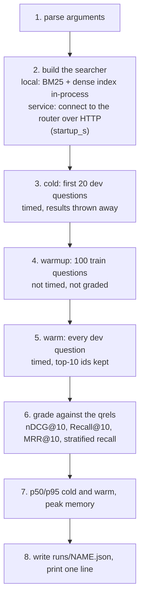
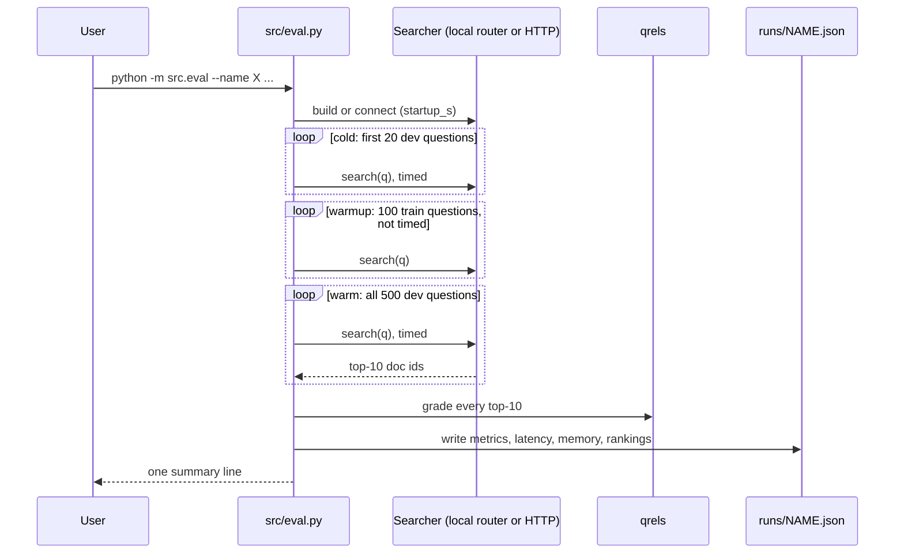
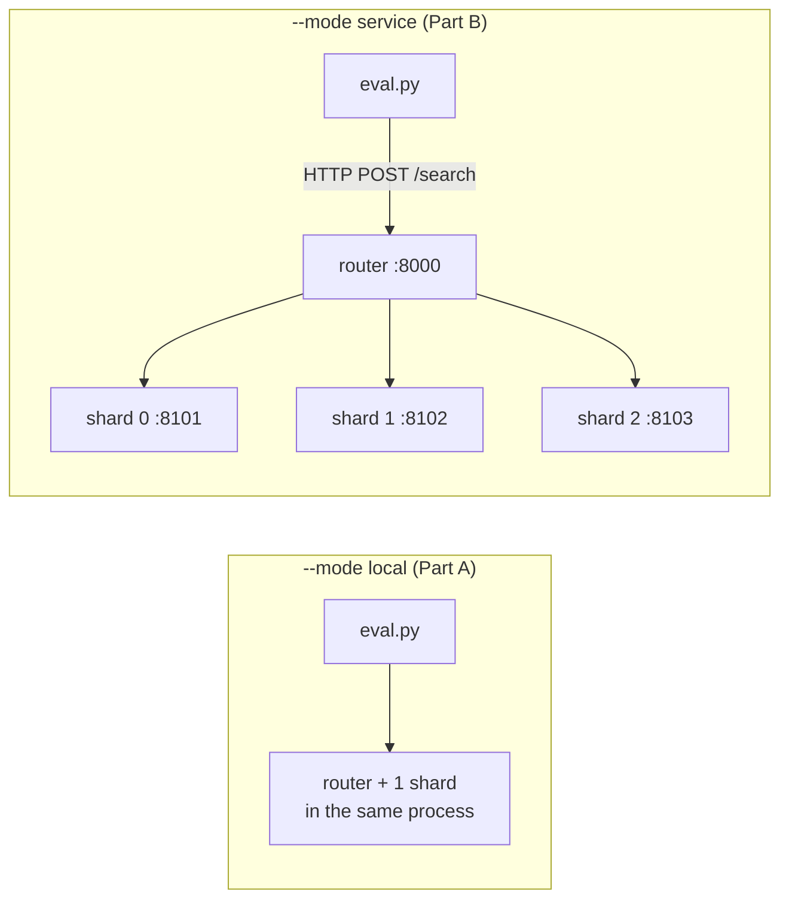

# How I evaluate a configuration (`src/eval.py`)

`src/eval.py` grades one configuration of the search system. It sends every question of a split (dev = 500 questions)
to the system, checks the returned top-10 against the qrels, and times each search. It writes one results file with
quality (nDCG, Recall, MRR, overall and per group), speed (p50 / p95, cold and warm) and memory (peak RAM). Every number
in `results/` and DESIGN.md comes from this program, run once per configuration by `scripts/bench.py`.

## Running it

```powershell
# from the repo root, venv active
python -m src.eval --name hybrid-linear-minilm --strategy hybrid --model minilm --fusion linear --alpha 0.7
```

It prints one line and writes `results\runs\hybrid-linear-minilm.json`:

```
hybrid-linear-minilm  nDCG@10=0.4190 R@10=0.4914 MRR@10=0.4872 warm p50/p95=20.7/24.5ms cold p50/p95=...
```

I run it as a module (`-m src.eval`) from the repo root because that puts the repo root first on `sys.path`, so
`from src.beir_data import ...` resolves. `python src\eval.py` would put `src\` first instead, and Python would fail with
`ModuleNotFoundError: No module named 'src'`.

## What happens in one run





| step | code (`src/eval.py`) | what it produces |
|---|---|---|
| 1 | `main()` → `argparse` | `a.strategy == "hybrid"`, `a.alpha == 0.7`, … |
| 2 | `Searcher(...)` | loading the model and building the indexes; `startup_s` is 10.0 s in the shipped run |
| 3 | `evaluate()`: `cold = [timed(q) ...]` | 20 timings; the first is usually the slowest |
| 4 | `evaluate()`: `rng.sample(train_q, 100)` | nothing (skipped if the dataset has no train split) |
| 5 | `evaluate()`: `run[qid], ms = timed(q)` | `run = {"1": ["363495", "130631", ...], ...}`, 500 latencies |
| 6 | `evaluate_run(run, qrels)`, `stratified(...)` | `{"ndcg@10": 0.419, ...}` |
| 7 | `latency_summary(...)`, `searcher.memory()` | `{"p50_ms": 20.73, "p95_ms": 24.54, "n": 500}` |
| 8 | `out.write_text(json.dumps(res))` | the file |

## Local mode and service mode



| | `--mode local` | `--mode service` |
|---|---|---|
| where the engine runs | inside eval's process (`single_node_router`) | separate router + shard processes that I start first (`python -m src.service.cluster --shards 3`) |
| latency includes | the search | the search, the HTTP hop to the router and the fan-out to shards |
| `--model`, `--bm25-stats`, `--threads` | used | ignored: the running router's settings decide |
| memory reported | this process (`process.rss_mb`, `peak_rss_mb`) | each shard's, plus `max_shard_peak_rss_mb` |
| used for | Part A numbers (single node) | Part B numbers (3 shards vs 1 shard, local IDF) |
| safety check | none needed | if a shard didn't answer (`partial` result), eval stops with `partial result during eval`. The cluster logs are in `artifacts\cluster3\*.log` |

## Arguments

The defaults are not the shipped system. The defaults (`--fusion rrf --alpha 0.5`) are plain RRF, which scores 0.373
instead of 0.419. I always pass `--strategy hybrid --model minilm --fusion linear --alpha 0.7` explicitly.

| argument | default | meaning |
|---|---|---|
| `--mode` | `local` | `local` builds the engine in this process; `service` sends each question over HTTP to a running router |
| `--url` | `http://127.0.0.1:8000` | service mode only: the router's address |
| `--strategy` | `hybrid` | `bm25`, `dense` or `hybrid` (both, fused) |
| `--model` | `minilm` | `minilm` or `bge-small`, the embedding model for the dense side (local mode only) |
| `--fusion` | `rrf` | hybrid only. `rrf` combines ranks; `linear` min-max normalises the scores, then takes a weighted sum |
| `--alpha` | `0.5` | hybrid only, the weight on dense (0.0 to 1.0). `linear`: α·dense + (1−α)·bm25. `rrf`: list weights (1−α, α), so 0.5 is plain RRF |
| `--rerank-k` | `0` | `0` is off; `N` re-scores the fused top N with the cross-encoder (~29 ms per doc, and it didn't help on FiQA, see [06_reranking.md](06_reranking.md)) |
| `--bm25-stats` | `global` | `global`: the router sums IDF statistics from all shards (correct). `local`: each shard uses its own. No effect in local mode, which has one shard |
| `--split` | `dev` | `dev` (500 questions) for all tuning; `test` (648) for the final run |
| `--final-test-run` | off | `--split test` refuses to run without it. I used it exactly once |
| `--limit N` | all | evaluate only the first N questions; `overall.n` then equals N |
| `--name` | required | the label on the summary line and the file name `runs/<name>.json`. The same name overwrites the file |
| `--threads` | `4` | CPU threads for query encoding (local mode), fixed so latencies are comparable between runs |
| `--out` | `RESULTS_DIR\runs\<name>.json` | write the results file elsewhere |

`python -m src.eval --help` prints a short version.

## Environment variables

`src/config.py` reads these from the shell, so they apply to every command in that terminal.

| variable | default | what it controls |
|---|---|---|
| `FIQA_DATA_DIR` | `data\raw\fiqa` (the real 57,638 docs) | which corpus, queries and qrels are loaded |
| `ARTIFACTS_DIR` | `artifacts\` | stored embeddings and cluster state. If no stored vectors match the corpus, docs are encoded on the fly |
| `RESULTS_DIR` | `results\` | where `runs\<name>.json` and `bench.json` go |
| `HF_HUB_OFFLINE` | unset | `1` means never contact the Hugging Face Hub, use only cached models |

For a quick plumbing check I point all three at the 24-doc test fixture, so the real `results\` stays untouched
(`toy_runs\` is gitignored):

```powershell
$env:FIQA_DATA_DIR = "$PWD\tests\fixtures\tinyfiqa"   # 24 docs, 4 dev questions, no train split
$env:ARTIFACTS_DIR = "$PWD\toy_runs\artifacts"
$env:RESULTS_DIR   = "$PWD\toy_runs\results"
# ... run commands ...
Remove-Item Env:FIQA_DATA_DIR, Env:ARTIFACTS_DIR, Env:RESULTS_DIR   # when done
```

That fixture has no train split, so eval prints
`[eval] no train split in this dataset: skipping warmup (warm latency is less meaningful)` and carries on. Scores on
24 hand-written docs only show that the pipeline runs; they say nothing about quality.

## Reading the output

The printed line has nDCG@10 (correct docs near the top, my headline number), R@10 (share of the correct docs in the
top 10), MRR@10 (1 / rank of the first correct doc, averaged), warm p50/p95 (the 50 ms limit applies to this p95) and
cold p50/p95 (the first 20 queries of a fresh process). The metrics are explained in [04_ir_metrics.md](04_ir_metrics.md).

The results file `runs/<name>.json`, with values from the shipped run:

| key | value in `hybrid-linear-minilm.json` | meaning |
|---|---|---|
| `split` | `"dev"` | which questions were graded |
| `overall` | `{"ndcg@10": 0.419, "recall@10": 0.4914, "mrr@10": 0.4872, "n": 500}` | each metric averaged over `n` questions |
| `stratified` | `{"qlen:short(<5)": {"recall@10": 0.385, "n": 13}, ...}` | Recall@10 per group (below). I always read `n` |
| `latency.cold_first20` | `{"p50_ms": 20.09, "p95_ms": 23.27, "n": 20}` | the first 20 questions, fresh process |
| `latency.warm` | `{"p50_ms": 20.73, "p95_ms": 24.54, "n": 500}` | all questions, after warmup |
| `memory` | `{"process": {"rss_mb": 811.6, "peak_rss_mb": 811.6}}` | RAM now and the peak (`peak_rss_mb` comes from Windows `peak_wset` or Linux `ru_maxrss`) |
| `run` | `{"1": ["363495", "130631", "246461", "14255", ...], ...}` | the actual top-10 per question; every metric is computed from this |
| `name`, `config` | `{"strategy": "hybrid", "fusion": "linear", "alpha": 0.7, ...}` | the exact settings, so the run can be reproduced |
| `startup_s` | `10.0` | seconds to load the model and build the indexes |

`scripts/bench.py` runs `src.eval` once per configuration, each in a fresh process, and merges the results into
`bench.json`: `machine` (CPU, cores, RAM, OS, Python), `protocol` (how cold, warm and warmup were measured) and
`configs` (one entry per configuration, everything above except `run`, which stays in `runs/` to keep the file small).

### Stratified recall

`overall` averages over all questions, which can hide a weak group: 13 short questions disappear among 487 others. So I
also split the questions into groups and average Recall@10 inside each one (the assignment asks for this in A2). Every
question lands in one `qlen:` group and one `doclen:` group, so the `n`s add up to 500 twice. A group with no
questions is missing from the file, not zero.

| prefix | question it asks | how the group is chosen |
|---|---|---|
| `qlen:` | is the query short, medium or long? | `length_bucket()`: under 5 words → `short(<5)`, 5 to 15 → `medium(5-15)`, over 15 → `long(>15)` |
| `doclen:` | is a correct document one of the longest? | `long_doc_ids()` keeps the 10% longest docs by word count. If any gold doc is in that set → `gold_in_top10pct_longest`, else `gold_not_longest` |

On the 500 dev questions (`results\runs\*.json`):

| group | n | BM25 | dense (MiniLM) | hybrid (linear, α = 0.7) |
|---|---|---|---|---|
| `qlen:short(<5)` | 13 | 0.231 | 0.423 | 0.385 |
| `qlen:medium(5-15)` | 403 | 0.316 | 0.471 | 0.491 |
| `qlen:long(>15)` | 84 | 0.315 | 0.454 | 0.510 |
| `doclen:gold_in_top10pct_longest` | 185 | 0.310 | 0.414 | 0.464 |
| `doclen:gold_not_longest` | 315 | 0.315 | 0.497 | 0.508 |

Short questions hurt BM25 most (0.231 vs ~0.315), since 2 to 4 words leave few terms to match. Dense does better on
them (0.423) because it matches meaning. With n = 13 I treat that as a hint.

Long gold docs hurt dense and barely touch BM25 (0.310 vs 0.315). Dense drops from 0.497 to 0.414 because MiniLM reads
at most 256 tokens of a passage (`max_seq_length`), so the end of a long answer is never embedded, while BM25 indexes
every word. Hybrid narrows the gap (0.464 vs 0.508) because BM25 rescues some of those docs. This is failure case 2 in
[results/failures.md](../results/failures.md).

The BM25 file (`results\runs\bm25.json`) for comparison: nDCG@10 / R@10 / MRR@10 0.264 / 0.314 / 0.322, warm p50 / p95
1.17 / 1.97 ms, peak memory 511 MB, startup 9.3 s (tokenising and indexing 57,638 passages). Every `run` list has 10
ids, because with 57K docs there are always at least 10 that contain some query word. BM25 loads no embedding model,
but `src.eval` still imports PyTorch (to set threads), numpy and scipy, and those libraries take a large share of the
memory.

## Why I measure this way

| decision | why | what goes wrong otherwise |
|---|---|---|
| cold = first 20 questions of a fresh process | the first searches pay one-off costs: lazy model init, empty CPU caches, new connections | measuring only warm hides a slow start that users feel after a restart |
| warmup on train questions | warms the caches without seeing any question that will be graded | warming on dev would make the timed run look faster than real traffic |
| each configuration in its own process (`bench.py`) | cold stays cold, and one config's loaded models and caches can't help the next | config 2 would look faster than it is |
| latency measured by the client, end to end | that is what a user experiences and what the 50 ms limit means | timing only inside the router hides HTTP and serialisation |
| percentiles (p50/p95), not the mean | one slow outlier drags the mean; p95 shows the tail | an average can describe no real query |
| test split locked behind `--final-test-run` | tuning on test makes its score optimistic | the final score would no longer be honest |
| `--threads 4` fixed | thread count changes encode time a lot | numbers wouldn't compare across runs or machines |

p95 still moves between runs when other programs use the CPU, and p95 of only 20 questions is just the 19th value, so
I compare full 500-question runs.

## Recipes

| goal | command |
|---|---|
| the shipped system | `python -m src.eval --name hybrid-linear-minilm --strategy hybrid --model minilm --fusion linear --alpha 0.7` |
| BM25 only | `python -m src.eval --name bm25 --strategy bm25` |
| dense only, BGE model | `python -m src.eval --name dense-bge-small --strategy dense --model bge-small` |
| plain RRF | `python -m src.eval --name hybrid-rrf-minilm --strategy hybrid --fusion rrf --alpha 0.5` |
| with reranking | `python -m src.eval --name rerank10 --strategy hybrid --fusion linear --alpha 0.7 --rerank-k 10` |
| quick smoke test | `python -m src.eval --name quick --strategy bm25 --limit 20` |
| through a running 3-shard cluster | first `python -m src.service.cluster --shards 3` (another terminal), then `python -m src.eval --mode service --name svc3-hybrid --strategy hybrid --fusion linear --alpha 0.7` |
| the whole matrix | `python scripts\bench.py` (or `--only local`) |
| the final test run (once) | `python -m src.eval --name FINAL-test --strategy hybrid --model minilm --fusion linear --alpha 0.7 --split test --final-test-run` |

## Code map

| function / class | job |
|---|---|
| `length_bucket(query)` | short / medium / long by word count |
| `long_doc_ids(corpus)` | ids of the 10% longest passages |
| `stratified(run, qrels, queries, long_docs)` | Recall@10 per group, with each group's `n` |
| `latency_summary(ms)` | p50 / p95 / n from a list of timings (nearest-rank percentile, `src/util.py`) |
| `Searcher` | one `search(query) → [doc ids]` interface over both modes: local (`single_node_router`) or service (HTTP to `/search`). `memory()` reports RAM the right way for each mode |
| `evaluate(searcher, split, cold_n=20, warmup_n=100, limit)` | the protocol: cold → warmup → warm → metrics. Returns the dict that becomes the JSON file |
| `main()` | parses arguments, enforces the test-split lock, sets torch threads, builds the `Searcher`, calls `evaluate`, writes the file, prints the line |

Related: `src/metrics.py` (the metric formulas) and `scripts/bench.py` (runs every configuration).
