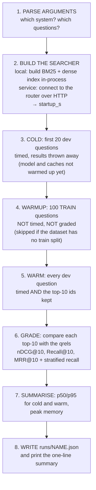
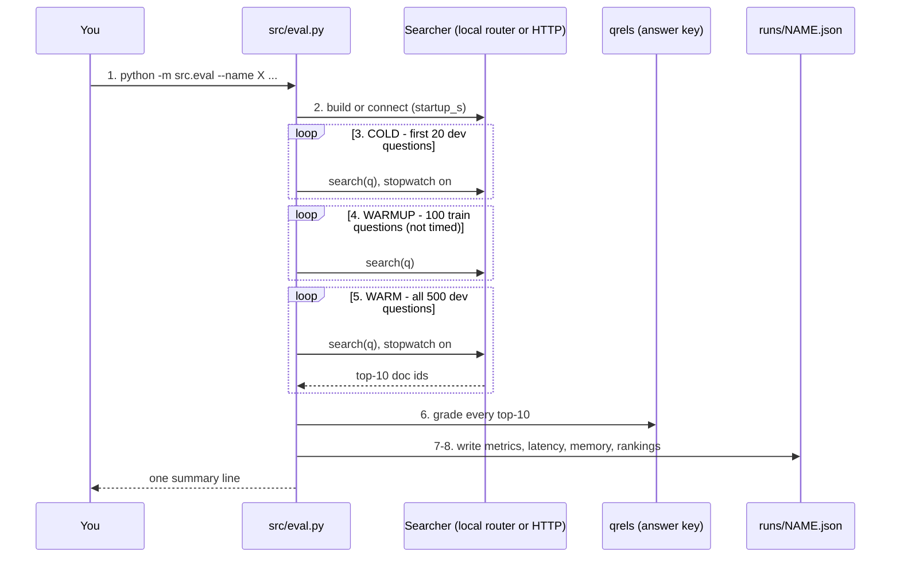
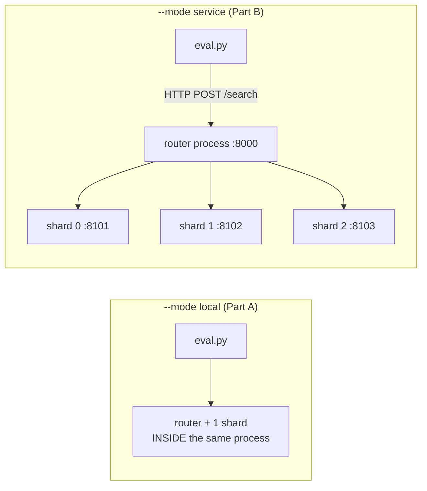

# `src/eval.py`, explained

**What it is:** the program that **grades one configuration** of the search system. It sends every question of a split
(dev = 500 questions) to the system, checks the returned top-10 against the answer key, and times each search.
It writes one results file with **quality** (nDCG / Recall / MRR, overall and per group), **speed** (p50 / p95, cold and
warm) and **memory** (peak RAM).

> Every number in `results/` and DESIGN.md comes from this program, run once per configuration by `scripts/bench.py`.

**Contents**
1. [The 30-second version](#1-the-30-second-version)
2. [What happens in one run, step by step](#2-what-happens-in-one-run-step-by-step)
3. [Local mode vs service mode](#3-local-mode-vs-service-mode)
4. [Every argument](#4-every-argument)
5. [Environment variables](#5-environment-variables-which-data-where-files-go)
6. [Reading the output](#6-reading-the-output)
7. [Why it measures the way it does](#7-why-it-measures-the-way-it-does-protocol-decisions)
8. [Recipes](#8-recipes-copy-paste-commands)
9. [Pitfalls](#9-pitfalls)
10. [Code map](#10-code-map-whats-where-in-srcevalpy)

---

## 1. The 30-second version

```powershell
# from the repo root, venv active
python -m src.eval --name hybrid-linear-minilm --strategy hybrid --model minilm --fusion linear --alpha 0.7
```

Prints one line, and writes `results\runs\hybrid-linear-minilm.json`:

```
hybrid-linear-minilm  nDCG@10=0.4190 R@10=0.4914 MRR@10=0.4872 warm p50/p95=20.7/24.5ms cold p50/p95=...
```

To try it on the **24-document toy dataset** first, set the three environment variables in [§5](#5-environment-variables-which-data-where-files-go).

### Why `python -m src.eval` and not `python src\eval.py`?

`-m` means "**run this module by its import name**" (`src.eval` = the file `src\eval.py` inside the package `src`),
instead of "run this file by its path". The difference is **where Python looks for imports**:

| command | what Python puts first on its import path (`sys.path[0]`) | can `eval.py` do `from src.beir_data import ...`? |
|---|---|---|
| `python -m src.eval` | the **current folder**, i.e. the repo root (run it from there) | ✅ yes: `src\` is a folder inside the repo root |
| `python src\eval.py` | the **script's own folder**, `src\` | ❌ no: Python looks for `src\src\beir_data.py` → `ModuleNotFoundError: No module named 'src'` |

So `-m` plus "run from the repo root" is what makes all the `from src.… import …` lines work. It's the same fix as for the
`No module named 'src'` error in chapter 1. You've used `-m` before: `python -m pytest`, `python -m pip`, `python -m venv`
all run an installed module by name the same way.

---

## 2. What happens in one run, step by step



The same flow as a conversation:



| step | code (`src/eval.py`) | what you'd see if you printed it |
|---|---|---|
| 1 | `main()` → `argparse` | `a.strategy == "hybrid"`, `a.alpha == 0.7`, … |
| 2 | `Searcher(...)` | ~14 s locally (loading the model + building indexes); `startup_s` in the file |
| 3 | `evaluate()`: `cold = [timed(q) ...]` | 20 numbers in ms; the first is usually the slowest |
| 4 | `evaluate()`: `rng.sample(train_q, 100)` | nothing (not timed) |
| 5 | `evaluate()`: `run[qid], ms = timed(q)` | `run = {"0": ["14255", ...], ...}`, 500 latencies |
| 6 | `evaluate_run(run, qrels)`, `stratified(...)` | `{"ndcg@10": 0.419, ...}` |
| 7 | `latency_summary(...)`, `searcher.memory()` | `{"p50_ms": 20.7, "p95_ms": 24.5, "n": 500}` |
| 8 | `out.write_text(json.dumps(res))` | the file |

---

## 3. Local mode vs service mode



| | `--mode local` | `--mode service` |
|---|---|---|
| where the engine runs | inside eval's own process (`single_node_router`) | separate router + shard processes, which **you start first** (`python -m src.service.cluster --shards 3`) |
| latency includes | the search itself | the search **plus** HTTP to the router and the fan-out to shards |
| `--model`, `--bm25-stats`, `--threads` | used | **ignored**: the running router's settings decide |
| memory reported | this process (`process.rss_mb`, `peak_rss_mb`) | each shard's, plus `max_shard_peak_rss_mb` |
| used for | Part A numbers (single node) | Part B numbers (3 shards vs 1 shard, local-IDF bug) |
| safety check | none needed | if a shard didn't answer (`partial` result), eval **stops with an error** rather than silently grading incomplete results |

---

## 4. Every argument

**The defaults are not the shipped system.** The shipped system is `--strategy hybrid --model minilm --fusion linear --alpha 0.7`.
The defaults (`--fusion rrf --alpha 0.5`) are plain RRF, which scored worse. Always pass the four settings explicitly.

### Where the search runs

| argument | default | meaning |
|---|---|---|
| `--mode` | `local` | `local` = build the engine inside this process. `service` = send each question over HTTP to a running router (§3) |
| `--url` | `http://127.0.0.1:8000` | service mode only: the router's address |

### What system to test (the configuration)

| argument | default | values | meaning |
|---|---|---|---|
| `--strategy` | `hybrid` | `bm25`, `dense`, `hybrid` | keywords only (ch03) · meaning only (ch04) · both, fused (ch05) |
| `--model` | `minilm` | `minilm`, `bge-small` | the embedding model for the dense side (local mode only) |
| `--fusion` | `rrf` | `rrf`, `linear` | hybrid only. `rrf` combines **ranks**. `linear` min-max normalises the **scores**, then takes a weighted sum |
| `--alpha` | `0.5` | 0.0 – 1.0 | hybrid only: **weight on dense**; BM25 gets 1 − α. `linear`: α·dense + (1−α)·bm25. `rrf`: list weights (1−α, α), so 0.5 = plain RRF |
| `--rerank-k` | `0` | 0, 10, 20, 50 … | `0` = off. `N` = re-score the fused top N with the cross-encoder (ch05: ~29 ms per doc, didn't help on FiQA) |
| `--bm25-stats` | `global` | `global`, `local` | `global` = the router sums IDF statistics from all shards (correct). `local` = each shard uses its own (the ch07 bug). No effect in local mode, which has one shard |

### Which questions

| argument | default | meaning |
|---|---|---|
| `--split` | `dev` | `dev` = 500 questions, used for **all** tuning. `test` = 648, the "final exam" |
| `--final-test-run` | off | **safety lock**: `--split test` refuses to run without it. We used it exactly once |
| `--limit N` | all | evaluate only the first N questions (quick checks). `overall.n` then equals N |

### Bookkeeping

| argument | default | meaning |
|---|---|---|
| `--name` | **required** | your label: printed on the summary line, and the file name `runs/<name>.json`. **The same name overwrites the file** |
| `--threads` | `4` | CPU threads for encoding the query (local mode). Fixed at 4 so latencies are comparable between runs |
| `--out` | `RESULTS_DIR\runs\<name>.json` | write the results file somewhere else |

`python -m src.eval --help` prints a short version of these tables.

---

## 5. Environment variables (which data, where files go)

These aren't arguments; they're read from your shell by `src/config.py`. They apply to every command in that terminal.

| variable | default | what it controls |
|---|---|---|
| `FIQA_DATA_DIR` | `data\raw\fiqa` (the real 57,638 docs) | which dataset is loaded: corpus, queries, qrels |
| `ARTIFACTS_DIR` | `artifacts\` | where the stored embeddings and cluster state live. If no stored vectors match the corpus, docs are encoded on the fly |
| `RESULTS_DIR` | `results\` (**the real numbers**) | where `runs\<name>.json` and `bench.json` are written |
| `HF_HUB_OFFLINE` | unset | `1` = never contact the Hugging Face Hub, use only the cached models |

**Toy dataset setup.** It takes seconds, and the real `results\` stays untouched; `toy_runs\` is gitignored:

```powershell
$env:FIQA_DATA_DIR = "$PWD\tests\fixtures\tinyfiqa"   # 24 docs, 4 dev questions, no train split
$env:ARTIFACTS_DIR = "$PWD\toy_runs\artifacts"
$env:RESULTS_DIR   = "$PWD\toy_runs\results"
# ... run your commands ...
Remove-Item Env:FIQA_DATA_DIR, Env:ARTIFACTS_DIR, Env:RESULTS_DIR   # when done
```

The tiny set has no train split, so eval prints
`[eval] no train split in this dataset: skipping warmup (warm latency is less meaningful)` and carries on.

---

## 6. Reading the output

### The printed line

```
hybrid-linear-minilm  nDCG@10=0.9579 R@10=1.0000 MRR@10=1.0000 warm p50/p95=27.0/29.22ms cold p50/p95=27.11/28.02ms
```

| piece | meaning | where it's explained |
|---|---|---|
| `nDCG@10` | right docs **and** near the top; the headline number | guide ch02 §2.4 |
| `R@10` | share of the correct docs found in the top 10 | guide ch02 §2.2 |
| `MRR@10` | 1 / rank of the first correct doc, averaged | guide ch02 §2.3 |
| `warm p50/p95` | typical / slow-tail latency after warmup: the 50 ms limit applies to this p95 | guide ch02 §2.7 |
| `cold p50/p95` | the first 20 queries of a fresh process | §7 below |

### The results file `runs/<name>.json`

Real example: the toy run of the shipped system, shortened.

| key | example | meaning |
|---|---|---|
| `split` | `"dev"` | which questions were evaluated |
| `overall` | `{"ndcg@10": 0.9579, "recall@10": 1.0, "mrr@10": 1.0, "n": 4}` | each metric's average over `n` questions |
| `stratified` | `{"qlen:medium(5-15)": {"recall@10": 1.0, "n": 4}, "doclen:gold_not_longest": {...}, ...}` | Recall@10 per **group** (see below). **Always read `n`**: a group of 3 questions proves nothing |
| `latency.cold_first20` | `{"p50_ms": 27.11, "p95_ms": 28.02, "n": 4}` | the first ≤ 20 questions, fresh process |
| `latency.warm` | `{"p50_ms": 27.0, "p95_ms": 29.22, "n": 4}` | all questions, after warmup |
| `memory` | `{"process": {"rss_mb": 551.1, "peak_rss_mb": 551.5}}` | RAM now / the most RAM ever used (`peak_rss_mb` comes from Windows `peak_wset` or Linux `ru_maxrss`) |
| `run` | `{"q1": ["1", "2", "9", "22", ...], ...}` | **the actual top-10 for every question**. Every metric above is computed from this |
| `name`, `config` | `{"strategy": "hybrid", "fusion": "linear", "alpha": 0.7, ...}` | the exact settings, so the run can be reproduced |
| `startup_s` | `13.9` | seconds to load the model and build the indexes before the first question |

**The stratified groups** answer "*who* does the system fail?":

| group | which questions | why we look |
|---|---|---|
| `qlen:short(<5)` | fewer than 5 words | short queries give BM25 little to match on |
| `qlen:medium(5-15)` | 5–15 words | most FiQA questions |
| `qlen:long(>15)` | more than 15 words | long, chatty questions dilute the meaning |
| `doclen:gold_in_top10pct_longest` | the correct doc is among the 10% longest passages | long passages get cut at 256 tokens by MiniLM (failure case 2) |
| `doclen:gold_not_longest` | everything else | the comparison group |

### `bench.json` (made by `scripts/bench.py`)

`bench.py` runs `src.eval` once per configuration, each in a **fresh process**, and merges the results:

| key | contents |
|---|---|
| `machine` | CPU, cores, RAM, OS, Python version (latency depends on hardware) |
| `protocol` | how cold/warm/warmup were measured, in words |
| `configs` | one entry per configuration: everything in the table above **except** `run` (kept out to keep the file small; the full runs stay in `runs/`) |

---

## 7. Why it measures the way it does (protocol decisions)

| decision | why | what goes wrong otherwise |
|---|---|---|
| **cold** = the first 20 questions of a **fresh** process | the first searches pay one-off costs: lazy model init, empty CPU caches, new connections | measuring only warm hides a slow start that real users after a restart *do* feel |
| **warmup on TRAIN** questions, not dev | warm the caches without "seeing" any question that will be graded | warming up on dev questions would make the timed run look faster than real traffic |
| each configuration in its **own process** (`bench.py`) | so "cold" really is cold, and one config's leftovers (models, caches) can't help the next | config 2 would look faster than it is, because config 1 already warmed things up |
| latency measured by the **client**, end to end | that's what a user experiences, and what the 50 ms limit means | timing only inside the router hides HTTP and serialisation cost |
| **percentiles** (p50/p95), not the mean | one slow outlier drags the mean; p95 shows the tail users notice | "28.5 ms average" when no query took 28 ms (guide ch02 §2.7) |
| **test split locked** behind `--final-test-run` | tuning on test makes its score optimistic | the "final exam" score would no longer be honest |
| `--threads 4` fixed | thread count changes encode time a lot | numbers wouldn't be comparable across runs or machines |

---

## 8. Recipes (copy-paste commands)

| goal | command |
|---|---|
| the shipped system | `python -m src.eval --name hybrid-linear-minilm --strategy hybrid --model minilm --fusion linear --alpha 0.7` |
| BM25 only | `python -m src.eval --name bm25 --strategy bm25` |
| dense only, BGE model | `python -m src.eval --name dense-bge-small --strategy dense --model bge-small` |
| plain RRF | `python -m src.eval --name hybrid-rrf-minilm --strategy hybrid --fusion rrf --alpha 0.5` |
| with reranking | `python -m src.eval --name rerank10 --strategy hybrid --fusion linear --alpha 0.7 --rerank-k 10` |
| quick smoke test | `python -m src.eval --name quick --strategy bm25 --limit 20` |
| through a running 3-shard cluster | first `python -m src.service.cluster --shards 3` (another terminal), then `python -m src.eval --mode service --name svc3-hybrid --strategy hybrid --fusion linear --alpha 0.7` |
| the whole matrix | `python scripts\bench.py` (or `--only local`) |
| the final exam (**once**) | `python -m src.eval --name FINAL-test --strategy hybrid --model minilm --fusion linear --alpha 0.7 --split test --final-test-run` |

---

## 9. Pitfalls

| symptom | cause | fix |
|---|---|---|
| your hybrid number is ~0.373, not 0.419 | you used the defaults (`rrf`, 0.5) | pass `--fusion linear --alpha 0.7` |
| an older results file changed | same `--name` → overwritten | use a new name per experiment |
| real `results\` got toy numbers | `RESULTS_DIR` wasn't set during a toy run | set all three variables (§5); `git checkout results` restores the real ones |
| a "real" run finished in seconds with nDCG ≈ 0.95 | the toy variables are still set in that terminal | `Remove-Item Env:FIQA_DATA_DIR, Env:ARTIFACTS_DIR, Env:RESULTS_DIR` |
| `Refusing to evaluate on TEST ...` | the safety lock | add `--final-test-run` **only** for the one final run |
| `partial result during eval` | a shard didn't answer (service mode) | check the cluster logs in `artifacts\cluster3\*.log` |
| p95 jumps between runs | other programs using the CPU, or too few questions (p95 of 20 = the 19th value) | close heavy apps, use all 500 questions, compare medians of a few runs |

---

## 10. Code map: what's where in `src/eval.py`

| function / class | job |
|---|---|
| `length_bucket(query)` | short / medium / long by word count, for the stratified groups |
| `long_doc_ids(corpus)` | the ids of the 10% longest passages |
| `stratified(run, qrels, queries, long_docs)` | Recall@10 per group, with each group's `n` |
| `latency_summary(ms)` | p50 / p95 / n from a list of timings (nearest-rank percentile, `src/util.py`) |
| `Searcher` | one `search(query) → [doc ids]` interface over **both** modes: local (`single_node_router`) or service (HTTP to `/search`). `memory()` reports RAM the right way for each mode |
| `evaluate(searcher, split, cold_n=20, warmup_n=100, limit)` | the protocol: cold → warmup → warm → metrics. Returns the dict that becomes the JSON file |
| `main()` | parses the arguments, enforces the test-split lock, sets torch threads, builds the `Searcher`, calls `evaluate`, writes the file, prints the line |

Related: `src/metrics.py` (the metric formulas), `scripts/bench.py` (runs every configuration), and guide chapter 6 §6.3
(`docs/from_zero/06_part_a_end_to_end.md`), which walks through running each configuration yourself on the toy data.
