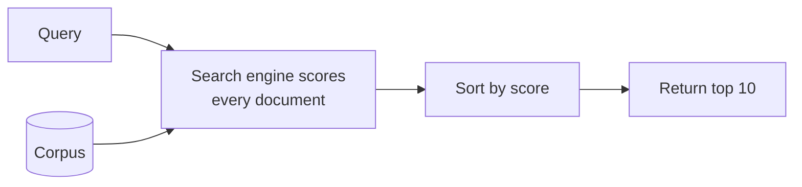
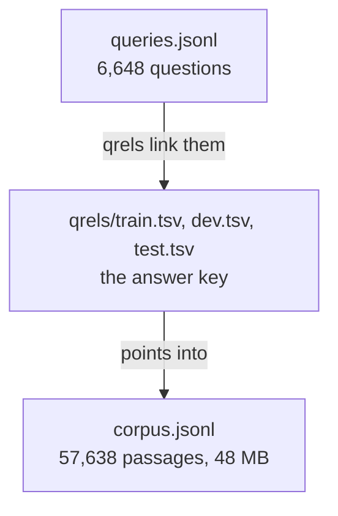
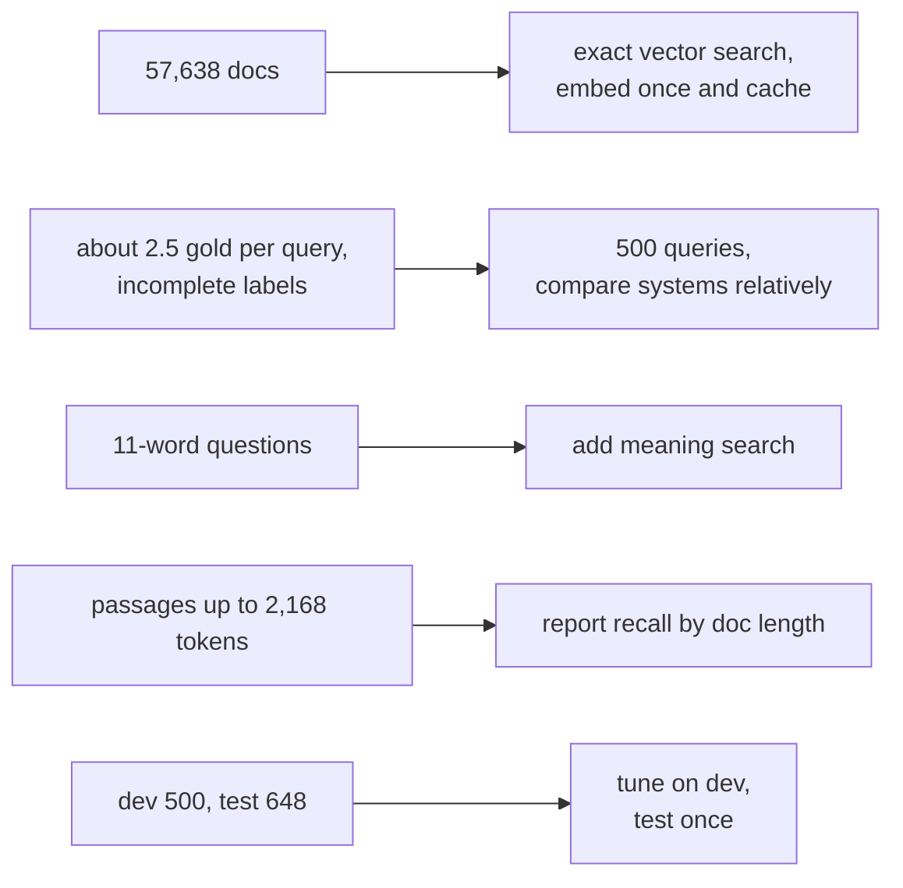
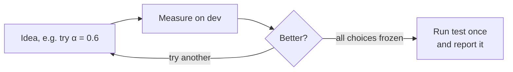
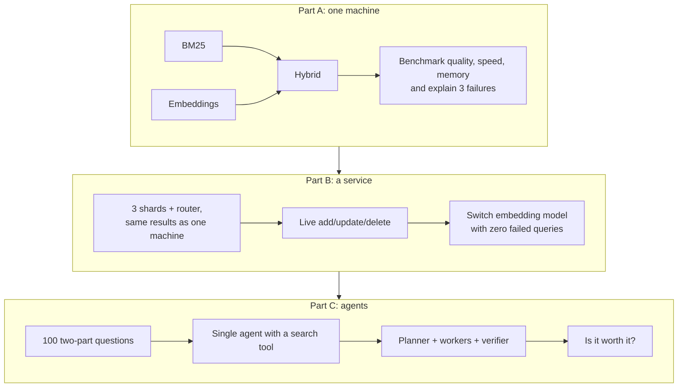
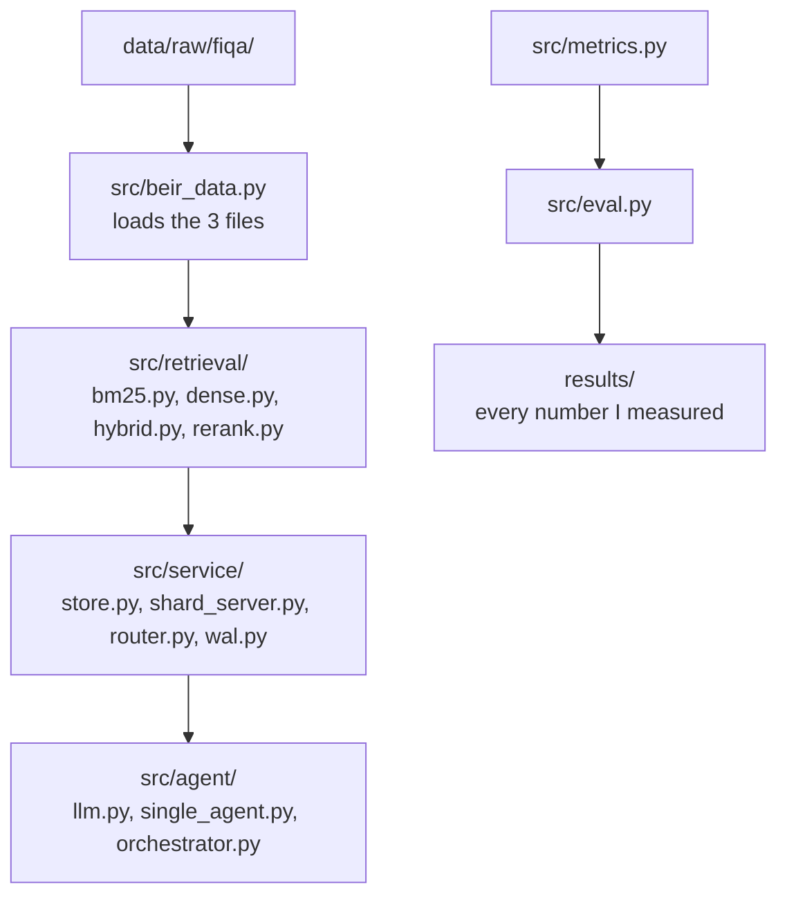

# Chapter 1: The problem and the data

I'll start with the problem my system solves, then show you the dataset I used, because almost every design decision
later traces back to a number in it.

## What retrieval is

Retrieval means: given a question, find the pieces of text in a big pile that are most likely to answer it. Ctrl+F in a PDF
is the crudest version (exact text match) and Google is a very smart one. My system sits in between.



Three words you'll see everywhere:

| word | meaning | in FiQA |
|---|---|---|
| corpus | the full pile of documents I search over | 57,638 answers from a finance Q&A forum |
| document (passage, doc) | one item in the corpus | one forum answer |
| query | the question you search with | "What is considered a business expense on a business trip?" |

### Why not just ask an LLM?

An LLM only knows what it saw in training, so it doesn't know your documents, and it can invent things. The fix is RAG
(retrieval-augmented generation): retrieve the top 10 real passages, paste them into the prompt, and let the LLM answer from
them. My project builds the retrieval half. Part C adds an LLM that drives the retrieval.


If retrieval misses the right passage, no LLM downstream can recover it. That is why I measure retrieval so carefully in
Chapter 2.

## FiQA

FiQA (2018) is a public dataset built from the Personal Finance & Money StackExchange forum. Like every retrieval dataset,
it has three parts:



The files live in `data/raw/fiqa/` after `python scripts/download_data.py`. Each corpus line is a JSON object (`title` is
always empty in FiQA):

```json
{"_id": "3", "title": "", "text": "I'm not saying I don't like the idea of on-the-job training too, but you can't expect the company to do that. ..."}
```

Each query line:

```json
{"_id": "0", "text": "What is considered a business expense on a business trip?"}
```

The qrels ("query relevance judgments") are the answer key, tab-separated. This says query 1 is answered by document 14255:

```
query-id	corpus-id	score
1	14255	1
2	308938	1
```

The `score` is how relevant a human judged the doc. In FiQA every row is 1, so relevance is binary. Other datasets use
grades (TREC-COVID uses 0/1/2), and nDCG gives a higher grade more credit (Chapter 2). A doc that isn't listed counts as
not relevant. My loader parses the score with `int(score)` on purpose, so a malformed `0.5` raises an error instead of
being misread, and every metric counts a doc as a hit only when its score is above 0.

### One real example

Dev query `10054` is "Is there an academic framework for deciding when to sell in-the-money call options?" Its qrels list
two correct passages, `190746` and `131989`. Here is the start of `190746`:

> "If any academic framework worked, your teachers would be the richest people on the planet. However, you must read
> up on macro and micro economic factors and make an educated guess where the market (or stock) would be at the date of expiry..."

"Call options" doesn't appear in that snippet at all. FiQA answers often don't reuse the question's words, and that is
the main reason plain keyword search struggles here (Chapters 3 to 5).

### The numbers I looked at before writing any code

All of these come from `python -m src.beir_data` and the tokenizer in Chapter 3.

| number | value | what it made me do |
|---|---|---|
| corpus size | 57,638 passages | All vectors fit in 88 MB, so I use exact vector search (Chapter 4). Embedding the corpus takes about 10 minutes on CPU, so I do it once and cache it. Sharding in Part B is about correctness, not capacity. |
| train queries | 5,500 (2.58 correct each) | I train no model, so I use them only to warm the system up before timing. |
| dev queries | 500 (2.48 correct each) | Every choice (α, model, reranker) is made here. |
| test queries | 648 (2.63 correct each) | Run exactly once at the end. My test nDCG@10 is 0.397. |
| correct passages per query | about 2.5 | Finding 1 of 2 is already 0.5 recall, so per-query metrics jump in big steps and I need hundreds of queries. The labels are also incomplete: the forum had good answers nobody labelled, so I read scores as relative (system A vs B). |
| passage length (tokens after cleaning) | mean 95, median 65, max 2,168 | 95 is `avgdl` in BM25. Most passages fit MiniLM's 256-token window, but the long tail doesn't, so I report recall separately for gold docs in the longest 10%: 0.464 vs 0.508. |
| query length | about 11 words | Queries are full questions phrased differently from the answers, which is why meaning search beats keyword search here (0.388 vs 0.264 nDCG@10). Short queries under 5 words are the hardest group (Recall@10 0.385). |

The qrels have 14,166 / 1,238 / 1,706 relevant pairs for train / dev / test.



### BEIR

BEIR (2021) is a benchmark that puts 18 retrieval datasets, FiQA included, into the same three-file format, so one
evaluation script works on all of them. I download FiQA from
`https://public.ukp.informatik.tu-darmstadt.de/thakur/BEIR/datasets/fiqa.zip`. The published BEIR number for BM25 on
FiQA test is nDCG@10 0.236, which I used as a sanity check for my own BM25.

## Train, dev, test

| split | analogy | what I use it for | how often |
|---|---|---|---|
| train (5,500) | the textbook | warming up the system before timing | anytime |
| dev (500) | practice exams | comparing ideas and choosing settings, e.g. α = 0.7 | as often as I like |
| test (648) | the final exam | the final number, after every choice is frozen | exactly once |



If you try 50 ideas and keep whichever scores best on test, you have tuned on the test set and your number is too
optimistic. My tuned system scored 0.419 on dev and 0.397 on test. Some drop is normal, and peeking would have hidden it.
To stop myself from doing it by accident, `src/eval.py` refuses `--split test` unless I pass `--final-test-run`.

## What the project has to do



The hard constraints: CPU only, p95 latency at most 50 ms per query after warmup, at most 2 GB of memory per shard, and
sharded results within 1% of single-machine results.

## Where things live



The loader is small. `load_corpus()` returns `{doc_id: text}` (title and text joined), and `load_split("dev")` returns
`(queries, qrels)` with `qrels = {qid: {doc_id: score}}`. It keeps only the queries that appear in that split's qrels,
because `queries.jsonl` holds all 6,648 queries for every split.

```python
>>> from src.beir_data import load_corpus, load_split
>>> corpus = load_corpus()
>>> len(corpus)
57638
>>> queries, qrels = load_split("dev")
>>> qrels["10054"]
{'190746': 1, '131989': 1}
```

There is also a 24-document miniature FiQA in `tests/fixtures/tinyfiqa/`, in the same format, which the tests use.

Next: [Chapter 2: measuring quality and speed](02_measuring_quality_and_speed.md)
