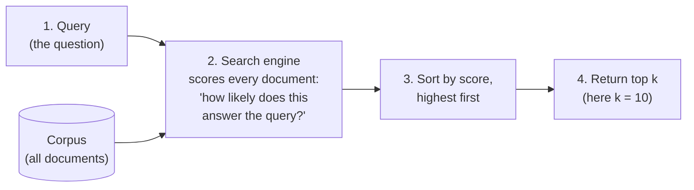
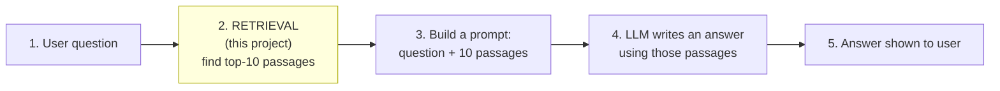
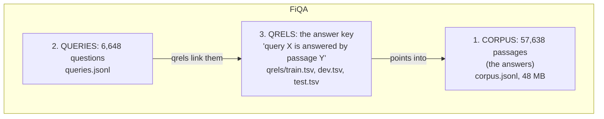
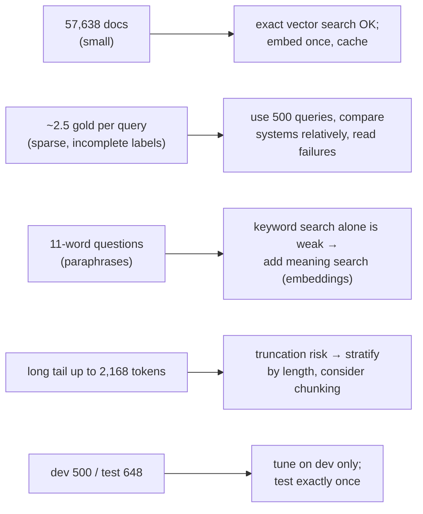
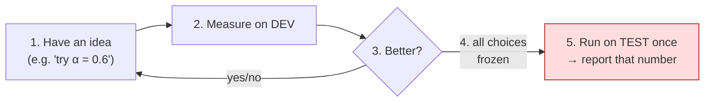
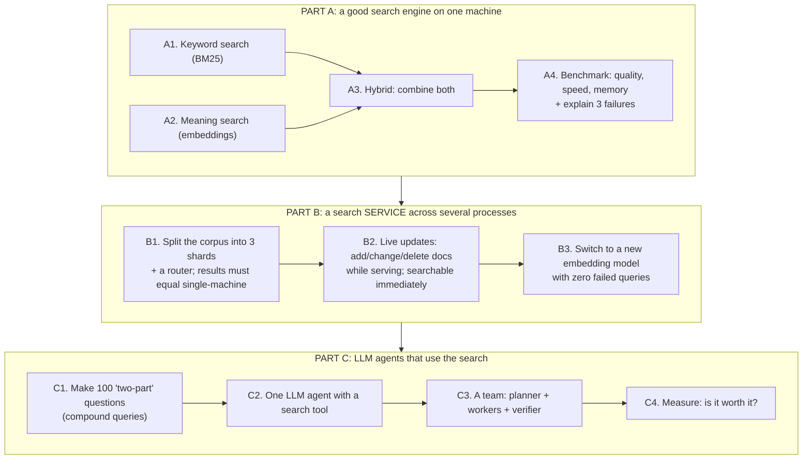
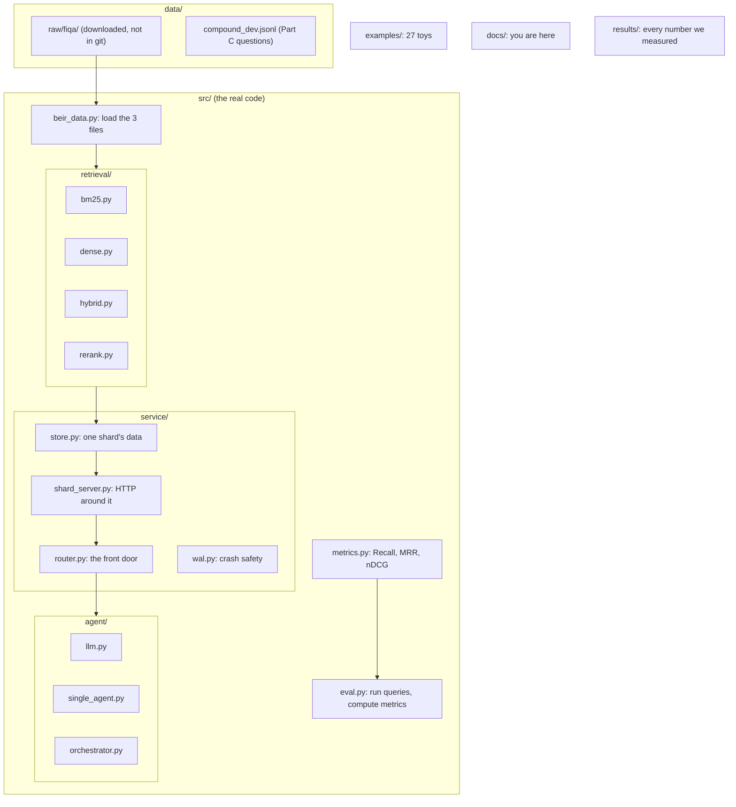
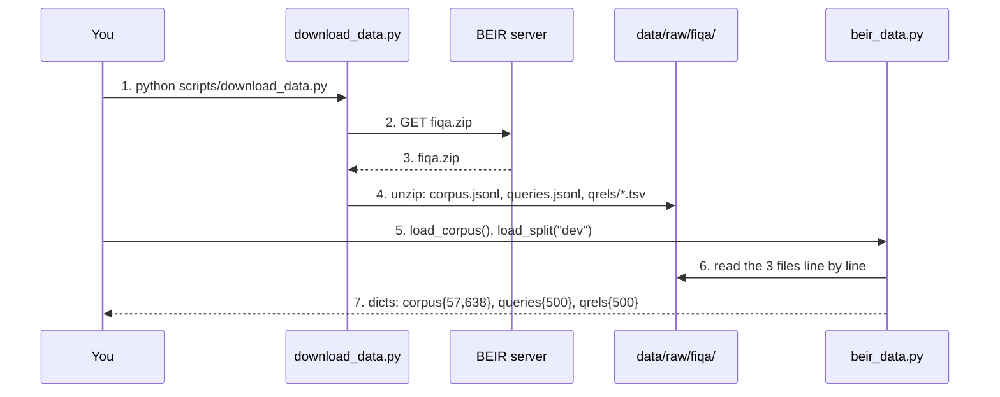

# Chapter 1: The problem, the data (FiQA), and the vocabulary

> Goal of this chapter: by the end, you can explain to a friend what "retrieval" is, what is inside the FiQA
> dataset, and what the assignment's three parts ask for, without using any jargon you can't define.

> ⚙️ **Running the commands:** open a terminal in the repo root (the folder with `src/`) and use the venv's Python.
> Seeing `No module named 'src'`? You're in the wrong folder. See "Before you run ANY command" in the [guide README](README.md).

---

## 1.1 What is "retrieval"?

> 🎯 **Why we're doing this:** Everything in this repo is one of three things: making retrieval *better* (Part A), making it *a reliable service* (Part B), or letting an LLM *drive* it (Part C). If you can't say what retrieval is, none of that has an anchor.

**Retrieval = given a question, find the pieces of text (out of a big pile) most likely to answer it.**

You use retrieval every day: Google search, searching your email, "Ctrl+F" in a PDF. Ctrl+F is the dumbest
version (exact text match). Google is a very smart version. This project builds something in between, and
learns *why* each improvement helps.



Three words to lock in now:

| word | meaning | in FiQA |
|---|---|---|
| **corpus** | the full pile of documents you search over | 57,638 answers from a finance Q&A forum |
| **document** (= passage, doc) | one item in the corpus | one forum answer, e.g. 65 words long |
| **query** | the question you search with | "What is considered a business expense on a business trip?" |

### Why not just let ChatGPT answer?

> 🎯 **Why we're doing this:** This is the business reason the whole field exists. It's also why we care so much about Recall@10 later: the LLM can only use passages we retrieve.
Two reasons, and they are the reason "RAG" exists:
1. An LLM (like ChatGPT) only knows what it saw during training. It doesn't know *your* documents (your company wiki, your 57,638 answers).
2. LLMs can invent things ("hallucinate"). If you first **retrieve** the real documents and hand them to the LLM, its answer is grounded in real text.

**RAG = Retrieval-Augmented Generation:** retrieve the top-10 documents, paste them into the LLM's prompt, and let the LLM write the answer.
This project builds the **R** (retrieval). Part C adds a little bit of the **G** side: an LLM that *drives* the retrieval.



If retrieval misses the right passage at step 2, **no LLM can fix it at step 4.** That's why retrieval quality
matters so much, and why we measure it so carefully (Chapter 2).

---

## 1.2 What is FiQA?

> 🎯 **Why we're doing this:** We need *real* questions with *known* correct answers, or we can't tell whether a change helped. FiQA gives us both; without it, every claim would be a guess.

**FiQA** ("Financial Opinion mining and Question Answering", 2018) is a public dataset built from the
*Personal Finance & Money* StackExchange site (a forum like StackOverflow, but for money questions).
People asked questions, other people wrote answers, and answers were judged as relevant.

It contains three kinds of data. Learn their names, because every retrieval dataset has the same three:



### The real files (look at them yourself: `data/raw/fiqa/`)

> 🎯 **Why we're doing this:** You will write a loader for exactly these three files (Ch. 1 §D). Every BEIR dataset uses this format, so learning it once lets you test on 18 datasets.

**corpus.jsonl**: one JSON object per line. `_id` is the document id, `text` is the answer (`title` is empty in FiQA):
```json
{"_id": "3", "title": "", "text": "I'm not saying I don't like the idea of on-the-job training too, but you can't expect the company to do that. ..."}
```

**queries.jsonl**: one question per line:
```json
{"_id": "0", "text": "What is considered a business expense on a business trip?"}
```

**qrels/dev.tsv**: the answer key, tab-separated. "Query 1 is answered by document 14255" (score 1 = relevant):
```
query-id	corpus-id	score
1	14255	1
2	308938	1
```

> **"qrels"** = "query relevance judgments". The word is ugly, but you'll see it in every IR paper.
> A qrel is a human judgment: "this passage answers this query".

**What does the `score` column mean?** It's *how relevant* a human judged that doc to be for that query:

| score | meaning | where you see it |
|---|---|---|
| `0` | judged and **not** relevant (a human looked and rejected it) | some datasets list these; counts the same as "not listed" |
| `1` | relevant | **FiQA: every single row is 1** (train 14,166 · dev 1,238 · test 1,706). FiQA is *binary* |
| `2`, `3`, … | *graded*: more relevant ("partially" vs "highly") | other BEIR sets, e.g. TREC-COVID uses 0/1/2 |

- Docs **not listed** for a query are treated as score 0 ("unjudged = not relevant"). That's why the answer key is incomplete (see below).
- **Recall and MRR only ask "is score > 0?"**, so the grade doesn't matter for them. **nDCG uses the grade**: gain = 2^score − 1,
  so a score-2 doc is worth 3, a score-1 doc 1 (Ch. 2). On FiQA all gains are 1.
- **Not a float**: in BEIR the score is an integer label, and our loader does `int(score)` on purpose, so a `0.5` would raise an error
  instead of being silently misread. The nDCG math would work with fractional grades, but supporting them would be a deliberate format change.
- Every metric filters with `score > 0`, never "is listed", precisely so that explicit `0` rows don't count as hits.

### A real example from the dev set

> 🎯 **Why we're doing this:** One concrete example shows the core difficulty of FiQA, *answers don't reuse the question's words*, which motivates Chapters 3 to 5.

Query `10054`: *"Is there an academic framework for deciding when to sell in-the-money call options?"*
Its qrels list **two** correct passages: `190746` and `131989`. Here is the start of `190746`:

> "If any academic framework worked, your teachers would be the richest people on the planet. However, you must read
> up on macro and micro economic factors and make an educated guess where the market (or stock) would be at the date of expiry..."

Notice: the answer doesn't repeat the question's words much ("call options" doesn't even appear in that snippet).
This is why simple keyword matching struggles on FiQA, and a big theme of Chapters 3–5.

### FiQA by the numbers, and why each one matters

> 🎯 **Why look at these numbers before writing any code?** Every one of them changes a design decision later.
> Knowing your data is step zero of any search (or ML) project. Read the "so what" column as "what this number makes us do".

**Sizes** (computed with `python -m src.beir_data`):

| number | value | 🎯 why it matters: what it makes us do |
|---|---|---|
| corpus size | **57,638 passages** | **Small enough for one machine.** All vectors fit in 88 MB of RAM, so we can use **exact** (brute-force) vector search instead of approximate (Ch. 4). Encoding the whole corpus takes ~10 min on CPU, so we do it **once and cache it** (Ch. 4). It also means sharding (Part B) is for *learning correctness*, not because we need the capacity. |
| train queries | **5,500** (2.58 correct each) | We don't train any model, so we use these only to **warm up** the system before timing it. That way no dev query is "seen" before it's measured (Ch. 2). They'd be the data for fine-tuning a model, if we ever did. |
| **dev** queries | **500** (2.48 correct each) | Our **practice exam**: every choice (α, model, reranker) is decided here. 500 is enough to trust differences of ~0.01 nDCG, but **not** ~0.002. We used that to reject a "fix" that gained only +0.0016 (Ch. 6). |
| **test** queries | **648** (2.63 correct each) | The **final exam**, run exactly **once** after all choices are frozen (§1.3). Our test score (0.397) is the honest number to report. |
| correct passages per query | **~2.5 on average** | (1) Recall@10 has a tiny denominator: finding 1 of 2 correct docs = 0.5 recall, so metrics jump in big steps per query, and we need hundreds of queries to average out (Ch. 2). (2) The answer key is **incomplete**: the forum had other good answers nobody labelled. Some "failures" are really good answers the qrels don't know about (Ch. 6, case 3). So treat scores as *relative* (system A vs B), not absolute truth. |

**Lengths** ("tokens" here = words after cleaning: lowercased, stopwords removed, stemmed, Chapter 3):

| number | value | 🎯 why it matters: what it makes us do |
|---|---|---|
| average passage length | **95 tokens** | This is `avgdl` in the BM25 formula (Ch. 3): every document's length is compared with it. |
| median passage length | **65 tokens** | Median < average means **a few very long passages pull the average up**. Most passages are short and fit comfortably inside MiniLM's 256-token reading window (Ch. 4). |
| longest passage | **2,168 tokens** | The long tail **doesn't fit** in MiniLM's 256-token window: the model never reads the end of these passages. That is failure case 2 in Ch. 6, and why we report recall separately for "gold in the 10% longest docs" (0.464 vs 0.508). (MiniLM counts *sub-word* pieces, which are even more: a 422-word passage = 542 pieces.) |
| average query length | **11 words** | Queries are **full natural-language questions**, not keyword lists ("Is there an academic framework for deciding when to sell in-the-money call options?"). Questions phrase things differently from answers, which is why **meaning search beats keyword search** on FiQA (Ch. 4: 0.388 vs 0.264). Very short queries (< 5 words) carry little information, so they're the hardest group (Recall 0.385). |



### What is BEIR?

> 🎯 **Why we're doing this:** BEIR's published numbers are our sanity check. If your BM25 scored 0.05 or 0.60 on FiQA test, you'd know something is broken, because the reference is 0.236.
**BEIR** (2021) is a *benchmark*: 18 retrieval datasets (FiQA, scientific papers, Wikipedia questions,
tweets, ...) converted into the **same three-file format** above. That means one evaluation script works on all of them,
and papers report comparable numbers. We download FiQA in BEIR's format:
`https://public.ukp.informatik.tu-darmstadt.de/thakur/BEIR/datasets/fiqa.zip` (`scripts/download_data.py`).

Published BEIR numbers for FiQA's **test** split are a good sanity check for your own work:
BM25 nDCG@10 = 0.236 (what nDCG is: Chapter 2). The best small models reach ~0.40.

---

## 1.3 Train, dev, test: why three splits?

> 🎯 **Why we're doing this:** Without this discipline your reported numbers would be quietly inflated, and every comparison would be unreliable. It's the single most important experimental habit.

This is one of the most important habits in all of machine learning, so spend a minute on it.

| split | analogy | what we use it for | how often |
|---|---|---|---|
| **train** (5,500 q) | the textbook | learning model weights (we don't train models), and **warming up** our system before timing it | anytime |
| **dev** (500 q) | practice exams | comparing ideas and choosing settings (e.g. "α = 0.7 is best") | as often as you like |
| **test** (648 q) | the final exam | reporting the final number **once**, after every choice is frozen | **exactly once** |



**Why touch test only once?** If you try 50 ideas and keep whichever scores best *on test*, you've secretly tuned to
the test set, and your reported number is too optimistic. That's like peeking at the final exam. We saw this
effect honestly: our tuned system scored 0.419 on dev and 0.397 on test. Some drop is normal; peeking would hide it.
The repo enforces this: `src/eval.py` refuses `--split test` unless you pass `--final-test-run`.

---

## 1.4 What the assignment asks (in plain words)

> 🎯 **Why we're doing this:** So you always know which requirement a piece of code serves. When you rebuild, each milestone maps to one box here.



The hard **constraints** (from the assignment): CPU only (no GPU), at most **50 ms** p95 per query after warmup
(Chapter 2 explains p95), at most **2 GB** of memory per shard, and the sharded results must be within 1% of the
single-machine results.

---

## 1.5 The map of this repo

> 🎯 **Why we're doing this:** So you know where to look when a chapter says "the real thing". Each folder corresponds to one concept chapter.



---

## 🧸 A. The toy: a 24-document FiQA

There is a **miniature FiQA** in `tests/fixtures/tinyfiqa/`, in exactly the same three-file format:
24 hand-written finance passages, a few queries (`q1` = "how does short selling work", `q2` = "roth ira vs traditional 401k taxes", ...)
and a `qrels/dev.tsv`. Every test uses it.

**How to use it.** First, open a terminal **in the repo root** (see "Before you run ANY command" in the [guide README](README.md)).
Otherwise Python can't find `src` and you'll get `ModuleNotFoundError: No module named 'src'`.
```powershell
cd C:\path\to\fiqa-agentic-retrieval   # the folder that contains src\ and examples\
Get-Content tests\fixtures\tinyfiqa\corpus.jsonl         # read all 24 docs (it fits on one screen)
Get-Content tests\fixtures\tinyfiqa\queries.jsonl
Get-Content tests\fixtures\tinyfiqa\qrels\dev.tsv
```
Then load it with the real loader. The easiest way is an interactive Python session started **from that same folder**:
```powershell
.\.venv\Scripts\python
```
```python
>>> from pathlib import Path
>>> from src.beir_data import load_corpus, load_split
>>> d = Path("tests/fixtures/tinyfiqa")
>>> corpus = load_corpus(d)            # {doc_id: text}
>>> len(corpus)
24
>>> queries, qrels = load_split("dev", d)
>>> queries["q1"]
'how does short selling work'
>>> qrels["q1"]                        # docs "1" and "2" are the correct answers to q1
{'1': 1, '2': 1}
>>> corpus["1"]                        # read a correct answer
>>> exit()
```
(Or as one line: `.\.venv\Scripts\python -c "from pathlib import Path; from src.beir_data import load_corpus, load_split; d=Path('tests/fixtures/tinyfiqa'); c=load_corpus(d); q,r=load_split('dev', d); print(len(c), q, r)"`)

**Exercise:** for `q1`, read all 24 docs and decide yourself which are relevant. Do you agree with the qrels?
(You'll find judging relevance is harder and more subjective than it sounds. Real qrels are also imperfect.)

## 🏭 B. The real thing in this repo

- `scripts/download_data.py`: downloads `fiqa.zip` from the BEIR URL and unzips it into `data/raw/fiqa/`.
- `src/beir_data.py`: `load_corpus()` → `{doc_id: text}` (title + text joined), `load_split("dev")` → `(queries, qrels)`
  where `queries = {qid: text}` and `qrels = {qid: {doc_id: score}}`. It only keeps queries that appear in that split's qrels.
- Run it: `python scripts/download_data.py` then `python -m src.beir_data` prints the table in §1.2.



## ✍️ C. The toy, by you

1. **On paper:** pick 3 docs and 1 query from `tinyfiqa`. Write your own qrels for them.
2. **In code** (`exercises/ch01_data/loader.py`, no repo imports; check with `python -m pytest exercises\ch01_data`): write `load_jsonl(path) -> dict` and
   `load_qrels(path) -> dict[qid, dict[docid, int]]` (skip the header line, split on tab).
3. Print: number of docs, number of queries, average relevant docs per query. **Check:** your numbers equal what
   `src/beir_data.py` gives for the same folder.

## 🔧 D. The real thing, by you

1. Download `fiqa.zip` yourself (`urllib.request.urlretrieve` + `zipfile`), unzip it into your own `data/` folder.
2. Write your loader (the same code as in C; it should just work on the big files: 48 MB is small).
3. **Join title + text** (`(title + " " + text).strip()`). FiQA titles are empty, but other BEIR datasets have them.
4. **Keep only queries present in the split's qrels** (queries.jsonl holds all 6,648 queries for all splits).
5. Compute the stats table. **Your numbers must match exactly:** 57,638 / 5,500 / 500 / 648 queries, and
   14,166 / 1,238 / 1,706 relevant pairs.
6. Habit to build now: write `assert len(corpus) == 57638` into your code. Silent data bugs are the worst bugs.

### Check yourself
1. What are the three files of a BEIR dataset, and what does each contain?
2. Why can't an LLM alone answer questions about your private documents?
3. You tried 20 settings on the test set and reported the best. What's wrong with that?
4. Query 10054's gold passage doesn't contain "call options". What does that predict about keyword search?

**Next:** [Chapter 2: how we measure](02_measuring_quality_and_speed.md)
