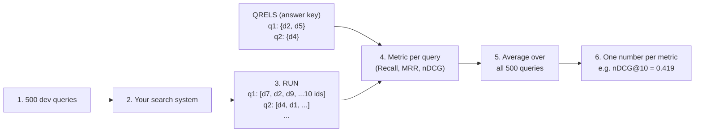
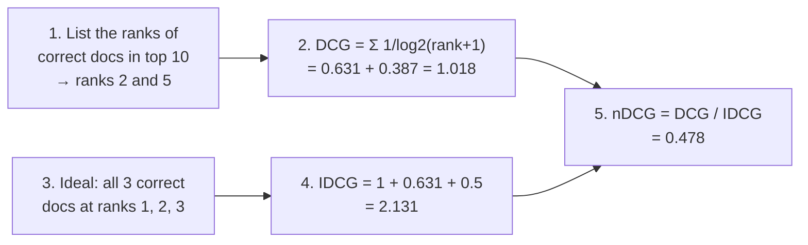
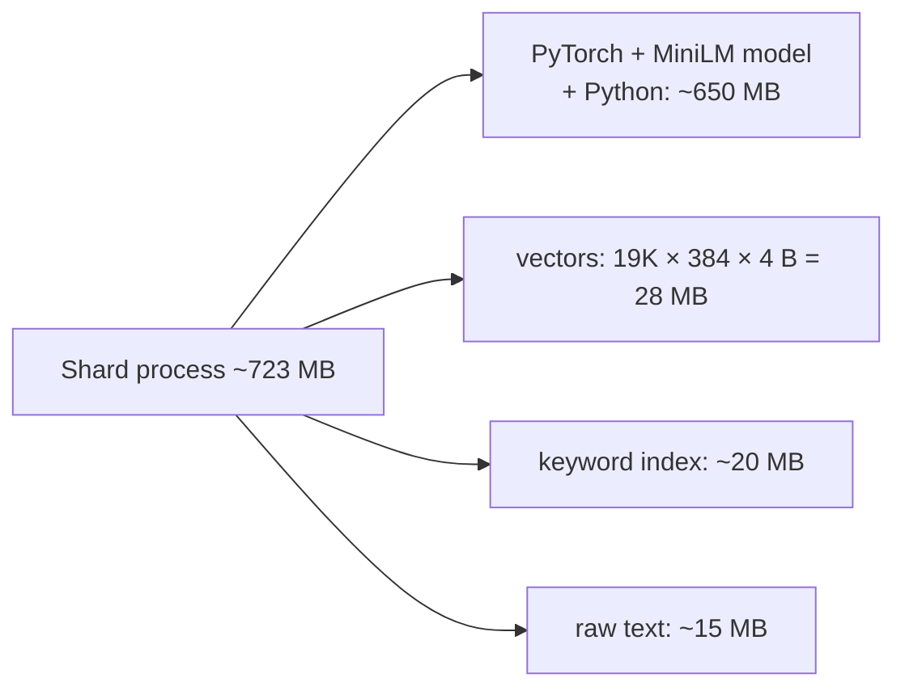
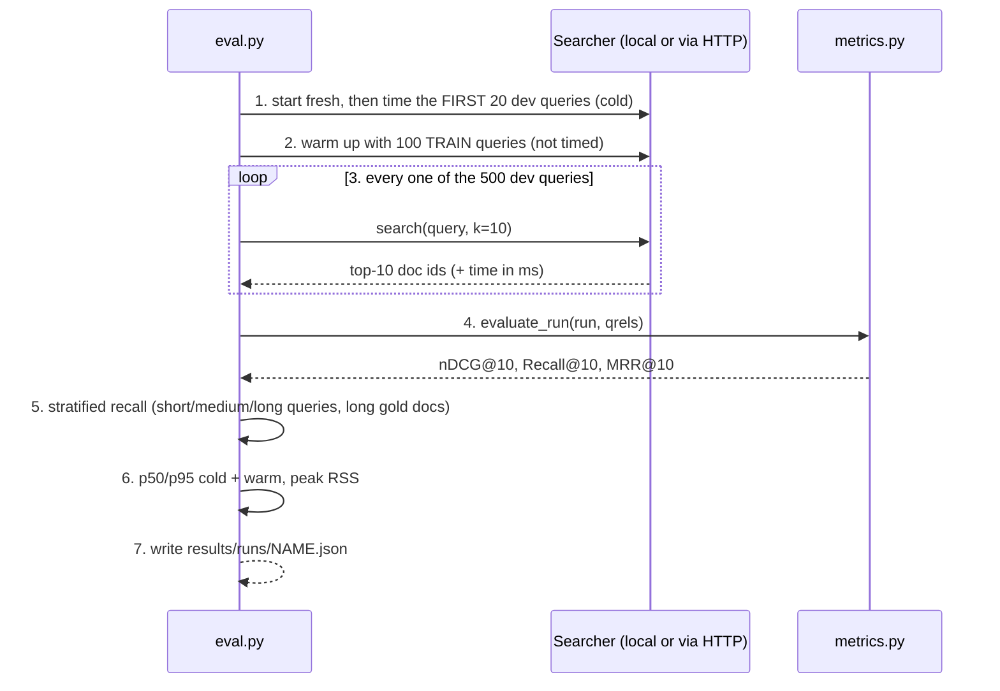

# Chapter 2: How we measure: Recall, MRR, nDCG, Coverage, latency, memory

> Goal: you can compute every metric in `results/` **by hand**, and you know which question each one answers.
> You must learn measurement *before* building anything. Otherwise you can't tell whether a change helped.

> ⚙️ **Running the commands:** open a terminal in the repo root (the folder with `src/`) and use the venv's Python.
> Seeing `No module named 'src'`? You're in the wrong folder. See "Before you run ANY command" in the [guide README](README.md).

---

## 2.1 The setup: a "run" and an "answer key"

> 🎯 **Why we're doing this:** Every decision in this project (BM25 vs dense, α = 0.7, no reranker, MiniLM vs BGE, agent or not) was made by comparing numbers. If you don't know exactly how a number is produced, you can't trust the decision.

For every query, a search system produces a **ranked list** (best first). Together, those lists are called a
**run**. The **qrels** (Chapter 1) are the answer key. A metric compares the two:



"@10" means "looking only at the top 10 results". Everything below 10 is ignored.

---

## 2.2 Recall@10: "did we find them?"

> 🎯 **Why we're doing this:** In RAG, the LLM reads all 10 passages, so **getting a correct passage into the 10 at all** is the main goal. Recall@10 measures exactly that. It's also the metric Part C uses to judge agents.

**Recall@10 = (number of correct docs in our top 10) ÷ (total number of correct docs for this query)**

Example: the query has **3** correct docs, A, B and C. Our top 10 is:

```
rank:   1   2   3   4   5   6   7   8   9   10
doc:    X   A   Y   Z   B   .   .   .   .   .        (C is not in the top 10)
            ✓           ✓
```
Recall@10 = 2 found ÷ 3 correct = **0.667**.

- It ignores *where* in the top 10 they are: A at rank 2 or rank 10 counts the same.
- **Why it matters for RAG:** the LLM reads all 10 passages, so *being in the top 10 at all* is what counts.

## 2.3 MRR@10: "how soon is the first good one?"

> 🎯 **Why we're doing this:** A human reading results top-down cares about the first good hit. MRR catches systems that *find* the answer but bury it at rank 9.

**Reciprocal Rank = 1 ÷ (rank of the FIRST correct doc)**, or 0 if none is in the top 10.
**MRR** (Mean Reciprocal Rank) = the average of that over all queries.

Same example: the first correct doc is A at rank 2, so RR = 1/2 = **0.5**.

| first correct at rank | 1 | 2 | 3 | 5 | 10 | not found |
|---|---|---|---|---|---|---|
| reciprocal rank | 1.0 | 0.5 | 0.333 | 0.2 | 0.1 | 0 |

- It only cares about the *first* hit (B and C don't matter at all).
- **Why it matters:** a human looking at results usually reads the first good one and stops.

## 2.4 nDCG@10: "correct docs, and near the top please"

> 🎯 **Why we're doing this:** It's the one number BEIR and papers report, so it's how we compare with the outside world and pick our final configuration. It rewards both finding and ordering.

nDCG combines both ideas: every correct doc counts (like recall), but **a hit lower down counts less** (like MRR,
but gentler). It sounds scary, but it is 3 small steps:

**Step 1, DCG** (Discounted Cumulative Gain): for each correct doc in the top 10, add `1 / log2(rank + 1)`:

| rank | 1 | 2 | 3 | 4 | 5 | 6 | 10 |
|---|---|---|---|---|---|---|---|
| `1/log2(rank+1)` (the "discount") | 1.000 | 0.631 | 0.500 | 0.431 | 0.387 | 0.356 | 0.289 |

Our example: A at rank 2 and B at rank 5 → DCG = 0.631 + 0.387 = **1.018**.

**Step 2, IDCG** (Ideal DCG): the DCG of the *perfect* ranking, i.e. all 3 correct docs at ranks 1, 2 and 3:
IDCG = 1.000 + 0.631 + 0.500 = **2.131**.

**Step 3, normalise:** nDCG = DCG ÷ IDCG = 1.018 ÷ 2.131 = **0.478**. Always between 0 (nothing found) and 1 (perfect).



#### Two details, with numbers

**Detail 1: where the "1" in Step 1 comes from (the *gain*).** The full formula gives each correct doc some
*points* (the **gain**) and then shrinks those points by the rank's discount:

```
contribution of one doc = gain × 1/log2(rank + 1)        where   gain = 2^relevance − 1
```

The relevance is the `score` column of the qrels (chapter 1): 0 = not relevant, 1 = relevant, 2 = highly relevant, …

| relevance (from the qrels) | gain = 2^rel − 1 | meaning |
|---|---|---|
| 0 | 2⁰ − 1 = **0** | a wrong doc earns nothing |
| 1 | 2¹ − 1 = **1** | a correct doc earns 1 point |
| 2 | 2² − 1 = **3** | a *highly* relevant doc earns 3 points (other datasets only) |

**In FiQA every relevance is 1, so every gain is 1.** "gain × discount" is then just "1 × discount", which is why
Step 1 simply says "add `1/log2(rank+1)`". You'll see `2 ** rel - 1` in the code because the code also works for graded datasets.

**Detail 2 (pitfall): the ideal (IDCG) must include the docs you MISSED.** Ask: "what would a *perfect* system have
scored on this query?" A perfect system finds **every** correct doc in the qrels and puts them at the top. So IDCG is
built from *all* gold docs, not just the ones your system found. Here's why it matters. Gold = {A, B, C}, and system S
finds only A, at rank 1:

| | DCG of S | IDCG | nDCG | verdict |
|---|---|---|---|---|
| ✅ **right:** ideal = all 3 gold docs at ranks 1, 2, 3 | 1.000 | 1 + 0.631 + 0.5 = 2.131 | 1.000 / 2.131 = **0.469** | "found 1 of 3": a mediocre score, correct |
| ❌ **wrong:** ideal = only the docs S found (just A, rank 1) | 1.000 | 1.000 | 1.000 / 1.000 = **1.0** | "perfect"?! It missed B and C |

With the wrong version, S (1 of 3 found) and a truly perfect system (3 of 3 at the top) would *both* score 1.0, and you
couldn't tell them apart. The ideal ranking is "everything correct, at the top", whether or not your system found it.

**nDCG@10 is the headline metric** of BEIR and of this project.

## 2.5 Same queries, different metrics: they answer different questions

> 🎯 **Why we're doing this:** Choosing the wrong metric leads to the wrong system. Seeing them disagree on the same data builds the intuition for which one to optimise when.

| query | correct docs | where we found them | Recall@10 | RR | nDCG@10 |
|---|---|---|---|---|---|
| q1 | {A, B} | A at rank 1, B not found | 1/2 = 0.50 | 1.00 | 1.000/1.631 = 0.61 |
| q2 | {A, B} | A at rank 4, B at rank 5 | 2/2 = 1.00 | 0.25 | (0.431+0.387)/1.631 = 0.50 |
| q3 | {A} | not found | 0.00 | 0.00 | 0.00 |
| **average** | | | **0.50** | **0.42** | **0.37** |

q1 vs q2: q2 has *double* the recall, but q1 has *4×* the MRR. Neither is "right". They measure different things.

## 2.6 Coverage@10 (Part C only): "did we answer BOTH halves?"

> 🎯 **Why we're doing this:** Plain recall can look fine while the system ignores half of a two-part question. Coverage is the metric that shows *why* agents (decomposition) help.

In Part C we create **compound questions** by gluing two questions together:
*"How does short selling work, and should I pay off my mortgage early?"* The gold docs are tagged by half
(half **a** = short selling, half **b** = mortgage).

**Coverage@10 = 1 if the top 10 contains at least one gold doc from EVERY half, else 0.** Then average over queries.

```
top 10:  [a-gold, x, x, a-gold, x, x, x, x, x, x]   → only half a covered → Coverage = 0
top 10:  [a-gold, x, b-gold, x, x, x, x, x, x, x]   → both halves         → Coverage = 1
```
Plain search tends to get "captured" by one half, which is why agents help here (Chapter 8).

---

## 2.7 Speed: latency, p50, p95, cold vs warm

> 🎯 **Why we're doing this:** The assignment has a hard limit (p95 ≤ 50 ms). Measured wrongly (the mean, cold-only, or on the queries you tuned on), you could pass or fail it by accident. Speed also decides real trade-offs: BGE and the reranker were rejected on latency.

**Latency** = time from sending a query to receiving results, in milliseconds (ms). We time all 500 dev queries and
summarise with **percentiles**, not the average. Here's why, with 10 measured queries (ms):

```
measured:  20 21 19 22 20 23 21 20 95 24
sorted:    19 20 20 20 21 21 22 23 24 95
mean   = 285 / 10 = 28.5 ms   ← no query actually took ~28 ms! one slow outlier dragged it up
p50    = the value at position ceil(0.50·10) = 5   → 21 ms   ("typical query")
p95    = the value at position ceil(0.95·10) = 10  → 95 ms   ("the slow ones")
```

- **p50** (median): half the queries are faster than this.
- **p95**: 95% of queries are faster than this. Users *feel* the slow ones, so the assignment's limit is on **p95 ≤ 50 ms**.
- **Cold**: the first queries after starting the program (models not loaded yet, caches empty). **Warm**: after a warm-up.
  We report both. Cold = the first 20 queries of a fresh process; warm = all 500 dev queries after warming up with 100
  **train** queries (never dev, so no dev query is "seen" before it's timed).

**Tail amplification** (important for Part B): if each of 3 shards is slow 5% of the time, a query that waits for
*all 3* is slow `1 − 0.95³ = 14%` of the time. Fan-out makes tails worse. We saw exactly this:
p95 was 26 ms with 1 shard vs 40 ms with 3 shards.

## 2.8 Memory: RSS and peak RSS

> 🎯 **Why we're doing this:** The assignment caps each shard at 2 GB. Knowing *what* uses memory (the model, not the data) tells you what to change if you hit the limit.

**RSS** (Resident Set Size) = how much RAM your process holds right now. **Peak RSS** = the highest it ever reached.
The assignment allows ≤ 2 GB per shard. Ours used ~723 MB, and most of it is the AI model plus the PyTorch library, not the data
(Chapter 7 explains the breakdown).



---

## 🧸 A. The toys

| toy | what it shows | run |
|---|---|---|
| `07_metrics_by_hand.py` | the 3-query table from §2.5, computed step by step **and** checked against `src/metrics.py` | `python examples/07_metrics_by_hand.py` |
| `10_latency_percentiles.py` | mean vs p50 vs p95 on simulated latencies; tail amplification as fan-out grows | `python examples/10_latency_percentiles.py` |
| `11_memory_measurement.py` | RSS vs Python's `tracemalloc`, and where memory goes | `python examples/11_memory_measurement.py` |

**How to read toy 07's output:** each `Step qN` block prints the ranked list, the hit ranks, then
`Recall@5 = 1/2 = 0.500 (src: 0.500)`. The left number is the hand formula; `(src: ...)` is the real function.
They must be equal. Then do its `TRY THIS` items: move q2's gold to ranks 1 and 2 and predict which metric jumps most
*before* running it.

## 🏭 B. The real thing in this repo

- `src/metrics.py`: `recall_at_k`, `mrr_at_k`, `ndcg_at_k`, `coverage_at_k`, `evaluate_run(run, qrels)`. Each has a
  `>>>` doctest example, and `tests/test_metrics.py` checks edge cases (duplicates, no relevant docs, IDCG uses all gold).
- `src/util.py`: `percentile` (nearest-rank, no interpolation) and `rss_mb` (current + peak).
- `src/eval.py`: the **harness** that ties it all together:



Run it: `python -m src.eval --mode local --strategy hybrid --fusion linear --alpha 0.7 --name my-test`.
**Our numbers** (dev, chosen system): nDCG@10 **0.419**, Recall@10 **0.491**, MRR@10 **0.487**, warm p50/p95 **20.7 / 24.5 ms**.

**Stratified metrics** = the same metric on sub-groups. They show *who* the system fails:
short queries (< 5 words) Recall 0.385 vs long (> 15 words) 0.510. The average hides that.

## ✍️ C. The toy, by you

1. **On paper**, for the ranking `[X, A, Y, B, Z, C, ...]` with gold `{A, B, C, D}`: compute Recall@5, RR@5 and nDCG@5.
   (Answer: hits at ranks 2 and 4 → Recall 2/4 = 0.5; RR 0.5; DCG = 0.631 + 0.431 = 1.062; IDCG(4 gold, k = 5) =
   1 + 0.631 + 0.5 + 0.431 = 2.562; nDCG = **0.414**.)
2. **In code** (`exercises/ch02_metrics/my_metrics.py`, no repo imports; check with `python -m pytest exercises\ch02_metrics`): write the 4 functions + `percentile`. Test them on §2.5's table
   and on toy 07's three queries. **Check:** you reproduce 0.613 / 0.501 / 0.000 for nDCG@5.
3. Write 3 edge-case tests yourself: duplicate doc ids in a ranking, a query with zero gold docs, and k larger than the list.

## 🔧 D. The real thing, by you

1. Write `evaluate(run, qrels)` that averages your metrics over queries.
2. **Sanity-check your evaluator before trusting it**. This habit catches most bugs:
   - **Oracle run:** for each query, rank = its gold docs first. Expected Recall@10 ≈ 1.0 and nDCG@10 = 1.0.
     (Recall slightly < 1 only if a query has > 10 gold docs.)
   - **Random run:** 10 random doc ids. Expected ≈ 0.000 (10 / 57,638 chance per gold doc).
   - **Reversed oracle:** gold docs placed at ranks 10, 9, ... → Recall still 1.0, but nDCG and MRR drop. Do you see why?
3. Write the timing harness: time each search with `time.perf_counter()`, run cold (20) and warm (after 100 train
   queries), report p50/p95 with *your* `percentile`. Record peak RSS with `psutil`.
4. Save every run to a JSON file (config + metrics + latencies). You'll compare dozens of runs later, so make them comparable now.
5. **Cross-check** (optional): `pip install pytrec_eval` (the official TREC evaluator) and compare your nDCG on a run.
   Must match to 4 decimals.

### Check yourself
1. A system returns the same 10 docs in a different order. Which of Recall@10 / MRR / nDCG can change?
2. Why does IDCG use *all* gold docs and not only the retrieved ones?
3. Your p50 is 20 ms and your mean is 35 ms. What does that tell you?
4. 3 shards, each slow 10% of the time. What fraction of fan-out queries are slow?  (1 − 0.9³ = 27%)

**Next:** [Chapter 3: keyword search and BM25](03_keyword_search_bm25.md)
