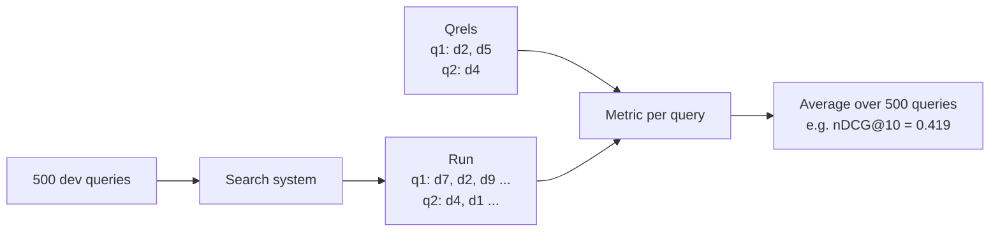
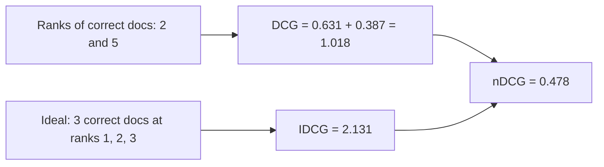
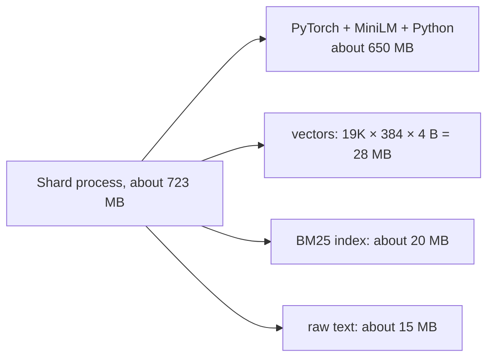
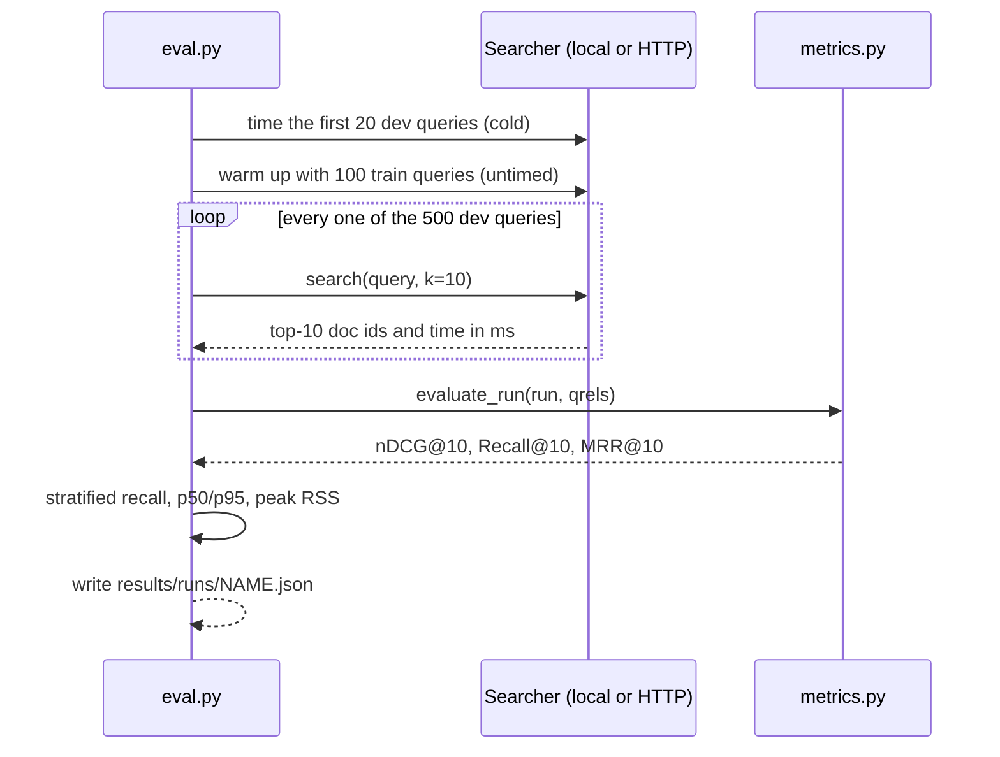

# Chapter 2: Measuring quality and speed

Every decision in this project (BM25 vs dense, α = 0.7, no reranker, MiniLM over BGE, when to use an agent) came from
comparing numbers, so I'll show you exactly how each number is produced before I build anything.

## A run and an answer key

For each query my system returns a ranked list, best first. All those lists together are a run. The qrels from Chapter 1
are the answer key, and a metric compares the two, query by query, then averages.



"@10" means I only look at the top 10 results.

I'll use one example throughout. A query has 3 correct docs, A, B and C, and my top 10 is:

```
rank:   1   2   3   4   5   6   7   8   9   10
doc:    X   A   Y   Z   B   .   .   .   .   .        (C is missing)
```

## Recall@10: did I find them?

Recall@10 = correct docs in my top 10 ÷ all correct docs for the query. Here that's 2 ÷ 3 = 0.667.

Position inside the top 10 doesn't matter. That suits RAG, where the LLM reads all 10 passages, so getting a correct one
into the 10 at all is the main goal. Part C also uses Recall@10 to judge the agents.

## MRR@10: how soon is the first good one?

Reciprocal rank = 1 ÷ (rank of the first correct doc), or 0 if none is in the top 10. MRR is its mean over queries. Here
the first hit is A at rank 2, so RR = 0.5.

| first correct at rank | 1 | 2 | 3 | 5 | 10 | not found |
|---|---|---|---|---|---|---|
| reciprocal rank | 1.0 | 0.5 | 0.333 | 0.2 | 0.1 | 0 |

MRR ignores everything after the first hit. It models a person who reads down the list and stops at the first good answer.

## nDCG@10: correct docs, near the top

nDCG is the headline metric of BEIR and of this project. Every correct doc counts, like recall, but a hit further down
counts less. It takes three steps.

DCG: for each correct doc in the top 10, add `1 / log2(rank + 1)`.

| rank | 1 | 2 | 3 | 4 | 5 | 6 | 10 |
|---|---|---|---|---|---|---|---|
| discount `1/log2(rank+1)` | 1.000 | 0.631 | 0.500 | 0.431 | 0.387 | 0.356 | 0.289 |

A at rank 2 and B at rank 5 give DCG = 0.631 + 0.387 = 1.018.

IDCG: the DCG of a perfect ranking, with all 3 correct docs at ranks 1, 2, 3: 1.000 + 0.631 + 0.500 = 2.131.

nDCG = DCG ÷ IDCG = 1.018 ÷ 2.131 = 0.478. It always lies between 0 and 1.



Two details matter when you implement it.

The full formula multiplies each discount by a gain, `gain = 2^relevance − 1`. A relevance-1 doc gains 1 and a relevance-2
doc gains 3. In FiQA every relevance is 1, so the gain is always 1, which is why the step above just adds the discount.
`src/metrics.py` still writes `2 ** rel - 1` so it works on graded datasets.

IDCG must be built from all gold docs, including the ones the system missed. Suppose a system finds only A, at rank 1.
With the correct IDCG (all 3 gold docs) its nDCG is 1.000 / 2.131 = 0.469. If you build IDCG only from the docs it found,
you get 1.000 / 1.000 = 1.0, and a system that found 1 of 3 looks perfect.

## The metrics disagree

| query | correct docs | where I found them | Recall@10 | RR | nDCG@10 |
|---|---|---|---|---|---|
| q1 | A, B | A at rank 1, B missing | 0.50 | 1.00 | 1.000/1.631 = 0.61 |
| q2 | A, B | A at rank 4, B at rank 5 | 1.00 | 0.25 | (0.431+0.387)/1.631 = 0.50 |
| q3 | A | missing | 0.00 | 0.00 | 0.00 |
| average | | | 0.50 | 0.42 | 0.37 |

q2 has double the recall of q1, and q1 has four times the MRR. They measure different things, and I pick the one that
matches what the user needs.

## Coverage@10 (Part C only)

In Part C I build compound questions by joining two questions: "How does short selling work, and should I pay off my
mortgage early?" Each gold doc is tagged with its half, a or b.

Coverage@10 = 1 if the top 10 has at least one gold doc from every half, else 0, averaged over queries.

```
top 10:  [a-gold, x, x, a-gold, x, x, x, x, x, x]   only half a covered   Coverage = 0
top 10:  [a-gold, x, b-gold, x, x, x, x, x, x, x]   both halves           Coverage = 1
```

Plain search tends to get captured by one half. Recall can look fine while half the question is ignored, and Coverage is
the number that shows it (Chapter 8).

## Latency: p50 and p95

Latency is the time from sending a query to getting results, in milliseconds. I report percentiles, not the mean. Ten
measured queries show why:

```
sorted:  19 20 20 20 21 21 22 23 24 95
mean = 28.5 ms     no query actually took about 28 ms, one outlier dragged it up
p50  = value at position ceil(0.50 × 10) = 5   → 21 ms   typical query
p95  = value at position ceil(0.95 × 10) = 10  → 95 ms   the slow ones
```

Users notice the slow queries, so the assignment's limit is p95 ≤ 50 ms. I use nearest-rank percentiles (`percentile` in
`src/util.py`).

Cold means the first queries after the process starts, before models and caches are warm. I time the first 20 dev queries
of a fresh process as cold. Warm means all 500 dev queries after a warm-up of 100 train queries. I warm up on train so that
no dev query has been seen before it's timed.

Fan-out makes tails worse. If each of 3 shards is slow 5% of the time, a query that waits for all 3 is slow
1 − 0.95³ = 14% of the time. I saw it: hybrid p95 was 26 ms with 1 shard and 40 ms with 3.

## Memory: peak RSS

RSS is the RAM a process holds right now, and peak RSS is the most it ever held. The limit is 2 GB per shard. My shards
peaked at about 723 MB, and most of that is the model, not the data:



## How my harness runs it

`src/metrics.py` has `recall_at_k`, `mrr_at_k`, `ndcg_at_k`, `coverage_at_k` and `evaluate_run(run, qrels)`, each with a
doctest, and `tests/test_metrics.py` covers edge cases such as duplicates, queries with no relevant docs, and IDCG using all
gold. `src/util.py` has `percentile` and `rss_mb`. `src/eval.py` ties it together:



```powershell
python -m src.eval --mode local --strategy hybrid --fusion linear --alpha 0.7 --name my-test
```

My chosen system on dev: nDCG@10 0.419, Recall@10 0.491, MRR@10 0.487, warm p50/p95 20.7 / 24.5 ms.

The harness also reports stratified recall, the same metric on sub-groups, because an average hides who the system fails.
Short queries (under 5 words) get Recall@10 0.385, long ones (over 15 words) 0.510.

If you write your own evaluator, test it on runs whose answer you already know. An oracle run (gold docs first) should give
nDCG@10 = 1.0. A run of random doc ids should give about 0. Gold docs placed at ranks 10, 9, 8 should keep recall at 1.0
while nDCG and MRR drop.

Next: [Chapter 3: keyword search with BM25](03_keyword_search_bm25.md)
