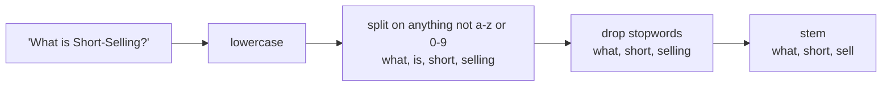
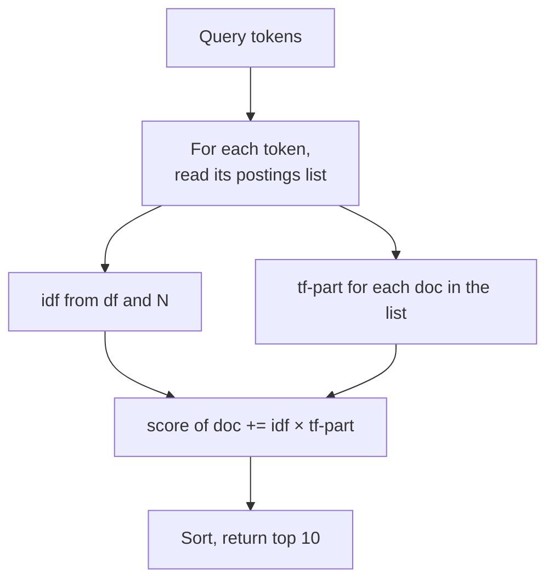
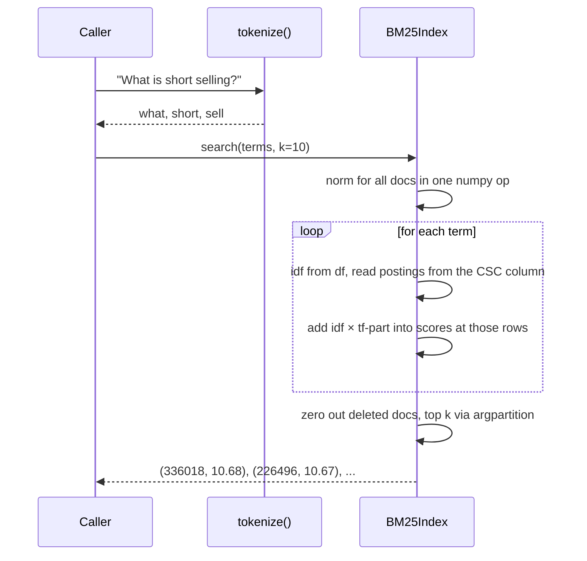

# Chapter 3: Keyword search with BM25

BM25 ("Best Matching 25", from the 1990s) is the classic keyword-scoring formula and still the default in Elasticsearch,
OpenSearch and Lucene. Here's the idea in one sentence: a document scores high if it contains the query's words,
especially rare ones, especially several times (with diminishing returns), and especially if the document is short. I
wrote my own BM25 in `src/retrieval/bm25.py`, and this chapter walks through it.

## Step zero: tokens

Computers compare strings, not meaning, so I first normalise text into tokens. "Selling", "sells" and "SELL" should all
become `sell`, and queries and documents must go through the same tokenizer or nothing matches.



Stopwords are words too common to say anything about the topic. I use Lucene's list of 33 so my numbers are comparable
with published BM25 results. That list includes "not" and "no", so BM25 sees "taxable" and "not taxable" as the same.
Stemming (Snowball, the Porter2 algorithm) cuts suffixes by rule: `investing → invest`, `mortgages → mortgag`,
`early → earli`. Stems don't have to be real words, they only have to be consistent.

Two real outputs of my tokenizer:

- `"I'm not paying taxes on my 401(k) withdrawals early"` → `[i, m, pay, tax, my, 401, k, withdraw, earli]`
- `"What is short selling?"` → `[what, short, sell]`

## The inverted index

Reading all 57,638 documents per query would be far too slow. So once, in advance, I build a map from each token to the
documents that contain it and how many times. It's the index at the back of a textbook.

```
 Forward (what I have):                  Inverted (what I build):
 d1: [short, sell, borrow, share]        borrow  → [(d1, tf=1)]
 d2: [short, stock, loss, unlimit]       sell    → [(d1, 1)]
 d3: [mortgag, pay, earli, mortgag]      short   → [(d1, 1), (d2, 1)]
                                         mortgag → [(d3, 2)]       tf = count in that doc
```

Each list is a postings list. To score `[short, sell]` I read just those two lists, so the cost grows with the number of
postings, not the number of documents. FiQA has 54,807 distinct tokens and 3.77 million (token, doc) pairs. This index
is also the structure I have to update for live writes in Part B.

## The ingredients

| symbol | meaning | FiQA example |
|---|---|---|
| `N` | number of documents | 57,638 |
| `df(t)` | documents containing token t | df(short) = 3,112 |
| `tf(t,d)` | times t appears in doc d | `short` appears 11 times in doc 336018 |
| `\|d\|` | length of doc d in tokens | 271 |
| `avgdl` | average doc length | 95.2 |
| `k1` | how fast extra repeats stop helping | 1.2 |
| `b` | how much long docs are penalised (0 none, 1 full) | 0.75 |

### IDF: rare words are better evidence

`idf(t) = ln(1 + (N − df + 0.5) / (df + 0.5))`. Real FiQA values with my tokenizer:

| token | df | idf |
|---|---|---|
| `what` | 15,719 | 1.30 |
| `stock` | 6,621 | 2.16 |
| `sell` | 5,639 | 2.32 |
| `short` | 3,112 | 2.92 |
| `ira` | 1,296 | 3.79 |
| `roth` | 822 | 4.25 |
| `bitcoin` | 346 | 5.11 |
| `prepay` | 115 | 6.21 |
| a token in only 1 doc | 1 | 10.56 |

`what` is in 27% of documents, so matching it says little. Matching `prepay` is worth about 5 times as much.

### TF with saturation

If I used raw tf, a spammy doc repeating "loan" 100 times would win. BM25 saturates it:

`tf-part = tf · (k1 + 1) / (tf + k1 · norm)`, where `norm = 1 − b + b · |d| / avgdl`

| tf (average-length doc, k1 = 1.2) | 1 | 2 | 5 | 20 | 100 |
|---|---|---|---|---|---|
| tf-part | 1.00 | 1.38 | 1.77 | 2.08 | 2.17 (the ceiling is k1 + 1 = 2.2) |

### Length normalisation

A 10-word doc that mentions "loan" once is probably about loans. A 1,000-word doc that mentions it once probably isn't.
`norm` handles this. It blends 1 ("ignore length") with the ratio `|d| / avgdl`, using b as the mix, and it sits in the
denominator, so a bigger norm means a smaller score. With b = 0 every doc gets norm 1. With b = 1 norm is the ratio itself.
I use the default b = 0.75.

One mention (tf = 1, k1 = 1.2, avgdl = 100):

| doc length | 25 | 50 | 100 | 200 | 400 |
|---|---|---|---|---|---|
| norm (b = 0.75) | 0.438 | 0.625 | 1.000 | 1.750 | 3.250 |
| tf-part | 1.443 | 1.257 | 1.000 | 0.710 | 0.449 |

A doc a quarter of the average length gets a 44% bonus for the same mention, and a doc 4 times longer gets less than half.

## The full formula

```
BM25(q, d) = Σ over query tokens t of   idf(t) × tf(t,d) · (k1 + 1) / (tf(t,d) + k1 · (1 − b + b · |d|/avgdl))
                                        "how rare"   "how much, saturated, length-adjusted"
```



## One real score by hand

Query "What is short selling?" gives `[what, short, sell]`. N = 57,638, avgdl = 95.21, k1 = 1.2, b = 0.75.

BM25's top result is doc 336018 (271 tokens): "...Good description (I hope) from Short Selling: What is Short Selling...".
Its norm is 1 − 0.75 + 0.75 × 271 / 95.21 = 2.385, since it's almost 3 times the average length.

| token | df | idf | tf | tf-part = tf·2.2 / (tf + 1.2·2.385) | contribution |
|---|---|---|---|---|---|
| what | 15,719 | 1.299 | 5 | 11.0 / (5 + 2.862) = 1.399 | 1.818 |
| short | 3,112 | 2.919 | 11 | 24.2 / (11 + 2.862) = 1.746 | 5.096 |
| sell | 5,639 | 2.324 | 8 | 17.6 / (8 + 2.862) = 1.620 | 3.766 |
| | | | | total | 10.680 |

The fifth result is doc 127585 (81 tokens, "In India the Short is what is called ... Naked Short..."), with norm 0.888:

| token | tf | tf-part | contribution |
|---|---|---|---|
| what | 1 | 1.065 | 1.384 |
| short | 5 | 1.813 | 5.293 |
| sell | 2 | 1.435 | 3.336 |
| | | total | 10.013 |

The long doc says "short" 11 times and the short doc only 5, yet "short" contributes more in the short doc (5.29 vs 5.10).
That's saturation and length normalisation working together. My index returns 10.6799 and 10.0129 for these two docs, so
the hand computation matches the code.

## Where BM25 fails

Paraphrases share no tokens: "shorting equities" and "betting a share price will fall" score 0 against each other.
Negation disappears because "not" is a stopword. And one rare word can dominate the score of an off-topic doc.

These are exactly the cases meaning search handles well, which is my argument for hybrid search in Chapter 5. On dev, my
BM25 gets nDCG@10 0.2642, Recall@10 0.3135, MRR@10 0.3222, at p50 1.2 ms. The published BEIR number on FiQA test is
0.236, so mine is in the expected range. It's the weakest system, but it's fast and catches what dense misses.

## How I implemented it

- `tokenize(text)`: regex `[a-z0-9]+` on lowercased text, drop the 33 stopwords, Snowball stem (cached).
- `idf(n_docs, df)`: the Lucene formula above.
- `CorpusStats(n_docs, total_len, df)`: what IDF and avgdl need. `merge()` adds two together, which Part B uses to get
  global statistics across shards (Chapter 7).
- `BM25Index.build(doc_ids, texts)`: builds a scipy sparse matrix (rows = docs, columns = tokens, values = tf). I keep it
  as CSC for fast "all docs for this token" and CSR for fast "all tokens of this doc", which deletes need.
- `BM25Index.search(terms, k, stats)`: vectorised. It computes `norm` for all docs in one numpy operation, adds each
  term's contribution into a `scores` array at that term's postings only, then takes the top k with `argpartition`.
- `add(doc_id, text)` and `delete(doc_id)`: live updates through a small delta dict for new docs and an `alive` mask for
  deleted ones (Chapter 7).



```powershell
python -m src.eval --mode local --strategy bm25 --name my-bm25
```

Next: [Chapter 4: meaning search with embeddings](04_meaning_search_embeddings.md)
