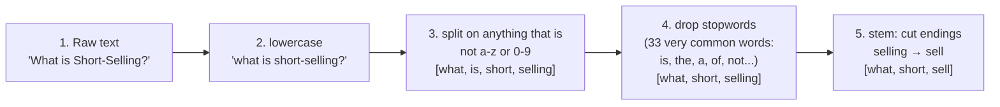
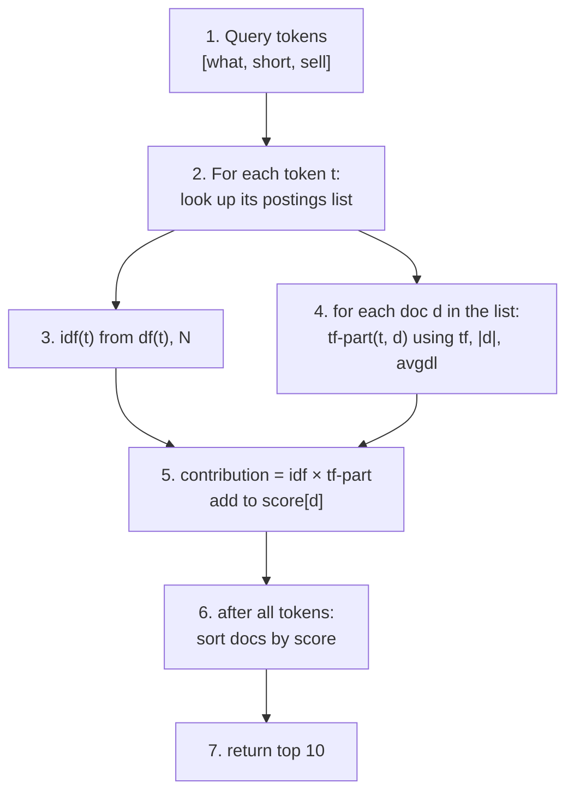
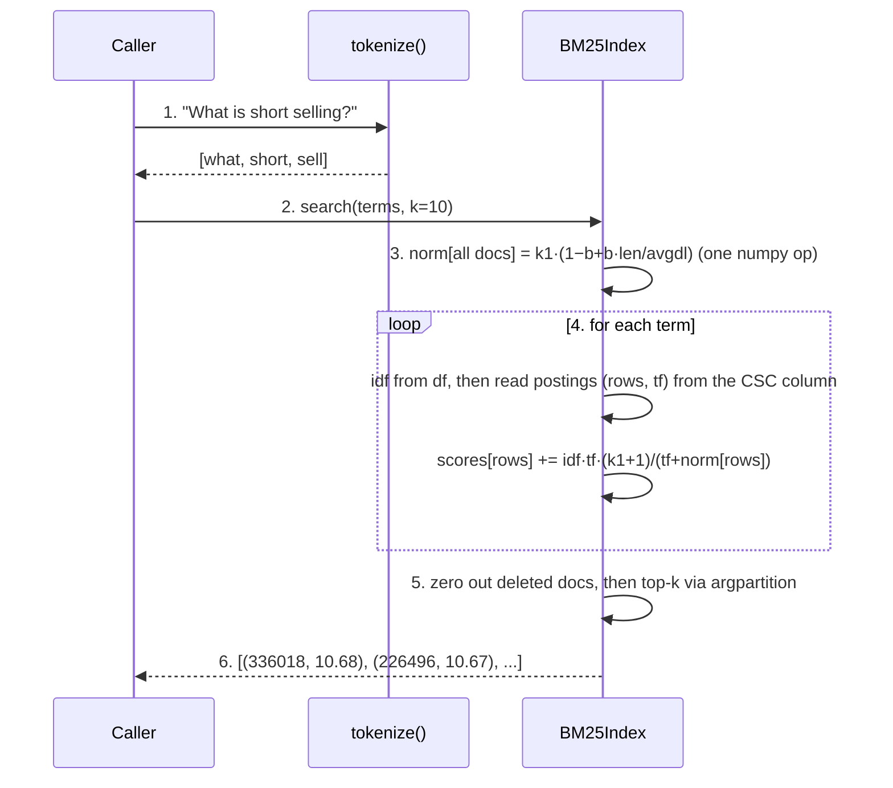

# Chapter 3: Keyword search: tokens, inverted index, TF-IDF, BM25

> Goal: you can compute a BM25 score by hand for a real FiQA document, explain every symbol in the formula,
> and build your own BM25 index that reproduces our numbers.

> ⚙️ **Running the commands:** open a terminal in the repo root (the folder with `src/`) and use the venv's Python.
> Seeing `No module named 'src'`? You're in the wrong folder. See "Before you run ANY command" in the [guide README](README.md).

**BM25** ("Best Matching 25", from the 1990s) is the classic keyword-search formula. It's still the default in
Elasticsearch, OpenSearch and Lucene, and still a strong baseline in 2026. Its idea in one sentence:
*a document scores high if it contains the query's words, especially the **rare** ones, especially **several times**
(with diminishing returns), especially if the document is **short**.*

---

## 3.1 Step zero: turn text into "tokens"

> 🎯 **Why we're doing this:** Keyword search only works if the query's words and the document's words are written the same way. Tokenisation decides what counts as "the same word", and a mismatch here silently zeroes scores.

A computer can't compare meaning; it compares strings. So first we normalise text into a list of **tokens**
(standardised words), so "Selling", "sells" and "SELL" all become the same token `sell`.



- **Stopwords** are words so common they carry no topic information ("the", "is"). We use Lucene's list of 33 so our numbers
  are comparable with published BM25 results. Pitfall: it includes **"not"** and **"no"**, so "taxable" and "not taxable" look identical to BM25.
- **Stemming** (the Snowball/Porter algorithm) chops suffixes with rules: `investing → invest`, `mortgages → mortgag`,
  `early → earli`. Stems aren't real words, and that's fine: they only need to be *consistent*.
- Real examples from our tokenizer:
  - `"I'm not paying taxes on my 401(k) withdrawals early"` → `[i, m, pay, tax, my, 401, k, withdraw, earli]`
  - `"What is short selling?"` → `[what, short, sell]`

**Critical rule:** queries and documents must go through the **same** tokenizer, or nothing will match.

## 3.2 The inverted index: the "back-of-the-book index"

> 🎯 **Why we're doing this:** Scoring all 57,638 docs from raw text per query would be far too slow. The inverted index makes BM25 cost ~1 ms, and it's also the structure we must update for live writes in Part B.

To find documents containing `short`, we can't read all 57,638 documents per query. Instead, we build, **once,
in advance**, a map from each token to the documents containing it (and how many times). That's exactly the index
at the back of a textbook: "mortgage → pages 12, 85, 201".

```
 Forward (what we have):                 Inverted (what we build):
 d1: [short, sell, borrow, share]        borrow → [(d1, tf=1)]
 d2: [short, stock, loss, unlimit]       sell   → [(d1, 1)]
 d3: [mortgag, pay, earli, mortgag]      short  → [(d1, 1), (d2, 1)]
                                         mortgag→ [(d3, 2)]        ← tf = term frequency in that doc
                                         ...
```
Each list is a **postings list**. To score the query `[short, sell]`, read just two short lists: cost ∝ the
number of postings, not the number of documents. FiQA has 54,807 distinct tokens and 3.77 million (token, doc) pairs.

## 3.3 The ingredients of the score

> 🎯 **Why we're doing this:** Each ingredient fixes a specific flaw of naive word counting: rare words matter more (IDF), repeats have diminishing value (saturation), long docs shouldn't win by size (length norm). Knowing which ingredient does what tells you which knob to turn.

| symbol | name | meaning | example (FiQA) |
|---|---|---|---|
| `N` | corpus size | number of documents | 57,638 |
| `df(t)` | document frequency | how many docs contain token t | df(short) = 3,112 |
| `tf(t,d)` | term frequency | how many times t appears in doc d | `short` appears 11× in doc 336018 |
| `|d|` | document length | tokens in doc d | 271 |
| `avgdl` | average doc length | mean of all `|d|` | 95.2 |
| `k1` | saturation knob | how fast extra repeats stop helping | 1.2 |
| `b` | length knob | how much long docs are penalised (0 = none, 1 = full) | 0.75 |

### IDF: rare words are better evidence
**IDF** (Inverse Document Frequency) turns df into a weight:  `idf(t) = ln(1 + (N − df + 0.5) / (df + 0.5))`

Real FiQA values (computed with our tokenizer):

| token | df | idf | intuition |
|---|---|---|---|
| `what` | 15,719 | 1.30 | in 27% of docs: weak evidence |
| `stock` | 6,621 | 2.16 | common in a finance forum |
| `sell` | 5,639 | 2.32 | |
| `short` | 3,112 | 2.92 | |
| `ira` | 1,296 | 3.80 | |
| `roth` | 822 | 4.25 | |
| `bitcoin` | 346 | 5.11 | |
| `prepay` | 115 | 6.21 | rare: very strong evidence |
| a token in only 1 doc | 1 | 10.56 | the maximum |

Matching `prepay` is worth ~5× matching `what`. That's the core insight of keyword search.

### TF with saturation: the 2nd mention helps, the 20th barely does
If we used tf directly, a spammy doc repeating "loan" 100 times would win. BM25 *saturates* tf instead:

`tf-part = tf · (k1 + 1) / (tf + k1 · norm)`, where `norm = 1 − b + b · |d| / avgdl` (= 1 for an average-length doc)

| tf (average-length doc, k1 = 1.2) | 1 | 2 | 5 | 20 | 100 |
|---|---|---|---|---|---|
| tf-part | 1.00 | 1.38 | 1.77 | 2.08 | 2.17 (max is k1 + 1 = 2.2) |

### Length normalisation: a match in a short doc means more
`norm` grows with document length. A 10-word doc mentioning "loan" once is probably *about* loans; a 1,000-word doc
mentioning it once probably isn't. With b = 0.75 and avgdl = 50: tf = 1 gives a tf-part of 1.49 for a 10-word doc and 0.11 for a
1,000-word doc (toy 02 prints exactly this).

## 3.4 The full formula

> 🎯 **Why we're doing this:** You'll implement this exactly (Ch. 3 §D). Every symbol must be clear, or your numbers won't match ours and you won't know why.

```
            ┌─ for every query token t ─────────────────────────────────────┐
BM25(q,d) = Σ    idf(t)  ×        tf(t,d) · (k1 + 1)
            t∈q            ─────────────────────────────────────
                            tf(t,d) + k1 · (1 − b + b · |d|/avgdl)
            └── "how rare" ──┘  └── "how much, saturated, length-adjusted" ──┘
```



## 3.5 A real example computed by hand

> 🎯 **Why we're doing this:** Computing one real score by hand is the fastest way to *believe* the formula, and it's the debugging technique you'll use when your implementation disagrees with ours.

Query: **"What is short selling?"** → tokens `[what, short, sell]`. N = 57,638, avgdl = 95.21, k1 = 1.2, b = 0.75.
BM25's **#1 result** is doc **336018** (271 tokens): *"...Good description (I hope) from Short Selling: What is Short Selling..."*

**Its norm:** 1 − 0.75 + 0.75 × 271 / 95.21 = **2.385** (it's 2.8× longer than average, so it gets penalised)

| token | df | idf | tf in doc | tf-part = tf·2.2 / (tf + 1.2·2.385) | contribution |
|---|---|---|---|---|---|
| what | 15,719 | 1.299 | 5 | 11.0 / (5 + 2.862) = 1.399 | 1.818 |
| short | 3,112 | 2.919 | 11 | 24.2 / (11 + 2.862) = 1.746 | 5.096 |
| sell | 5,639 | 2.324 | 8 | 17.6 / (8 + 2.862) = 1.620 | 3.766 |
| | | | | **total** | **10.680** |

And BM25's **#5 result**, doc **127585** (81 tokens, *"In India the Short is what is called ... Naked Short..."*): norm = 0.888

| token | tf | tf-part | contribution |
|---|---|---|---|
| what | 1 | 1.065 | 1.384 |
| short | 5 | 1.813 | 5.293 |
| sell | 2 | 1.435 | 3.336 |
| | | **total** | **10.013** |

Look how close they are: the long doc mentions "short" **11** times, the short doc only **5**, yet "short"
contributes *more* in the short doc (5.29 vs 5.10). That's saturation + length normalisation at work.
Our index returns exactly 10.6799 and 10.0129 for these two docs.

## 3.6 Where BM25 fails (why we need Chapter 4)

> 🎯 **Why we're doing this:** Knowing a method's failure modes tells you what to combine it with. BM25's failures are exactly dense retrieval's strengths, which is the whole argument for hybrid (Ch. 5).

1. **Synonyms / paraphrases:** query "shorting equities" vs doc "betting a share price will fall" → zero shared tokens → score 0.
2. **Negation is erased:** "not" is a stopword.
3. **Rare-word hijacking:** one rare word can dominate the score even if the doc is off-topic.

Our measured result: **BM25 nDCG@10 = 0.264** on dev (the published BEIR test number is 0.236). It's the weakest
system, but it is fast (1.2 ms/query) and complements meaning search (Chapter 5).

---

## 🧸 A. The toys

| toy | shows | run |
|---|---|---|
| `00_tokenization.py` | the 5 steps of §3.1 on one sentence, and why stemming makes `investing`/`invest` match | `python examples/00_tokenization.py` |
| `01_tf_idf_by_hand.py` | df and idf on 10 hand-written docs, and plain TF-IDF ranking | `python examples/01_tf_idf_by_hand.py` |
| `02_bm25_by_hand.py` | the saturation table, the length-normalisation table, and a **hand computation vs the real index** (they match: 0.7510 = 0.7510) | `python examples/02_bm25_by_hand.py` |
| `03_inverted_index_sparse.py` | the inverted index as a sparse matrix; adding docs (delta) and deleting them (tombstones) | `python examples/03_inverted_index_sparse.py` |

**How to read toy 02:** Step 2 is the saturation table (watch it approach 2.2). Step 3 is the length table (watch
0.114 for the 1,000-word doc). Step 4 prints `hand=... index=...`, which must be equal. Then do `TRY THIS 1`: set
`k1 = 0` and figure out why BM25 becomes "does the doc contain the word: yes/no".

## 🏭 B. The real thing in this repo: `src/retrieval/bm25.py`

- `tokenize(text)`: regex `[a-z0-9]+` on lowercased text → drop the 33 stopwords → Snowball stem (cached).
- `idf(n_docs, df)`: the Lucene formula above.
- `CorpusStats(n_docs, total_len, df)`: the numbers IDF and avgdl need. `merge()` adds two together; this matters
  hugely in Part B (Chapter 7: sharded IDF).
- `BM25Index`:
  - `build(doc_ids, texts)`: tokenises everything, builds a **scipy sparse matrix** (rows = docs, columns = tokens,
    values = tf). It's stored twice: CSC (fast "all docs for this token", i.e. postings) and CSR (fast "all tokens of this doc", for deletes).
  - `search(terms, k, stats)`: **vectorised** BM25. It computes `norm` for all docs at once, then for each query term
    adds `idf · tf·(k1+1)/(tf+norm)` into a numpy `scores` array, only at that term's postings. Then picks the top-k with `argpartition`.
  - `add(doc_id, text)` / `delete(doc_id)`: live updates (Chapter 7) through a small "delta" dict plus an `alive` mask.



Run it on FiQA: `python -m src.eval --mode local --strategy bm25 --name my-bm25`
→ **nDCG@10 0.2642, Recall@10 0.3135, MRR@10 0.3222, p50 1.2 ms**.
Build time: ~9 s for 57,638 docs (54,807 distinct tokens).

## ✍️ C. The toy, by you

1. **On paper**, with 3 docs:
   `d1 = "short selling means borrowing shares"`, `d2 = "a short story about selling a house and selling a car"`,
   `d3 = "mortgage rates rose"`. Query: `"short selling"`.
   Tokenise each (of these words only "a" and "and" are Lucene stopwords; "about" is kept!), compute df, idf (N = 3),
   |d|, avgdl, then BM25 for d1 and d2. Which wins, and why? (d2 has tf(sell) = 2, but it's longer...)
   *Answer:* d1 = `[short, sell, mean, borrow, share]` (5 tokens), d2 = `[short, stori, about, sell, hous, sell, car]` (7 tokens);
   **d2 wins narrowly, 0.985 vs 0.940**: the second "sell" outweighs the length penalty here.
2. **In code** (`my_attempt/bm25_toy.py`, ~50 lines, only `math`, `re`, `collections`):
   `tokenize` (lowercase + regex + stopword set + use `snowballstemmer`), `build_index(docs) -> {token: [(doc, tf)]}`,
   `bm25_search(query, index, ...)`. **Check:** your scores equal the real one for the same 3 docs:
   ```powershell
   .\.venv\Scripts\python -c "from src.retrieval.bm25 import BM25Index, tokenize; i=BM25Index().build(['d1','d2','d3'],['short selling means borrowing shares','a short story about selling a house and selling a car','mortgage rates rose']); print(i.search(tokenize('short selling'),3))"
   ```

## 🔧 D. The real thing, by you

1. **Version 1, pure Python dicts:** inverted index `{token: [(doc_idx, tf)]}`, doc lengths in a list, a score dict
   per query. Run all 500 dev queries through your Chapter 2 evaluator.
   **Target:** nDCG@10 ≈ **0.264** (exact if you use the same tokenizer: Lucene's 33 stopwords + `snowballstemmer` English
   + Lucene IDF + k1 = 1.2, b = 0.75). Expect it to be slower than ours (tens of ms/query). That's fine for now.
2. **Version 2, numpy/scipy:** build a `scipy.sparse.csc_matrix` (docs × tokens) and vectorise the scoring like §B.
   **Target:** the same metrics, ~1–2 ms/query.
3. **Experiments** (each one teaches something):
   - b = 0 vs 0.75 vs 1.0. Does length normalisation help on FiQA?
   - remove stemming → how much does nDCG drop?
   - remove "not" from the stopword list
4. **Live updates** (needed for Part B): add `add(doc)` and `delete(doc)` *without rebuilding*. Hint: a delta dict for
   new docs, an `alive` boolean array for deletes, and keep `df`/`total_len` updated. Test: add a doc with a made-up word,
   search for it, delete it, search again.

### Check yourself
1. Why is `idf` of a word in every doc ≈ 0? Why does Lucene add `1 +` inside the log?
2. What does `k1 = 0` do? What does `b = 0` do?
3. Doc A has tf = 11 and is 271 tokens long; doc B has tf = 5 and is 81 tokens long. Why can B's contribution be larger?
4. Name a FiQA query where BM25 must fail, and say why.

**Next:** [Chapter 4: meaning search with embeddings](04_meaning_search_embeddings.md)
