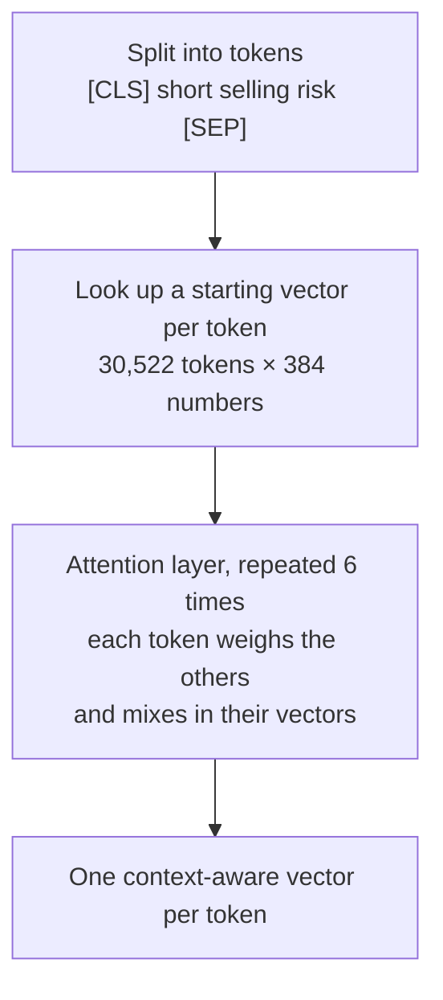
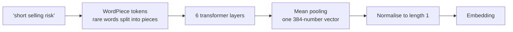
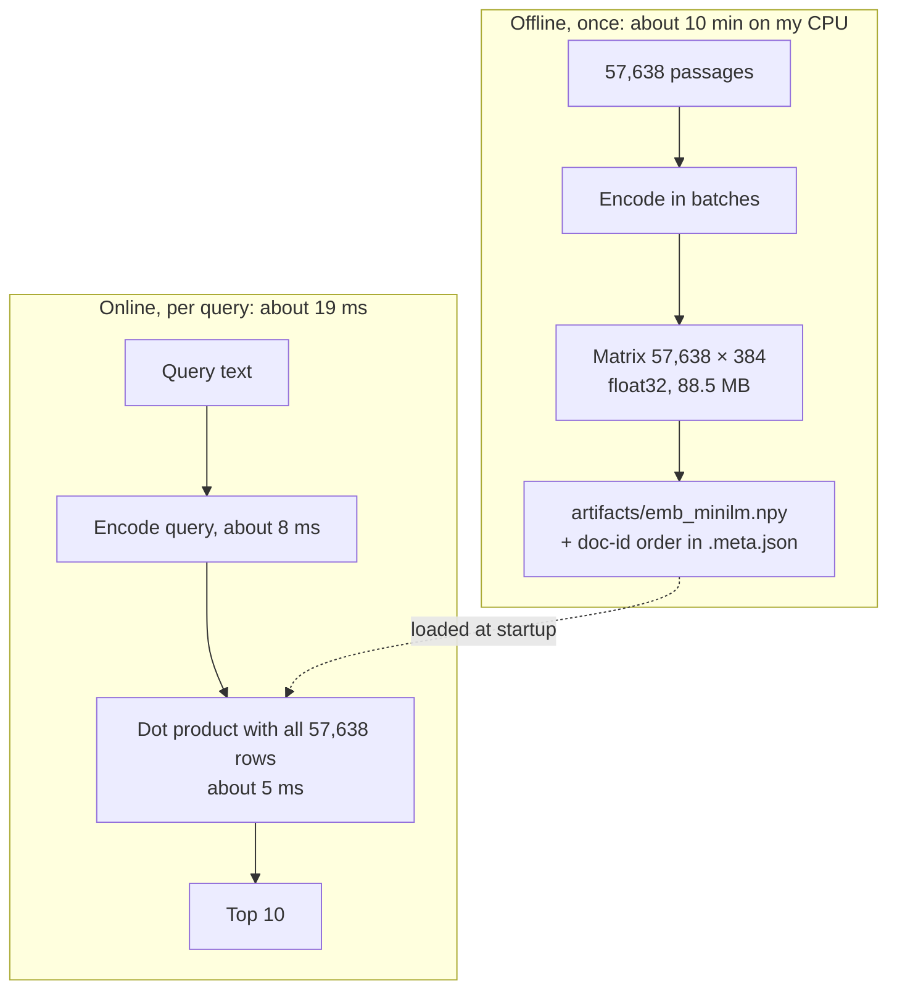
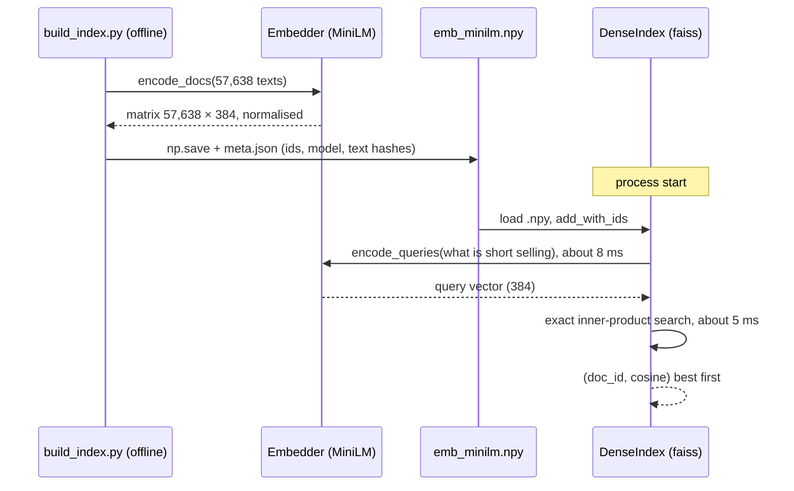

# Chapter 4: Meaning search with embeddings

BM25 fails when the answer uses different words from the question, and on FiQA that happens all the time. Meaning search
(also called dense retrieval, semantic search or vector search) fixes it, and it gave me +0.12 nDCG@10 over BM25. Here's
how it works.

## A map of meaning

Picture a map where every sentence is a point and sentences with similar meaning sit close together, even with no shared
words. "How do I pay off my mortgage early?" lands next to "Prepaying a home loan saves interest" and far from "Roth IRA
contribution limits".

```
          ▲ dimension 2
          │      • "Prepaying a home loan saves interest"
          │    • "How do I pay off my mortgage early?"   ← query
          │
          │                              • "Roth IRA contribution limits"
          └────────────────────────────────────────▶ dimension 1
```

An embedding is a point's coordinates. My map has 384 dimensions instead of 2, so every text becomes a list of 384
numbers (a vector). Nobody decides what each dimension means. A neural network learned the layout from data.

Real cosines from MiniLM (1 = same direction, 0 = unrelated):

| text A | text B | cosine |
|---|---|---|
| "How do I pay off my mortgage early?" | "Prepaying a home loan saves interest." | 0.53, with no shared content word |
| "How do I pay off my mortgage early?" | "Roth IRA contribution limits" | 0.08 |

## Cosine similarity

To compare two vectors I measure the angle between them:
`cosine(a, b) = (a · b) / (|a| · |b|)`, where `a · b = a1·b1 + a2·b2 + ...` and `|a| = sqrt(a1² + a2² + ...)`.

```
q  = (0.6, 0.8, 0.0)    |q|  = 1.0
d1 = (0.8, 0.6, 0.0)    |d1| = 1.0    q·d1 = 0.48 + 0.48 + 0 = 0.96   very similar
d2 = (0.0, 0.0, 1.0)    |d2| = 1.0    q·d2 = 0                        unrelated
```

If every vector is scaled to length 1 first (normalised), cosine is just the dot product, one multiply-add per dimension.
My models output normalised vectors, so every similarity in the system is a dot product.

## Where the numbers come from

### Transformers in brief

A transformer (from the 2017 paper "Attention Is All You Need") is a neural network that reads a whole text at once and
lets each word adjust its meaning by looking at the words around it. That step is called attention.

Context matters because words change meaning. BM25 thinks "a short story about selling a house" matches "short selling".
A fixed one-vector-per-word dictionary would give "short" the same vector in both. A transformer doesn't. I measured it on
MiniLM:

| word | sentence A | sentence B | cosine before the layers | after the 6 layers |
|---|---|---|---|---|
| short | "short selling a stock" | "a short story" | 1.000 | 0.743 |
| bank | "the river bank" | "a bank loan" | 1.000 | 0.791 |

Each word goes in identical (a table lookup) and comes out different because of its neighbours.



Attention in miniature, with made-up 2-number vectors: "short" = [1, 0] and "selling" = [0, 1]. If, for "short", its own
vector gets weight 0.4 and "selling" gets 0.6, the new "short" is 0.4 × [1, 0] + 0.6 × [0, 1] = [0.4, 0.6], pulled
towards "selling". In "a short story" the weight would go to "story" instead. The weight is a dot product of the first
token's query vector with the other token's key vector, and what flows across is the other token's value vector. A real
MiniLM layer does this with 384 numbers and 12 heads (12 parallel ways of deciding who matters), and repeats it 6 times.

### What MiniLM's 22.7 million weights are

MiniLM has 22,713,216 learned numbers (parameters), stored as 4-byte floats, which is about 91 MB on disk. I counted them
from the real model:

| part | numbers |
|---|---|
| word table, 30,522 tokens × 384 | 11,720,448 |
| position table, 512 × 384 (attention alone ignores word order) | 196,608 |
| sentence-type table and one normaliser | 1,536 |
| 6 layers × 1,774,464 (query, key, value and output matrices, a feed-forward block that expands to 1,536 and back, two normalisers) | 10,646,784 |
| pooler, a BERT leftover I don't use | 147,840 |
| total | 22,713,216 |

The word table is only about half. The query, key and value matrices are the numbers that decide which tokens listen to
which.

### The 256-token limit

Attention compares every token with every other token: 256 tokens is 65,536 comparisons per head per layer, and 2,048
tokens would be 64 times more. So small, fast models cap the input length, and MiniLM drops everything after token 256.
That cut-off is failure case 2 in Chapter 6.

To see context change a word's vector yourself (about 10 s):

```python
import numpy as np
from sentence_transformers import SentenceTransformer
m = SentenceTransformer("sentence-transformers/all-MiniLM-L6-v2", device="cpu")
sents = ["short selling a stock", "a short story"]
vecs = m.encode(sents, output_value="token_embeddings")        # one 384-number vector PER TOKEN
toks = [m.tokenizer.convert_ids_to_tokens(m.tokenizer(s)["input_ids"]) for s in sents]
a = vecs[0][toks[0].index("short")].numpy(); b = vecs[1][toks[1].index("short")].numpy()
print(toks)                                                    # [CLS] short selling a stock [SEP] ...
print(a @ b / np.linalg.norm(a) / np.linalg.norm(b))           # ≈ 0.74: same word, different context
```

### The two models I use

all-MiniLM-L6-v2 is a small transformer (6 layers) trained on over a billion pairs of related sentences, with one goal:
related pairs get close vectors and random pairs get distant ones. To turn its per-token vectors into one vector per text,
it averages them (mean pooling) and normalises the result. The loaded model prints exactly this:
`BertModel → Pooling(mean, 384) → Normalize`.



MiniLM is a bi-encoder: the query and the document are encoded separately. That is what makes it fast, because documents
are encoded once, offline. It's also why it is less precise than a cross-encoder (Chapter 5).

bge-small-en-v1.5 (BAAI, 2023) is a slightly bigger, newer model, 33M weights, also 384 dimensions. For search, the
query gets the prefix `"Represent this sentence for searching relevant passages: "` and documents don't. It scores a
little higher than MiniLM (nDCG@10 0.398 vs 0.388) and is about 60% slower. In Part B, migrating from MiniLM to BGE is my
zero-downtime model upgrade.

## Two phases: offline and online



The expensive part runs once and the per-query part is cheap. The split also explains the migration problem in Part B: a
new model means re-embedding the whole corpus.

Here is a real case where meaning wins. Dev query 600 is "After a stock dividend, how do you calculate holding periods for
capital gains taxes?" The gold answer, doc 472470, is one sentence:

> "Stock acquired through a (non-taxable) stock dividend has the same holding period as the stock on which the dividend was paid."

Dense ranks it first. BM25 doesn't have it in its top 100, even though they share the stems `stock, dividend, hold,
period`. BM25's top hit is a long post about mutual-fund capital-gains distributions that repeats "capital", "gain" and
"tax" more often. Dense judges the overall meaning.

## Searching vectors fast: faiss

faiss is a library for finding the vectors closest to a query vector.

| index type | how it works | recall | speed | when to use |
|---|---|---|---|---|
| Flat (`IndexFlatIP`) | every dot product, exactly | 100% | 5.3 ms for 57K, 1.4 ms per 19K shard | up to about 1M vectors |
| HNSW | a layered graph, hop greedily towards the query | 95 to 99%, tunable | about 0.1 to 1 ms | millions of vectors in RAM |
| IVF-PQ | cluster the vectors, search only nearby clusters, store compressed codes | 80 to 95% | fast, about 30 times less memory | 100M+ vectors |

"IP" is inner product, which equals cosine for normalised vectors. I use Flat because it is exact and already fast at this
size. At 100M vectors Flat would take about 9 s per query, so there approximate search is mandatory
([docs/topics/15_scaling_to_100M.md](../topics/15_scaling_to_100M.md)). I wrap the index in `IndexIDMap2` so each vector carries my own
id and can be removed, which live deletes need.

## Results

| system (dev) | nDCG@10 | Recall@10 | MRR@10 | p50 latency |
|---|---|---|---|---|
| BM25 | 0.264 | 0.314 | 0.322 | 1.2 ms |
| dense MiniLM | 0.388 | 0.467 | 0.453 | 18.8 ms |
| dense bge-small | 0.398 | 0.468 | 0.477 | 30.6 ms |

Dense is still weak where BM25 is strong: exact identifiers and rare names (`1099-B`, `EFU`, tickers), negation (only
partly handled), and long documents because of the 256-token cut-off. So I keep both, which is Chapter 5.

## How I implemented it

- `src/config.py` has `MODELS`, a registry `{"minilm": spec, "bge-small": spec}` with the HuggingFace name, the query
  prefix and max length 256.
- `src/retrieval/dense.py`: `Embedder.encode_queries(texts)` adds the prefix and calls
  `model.encode(..., normalize_embeddings=True)`. `Embedder.encode_docs(texts)` does the same without the prefix, in
  batches. `HashEmbedder` is a fake embedder that hashes words into a vector, so tests run without downloading a model.
  `DenseIndex` is `faiss.IndexIDMap2(faiss.IndexFlatIP(384))` plus a string-to-int id map, with `add`, `remove` and
  `search`.
- `src/index/build_index.py` encodes the corpus once into `artifacts/emb_minilm.npy` plus `.meta.json` (doc-id order, model
  spec, and a hash of each text so changed docs can be detected). It took 567 s for MiniLM and 1,063 s for BGE on my CPU.
  `--package` zips the artifacts.

I save the matrix and its doc-id list as a pair for a reason: if the corpus were reloaded in a different order, vector 17
would no longer belong to doc 17 and every result would be silently wrong.



```powershell
python -m src.eval --mode local --strategy dense --name my-dense
```

Next: [Chapter 5: hybrid fusion and reranking](05_hybrid_and_reranking.md)
