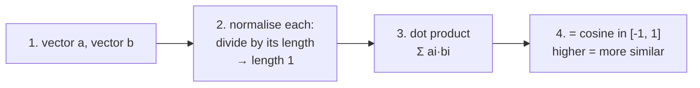
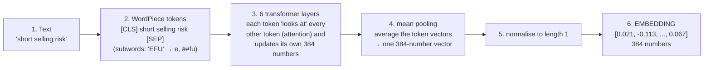
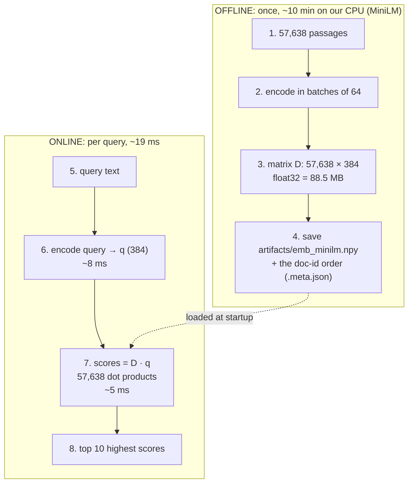
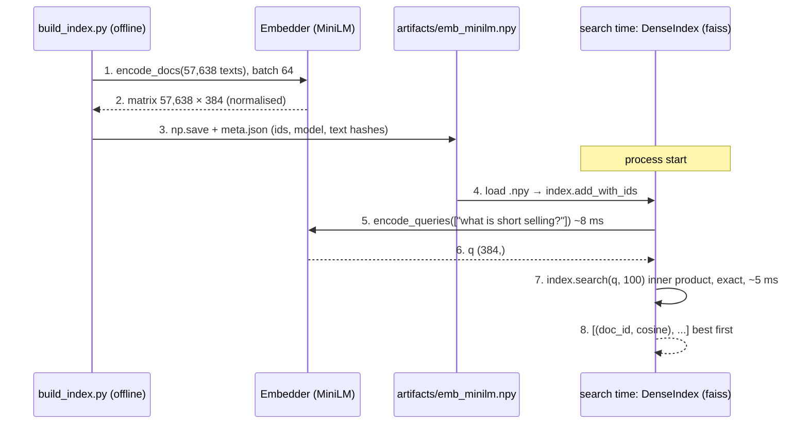

# Chapter 4: Meaning search: embeddings, MiniLM, BGE, cosine, faiss

> Goal: you understand what an "embedding" is, why it finds answers with no shared words, how MiniLM makes one,
> how we search 57,638 of them in milliseconds, and you can build dense retrieval yourself.

> ⚙️ **Running the commands:** open a terminal in the repo root (the folder with `src/`) and use the venv's Python.
> Seeing `No module named 'src'`? You're in the wrong folder. See "Before you run ANY command" in the [guide README](README.md).

"Dense retrieval", "semantic search", "vector search" and "embedding search" all mean the same thing: this chapter.

---

## 4.1 The idea: put every text on a "map of meaning"

> 🎯 **Why we're doing this:** FiQA questions and answers use different words for the same thing. Keyword search can't bridge that; a meaning map can. This single idea gave us +0.12 nDCG over BM25.

Imagine a map where every sentence is a point, and **sentences with similar meaning are close together**,
even if they use different words. "How do I pay off my mortgage early?" sits right next to "Prepaying a home loan
saves interest", and far away from "Roth IRA contribution limits".

```
          ▲ (dimension 2)
          │      • "Prepaying a home loan saves interest"
          │    • "How do I pay off my mortgage early?"   ← query
          │
          │                              • "Roth IRA contribution limits"
          │
          └────────────────────────────────────────▶ (dimension 1)
```

An **embedding** is a point's coordinates: a list of numbers. Our map doesn't have 2 dimensions but **384**,
so every text becomes a list of 384 numbers (a **vector**). Nobody chooses what each dimension means. A neural
network learned the layout from data.

Real numbers from MiniLM (cosine, explained next: 1 = same direction, 0 = unrelated):

| text A | text B | cosine |
|---|---|---|
| "How do I pay off my mortgage early?" | "Prepaying a home loan saves interest." | **0.53** (no shared content word!) |
| "How do I pay off my mortgage early?" | "Roth IRA contribution limits" | **0.08** |

## 4.2 Cosine similarity, by hand

> 🎯 **Why we're doing this:** Cosine is *the* comparison every vector search does billions of times. Normalising so that cosine = dot product is what makes it fast enough.

To compare two vectors, we measure the **angle** between them: same direction = similar meaning.

`cosine(a, b) = (a · b) / (|a| · |b|)`, where `a · b = a1·b1 + a2·b2 + ...` (the **dot product**) and `|a| = sqrt(a1² + a2² + ...)` (the length).

Hand example with 3-dimensional vectors:
```
q  = (0.6, 0.8, 0.0)       |q| = sqrt(0.36 + 0.64) = 1.0
d1 = (0.8, 0.6, 0.0)       |d1| = 1.0      q·d1 = 0.48 + 0.48 + 0 = 0.96   → cosine 0.96 (very similar)
d2 = (0.0, 0.0, 1.0)       |d2| = 1.0      q·d2 = 0                        → cosine 0.00 (unrelated)
```

**Trick we use everywhere:** if every vector is first scaled to length 1 ("**normalised**"), then
`cosine = dot product`, which is a single multiply-add per dimension: very fast. Our models output normalised vectors.



## 4.3 Where do the numbers come from? (MiniLM in plain words)

> 🎯 **Why we're doing this:** You don't need to train a transformer, but you must know its limits (the 256-token cut-off, separate query and doc encoding, the BGE prefix). Each of those limits shows up later as a failure or a design choice.

**all-MiniLM-L6-v2** is a small **transformer** (the same family as GPT, but tiny: 6 layers, ~22 million weights,
~90 MB on disk). It was trained on over 1 billion pairs of related sentences (question ↔ answer, title ↔ post, ...)
with one goal: *related pairs → vectors close together; random pairs → far apart.* After training, it places
new text sensibly on the map.



(This is exactly what our loaded model prints: `BertModel → Pooling(mean, 384) → Normalize`.)

Important limits:
- **Max 256 tokens.** Longer text is cut off, and the model never sees the rest. Remember this for the failure analysis (Chapter 6).
- It's a **bi-encoder**: the query and the document are encoded *separately*. That's what makes it fast (documents are
  encoded once, offline), and also what makes it less precise than a cross-encoder (Chapter 5).

**bge-small-en-v1.5** (from BAAI, 2023) is a slightly bigger and newer model (33M weights, also 384 numbers). One quirk:
for search, the *query* should start with the instruction `"Represent this sentence for searching relevant passages: "`.
Documents don't get it. It's slightly better than MiniLM alone (nDCG 0.398 vs 0.388) but ~60% slower. In Part B we
**migrate** from MiniLM to BGE as the "model upgrade" exercise.

## 4.4 Dense retrieval: the two phases

> 🎯 **Why we're doing this:** Splitting the work into an expensive offline phase (embed the corpus once, ~10 min) and a cheap online phase (~19 ms per query) is what makes dense search usable. It also explains the migration problem in Part B: a new model means re-embedding everything.



**A real FiQA example where meaning beats keywords.** Dev query **600**: *"After a stock dividend, how do you calculate
holding periods for capital gains taxes?"* The gold answer (doc 472470) is one precise sentence:

> "Stock acquired through a (non-taxable) stock dividend has the same holding period as the stock on which the dividend was paid."

**Dense ranks it #1. BM25 doesn't even have it in its top 100**, even though they share the stems `stock, dividend, hold, period`.
BM25's top hit is a long post about mutual-fund capital-gains distributions: it matches the many words "capital", "gain", "tax"
more often. Dense judges the *overall* meaning.

## 4.5 Searching vectors fast: faiss, flat vs approximate

> 🎯 **Why we're doing this:** At our size exact search is fine; at 100M it's impossible. Knowing the options and their recall/speed trade-off is what the "scale to 100M" question in the assignment tests.

**faiss** (Facebook AI Similarity Search) is a library for "find the vectors closest to this one".

| index type | how it works | recall | speed | when to use |
|---|---|---|---|---|
| **Flat** (`IndexFlatIP`) | compute **every** dot product, exactly | 100% | 5.3 ms for 57K; 1.4 ms per 19K shard | up to ~1M vectors |
| **HNSW** | a multi-level "small world" graph; hop greedily towards the query | 95–99% (tunable) | ~0.1–1 ms | millions of vectors in RAM |
| **IVF-PQ** | cluster the vectors, search only the nearest clusters, store compressed codes | 80–95% | fast, ~30× less memory | 100M+ vectors |

"IP" = **inner product** (= dot product = cosine for normalised vectors). We use **Flat**: exact, and fast enough at this size.
We wrap it in `IndexIDMap2` so each vector carries our own id and can be **removed** (needed for live deletes).

**"Approximate nearest neighbour" (ANN)** means trading a bit of recall for a lot of speed. At 57K vectors it's not
worth it (Flat is already 5 ms). At 100M it's mandatory (Flat would take ~9 s per query: `docs/15_scaling_to_100M.md`).

## 4.6 Results and trade-offs

> 🎯 **Why we're doing this:** This table is the evidence for two decisions: use dense (big quality gain), but keep BM25 around (it wins on exact identifiers).

| system (dev) | nDCG@10 | Recall@10 | MRR@10 | p50 latency | why |
|---|---|---|---|---|---|
| BM25 | 0.264 | 0.314 | 0.322 | 1.2 ms | exact words only |
| dense MiniLM | **0.388** | 0.467 | 0.453 | 18.8 ms | understands paraphrases; 8 ms is the query encoder |
| dense bge-small | 0.398 | 0.468 | 0.477 | 30.6 ms | better model, slower encoder |

Dense's weaknesses (BM25's strengths): **exact identifiers and rare names** (`1099-B`, `EFU`, tickers), negation
(it handles "not" only somewhat), and long documents (the 256-token cut-off).

---

## 🧸 A. The toys

| toy | shows | run |
|---|---|---|
| `04_embeddings_cosine.py` | query "gambling on equities dropping" shares **no** stem with any doc, so BM25 returns nothing, while dense finds all 3 shorting passages | `python examples/04_embeddings_cosine.py` |
| `05_bge_query_prefix.py` | the BGE query prefix: rankings with vs without it | `python examples/05_bge_query_prefix.py` |
| `06_faiss_flat_vs_hnsw.py` | exact Flat vs HNSW on 20,000 random vectors: speed vs recall | `python examples/06_faiss_flat_vs_hnsw.py` |

**How to read toy 04:** Step 2 says `BM25 top-3: nothing matched`. Step 3 lists cosines (d10 0.490, d2 0.360, d1 0.288):
those are the shorting docs. Step 4 shows geometry: cos(mortgage, home loan) = 0.47 vs cos(mortgage, roth ira) = 0.17.
**How to read toy 06:** flat = 1.6 ms with recall 1.0. HNSW gets 2–20× faster as recall drops. Random vectors are HNSW's worst case.

## 🏭 B. The real thing in this repo

- `src/config.py` → `MODELS`: a registry `{"minilm": spec, "bge-small": spec}` with the HuggingFace name, query prefix and max length 256.
- `src/retrieval/dense.py`:
  - `Embedder.encode_queries(texts)` adds the prefix → `model.encode(..., normalize_embeddings=True)` → float32 array.
  - `Embedder.encode_docs(texts)`: the same, without the prefix, in batches.
  - `HashEmbedder`: a fake embedder (hashing words into a vector) so tests/toys run without downloading a model.
  - `DenseIndex`: `faiss.IndexIDMap2(faiss.IndexFlatIP(384))` + a string↔int id map; `add`, `remove`, `search`.
- `src/index/build_index.py`: encodes the corpus once → `artifacts/emb_minilm.npy` + `.meta.json` (doc-id order, model
  spec, a hash of each text so changed docs can be detected). Took 567 s (MiniLM) and 1,063 s (BGE) on our CPU.
  `--package` zips the artifacts.



Run on FiQA: `python -m src.eval --mode local --strategy dense --name my-dense` → nDCG@10 **0.388**.

## ✍️ C. The toy, by you

1. **On paper:** normalise `a = (3, 4)` and `b = (4, 3)`, then compute their cosine. (Answer: (0.6, 0.8)·(0.8, 0.6) = **0.96**.)
   Then `c = (−3, −4)`: cosine with `a` = **−1** (opposite).
2. **In code** (`my_attempt/dense_toy.py`):
   ```python
   from sentence_transformers import SentenceTransformer
   import numpy as np
   m = SentenceTransformer("sentence-transformers/all-MiniLM-L6-v2", device="cpu")
   docs = ["Short selling means borrowing shares and selling them", "Paying off a mortgage early saves interest",
           "Betting that a share price will fall is called shorting", "A Roth IRA grows tax free"]
   D = m.encode(docs, normalize_embeddings=True)          # shape (4, 384)
   q = m.encode(["gambling on equities dropping"], normalize_embeddings=True)[0]
   scores = D @ q                                          # 4 cosines in one line
   print(sorted(zip(scores.round(3), docs), reverse=True))
   ```
   Then write your own `cosine(a, b)` with a Python loop (no numpy) and check it matches `D @ q`.
3. Try the negation test: embed `"a good investment"` and `"not a good investment"`. Their cosine is high (≈ 0.8–0.9).
   Embeddings capture *topic* better than *logic*.

## 🔧 D. The real thing, by you

1. **Encode the corpus** with all-MiniLM-L6-v2 (`max_seq_length = 256`, `normalize_embeddings=True`, batch 64).
   On a CPU this takes ~10 min, so **save it** (`np.save`) together with the list of doc ids **in the same order**.
   (Classic bug: re-loading the corpus into a dict with a different order, so vector 17 no longer belongs to doc 17.)
2. **Search v1, numpy:** `scores = D @ q; top = np.argpartition(-scores, 10)[:10]`, then sort those 10.
   Evaluate on dev. **Target: nDCG@10 ≈ 0.388, Recall@10 ≈ 0.467.**
3. **Search v2, faiss:** `IndexIDMap2(IndexFlatIP(384))`, `add_with_ids`, `search`. Same numbers, faster.
4. **Measure the parts** with `time.perf_counter()`: query encode (~8 ms here), search (~5 ms). Which dominates?
5. **Try BGE:** `BAAI/bge-small-en-v1.5`; the query gets the prefix, documents don't. **Target ≈ 0.398.** Then try without the
   prefix and see how much it mattered.
6. **Live updates:** support `remove(doc_id)` (faiss `remove_ids`) and `add(doc_id, vector)`. For an update, encode the
   new text, then remove + add.

### Check yourself
1. Why normalise vectors? What does it let you replace cosine with?
2. Why can dense find answers that share no words with the query?
3. What happens to a 1,000-word passage inside MiniLM? What does that predict?
4. Why is "query encode" (8 ms) slower than "search 57K vectors" (5 ms)?
5. When would you switch from Flat to HNSW or IVF-PQ?

**Next:** [Chapter 5: combining both, and re-ranking](05_hybrid_and_reranking.md)
