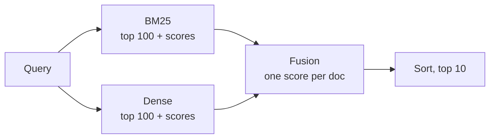
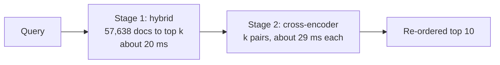
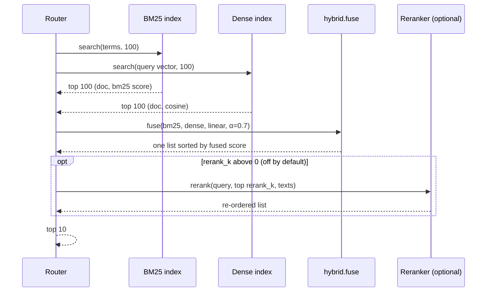

# Chapter 5: Hybrid fusion and reranking

BM25 and dense search fail on different queries, so I combine them. This chapter covers how I add two scores that live
on different scales, why I chose linear fusion over RRF, and why the cross-encoder reranker made my results worse.

## Why combine

| | BM25 (keywords) | dense (meaning) |
|---|---|---|
| good at | exact terms: `1099-B`, `EFU`, tickers, rare names | paraphrases: "prepay" ≈ "pay off early" |
| bad at | synonyms, paraphrases | rare identifiers, very long docs |
| nDCG@10 (dev) | 0.264 | 0.388 |

When two systems make different mistakes, combining them usually helps. That is hybrid retrieval.



I take the top 100 from each (the candidate depth), so fusion can rescue a doc even if one system ranked it 60th.

## You can't just add the scores

BM25 scores are unbounded (2 to 18 in this example) and cosines sit around 0.5 to 0.8:

```
BM25:  A 18.2   B 11.0   C 10.7   D 2.1
Dense: C 0.83   E 0.81   A 0.52   B 0.50
naive sum: A 18.72, C 11.53, B 11.50, D 2.10, E 0.81     this is just BM25's order
```

Dense barely moves anything. Adding raw scores is the most common hybrid bug, and it silently gives you BM25-only results.
There are two standard fixes.

### Linear fusion after min-max (what I chose)

1. Min-max each list to [0, 1]: `norm(s) = (s − min) / (max − min)`.
2. Combine: `score = α · dense_norm + (1 − α) · bm25_norm`. α is the weight on dense. A doc missing from one list gets 0
   for that part.

By hand with α = 0.7:

| doc | BM25 norm | dense norm | 0.7·dense + 0.3·bm25 |
|---|---|---|---|
| C | (10.7−2.1)/16.1 = 0.534 | (0.83−0.50)/0.33 = 1.000 | 0.700 + 0.160 = 0.860 |
| E | missing (0) | (0.81−0.50)/0.33 = 0.939 | 0.658 |
| A | 1.000 | (0.52−0.50)/0.33 = 0.061 | 0.042 + 0.300 = 0.342 |
| B | 0.553 | 0.000 | 0.166 |
| D | 0.000 | missing (0) | 0.000 |

### RRF: positions only

Reciprocal Rank Fusion ignores scores: `RRF(d) = Σ over lists of 1 / (60 + rank in that list)`. The constant 60 comes from
the 2009 paper and softens the gap between ranks.

| doc | BM25 rank | dense rank | RRF |
|---|---|---|---|
| A | 1 | 3 | 1/61 + 1/63 = 0.03227 |
| C | 3 | 1 | 1/63 + 1/61 = 0.03227 (tie) |
| B | 2 | 4 | 1/62 + 1/64 = 0.03175 |
| E | missing | 2 | 1/62 = 0.01613 |
| D | 4 | missing | 1/64 = 0.01562 |

RRF needs no scale handling and no tuning, which is why it's the industry default. But it throws information away: dense
said C (0.83) and E (0.81) are far better than A (0.52), and RRF only sees ranks 1, 2 and 3.

## The alpha sweep on FiQA

I measured both methods across α on dev (`scripts/ablations.py` → `results/ablation_fusion_minilm.json`). Every cell is
nDCG@10 over the 500 dev queries, with MiniLM as the dense model.

| α (weight on dense) | 0.1 | 0.3 | 0.5 | 0.6 | 0.7 | 0.8 | 0.9 |
|---|---|---|---|---|---|---|---|
| linear (min-max) | 0.287 | 0.336 | 0.402 | 0.418 | 0.419 | 0.406 | 0.401 |
| weighted RRF | not run | not run | 0.373 | 0.387 | 0.395 | 0.404 | 0.406 |

For reference, α = 0 would be pure BM25 (0.264) and α = 1 pure dense (0.388), so any cell above 0.388 beats the best single
system. At α = 0.5, weighted RRF is plain RRF. I didn't run RRF at α = 0.1 and 0.3, because with most of the weight on the
much weaker BM25 list it could only get worse.

Linear fusion peaks at α = 0.7 with nDCG@10 0.419 (Recall@10 0.491, MRR@10 0.487): +0.031 over dense alone for about 2 ms
more latency. The peak is a broad plateau, between 0.40 and 0.42 for every α from 0.5 to 0.9, and 0.6 would cost only
0.001, so I'm not fitting a lucky point. Plain RRF gives equal votes to a much weaker system and lands below dense alone.

| I chose | because | alternative | why I didn't use it |
|---|---|---|---|
| linear fusion, α = 0.7 | best nDCG@10 on dev (0.419), on a broad plateau | RRF | plain RRF scored 0.373, below dense alone, and the best weighted RRF reached 0.406 |

These live in `src/config.py` as `DEFAULT_FUSION = "linear"`, `DEFAULT_ALPHA = 0.7` and `CANDIDATE_DEPTH = 100`.

## Reranking with a cross-encoder

A cross-encoder reads the query and a passage together in one transformer pass, `[CLS] query [SEP] passage [SEP]`, and
outputs one relevance score. Every query word can attend to every passage word, so it can notice that "risk" in this
question is answered by "loss is unlimited" in this passage.

MiniLM and BGE are bi-encoders: the query and the passage are encoded separately and compared by cosine, and inside the
model they never see each other. That one difference decides the rest:

| | bi-encoder (MiniLM, BGE) | cross-encoder (reranker) |
|---|---|---|
| input | query alone, passage alone | query and passage together |
| output | one vector each, then cosine | one relevance score |
| precompute passages | yes, once, offline | no |
| work per query | 1 encode (about 8 ms) + dot products (about 5 ms over 57,638) | 1 full model pass per candidate (about 29 ms each) |
| can search | the whole corpus | a short list only |
| typical accuracy | good | usually better, but not on my data |

A bi-encoder has to squeeze every possible meaning of a passage into 384 numbers before it knows the question, so detail
gets lost. A cross-encoder avoids that, at a price: reranking all 57,638 docs would take about 28 minutes per query. So it
can only run as a second stage on the top k from the first.



I measured it on dev (`results/ablation_rerank_minilm.json`):

| rerank depth k | nDCG@10 | Recall@10 | p50 |
|---|---|---|---|
| none (hybrid only) | 0.419 | 0.491 | 20.7 ms |
| 10 | 0.406 | 0.491 | 338.6 ms |
| 20 | 0.396 | 0.483 | 621.0 ms |
| 50 | 0.377 | 0.463 | 1,246.3 ms |

At k = 10 the reranker only reorders the same 10 docs, so Recall@10 can't change, yet nDCG drops: it orders them worse.
The model, `ms-marco-MiniLM-L-6-v2`, was trained on short Bing web snippets, while FiQA is long opinionated forum posts
cut to 256 tokens. That is domain shift. I expected a stronger model to help and measured the opposite.

| I chose | because | alternative | why I didn't use it |
|---|---|---|---|
| no reranker by default | hybrid alone gives the best nDCG@10 (0.419) at 20.7 ms p50 | cross-encoder on the top 10 | nDCG fell to 0.406 and p50 rose to 338.6 ms, far over the 50 ms p95 budget |

The reranker stays in the code as an option (`rerank_k`, off by default).

## How I implemented it

- `src/retrieval/hybrid.py`: `minmax`, `linear(bm25, dense, alpha)`, `rrf(lists, k=60, weights)`, and `fuse(...)`, which
  dispatches to one of them. α is the dense weight in both, and RRF uses weights `(1 − α, α)`. `merge_shard_lists` is for
  Part B (Chapter 7).
- `src/retrieval/rerank.py`: `get_reranker()` loads the cross-encoder once, and `rerank(query, candidates, texts)`
  reorders.



```powershell
python -m src.eval --mode local --strategy hybrid --fusion linear --alpha 0.7 --name my-hybrid
python scripts/ablations.py                         # fusion sweep
python scripts/ablations.py --rerank --ks 10,20,50  # rerank sweep, slow (about 30 min)
```

Only after every choice was frozen on dev did I run test, once: nDCG@10 0.397.

Next: [Chapter 6: Part A end to end](06_part_a_end_to_end.md)
