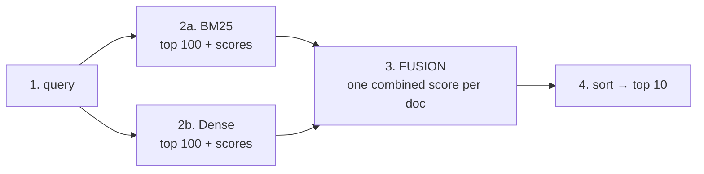
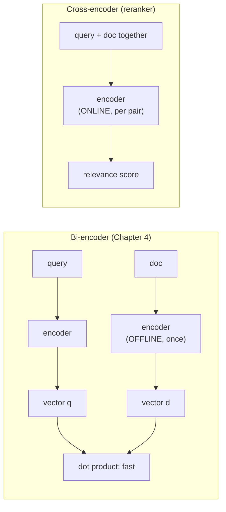
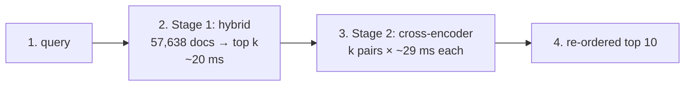
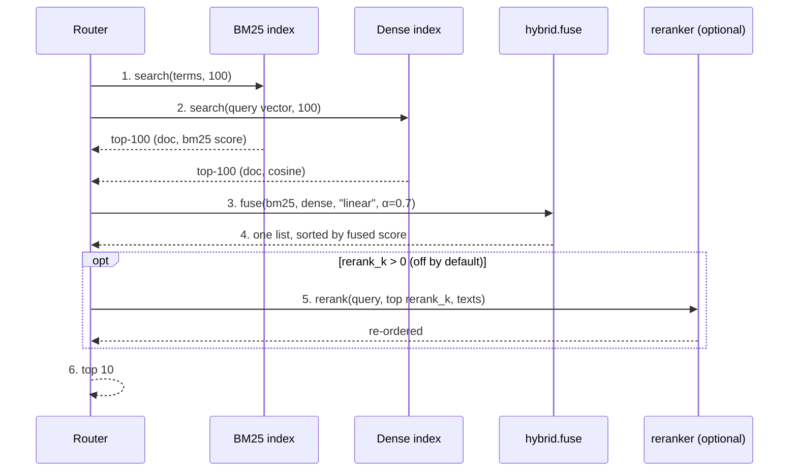

# Chapter 5: Combining and re-ranking: hybrid fusion, RRF, cross-encoders

> Goal: you know why combining keyword search and meaning search beats both, how to add two scores that live on
> different scales, and why the "smarter" reranker made our results *worse*.

> ⚙️ **Running the commands:** open a terminal in the repo root (the folder with `src/`) and use the venv's Python.
> Seeing `No module named 'src'`? You're in the wrong folder. See "Before you run ANY command" in the [guide README](README.md).

---

## 5.1 Why combine at all?

Chapters 3 and 4 showed that the two systems fail on **different** queries:

| | BM25 (keywords) | Dense (meaning) |
|---|---|---|
| good at | exact terms: `1099-B`, `EFU`, tickers, rare names | paraphrases: "prepay" ≈ "pay off early" |
| bad at | synonyms, paraphrases | rare identifiers, very long docs |
| nDCG@10 (dev) | 0.264 | 0.388 |

When two systems make *different* mistakes, combining them usually helps. This is called **hybrid retrieval**.



We take the top **100** from each (the "candidate depth"), so a doc can be rescued by fusion even if one system
ranked it only #60.

## 5.2 The scale problem: you can't just add the scores

> 🎯 **Why we're doing this:** The most common hybrid bug is adding raw scores and silently getting BM25-only results. Seeing it fail on numbers prevents that bug.

BM25 scores are unbounded (2 … 18 in this example); cosine scores sit around 0.5–0.8. A real example (toy 08):

```
BM25:  A 18.2   B 11.0   C 10.7   D 2.1
Dense: C 0.83   E 0.81   A 0.52   B 0.50
naive sum: A 18.72, C 11.53, B 11.50, D 2.10, E 0.81    ← that's just BM25's order; dense barely matters
```

Two standard fixes:

### Fix 1: Linear fusion after min-max normalisation (what we chose)

> 🎯 **Why we're doing this:** This is our final system's scoring rule. Computing it by hand lets you verify fusion code in seconds.
1. **Min-max** each list to [0, 1]: `norm(s) = (s − min) / (max − min)`.
2. Combine: `score = α · dense_norm + (1 − α) · bm25_norm`. **α** (alpha) is the weight on dense.
   A doc missing from one list gets 0 for that part.

By hand with α = 0.7:

| doc | BM25 norm | dense norm | 0.7·dense + 0.3·bm25 |
|---|---|---|---|
| C | (10.7−2.1)/16.1 = 0.534 | (0.83−0.50)/0.33 = 1.000 | 0.700 + 0.160 = **0.860** |
| E | – (0) | (0.81−0.50)/0.33 = 0.939 | **0.658** |
| A | 1.000 | (0.52−0.50)/0.33 = 0.061 | 0.042 + 0.300 = **0.342** |
| B | 0.553 | 0.000 | **0.166** |
| D | 0.000 | – (0) | **0.000** |

### Fix 2: RRF (Reciprocal Rank Fusion): use only positions

> 🎯 **Why we're doing this:** RRF is the industry-standard default. You need to know it to explain why we *didn't* choose it on FiQA.
Ignore scores entirely: `RRF(d) = Σ over lists  1 / (60 + rank_in_that_list)`. The constant 60 (from the 2009 paper)
softens the difference between ranks.

| doc | BM25 rank | dense rank | RRF |
|---|---|---|---|
| A | 1 | 3 | 1/61 + 1/63 = **0.03227** |
| C | 3 | 1 | 1/63 + 1/61 = **0.03227** (tie!) |
| B | 2 | 4 | 1/62 + 1/64 = 0.03175 |
| E | – | 2 | 1/62 = 0.01613 |
| D | 4 | – | 1/64 = 0.01562 |

RRF is simple and robust (no scales, no tuning), which is why it's popular. But it throws information away: dense said C (0.83) and
E (0.81) are far better than A (0.52), and RRF just sees ranks 1, 2, 3.

## 5.3 What happened on FiQA (the "alpha sweep")

> 🎯 **Why we're doing this:** A design choice (α = 0.7, linear) must be *measured*, not assumed. The sweep is the evidence, and its shape (a broad plateau) tells us the choice is robust.

We tried many α values on **dev** (`scripts/ablations.py` → `results/ablation_fusion_minilm.json`).
**Every cell is nDCG@10**: the average over the 500 dev queries, with MiniLM as the dense model.

| nDCG@10 on dev, α = weight on dense | 0.1 | 0.3 | 0.5 | 0.6 | 0.7 | 0.8 | 0.9 |
|---|---|---|---|---|---|---|---|
| linear (min-max) | 0.287 | 0.336 | 0.402 | 0.418 | **0.419** | 0.406 | 0.401 |
| weighted RRF | – | – | 0.373 | 0.387 | 0.395 | 0.404 | **0.406** |

For reference: dense alone = 0.388, BM25 alone = 0.264. (α = 0.5 RRF is plain, unweighted RRF.)
The same file also stores Recall@10 and MRR@10 for every cell. At the shipped point (linear, α = 0.7):
nDCG@10 **0.419**, Recall@10 **0.491**, MRR@10 **0.487**.

**How to read the table:**
- **α is the dense share; 1 − α goes to BM25.** The two ends would be the single systems: α = 0 is pure BM25 (0.264),
  α = 1 is pure dense (0.388). **Any cell above 0.388 means the mix beat the best single system.**
- **Linear row:** climbs from 0.287 (α = 0.1, mostly BM25) to a peak of **0.419 at α = 0.7**, then slips back
  (0.406, 0.401). The best mix leans heavily on dense, but a ~30% BM25 share still adds something dense misses
  (exact names, numbers, rare terms).
- **Weighted RRF row:** at α = 0.5 both lists get equal weight, i.e. plain RRF: **0.373, below dense alone**. It improves only
  as dense gets more weight (0.406 at α = 0.9), and never reaches linear's 0.419.
- **Why the dashes:** RRF wasn't run at α = 0.1 and 0.3. With most of the weight on the much weaker BM25 list, it can
  only get worse, so those runs would have told us nothing.

Three lessons:
1. **Hybrid wins**, +0.031 nDCG over dense for +2 ms. Cheap quality.
2. **Plain RRF hurt** (0.373 < 0.388): giving equal votes to a much weaker system drags you down.
3. The best α is a **broad plateau**: linear stays between 0.40 and 0.42 for every α from 0.5 to 0.9, and peaks at 0.6–0.7.
   We aren't overfitting a single lucky point. Picking 0.6 instead of 0.7 would cost only 0.001.

## 5.4 Re-ranking: a second, slower, more careful look

> 🎯 **Why we're doing this:** Rerankers are the textbook next step after hybrid. Learning *why* ours failed (domain shift, truncation, cost) teaches you to measure before trusting "stronger models".

A **cross-encoder** reads the query and a passage **together** in one transformer pass:
`[CLS] query [SEP] passage [SEP]` → one relevance score. Every query word can "look at" every passage word,
so it can notice that "risk" relates to "loss is unlimited". It's usually more accurate than a bi-encoder (Chapter 4),
but **nothing can be precomputed**: one full model pass per (query, passage) pair.

**What's a bi-encoder, then?** It's what MiniLM and BGE are (Chapter 4). "Bi" means **two separate encodings**: the query
goes through the model on its own, the passage goes through on its own, each becomes a vector of 384 numbers, and
the score is just the **cosine** of the two vectors. Inside the model, the query and the passage **never see each
other**. That one difference decides everything else:

- **What can be done ahead of time.** A bi-encoder's passage vector doesn't depend on the question, so every passage is
  encoded **once, in advance**. We did all 57,638 (about 10 minutes, saved as `artifacts/emb_minilm.npy`, 88 MB). At query time
  we only encode the query (~8 ms) and take dot products with all stored vectors (~5 ms for 57,638). That's why it can
  search the **whole corpus**. A cross-encoder's score depends on the *pair*, so nothing can be prepared, and every
  candidate needs its own full model pass. That's only affordable for a **short list** of candidates the fast retrievers already found.
- **Why the bi-encoder is usually less accurate.** The passage's vector is made **without knowing the question**. All its
  possible meanings must be squeezed into 384 numbers in advance, and detail gets lost. Its words never attend to the
  query's words, so it can't notice, the way the cross-encoder can, that the "risk" in *this* question is answered by
  "loss is unlimited" in *this* passage.

| | bi-encoder (MiniLM, BGE) | cross-encoder (the reranker) |
|---|---|---|
| input | query alone; passage alone | query + passage together |
| output | one vector each → cosine | one relevance score |
| precompute the passages? | **yes**, once, offline | **no** |
| work per query | 1 encode (~8 ms) + dot products (~5 ms over 57,638) | 1 full model pass **per candidate** (~29 ms each) |
| can search | the whole corpus | a short list only, i.e. reranking (top 10 → ~340 ms, top 50 → ~1.2 s) |
| typical accuracy | good | usually better (but not on our data, see below) |

(Measured: `results/microbench.json` and `results/ablation_rerank_minilm.json`.)



So it's used as **stage 2** on only the top-k from stage 1:



Cost arithmetic: ~29 ms per pair on our CPU, so k = 10 adds ~300 ms and k = 50 adds ~1.2 s. Reranking all 57,638 docs
would take **28 minutes per query**.

**Our result: a negative one, and that's an important lesson.**

| rerank depth k | nDCG@10 | Recall@10 | p50 |
|---|---|---|---|
| none (hybrid only) | **0.419** | 0.491 | 20.7 ms |
| 10 | 0.406 | 0.491 | 339 ms |
| 20 | 0.396 | 0.483 | 621 ms |
| 50 | 0.377 | 0.463 | 1,246 ms |

At k = 10 Recall@10 can't change (same 10 docs, reordered), yet nDCG *drops*: the reranker orders them **worse**.
Why? The model (`ms-marco-MiniLM-L-6-v2`) was trained on short Bing web snippets, while FiQA is long opinionated forum posts
(cut to 256 tokens). That's **domain shift**. "Stronger model" is a hypothesis, not a fact. **Always measure.** We don't ship it.

---

## 🧸 A. The toys

| toy | shows | run |
|---|---|---|
| `08_fusion_rrf_vs_linear.py` | exactly the tables in §5.2: naive sum, RRF (with the A/C tie), linear at α = 0.3/0.5/0.7 | `python examples/08_fusion_rrf_vs_linear.py` |
| `09_bi_vs_cross_encoder.py` | bi-encoder vs cross-encoder on 10 toy docs: scores and time per pair | `python examples/09_bi_vs_cross_encoder.py` |

**How to read toy 08:** Step 2 (naive sum) shows E, dense's #2, ending *last*. Step 3 shows the RRF tie. Step 4 shows how
raising α moves C and E up. **Toy 09:** the "CE logit" column is the cross-encoder's raw score (can be negative; only its
order matters). Its timings depend heavily on how busy your CPU is, so compare ratios, not absolute ms.

## 🏭 B. The real thing in this repo

- `src/retrieval/hybrid.py`: `minmax(list)`, `linear(bm25, dense, alpha)`, `rrf(lists, k=60, weights)`, and
  `fuse(bm25, dense, method, alpha)`, which dispatches to one of them. α is the dense weight in both (RRF uses weights `(1−α, α)`).
  `merge_shard_lists` is used in Part B (Chapter 7).
- `src/retrieval/rerank.py`: `get_reranker()` (loads the cross-encoder once) and `rerank(query, candidates, texts)`.
- `src/config.py`: `DEFAULT_FUSION = "linear"`, `DEFAULT_ALPHA = 0.7`, `CANDIDATE_DEPTH = 100`.
- Hybrid search in the system (single node or sharded):



Run: `python -m src.eval --mode local --strategy hybrid --fusion linear --alpha 0.7 --name my-hybrid` → **0.419**.
The sweep: `python scripts/ablations.py` (fusion) and `python scripts/ablations.py --rerank --ks 10,20,50` (slow: ~30 min).

## ✍️ C. The toy, by you

1. **On paper:** redo §5.2's linear table for α = 0.5. Which doc is #1? (Answer: C = 0.5·1 + 0.5·0.534 = 0.767.)
   Then compute RRF with k = 1 instead of 60. Does the tie survive? (A = 1/2 + 1/4 = 0.75, C = 1/4 + 1/2 = 0.75: still tied.)
2. **In code** (`exercises/ch05_fusion/my_fusion.py`, ~30 lines; check with `python -m pytest exercises\ch05_fusion`): `minmax`, `linear`, `rrf`. **Check** against toy 08's printed numbers.
3. Edge cases to handle: a list where all scores are equal (division by zero in min-max!), a doc in only one list, an empty list.

## 🔧 D. The real thing, by you

1. Using your BM25 (Ch. 3) and dense (Ch. 4): for each dev query, get the top 100 from each, fuse, take the top 10, evaluate.
2. **Sweep α** ∈ {0.1, 0.2, …, 0.9} for linear, and the same for weighted RRF. Plot nDCG vs α. **Target:** a peak ≈ **0.419**
   near α = 0.7, and plain RRF ≈ 0.373.
3. **Pitfall to experience:** fuse with candidate depth 10 instead of 100 and compare. Then compare depth 100 vs 200 for the
   *same* query. Min-max depends on what's in the list, so the scores (and sometimes the order) change!
4. **Rerank:** `from sentence_transformers import CrossEncoder; ce = CrossEncoder("cross-encoder/ms-marco-MiniLM-L-6-v2")`;
   `ce.predict([(q, text) for text in top_k_texts])`. Measure nDCG and latency for k = 10 and 20 on the first 100 dev queries
   (the full 500 takes long). Do you also see it *lose*?
5. Only after all choices are frozen on dev: run **test once** (Chapter 1). Ours: **0.397**.

### Check yourself
1. Why does the naive sum of BM25 + cosine behave like BM25 alone?
2. When would you prefer RRF over linear fusion? (Hint: unknown or very different score scales, no tuning data.)
3. Why can't reranking the top 10 change Recall@10?
4. Give two reasons our reranker hurt. How would you try to fix it?

**Next:** [Chapter 6: Part A end to end](06_part_a_end_to_end.md)
