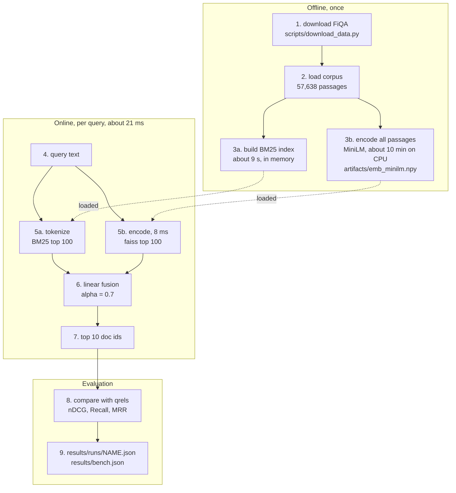
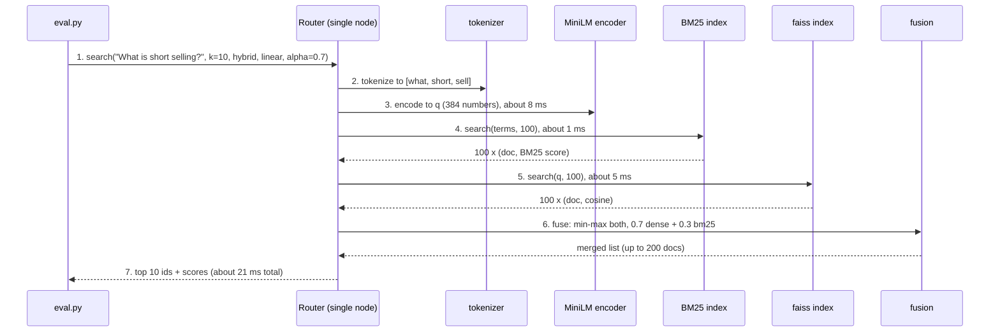
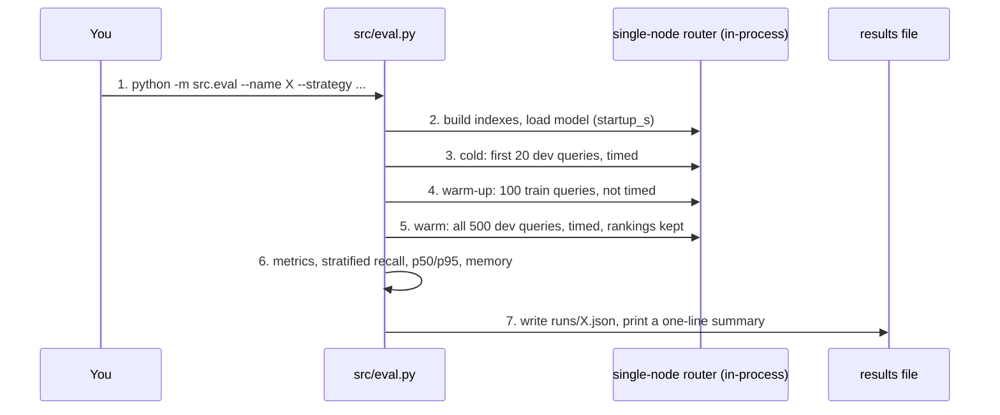
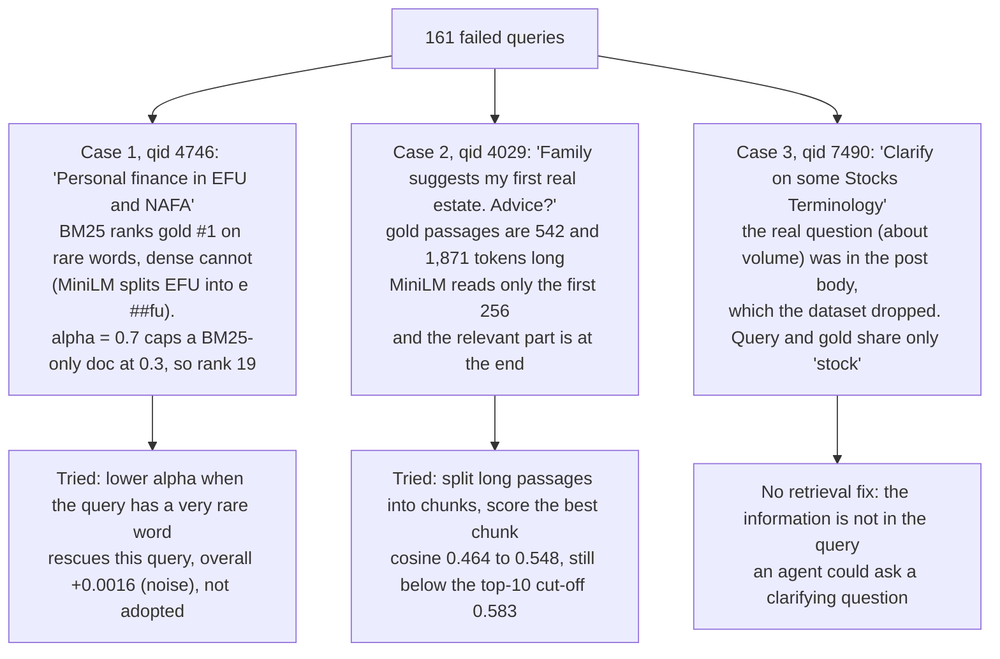

# Chapter 6: Part A end to end: indexing, querying, evaluating, explaining failures

Chapters 1 to 5 gave you the pieces. In this chapter I put them together into what Part A asks for: a single-machine
search system, benchmarked honestly, with its failures explained. Run every command from the repo root with the venv's
Python (see the [guide README](README.md)).

## 6.1 The whole pipeline

Some work happens once, offline. The rest happens on every query. Keeping that split in mind explains both the speed
and the Part B design.

## 6.2 One query, step by step

When a number looks wrong, I follow one query through each step. This is that path:

Even "single node" goes through the same Router code as the 3-shard service, with one in-process shard
(`single_node_router()`). Part B then only changes where the shards live, not the logic. That is also how I check that
sharded equals single node (Chapter 7).

## 6.3 The benchmark

For each configuration Part A wants quality (nDCG@10, Recall@10, MRR@10, overall and stratified), latency (p50/p95,
cold and warm) and peak memory. `scripts/bench.py` runs every configuration in a fresh process, so "cold" really is cold,
and merges the results into `results/bench.json`. The full protocol and every argument of `src/eval.py` are in
[`docs/walkthroughs/eval.md`](../walkthroughs/eval.md).

One `python -m src.eval` run does this:

I warm up on train queries so the dev queries are never seen twice. A run file such as
`results/runs/hybrid-linear-minilm.json` holds `overall` (the averages), `stratified` (Recall@10 per group, with `n`),
`latency.cold_first20` and `latency.warm` (p50/p95), `memory`, `config`, `startup_s`, and `run`: the ranked top 10 per
query, from which everything else is computed. `bench.json` adds `machine` and `protocol` and drops `run` to stay small.

The commands:

| step | command |
|---|---|
| download | `python scripts/download_data.py` |
| embedding cache | `python -m src.index.build_index --models minilm bge-small` |
| one evaluation | `python -m src.eval --mode local --strategy hybrid --fusion linear --alpha 0.7 --name X` |
| the full matrix | `python scripts/bench.py` (single-node and service configs), `--only local` for the six single-node ones |
| ablations | `python scripts/ablations.py` (alpha sweep), `--rerank` (cross-encoder sweep) |
| failures | `python scripts/failure_cases.py` writes `results/failure_candidates.json` |
| test, once | `python -m src.eval ... --split test --final-test-run` |

The `Makefile` has short names for these (`make bench`, `make failures`). On Windows without `make`, run the commands.

### My numbers (dev, single node)

| configuration | nDCG@10 | R@10 | MRR@10 | warm p50 / p95 ms | peak RSS |
|---|---|---|---|---|---|
| BM25 | 0.264 | 0.314 | 0.322 | 1.2 / 2.0 | 511 MB |
| dense MiniLM | 0.388 | 0.467 | 0.453 | 18.8 / 20.8 | 806 MB |
| dense bge-small | 0.398 | 0.468 | 0.477 | 30.6 / 34.2 | 851 MB |
| hybrid RRF (plain) | 0.373 | 0.442 | 0.449 | 22.1 / 39.9 | 812 MB |
| hybrid linear alpha=0.7, MiniLM (chosen) | 0.419 | 0.491 | 0.487 | 20.7 / 24.5 | 812 MB |
| hybrid linear alpha=0.7, bge-small | 0.416 | 0.486 | 0.495 | 35.3 / 40.3 | 854 MB |
| TEST split, chosen config (run once) | 0.397 | 0.466 | 0.479 | 21.5 / 24.9 | 813 MB |

How I read it:

- I chose MiniLM over BGE. BGE wins as dense alone (+0.010), but in hybrid it does not (0.416 vs 0.419) and costs
  about 15 ms more. BM25 already supplies what BGE adds, so I measure the combination, not the parts.
- The 21 ms splits like this (`scripts/microbench.py`): query encode 8.2 ms, faiss over 57K vectors 5.3 ms, BM25 1.0 ms,
  and the rest is Python glue (building lists, fusion, id mapping).
- Cold is close to warm because the code loads the model and runs a warm-up encode at start-up. What that hides: loading
  the model takes 1.5 s, and the very first encode takes 19 ms instead of 8 ms.
- Memory is about 800 MB, mostly PyTorch and the model. The data is small: 88 MB of vectors, about 20 MB of BM25.

### Stratified recall: who does the system fail?

An average hides which users suffer. The groups point at concrete fixes:

| group | Recall@10 | n |
|---|---|---|
| short queries (under 5 words) | 0.385 | 13 |
| medium (5 to 15 words) | 0.491 | 403 |
| long (over 15 words) | 0.510 | 84 |
| gold answer is among the 10% longest passages | 0.464 | 185 |
| gold answer is not | 0.508 | 315 |

Short queries give both retrievers little to work with. Long gold passages get truncated by the encoder and
length-penalised by BM25. The short group has only 13 queries, so treat it as noisy.

## 6.4 Failure analysis

Metrics say how much the system fails. Failure analysis says why, and what to try next.

161 of the 500 dev queries have Recall@10 = 0. `scripts/failure_cases.py` dumps them with their top 5 and each gold doc's
rank in BM25, dense and fused. I picked 3 with different causes (full write-up: `results/failures.md`):

How common each failure type is (one query can be in several):

| pattern | count of 161 |
|---|---|
| neither retriever has any gold doc in its top 100 (first-stage miss) | 58 |
| near miss: a gold doc at fused rank 11 to 20 | 29 |
| all gold docs are very long (over 270 words) | 18 |
| BM25 has gold in its top 10, dense does not have it in its top 100 | 10 |

A third of the failures are first-stage misses: the right doc never entered the candidate pool, so no reranker or LLM
can fix them. Better recall at stage 1 has to come first.

## 6.5 The chosen configuration against the constraints

| constraint | requirement | mine |
|---|---|---|
| CPU only | no GPU | yes |
| latency | p95 at most 50 ms after warm-up | 24.5 ms single node, 40.5 ms through 3 shards |
| memory | at most 2 GB per shard | about 723 MB per shard |
| quality | best that fits the constraints | 0.419 dev, 0.397 test |

**Next:** [Chapter 7: Part B: going distributed](07_part_b_distributed.md)
