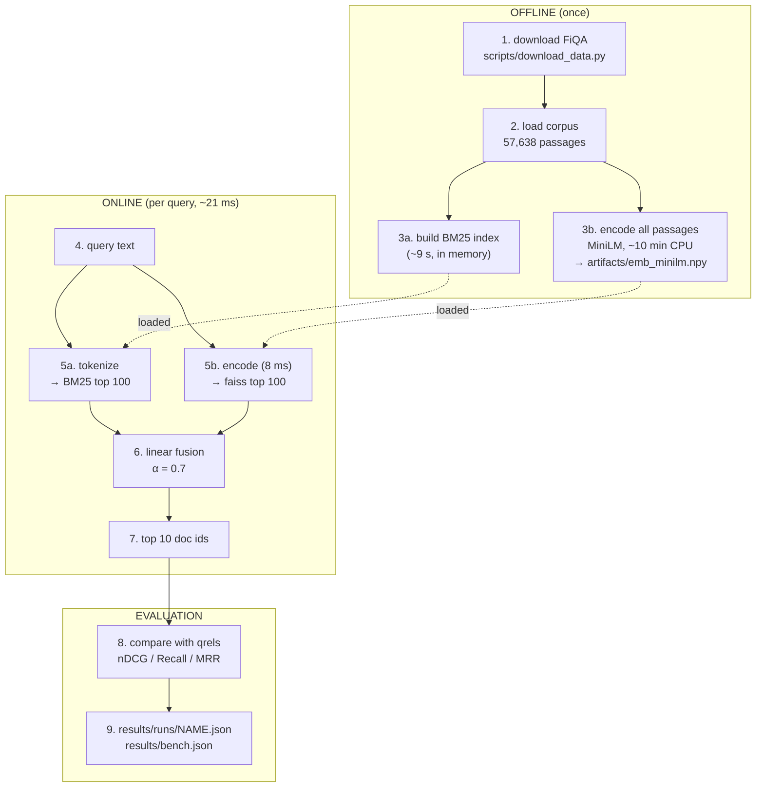
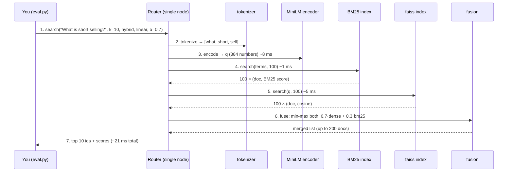
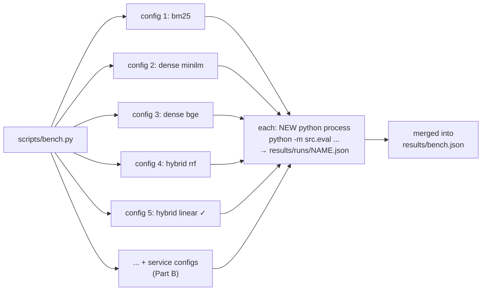
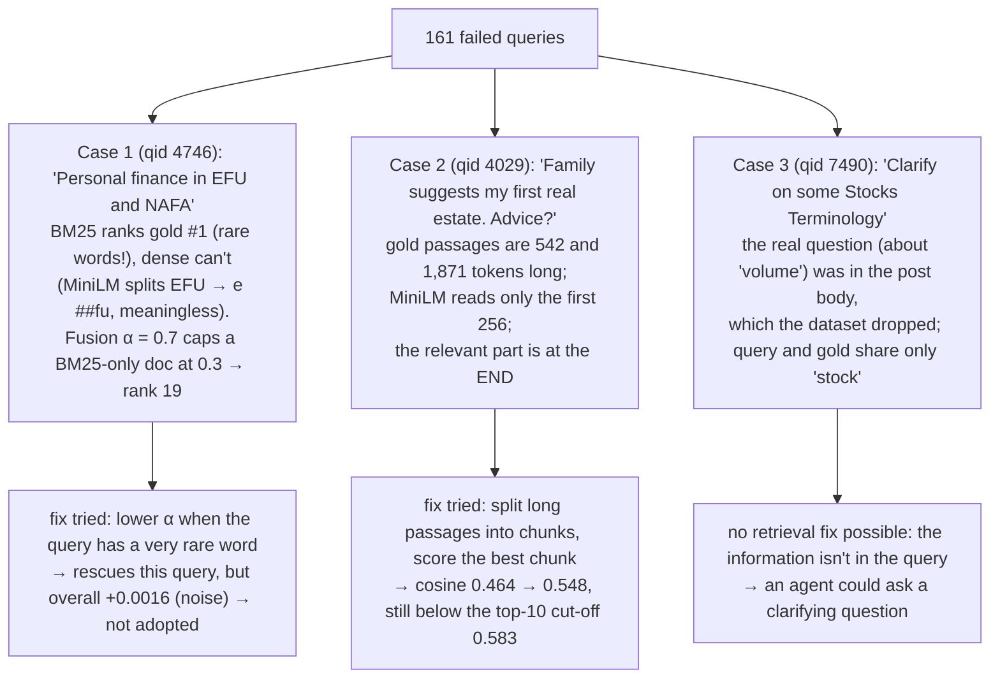

# Chapter 6: Part A end to end: indexing, querying, evaluating, explaining failures

> Goal: you can draw the whole Part A pipeline from memory, run it, read every number in `results/bench.json`,
> and explain *why* the system fails on the queries it fails on.

> ⚙️ **Running the commands:** open a terminal in the repo root (the folder with `src/`) and use the venv's Python.
> Seeing `No module named 'src'`? You're in the wrong folder. See "Before you run ANY command" in the [guide README](README.md).

Chapters 1–5 gave you the pieces. This chapter assembles them into what Part A asks for: **a single-machine search
system, benchmarked honestly, with its failures explained.**

---

## 6.1 The whole pipeline in one picture

> 🎯 **Why we're doing this:** Part A is graded as one system, not as parts. Seeing it end to end shows what is computed once (offline) vs per query (online), which is the key to both speed and the Part B design.



## 6.2 One query, followed step by step

> 🎯 **Why we're doing this:** When a number looks wrong, you debug by following one query through each step. This diagram is that checklist.



Fun detail: in this repo, even "single node" goes through the **same Router code** as the 3-shard service, just with one
in-process shard (`single_node_router()`). Part B then only changes *where* the shards live, not the logic. That's also
how we prove sharded = single-node (Chapter 7).

## 6.3 The benchmark: what we measure and how

> 🎯 **Why we're doing this:** The assignment asks for an honest comparison of configurations. Fresh processes, warm-up on train and percentiles are what make the numbers trustworthy enough to base decisions on.

Part A wants, for each configuration: **quality** (nDCG@10, Recall@10, MRR@10, overall + stratified), **latency**
(p50/p95, cold and warm), and **peak memory**. `scripts/bench.py` runs each configuration **in a fresh process**
(so "cold" is real) and collects everything into `results/bench.json`.



### Our numbers (dev, single node)

| configuration | nDCG@10 | R@10 | MRR@10 | warm p50 / p95 ms | peak RSS |
|---|---|---|---|---|---|
| BM25 | 0.264 | 0.314 | 0.322 | 1.2 / 2.0 | 511 MB |
| dense MiniLM | 0.388 | 0.467 | 0.453 | 18.8 / 20.8 | 806 MB |
| dense bge-small | 0.398 | 0.468 | 0.477 | 30.6 / 34.2 | 851 MB |
| hybrid RRF (plain) | 0.373 | 0.442 | 0.449 | 22.1 / 39.9 | 812 MB |
| **hybrid linear α=0.7, MiniLM (chosen)** | **0.419** | **0.491** | **0.487** | 20.7 / 24.5 | 812 MB |
| hybrid linear α=0.7, bge-small | 0.416 | 0.486 | 0.495 | 35.3 / 40.3 | 854 MB |
| **TEST split, chosen config (run once)** | **0.397** | 0.466 | 0.479 | 21.5 / 24.9 | 813 MB |

**How to read it like a reviewer:**
- **Why MiniLM and not BGE?** BGE wins as *dense alone* (+0.010), but in *hybrid* it doesn't (0.416 vs 0.419) and costs
  +15 ms. BM25 already supplies what BGE adds. Measure the combination, not the parts!
- **Where does the 21 ms go?** Measured with `scripts/microbench.py`: query encode 8.2 ms, faiss over 57K vectors 5.3 ms,
  BM25 1.0 ms, and the rest is Python glue (building lists, fusion, id mapping).
- **Cold ≈ warm** here because the code deliberately loads the model and runs a warm-up encode at start-up. What that hides
  (measured): loading the model takes 1.5 s, and the very first encode takes 19 ms instead of 8 ms.
- **Why is memory ~800 MB?** Mostly PyTorch + the model (~650 MB). The data itself is small (88 MB of vectors, ~20 MB of BM25).

### Stratified recall: *who* does the system fail?

> 🎯 **Why we're doing this:** An average hides which users suffer. Strata point to concrete fixes (chunk long docs, help short queries) that the overall number never would.

| group | Recall@10 | n |
|---|---|---|
| short queries (< 5 words) | 0.385 | 13 |
| medium (5–15 words) | 0.491 | 403 |
| long (> 15 words) | 0.510 | 84 |
| gold answer is among the 10% longest passages | 0.464 | 185 |
| gold answer is not | 0.508 | 315 |

Short queries give both systems little to work with; long gold passages get truncated (dense) and length-penalised (BM25).
Beware small groups (n = 13 is noisy).

## 6.4 Failure analysis: learning from what goes wrong

> 🎯 **Why we're doing this:** Metrics tell you *how much* the system fails; failure analysis tells you *why* and *what to do next*. It's also an explicit assignment deliverable (3 cases, different modes, concrete fixes).

161 of the 500 dev queries have **Recall@10 = 0** (no correct doc in the top 10). `scripts/failure_cases.py` dumps
them with the top 5, plus each gold doc's rank in BM25, dense and fused. We then picked 3 with **different causes**
(full write-up: `results/failures.md`):



And how common each failure type is (one query can be in several):

| pattern | count of 161 |
|---|---|
| **neither** retriever has any gold doc in its top 100 (first-stage miss) | 58 |
| near miss: a gold doc at fused rank 11–20 | 29 |
| all gold docs are very long (> 270 words) | 18 |
| BM25 has gold in its top 10 but dense doesn't have it in its top 100 | 10 |

**The big lesson:** a third of the failures are misses where *no later stage can help*, because the right doc never
entered the candidate pool. Fancier reranking (or an LLM) can't fix those. Better recall at stage 1 must come first.

## 6.5 The chosen operating point, checked against the constraints

> 🎯 **Why we're doing this:** A "best" system that breaks a constraint isn't a valid answer. This table is the final yes/no check before Part B builds on this configuration.

| constraint | requirement | ours | ✓ |
|---|---|---|---|
| CPU only | no GPU | yes | ✓ |
| latency | p95 ≤ 50 ms after warm-up | 24.5 ms single node; 40.5 ms through 3 shards | ✓ |
| memory | ≤ 2 GB per shard | ~723 MB per shard | ✓ |
| quality | best that fits the constraints | 0.419 dev / 0.397 test | ✓ |

---

## 🧸 A. The toy: a 20-query run of the real pipeline

The "toy" here is the real pipeline on a few queries, so you can watch it work in seconds:
```powershell
.\.venv\Scripts\python -m src.eval --mode local --strategy hybrid --fusion linear --alpha 0.7 --limit 20 --name toy20
```
Then open `results/runs/toy20.json` and find: `overall` (metrics), `stratified`, `latency.cold_first20` / `latency.warm`,
`memory`, and the per-query rankings. With only 20 queries the metrics jump around a lot. Try `--limit 20` vs `--limit 100`
and notice how much. That is *why* we use all 500.

Also play with single queries interactively:
```powershell
.\.venv\Scripts\python -c "import asyncio; from src.service.router import single_node_router as s; r=s(); print(asyncio.run(r.search('should I pay off my mortgage early', k=5, include_text=True)))"
```

## 🏭 B. The real thing in this repo

| step | file / command |
|---|---|
| download | `python scripts/download_data.py` |
| embedding cache | `python -m src.index.build_index --models minilm bge-small` |
| one evaluation | `python -m src.eval --mode local --strategy hybrid --fusion linear --alpha 0.7 --name X` |
| the full matrix | `python scripts/bench.py` → `results/bench.json` (single-node + service configs) |
| ablations | `python scripts/ablations.py` (α sweep), `--rerank` (cross-encoder sweep) |
| failures | `python scripts/failure_cases.py` → `results/failure_candidates.json`; `scripts/failure_probe.py` tests the fixes |
| test (once!) | `python -m src.eval ... --split test --final-test-run` |

(The `Makefile` has short names for these: `make bench`, `make failures`, ... On Windows without `make`, run the commands above.)

## ✍️ C. The toy, by you

Write `my_attempt/mini_pipeline.py` (~80 lines, your own Chapter 2–5 code, no repo imports):
1. Take the 24-doc `tests/fixtures/tinyfiqa` corpus and its queries/qrels.
2. Build your BM25 and dense (MiniLM) indexes over the 24 docs; implement linear fusion.
3. Evaluate BM25 vs dense vs hybrid with your metrics. With 24 docs you can **read every ranking** and say why each doc
   is where it is. Do it for at least 2 queries.

## 🔧 D. The real thing, by you

1. Glue your Chapter 3–5 pieces into one `search(query, strategy, k)` function over the full corpus.
2. Write your own harness (Chapter 2 §D): cold 20 → warm-up 100 train → 500 dev, with metrics, p50/p95 and peak RSS, and save JSON.
3. Produce **your own** benchmark table for BM25 / dense / hybrid. **Targets:** 0.264 / 0.388 / 0.419 nDCG@10.
   If you're off by more than ~0.005, diff your rankings against ours for the same query: `results/runs/*.json` has our
   per-query rankings.
4. Add stratified recall (query-length buckets; "gold in the 10% longest docs").
5. Failure analysis: list the queries with Recall@10 = 0; for each, find the gold docs' ranks in BM25 and dense separately
   (search to depth 1000). Write up 3 *different* failure modes, each with a concrete fix, and **test** at least one fix.
6. Freeze everything, then run test once.

### Check yourself
1. Why does each benchmark configuration run in a fresh process?
2. BGE beats MiniLM alone but not in hybrid. Explain.
3. 58 failures have no gold in either top-100. Why can't a reranker help them? What could?
4. Why is warm-up done with *train* queries and not dev queries?

**Next:** [Chapter 7: Part B: going distributed](07_part_b_distributed.md)
