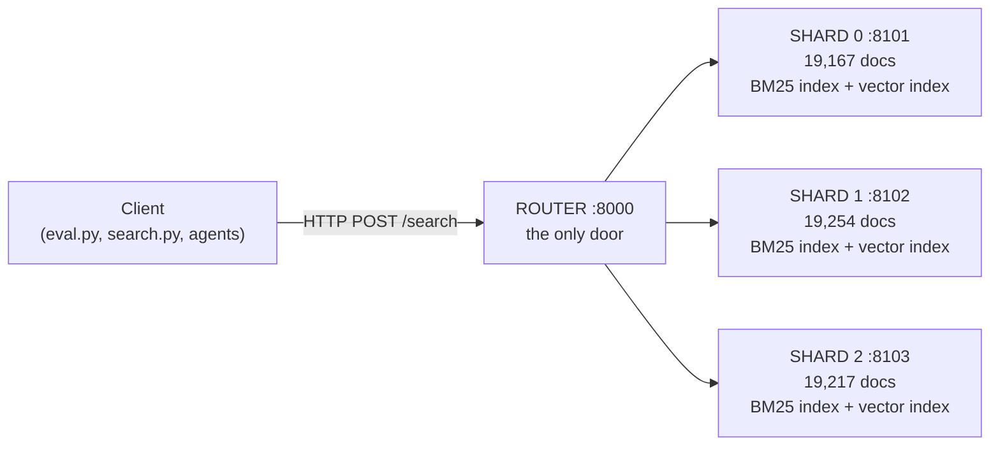
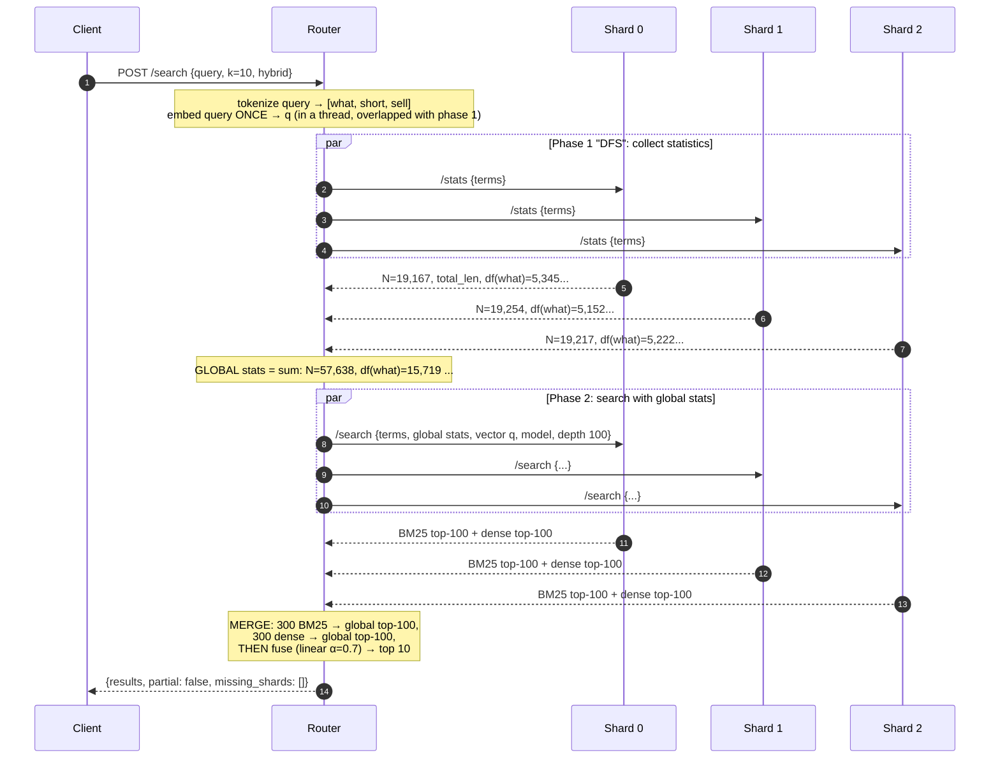
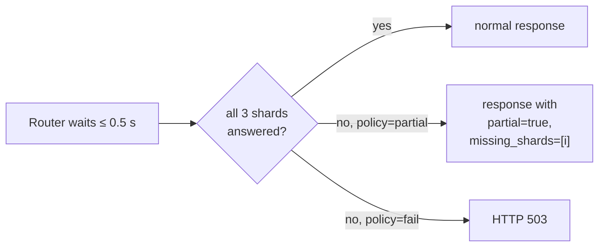
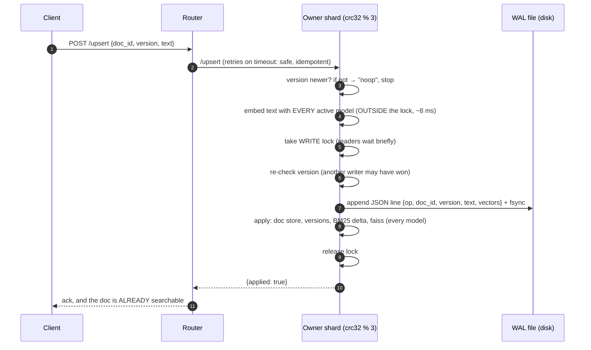
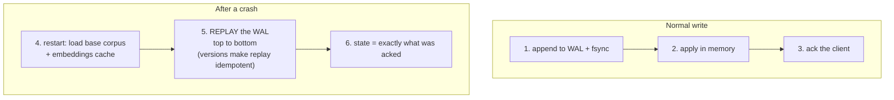
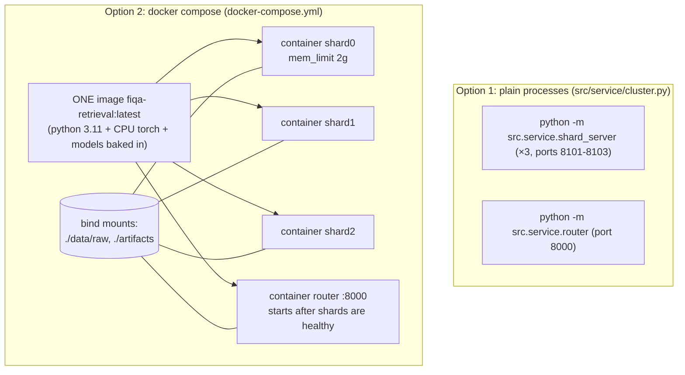

# Chapter 7: Part B: shards, router, live updates, model migration, deployment

> Goal: you understand how the single-machine search engine becomes a **service** of 4 processes (a router + 3 shards)
> that returns *exactly* the same results, accepts writes while serving, survives crashes, and swaps its AI model
> without a single failed query. And you can build and deploy it yourself.

> ⚙️ **Running the commands:** open a terminal in the repo root (the folder with `src/`) and use the venv's Python.
> Seeing `No module named 'src'`? You're in the wrong folder. See "Before you run ANY command" in the [guide README](README.md).

---

## 7.1 Why split the data at all?

One machine runs out of something eventually: **memory** (vectors for 100M docs = 154 GB), **CPU** (queries per second),
or **safety** (one machine dies → everything is down). The standard answer is to **shard**: split the corpus into
pieces, put each piece in its own process/machine, and put a **router** in front.



Every shard is the same program holding **both** indexes (BM25 and faiss vectors) for **its own third** of the
docs. A search goes to **all** shards. A write goes only to the **one** shard that owns that doc (§7.2).

At 57K docs we don't *need* this (one process does it in 21 ms). The assignment wants us to build it correctly
anyway, because the hard part is correctness, not size.

## 7.2 Which doc goes to which shard? Hash partitioning

> 🎯 **Why we're doing this:** Every read and write must agree on where a document lives. A stable, table-free rule makes that true across processes and restarts.

`shard = crc32(doc_id) % 3`: a **hash** turns the id into a big number (deterministically), and `% 3` picks 0, 1 or 2.

```
doc_id "12345" → crc32 → 3,421,846,044 → % 3 → 0 → shard 0
doc_id "12346" → crc32 → 1,392,274,342 → % 3 → 1 → shard 1
```
- Every process computes the same answer with no lookup table: the router knows where to send a write.
- It balances well: 19,167 / 19,254 / 19,217 docs (sum 57,638).
- **Pitfall:** Python's built-in `hash("12345")` is **randomised per process** (for security). If the router and a shard each
  used `hash()`, they'd disagree about where documents live. Use `crc32`.
- **Pitfall:** changing 3 → 4 shards with `% N` moves ~75% of docs. *Consistent hashing* moves only ~1/N (toy 15).

## 7.3 A sharded search: "scatter-gather" in two phases

> 🎯 **Why we're doing this:** The assignment requires sharded results within 1% of single node. The two phases (global stats, then merge-then-fuse) are exactly what makes them *identical*. Get them wrong and quality silently drifts.

The router **scatters** the query to all shards in parallel, then **gathers** and merges the answers:



(The df(what) split across shards above is illustrative; the global sum is the real value.)

Each shard call has a **0.5 s timeout**. Embedding the query **once at the router**, instead of on every shard, saves 2×8 ms of CPU per query.

### Correctness rule 1: global IDF (the "DFS phase")

BM25's IDF needs `N` and `df`. If each shard used its **own** (local) numbers, the same word gets a different weight on
each shard, so **identical documents get different scores depending on where they were hashed**. That's the classic
**local-IDF bug**:

```
Toy 12: docs a5 (shard A) and b1 (shard B) have IDENTICAL text.
   local stats:  a5 = 1.367   b1 = 2.392    ← 'dividend' is common on A, rare on B
   global stats: a5 = 1.800   b1 = 1.800    ← equal, as they must be
```
Fix: phase 1 asks every shard for its `N`, total length and `df` for the query terms; the router **sums** them
(`CorpusStats.merge`) and sends the global numbers back in phase 2. The name comes from Elasticsearch's "DFS query then fetch".
Cost: one extra round trip (~4 ms). Dense search doesn't need this: a cosine doesn't depend on other documents.

### Correctness rule 2: each shard returns its top-D, and the router merges *then* fuses

- **Why top-D per shard is enough:** the global top-100 must be made of docs that are in *their own* shard's top-100.
  (If a doc isn't in its shard's top 100, 100 docs on that shard beat it, so it can't be in the global top 100.)
- **Why fuse after merging:** min-max normalisation makes each *shard's* best doc = 1.0. Fusing per shard would inflate
  every shard's local winner:

```
Toy 13: shard0 has an excellent doc 'a' (BM25 10), shard1's best is mediocre 'c' (BM25 2).
   merge, then fuse:  a 0.750, b 0.688, c 0.556, d 0.000      ← correct
   fuse per shard:    a 1.000, c 1.000, b 0.000, d 0.000      ← 'c' ties 'a'. Wrong!
```

**Result:** sharded quality is **identical** to single node, to 4 decimals, for BM25, dense and hybrid (0.4190 = 0.4190).
The assignment allowed 1% difference; exact equality proves the merge logic is right.

### Timeouts and partial results

> 🎯 **Why we're doing this:** In a distributed system some machine is always slow or dead. Without timeouts one bad shard freezes every query; without the `partial` flag clients can't tell they got incomplete results.

If a shard is slow or dead, the router doesn't hang. After the timeout it returns what it has, **marked**
`partial: true, missing_shards: [2]` (policy `partial`), or an HTTP 503 (policy `fail`). A slightly worse answer usually beats
an error for a search box; for compliance search you'd choose `fail`.



### What sharding cost in latency (the counter-intuitive finding)

> 🎯 **Why we're doing this:** Sharding is not a free speed-up. Measuring it (instead of assuming) is what the assignment's "counter-intuitive finding" question is about.

| setup | p50 | p95 |
|---|---|---|
| single process, no HTTP | 20.7 ms | 24.5 ms |
| router + **1** shard (HTTP) | 23.4 ms | 26.3 ms |
| router + **3** shards (HTTP) | 28.6 ms | 40.5 ms |

You'd expect 3 shards to be faster (each searches a third). But each shard's work is tiny (~1.4 ms faiss + ~1 ms BM25), so
there's little to parallelise, while 3 shards add the DFS round trip, 3× the HTTP calls, and **waiting for the slowest of 3**
(tail amplification, Chapter 2). At this size, sharding buys **capacity and isolation, not speed**.

## 7.4 Live updates: changing documents while serving

> 🎯 **Why we're doing this:** Real corpora change. The assignment requires writes during serving, searchable fast, safe under retries and crashes. Each sub-mechanism below exists to prevent one specific way of losing or corrupting data.

The API: `POST /upsert {doc_id, version, text}` and `POST /delete {doc_id, version}`. The router sends each write to the
**owner** shard (`crc32 % 3`).

### Versions make writes safe to retry (idempotency)

> 🎯 **Why we're doing this:** Networks lose acknowledgements, so clients *will* retry and messages *will* arrive out of order. Versions turn those from data-corruption bugs into harmless no-ops.
Networks lose acknowledgements, so clients retry. Messages arrive out of order. Rule: **apply a write only if its version
is newer than what we have.**

```
upsert(x, v1)          → applied
upsert(x, v1) [retry]  → no-op (same version)       ← retrying is safe = "idempotent"
upsert(x, v3)          → applied
upsert(x, v2) [late]   → no-op (older)              ← old data never overwrites new
delete(x, v4)          → applied, leaves a TOMBSTONE (x: version 4, deleted)
upsert(x, v3) [late]   → no-op                       ← without the tombstone, x would come back to life!
```

### The write path, step by step

> 🎯 **Why we're doing this:** The order of steps *is* the correctness argument: what happens under the lock, what goes to disk first, and when the client is told "done".



- **One lock for both indexes:** a reader can never see the new text in BM25 but the old vector in faiss (that would be inconsistent).
- **Freshness guarantee:** the write is applied *before* the ack, so **the first search after the ack finds it**. Measured
  and proven by a test across 3 real processes. (Elasticsearch, by default, makes writes visible only after a ~1 s "refresh".)

### Crash safety: the write-ahead log (WAL)

> 🎯 **Why we're doing this:** RAM is lost on a crash. Without a log, any acknowledged write since start-up would vanish, breaking the promise you made to the client.

Everything above lives in RAM, so a crash would lose it. The fix is the oldest trick in databases: **write the change to
an append-only log file on disk *before* applying it in memory** (then `fsync` = force it onto the physical disk).


- Crash **before** step 1 → the write never happened, and the client got no ack, so it retries.
- Crash **after** step 1 → the replay re-applies it.
- Crash **during** step 1 (half a line written) → that line was never acked → drop it.
  **A real bug we found and fixed:** at first we only *skipped* the half line during replay, but left it in the file, so the
  next write got glued onto it and was lost on the *next* restart. Now the WAL truncates the torn tail when it opens.
  Lesson: test recovery **twice in a row**.
- The WAL stores the **vectors** too, so replay doesn't need to run the model: fast and deterministic.

## 7.5 Model migration with zero downtime ("blue/green")

> 🎯 **Why we're doing this:** Upgrading the embedding model is routine in real systems, and the naive way (stop, re-embed for hours, restart) means downtime. The assignment requires zero failed queries during the switch, plus a way back.

**Goal:** switch from MiniLM to bge-small while queries and writes keep flowing, and be able to undo it instantly.
**The catch:** a query vector from model A compared with document vectors from model B is **silent garbage** (no error,
just nonsense rankings). So every search must use *one* model end to end.

```mermaid
stateDiagram-v2
    [*] --> Serving_A: normal
    Serving_A --> Building_B: 1. migrate: each shard creates an empty B index<br/>+ turns ON dual-write (new writes → A and B)
    Building_B --> Ready_B: 2. backfill: embed all old docs with B in the background<br/>(throttled; skips docs changed since the snapshot)
    Ready_B --> Serving_B: 3. cutover: router flips active_model = B<br/>(only if EVERY shard reports B ready)
    Serving_B --> Serving_A: 4. rollback: flip back (instant; A is still up to date)
    Serving_B --> Final_B: 5. finalize: drop A (no more rollback)
```



- **Dual-write** keeps both indexes current during the build, so neither goes stale.
- **The backfill race:** the backfill reads doc d3 at version 0 while a user updates d3 to version 1 (dual-written to B).
  The backfill must not overwrite the newer vector. Check: "only write if the doc's version hasn't changed since my snapshot".
- **In-flight queries** read `active_model` once at the start, so a query never mixes models.

Our demo (`scripts/migration_demo.py` → `results/migration_demo.json`): 4 query threads + 1 writer for 77 s across
migrate → backfill (17 s) → cutover → rollback. **2,045 queries, 0 failed**; all 116 docs written during the run were findable with both models.

## 7.6 Deployment: processes or Docker

> 🎯 **Why we're doing this:** "It works on my machine" isn't a deliverable. Docker makes the 4-process system start the same way anywhere, enforces the 2 GB limit, and proves the results don't depend on your laptop.

Two ways to run the 4 processes:



- Each shard reads `SHARD_ID`, `N_SHARDS`, `SHARD_MODELS` and `STATE_DIR` from its environment, loads *only its own* docs
  (`crc32 % 3 == SHARD_ID`) plus their vectors from the shared embeddings cache, then replays its WAL.
- The router reads `SHARD_URLS`. Health checks (`GET /health`) gate start-up order.
- Measured in Docker: stack up in ~60 s; dev nDCG **0.4190**, identical to native; warm p50/p95 **30.4 / 34.1 ms** (native: 28.6 / 40.5);
  ~505 MiB per shard container (2 GiB cap).

---

## 🧸 A. The toys

| toy | shows |
|---|---|
| `12_sharded_idf_bug.py` | the local-IDF bug (1.367 vs 2.392) and the global-stats fix (1.800 = 1.800) |
| `13_merge_then_fuse.py` | why fusing per shard is wrong (the 'c' ties 'a' example) |
| `14_scatter_gather_timeouts.py` | asyncio fan-out with one slow and one dead shard; partial vs fail policies |
| `15_hash_partitioning.py` | crc32 % 3 balance; 75% movement when growing to 4; consistent hashing; why not `hash()` |
| `16_idempotent_versioned_writes.py` | retries, out-of-order delivery, tombstones on a real `ShardStore` |
| `17_wal_crash_recovery.py` | writes, a simulated crash mid-append, restart + replay (twice) |
| `18_freshness.py` | sync apply (searchable at ack) vs async refresh (searchable ~200 ms later) |
| `19_blue_green_migration.py` | dual-write, backfill race, cutover, rollback |

Run any with `python examples/NN_name.py`. Read the `->` lines (the explanation), then do `TRY THIS`. Toys 16, 17 and 19 use the **real**
`ShardStore` with a fake "hash" embedder, so they run in a second and teach the actual code.

## 🏭 B. The real thing in this repo

| file | role |
|---|---|
| `src/index/sharding.py` | `shard_of(doc_id, n) = crc32 % n` |
| `src/service/store.py` | `ShardStore`: one shard's data: BM25, dense indexes per model, docs, versions, WAL, migration build |
| `src/service/wal.py` | `WAL` (append + fsync, replay, torn-tail truncation), `RWLock` (many readers / one writer) |
| `src/service/shard_server.py` | FastAPI app: `GET /health`, `POST /{op}` for stats / search / docs / upsert / delete / build_model / drop_model |
| `src/service/router.py` | `Router`: the two-phase search, merge, fuse, fetch texts, write routing + retries, migration admin; `create_app()` exposes `/search /upsert /delete /health /admin/{status,migrate,cutover,rollback,finalize}` |
| `src/service/cluster.py` | starts 3 shards + router as local processes (tests and benchmarks use it) |
| `scripts/migration.py`, `query_load.py`, `migration_demo.py` | migration CLI, load generator, scripted demo |
| `tests/test_store.py`, `tests/test_integration_service.py` | sharded = single node, idempotency, freshness, crash + WAL recovery, partial results |

Try it locally (processes):
```powershell
.\.venv\Scripts\python -m src.service.cluster --shards 3        # terminal 1: starts shards + router
.\.venv\Scripts\python src/search.py --query "what is short selling?"   # terminal 2
.\.venv\Scripts\python -m src.eval --mode service --strategy hybrid --fusion linear --alpha 0.7 --name svc-test
```
Or with Docker: `docker compose build`, `docker compose up -d`, `docker compose run --rm eval`.

## ✍️ C. The toy, by you

Build a **2-shard system inside one Python process** (`exercises/ch07_shards/mini_shards.py`, no HTTP yet; check: `python -m pytest exercises\ch07_shards`):
1. 10 docs; assign each with `zlib.crc32(id.encode()) % 2`; give each shard its own BM25 (your Ch. 3 code).
2. Write `router_search(query)`: (a) collect each shard's N / total_len / df, sum them; (b) each shard scores with the global
   stats and returns its top-5; (c) merge by score → top-5.
3. **Check:** the results equal one BM25 over all 10 docs. Then switch to local stats and find a query where they differ (toy 12's trick:
   put identical texts on both shards).
4. Add `upsert(id, version, text)` / `delete(id, version)` with version checks and tombstones; replay toy 16's sequence and get the same
   applied/no-op pattern.
5. Add a WAL: append a JSON line + `os.fsync` before applying. Simulate a crash by writing half a line, then "restart" (rebuild from the file)
   **twice**, with a write in between.

## 🔧 D. The real thing, by you (and deploy it)

1. **Shard server** (FastAPI): at start-up, load the corpus, keep only `crc32(id) % N == SHARD_ID`, build BM25 + faiss from the embedding
   cache rows for those ids, replay the WAL. Endpoints: `POST /stats`, `POST /search`, `POST /docs`, `POST /upsert`, `POST /delete`, `GET /health`.
2. **Router** (FastAPI + `httpx.AsyncClient`, **one persistent client**: creating one per request costs ~600 ms on Windows!):
   `asyncio.gather` with `asyncio.wait_for(..., 0.5)` for each phase; global stats; merge-then-fuse; the `partial`/`missing_shards` fields.
3. **Prove correctness:** run your Chapter 6 evaluation through the router. **Target:** identical nDCG to single node (0.419). If it's off,
   suspect: local IDF, fuse-before-merge, too-small per-shard depth, or a different tokenizer in router vs shard.
4. **Measure** 1 shard vs 3 shards p50/p95. Do you also see 3 shards being slower?
5. **Writes:** versions + tombstones + RW lock + WAL. Write the integration tests: idempotent retry, out-of-order, delete visible in BM25 *and*
   dense, freshness (search right after the ack, no sleep), and kill -9 a shard → restart → acked writes still there.
6. **Migration:** keep `{model: index}` per shard; `/build_model` (create + dual-write on, then a background backfill thread, throttled); router
   `active_model` persisted to a file; cutover only when all shards report ready. Run a load generator during migrate → cutover → rollback and
   count failed queries (**target: 0**).
7. **Deploy:** write a Dockerfile (python:3.11-slim, CPU-only torch from `https://download.pytorch.org/whl/cpu`, bake the models into the image),
   and a `docker-compose.yml` with 3 shard services (`mem_limit: 2g`, healthchecks) + a router (`depends_on: service_healthy`) + bind-mounted
   `data/` and `artifacts/`. `docker compose up -d`, then run your eval from a container. **Target:** the same nDCG as native.
   (Corporate network? Pass `--build-arg PIP_INDEX_URL=...` for your PyPI mirror.)

### Check yourself
1. Two identical documents end up on different shards and get different BM25 scores. What's the bug and the fix?
2. Why must the router fuse *after* merging shard lists?
3. Why is "retry on timeout" safe for our writes?
4. What can go wrong if you apply a write in memory *before* appending it to the WAL? (Toy 17, TRY THIS 3)
5. Why must one search never mix query vectors from model A with document vectors from model B?
6. Why were 3 shards slower than 1 here? When would sharding make queries faster?

**Next:** [Chapter 8: Part C: LLMs and agents](08_part_c_agents.md)
