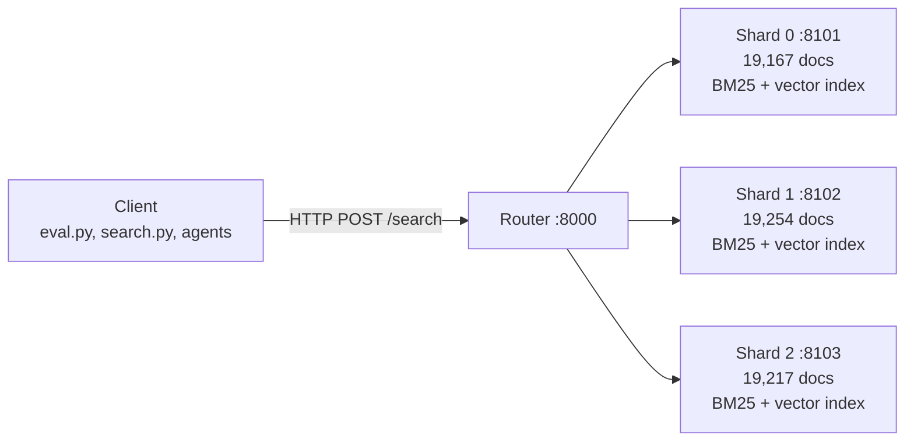
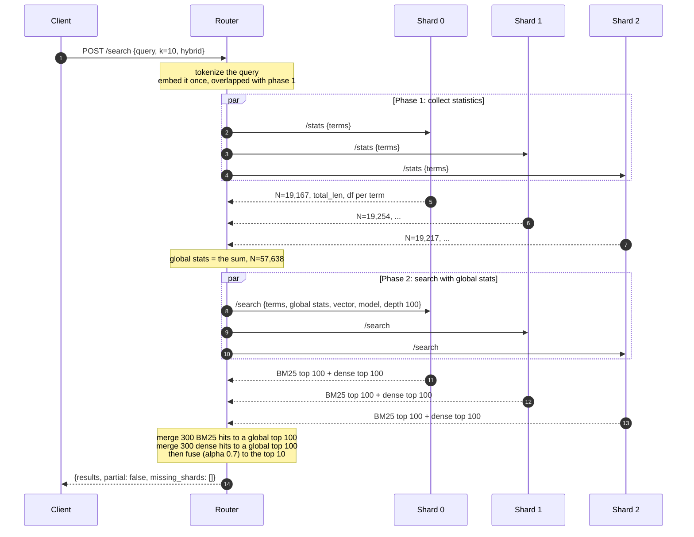
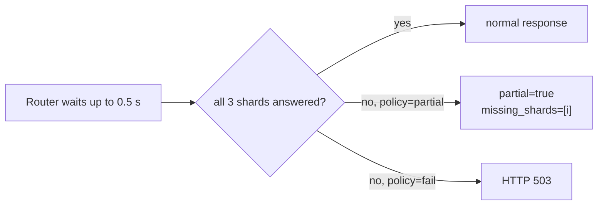
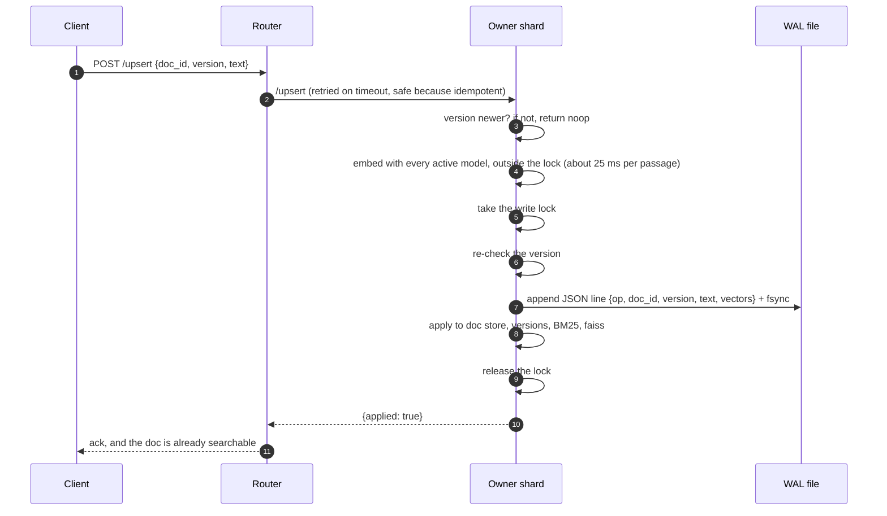
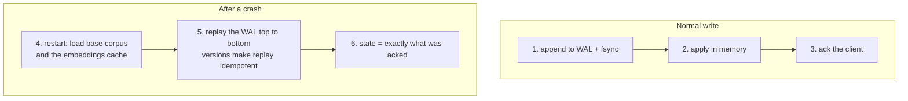
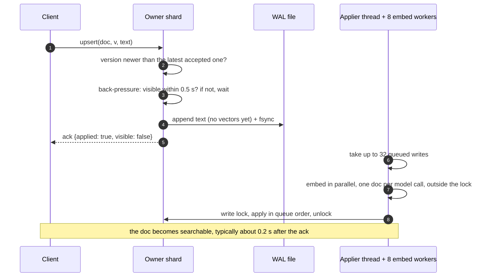
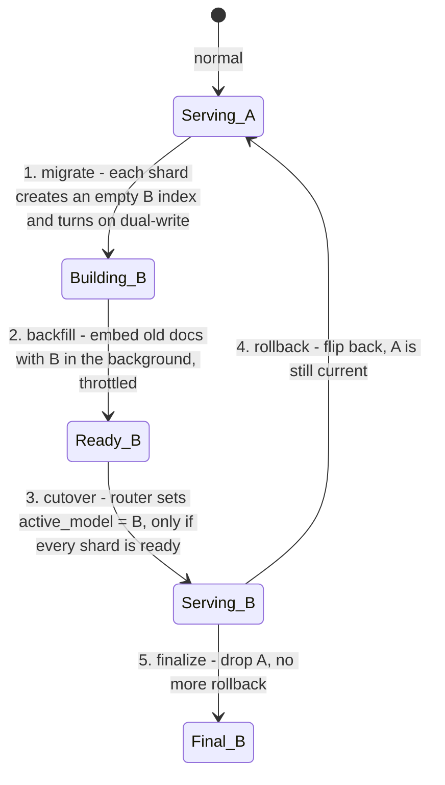
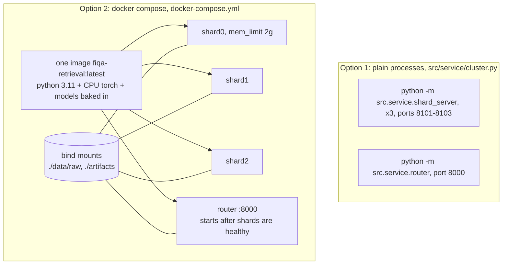

# Chapter 7: Part B: shards, router, live updates, model migration, deployment

In this chapter I turn the single-machine engine into a service of 4 processes (a router and 3 shards). It returns
exactly the same results, accepts writes while serving, survives crashes, and swaps its embedding model without a single
failed query.

## 7.1 Why split the data

One machine eventually runs out of memory (vectors for 100M docs take 154 GB), CPU, or availability (one machine dies
and everything is down). The standard answer is to shard: split the corpus into pieces, give each piece its own process,
and put a router in front.



Every shard is the same program and holds both indexes for its third of the docs. A search goes to all shards. A write
goes only to the shard that owns the doc. At 57K docs I don't need this (one process answers in 21 ms), but the hard
part of sharding is correctness, and size doesn't change that.

## 7.2 Which doc goes where

`shard = crc32(doc_id) % 3`. The hash turns the id into a big number deterministically, and `% 3` picks 0, 1 or 2.
Every process computes the same answer without a lookup table, so the router knows where to send a write. The split is
even: 19,167 / 19,254 / 19,217 docs.

I used `crc32` because Python's built-in `hash()` is randomised per process. If the router and a shard each used
`hash()`, they would disagree about where documents live. One limit: going from 3 to 4 shards with `% N` moves about
75% of the docs. Consistent hashing would move only about 1/N.

## 7.3 A sharded search in two phases

Here's how the router answers a query. It scatters the request to all shards in parallel, then gathers and merges:



Each shard call has a 0.5 s timeout. I embed the query once at the router, which saves 2 x 8 ms of CPU per query compared
with embedding on every shard. Two rules make the sharded result identical to single node.

### Rule 1: global IDF

BM25's IDF needs `N` and `df`. If each shard used its own local numbers, the same word would get a different weight on
each shard, and two identical documents would score differently depending on where they were hashed. That's the
local-IDF bug. Phase 1 fixes it: every shard reports its `N`, total length and `df` for the query terms, the router sums
them (`CorpusStats.merge`) and sends the totals back in phase 2. The name comes from Elasticsearch's "DFS query then
fetch". Dense search doesn't need it, because a cosine doesn't depend on other documents. With local stats
(`--bm25-stats local`, kept only to reproduce the bug) BM25 nDCG was 0.2653 instead of 0.2642: close on average, but the
rankings are not the single-node rankings.

Nothing global is stored. Each shard keeps only its own counts (N, total length, df per term), and the router sums them
fresh on every query. For N that's 19,167 + 19,254 + 19,217 = 57,638.

A write updates the owner shard's counts under the write lock, before the ack (`BM25Index.add()` / `delete()` in
`src/retrieval/bm25.py`): a new doc adds 1 to N and to the df of each of its distinct terms, an edit swaps the old terms
and length for the new ones, and a delete subtracts. So the next query's phase 1 already includes the write, and IDF is
as fresh as the doc itself. If a write lands between one query's phase 1 and phase 2, that one query scores with counts
that are one doc out of date. I accepted that: a snapshot across all shards would cost far more than it's worth.

### Rule 2: merge, then fuse

Each shard returns its top 100. That's enough: if a doc isn't in its own shard's top 100, then 100 docs on that shard
beat it, so it can't be in the global top 100. The router merges the shard lists first and fuses after. Fusing per shard
would be wrong, because min-max normalisation sets each shard's best doc to 1.0, so a mediocre winner on one shard would
tie an excellent winner on another.

Result: sharded quality equals single node to 4 decimals for BM25, dense and hybrid (0.4190 = 0.4190). The assignment
allowed a 1% difference.

### Timeouts and partial results

If a shard is slow or dead, the router doesn't hang. After the timeout it returns what it has, marked
`partial: true, missing_shards: [2]` (policy `partial`), or HTTP 503 (policy `fail`). For a search box a slightly worse
answer beats an error. For compliance search I would choose `fail`.



### What sharding cost in latency

| setup | p50 | p95 |
|---|---|---|
| single process, no HTTP | 20.7 ms | 24.5 ms |
| router + 1 shard (HTTP) | 23.4 ms | 26.3 ms |
| router + 3 shards (HTTP) | 28.6 ms | 40.5 ms |

Three shards are slower here. To see why, `scripts/latency_breakdown.py` times every step inside one process with the
real BM25, faiss, merge and fuse code on the 500 dev queries (`results/latency_breakdown.json`). Whatever is left of the
end-to-end time after that compute is network and coordination. All values are p50 in ms. This session ran about 10%
slower than the table above (encode 11.2 vs 8.2 ms), so compare the rows with each other.

| setup | encode | search | DFS stats | merge + fuse | network and coordination | other in-process | end-to-end |
|---|---|---|---|---|---|---|---|
| single process (no HTTP) | 11.2 | 7.5 (BM25 1.3 + faiss 6.2) | 0 | 0.24 (fuse only) | 0 | 3.7 | 22.6 |
| router + 1 shard (HTTP) | 11.2 | 7.5 | 0 (skipped) | 0.24 | 3.8 | 3.7 | 26.4 |
| router + 3 shards (HTTP) | 11.2 | 3.1 (slowest shard) | 0.04 | 0.58 | 13.8 | 3.7 | 32.4 |

"Search" for 3 shards is the slowest of the 3, because the router waits for the last one. "Other in-process" is the
single-process total minus its compute, assumed equal for every setup. The router overlaps the encode with the DFS round
trip, so treat the network column as approximate.

Splitting the search itself does pay, as long as the shards really run in parallel:

| | search | DFS | merge / fuse | compute total |
|---|---|---|---|---|
| one index, 57,638 docs | 7.5 | 0 | 0.24 | 7.8 ms |
| 3 shards in parallel (3 processes) | 3.1 | 0.04 | 0.58 | 3.7 ms (2.1x faster) |
| 3 shards one after another (one process) | 8.9 | 0.04 | 0.58 | 9.5 ms (slower than one index) |

Going from 1 to 3 shards over HTTP saves about 4.4 ms of search and pays about 10.4 ms more (10.0 ms of extra network and
coordination, 0.34 ms of extra merging, 0.04 ms of DFS). The net, about +6.0 ms, matches the measured 32.4 - 26.4. The
encode happens once at the router either way.

The network cost stays roughly fixed per query (each shard always returns 100 + 100 hits), while the search saving grows
with the corpus, because flat search is O(N). My rough estimate is that sharding starts winning at 2 to 3 times today's
corpus (about 135K docs against router + 1 shard, about 185K against a single process). At 10M+ docs I would switch to an
approximate index ([`docs/03_vector_indexes.md`](../03_vector_indexes.md),
[`docs/15_scaling_to_100M.md`](../15_scaling_to_100M.md)), and sharding becomes mostly about memory: 10M x 384 floats is
about 15 GB. At 57K docs, sharding buys capacity and fault isolation, not speed.

## 7.4 Live updates

The API is `POST /upsert {doc_id, version, text}` and `POST /delete {doc_id, version}`. The router sends each write to
the owner shard (`crc32 % 3`).

### Versions make retries safe

Networks lose acknowledgements, so clients retry, and messages arrive out of order. My rule: apply a write only if its
version is newer than the one I have.

```
upsert(x, v1)          -> applied
upsert(x, v1) [retry]  -> no-op (same version), so retrying is safe
upsert(x, v3)          -> applied
upsert(x, v2) [late]   -> no-op (older), old data never overwrites new
delete(x, v4)          -> applied, leaves a tombstone (x: version 4, deleted)
upsert(x, v3) [late]   -> no-op; without the tombstone, x would come back
```

### The write path

The order of the steps is the correctness argument:



One lock covers both indexes, so a reader never sees the new text in BM25 next to the old vector in faiss. Because the
write is applied before the ack, the first search after the ack finds it. A test across 3 real processes checks this.
Elasticsearch, by default, makes writes visible only after a refresh of about 1 s.

### Crash safety: the write-ahead log

Everything above lives in RAM. So before applying a change in memory, I append it to a log file and `fsync` it to disk:



A crash before step 1 means the client got no ack and retries. A crash after step 1 is fixed by the replay. A crash
during step 1 leaves half a line that was never acked, so it's dropped. That last case hid a bug: at first I only skipped
the torn line during replay and left it in the file, so the next write got glued onto it and was lost on the following
restart. Now the WAL truncates the torn tail when it opens, and I test recovery twice in a row. The WAL stores the vectors
too, so replay doesn't run the model.

### Two write modes: sync (default) and async

Sync makes every client wait for the embedding. The common alternative (Kafka-fed indexers, Elasticsearch's translog
plus refresh) is log, ack, apply later: faster acks, but a write isn't visible the moment it's acked. I built both to
measure the trade, with the promise that async writes are searchable within 1 s. Switch per shard with
`APPLY_MODE=sync|async` (Docker: `./scripts/bootstrap.sh --mode async`). Code: `src/service/async_apply.py`.



In async mode the ack means durable and searchable within 1 s. The client waits only for the version check and the WAL
append (plus back-pressure if the applier is behind), and the WAL holds text without vectors, so a replay re-embeds.

The measurement (`python -m scripts.write_load`, real corpus, 3 shards, 8 writers, 2 readers and 1 freshness probe, 30 s
per mode, `results/write_load.json`):

| | sync | async |
|---|---|---|
| writes acked / s | 57.8 | 94.2 (1.6x) |
| ack ms p50 / p95 | 128 / 181 | 78 / 120 |
| visible lag ms p50 / p95 / max | 0 / 0 / 0 | 203 / 466 / 583 |
| freshness probes found by the first search after the ack | 55 / 55 | 1 / 39 |
| search ms p50 / p95 under this load | 131 / 165 | 184 / 244 |
| write errors | 0 | 0 |

Async takes 63% more writes per second with faster acks. It pays in freshness (about 0.2 s typical, 0.58 s worst) and in
search latency, because the shards spend more CPU embedding 94 writes/s than 58 on the same cores. The measured lock wait
was about 0 ms, so it isn't lock contention. I kept sync as the default because "searchable at ack" is the simpler
promise. Async is the better choice when write throughput matters more.

My first async version failed this test: 47.1 writes/s (slower than sync) and a visible lag p95 / max of 1,071 / 1,306
ms, which broke the 1 s promise. I had assumed batching was async's big win, and v1 embedded each batch in one model call
on one thread. Timing the same 256 FiQA passages at different batch sizes (MiniLM, 4 threads) showed batching doesn't
help on CPU:

| docs per model call | 1 | 2 | 4 | 8 | 16 | 32 | 256 |
|---|---|---|---|---|---|---|---|
| ms per doc | 25.6 | 26.1 | 27.6 | 31.5 | 30.9 | 32.3 | 24.7 |

A batch is padded to its longest passage, so a small batch of random-length docs costs more per doc. Meanwhile sync's 8
concurrent requests embedded in parallel. v2 uses 8 embed workers, one doc per call, and predicts back-pressure per doc
instead of per batch (a batch of 18 docs costs about 6x a batch of 3). The per-batch timing in `/admin/status`
(`async.batch_timing`) showed embedding was about 100% of the applier's time, so I fixed that instead of guessing lock
contention. A side bug turned up too: FiQA has 38 empty passages, and an empty upsert used to surface as a misleading 503.
Now both modes reject empty text and the router answers 422 at once.

## 7.5 Model migration with zero downtime

The goal: switch from MiniLM to bge-small while queries and writes keep flowing, and be able to undo it instantly. The
risk: a query vector from model A compared with document vectors from model B gives nonsense rankings with no error. So
every search must use one model end to end.



Dual-write keeps both indexes current during the build. The backfill has a race: it may read doc d3 at version 0 while a
user writes version 1 (dual-written to B), so the backfill only writes if the doc's version hasn't changed since its
snapshot. In-flight queries read `active_model` once at the start, so a query never mixes models.

The demo (`scripts/migration_demo.py`, `results/migration_demo.json`) ran 4 query threads and 1 writer for 77 s through
migrate, backfill (17 s), cutover and rollback: 2,045 queries, 0 failed, and all 116 docs written during the run were
found with both models.

## 7.6 Deployment



Each shard reads `SHARD_ID`, `N_SHARDS`, `SHARD_MODELS` and `STATE_DIR` from its environment, loads only its own docs
(`crc32 % 3 == SHARD_ID`) and their vectors from the shared embeddings cache, then replays its WAL. The router reads
`SHARD_URLS`, and `GET /health` checks gate the start-up order. In Docker the stack is up in about 60 s, dev nDCG is
0.4190 (identical to native), warm p50/p95 is 30.4 / 34.1 ms (native: 28.6 / 40.5), and each shard container uses about
505 MiB of its 2 GiB cap. Docker makes the 4-process system start the same way anywhere and enforces the memory limit.

The code: `src/index/sharding.py` (`shard_of`), `src/service/store.py` (`ShardStore`: one shard's indexes, docs,
versions, WAL and migration build), `src/service/wal.py` (`WAL`, `RWLock`), `src/service/shard_server.py` (the shard's
FastAPI app), `src/service/router.py` (`Router` and `create_app()`, which exposes `/search /upsert /delete /health
/admin/{status,migrate,cutover,rollback,finalize}`) and `src/service/cluster.py` (starts 3 shards and the router as local
processes). `tests/test_store.py` and `tests/test_integration_service.py` check sharded = single node, idempotency,
freshness, crash recovery and partial results. To run it locally:

```powershell
.\.venv\Scripts\python -m src.service.cluster --shards 3        # terminal 1: starts shards + router
.\.venv\Scripts\python src/search.py --query "what is short selling?"   # terminal 2
.\.venv\Scripts\python -m src.eval --mode service --strategy hybrid --fusion linear --alpha 0.7 --name svc-test
```

Or with Docker: `docker compose build`, `docker compose up -d`, `docker compose run --rm eval`.

**Next:** [Chapter 8: Part C: LLMs and agents](08_part_c_agents.md)
