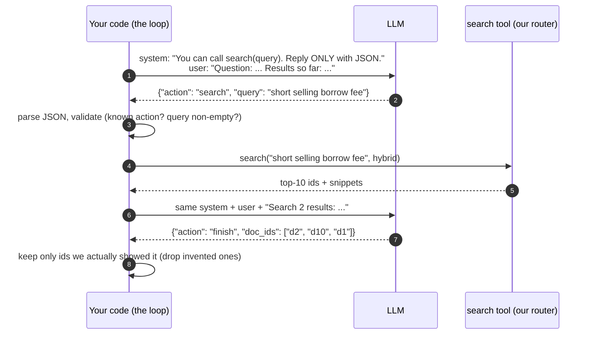
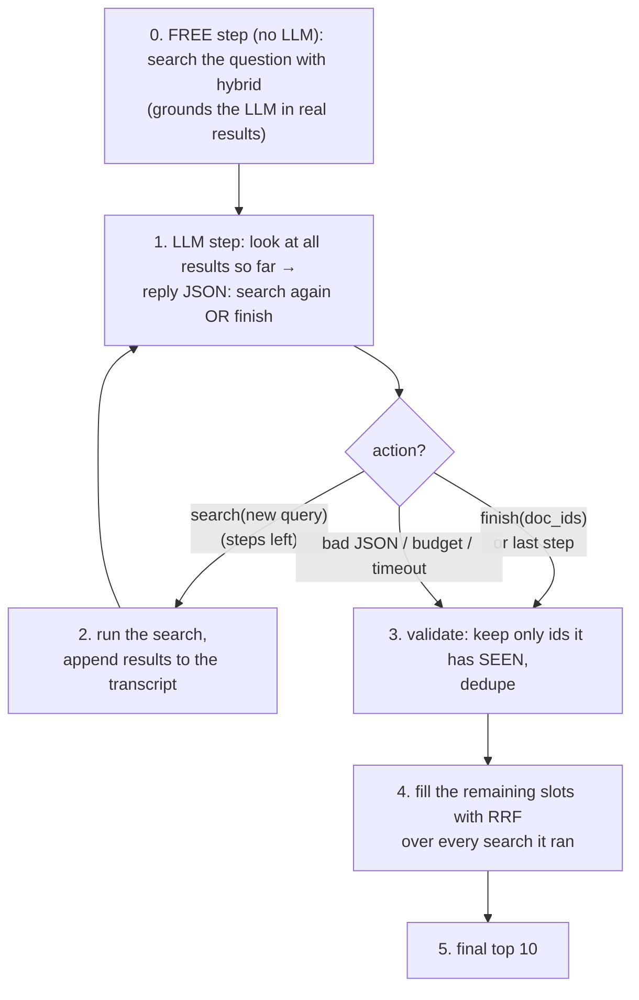
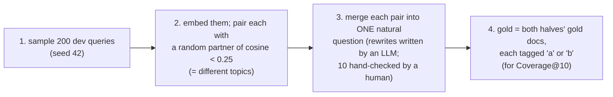
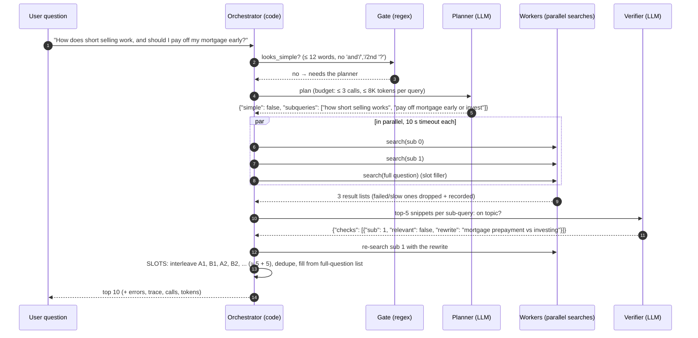
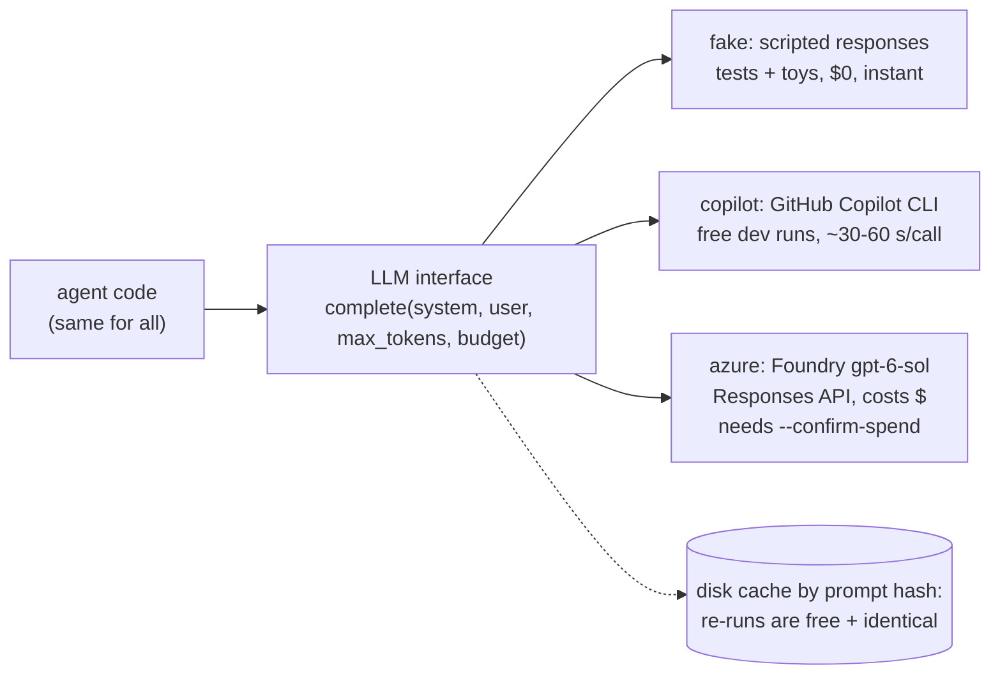

# Chapter 8: Part C: LLMs, tool calling, agents, multi-agent

> Goal: you understand that an "agent" is just **a loop in your code around an LLM**, how the single agent and the
> planner → workers → verifier team work, how we measured whether they help, and you can build both yourself.

> ⚙️ **Running the commands:** open a terminal in the repo root (the folder with `src/`) and use the venv's Python.
> Seeing `No module named 'src'`? You're in the wrong folder. See "Before you run ANY command" in the [guide README](README.md).

---

## 8.1 What an LLM is (just enough)

> 🎯 **Why we're doing this:** you can't design or budget an agent without knowing what an LLM call *is*: text in,
> text out, billed per token, sometimes wrong. Every guardrail in this chapter follows from those four facts.

An **LLM** (large language model: GPT, Claude, ...) is a function: **text in → text out**. That's all.

| term | meaning | why you care |
|---|---|---|
| **token** | a chunk of text, ~¾ of a word (`"mortgage"` ≈ 1–2 tokens) | **you pay per token**, input and output, every call |
| **prompt** | the input text. Usually a **system** part (the rules / role) + a **user** part (this request) | the system part is re-sent (and re-paid) on every call |
| **context window** | max tokens per call | long transcripts get expensive, then impossible |
| **temperature** | randomness of the output (0 = most deterministic) | reproducibility; we also **cache** every response |
| **hallucination** | confident, wrong output (e.g. an invented doc id) | **validate everything the LLM returns** |

Cost formula: `$ = input_tokens × price_in + output_tokens × price_out` (prices are per 1M tokens).

## 8.2 Tool calling: the LLM asks, *your code* acts

> 🎯 **Why we're doing this:** an LLM can't search our index by itself. It can only *write text*. Tool calling is the
> trick that lets it *request* a search, which our code executes. This is the foundation of every agent.

The LLM never runs anything. We describe a tool in the prompt, the LLM replies with a **structured request**
(JSON), *our* code runs the function, and we send the result back in the next prompt.



"Native function calling" in the OpenAI/Anthropic APIs is the same loop: the provider just enforces the JSON schema and returns
the call in a dedicated field. We use a plain **JSON-in-text protocol**, so the same agent code works with any backend.

## 8.3 An agent = a loop. Our single agent

> 🎯 **Why we're doing this:** Part C2 asks for one agent with a search tool. It's also the baseline the multi-agent
> design has to beat. If one loop already solves it, a team isn't worth its cost.



Guardrails (real code: `src/agent/single_agent.py`): max **3 LLM steps** (the last one is forced to `finish`), a **token budget**
(12K), invented ids dropped, any error → fall back to the results gathered so far. **An agent must never return *worse than
nothing*: the worst case is the plain search.**

Cost insight (toy 21): every step **re-sends the whole transcript**, so step 2's prompt is longer than step 1's. Agent cost
grows faster than linearly with the number of steps.

## 8.4 The test set: compound questions

> 🎯 **Why we're doing this:** on ordinary one-topic questions, plain hybrid search is already good, so an agent has
> little to add. To find out *when* agents help, we need questions where plain search predictably fails: two needs in one question.

`data/build_compound.py` (Part C1) builds **100 two-topic questions** from dev:



A real one (`c000`): **"Why might a share price not change at all for several days, and what are the steps to buying a home?"**
Gold: `128888` (half a), `283141` and `390447` (half b). Plain hybrid search here tends to fill the top 10 with one half,
so Coverage@10 suffers (baseline Coverage **0.10**).

## 8.5 The multi-agent team: planner → workers → verifier

> 🎯 **Why we're doing this:** Part C3 asks for multiple cooperating roles with budgets and failure handling. The design
> question is *which* steps need an LLM at all. Every LLM call costs seconds and money, so we use one only where judgement is needed.

| role | LLM? | job |
|---|---|---|
| **Orchestrator** | **no: plain Python** | owns the budget, timeouts and the final 10 slots. Control flow you can unit-test beats asking a model to "coordinate". |
| **Gate** | no (regex + length) | short, single-clause question → skip the planner entirely (0 LLM calls) |
| **Planner** | yes (1 call) | "simple, or compound?" → up to 3 standalone sub-queries |
| **Workers** | no | one search per sub-query + one for the full question, **in parallel** threads, 10 s timeout each |
| **Verifier** | yes (1 batched call) | sees the top-5 snippets per sub-query; may rewrite a drifted sub-query once |



**Why interleave instead of sorting by score?** Scores from different sub-queries aren't comparable. Toy 25: a score merge
gave all 10 slots to the "easy" half (Coverage **0.00**); interleave guaranteed both halves (Coverage **1.00**).
Price: each half keeps only its top ~5.

**Budgets are checked *before* each call** (reserve the worst case: prompt + max output). That way even parallel workers can't jointly overspend.
When the budget runs out, the orchestrator *skips* the remaining LLM steps and still returns results.

## 8.6 Did it help? The evaluation

> 🎯 **Why we're doing this:** agents cost 1–3 LLM calls (seconds and money) per query. They're only worth shipping if
> they measurably improve something users care about, on the queries where they're used. Part C4 asks for exactly this decision.

Dev evaluation: 100 plain dev queries (seed 42) + the 100 compound ones, through the same search API
(`results/agent_eval_dev_copilot.json`, LLM = claude-haiku-4.5 via the free GitHub Copilot CLI):

| set | system | Recall@10 | MRR@10 | Coverage@10 | LLM calls / q | tokens / q |
|---|---|---|---|---|---|---|
| plain | baseline (no LLM) | **0.502** | **0.485** | – | 0 | 0 |
| plain | single agent | 0.494 | 0.432 | – | 1.67 | 1,789 |
| plain | multi-agent | 0.476 | 0.472 | – | 0.53 | 138 |
| compound | baseline | 0.204 | 0.365 | 0.10 | 0 | 0 |
| compound | single agent | 0.327 | **0.513** | **0.29** | 2.24 | 2,681 |
| compound | multi-agent | **0.335** | 0.493 | 0.26 | 2.00 | 940 |

**How to read it:**
- **Plain questions: agents don't help** (slightly worse). There was nothing to fix, and the LLM's re-ordering lost some MRR.
- **Compound questions: agents help a lot.** Recall goes from 0.20 to ~0.33 (+60% relative), and Coverage from 0.10 to 0.26–0.29.
- Single vs multi: similar quality, but multi uses **~3× fewer tokens** (workers need no LLM; one batched verifier call).
- Traces: the planner split **100/100** compound questions and kept **91/100** plain ones simple (56 by the free gate). All of
  multi's plain-set loss comes from the **9 wrongly split** plain questions (their recall fell 0.70 → 0.40).

**Decision: route.** Simple → plain search (fast, free, best on plain). Compound (gate + planner say so) → multi-agent.
Don't wrap every query in an agent. Next fix: stop the 9 false splits. Final cost/latency numbers come from the Azure
`gpt-6-sol` run you'll do yourself (`DESIGN.md` §7).

## 8.7 Three LLM backends, and cost control

> 🎯 **Why we're doing this:** real LLM calls cost money and are slow and non-deterministic, which is terrible for tests
> and iteration. Swappable backends let us develop for free and spend only on the final measurement.



Cost guards: `--dry-run` (estimate tokens/$ with the fake LLM first), `--max-usd` (abort the run past a cap), a per-query
`Budget`, `max_output_tokens` on every call, snippets truncated to ~200 characters, and the cache.

---

## 🧸 A. The toys

| toy | shows |
|---|---|
| `20_tool_calling_loop.py` | the bare loop: LLM text → parse JSON → run the tool → repeat → finish |
| `21_query_rewrite_agent.py` | the single agent on a two-topic question; an invented id gets dropped; prompts grow each step |
| `22_planner_decompose.py` | which questions the free gate skips (56/100 plain, 0/100 compound) |
| `23_budget_guardrails.py` | call cap and token budget refusing a call *before* spending; graceful degradation |
| `24_partial_failure.py` | 3 parallel workers: one crashes, one is too slow, one works; the user still gets results |
| `25_slot_allocation.py` | score merge vs RRF vs interleave → Coverage 0.00 vs 1.00 |
| `26_cost_accounting.py` | tokens → dollars for single vs multi; caching savings |

All use the **fake** LLM (scripted replies), so they're free, instant and deterministic. **How to read toy 21:** Step 0 is the
free search; each `LLM action` line is one parsed JSON reply; the final line shows `llm_calls`, `searches` and approximate tokens.

## 🏭 B. The real thing in this repo

| file | role |
|---|---|
| `src/agent/llm.py` | `LLM` base (`complete`: reserve budget (worst case) → disk-cache lookup → backend call if not cached → record tokens), `FakeLLM`, `CopilotLLM`, `AzureLLM`, `Budget`, `parse_json` (finds the JSON object even inside ```` ``` ```` fences) |
| `src/agent/prompts.py` | the 3 prompts: `SINGLE_AGENT`, `PLANNER`, `VERIFIER`. Short, with the exact JSON format shown |
| `src/agent/tools.py` | `SearchTool`: calls the router, returns ids + 200-char snippets; `render_hits` formats them for prompts |
| `src/agent/single_agent.py` | `run_single_agent` (§8.3) |
| `src/agent/orchestrator.py` | `looks_simple`, `plan`, `verify`, `interleave`, `Orchestrator.run` (§8.5) |
| `data/build_compound.py` | the compound set (§8.4); `data/compound_review_sheet.md` = 10 for a human to check |
| `scripts/agent_eval.py` | the evaluation (§8.6); `scripts/render_agent_table.py` prints the table |
| `tests/test_agents.py` | 11 tests with the fake LLM: budgets, bad JSON, invented ids, worker failure, slot allocation |

```powershell
.\.venv\Scripts\python scripts\agent_eval.py --backend fake --limit 10              # free, instant plumbing check
.\.venv\Scripts\python scripts\agent_eval.py --backend copilot --limit 5 --workers 4 # free, slow (real LLM)
.\.venv\Scripts\python scripts\agent_eval.py --backend azure --dry-run              # estimate $ first
.\.venv\Scripts\python scripts\agent_eval.py --backend azure --confirm-spend --max-usd 2   # the real run (you)
```

## ✍️ C. The toy, by you

1. Fill in `exercises/ch08_agents/agent_loop.py` (check: `python -m pytest exercises\ch08_agents`) with a **fake LLM**: a function that returns scripted strings in order
   (`'{"action":"search","query":"..."}'`, then `'{"action":"finish","doc_ids":[...]}'`). Write the loop: parse JSON,
   call your toy BM25 from Ch. 3, append results to the transcript, stop at finish or 3 steps.
2. Add guardrails one by one, each with a scripted reply that triggers it: invalid JSON, an unknown action, an invented doc id,
   too many steps. Each must end with a valid top-k, never an exception.
3. Write `interleave(lists, k)` and reproduce toy 25: score merge → Coverage 0, interleave → Coverage 1.

## 🔧 D. The real thing, by you

1. **LLM client:** pick any OpenAI-compatible endpoint (e.g. your Azure Foundry deployment). Wrap it in your own
   `complete(system, user, max_tokens)` with: a disk cache keyed by `sha256(model + system + user)`, token accounting from the
   API's `usage`, a timeout, and a per-query budget checked *before* the call. Keep a fake implementation of the same interface for tests.
2. **Compound set:** reproduce §8.4 (sample, pair by low cosine, rewrite, tag gold). Or reuse `data/compound_dev.jsonl` to
   compare with our numbers.
3. **Single agent** over your Part B router API. **Target** (compound, dev): Recall@10 well above the 0.20 baseline (ours: 0.33).
4. **Multi-agent:** gate → planner → parallel workers (`ThreadPoolExecutor` + timeouts) → verifier → interleave. Unit-test it with the fake
   LLM *before* spending a single token.
5. **Evaluate** baseline vs single vs multi on plain + compound: Recall@10, MRR@10, Coverage@10, LLM calls, tokens, $ and p50/p95 latency.
   Always `--dry-run` and set a dollar cap first.
6. **Decide and write it down:** which queries get which path, and why (use your numbers). That's the deliverable, not the agent itself.

### Check yourself
1. What exactly does the LLM do in tool calling, and what does your code do?
2. Why does the single agent search once *before* the first LLM call?
3. Why is the orchestrator plain code and not another LLM?
4. Why interleave sub-query results instead of sorting them by score?
5. Agents lost a little on plain questions and gained a lot on compound ones. What routing policy follows?

**Next:** [Chapter 9: rebuild it yourself](09_rebuild_it_yourself.md)
