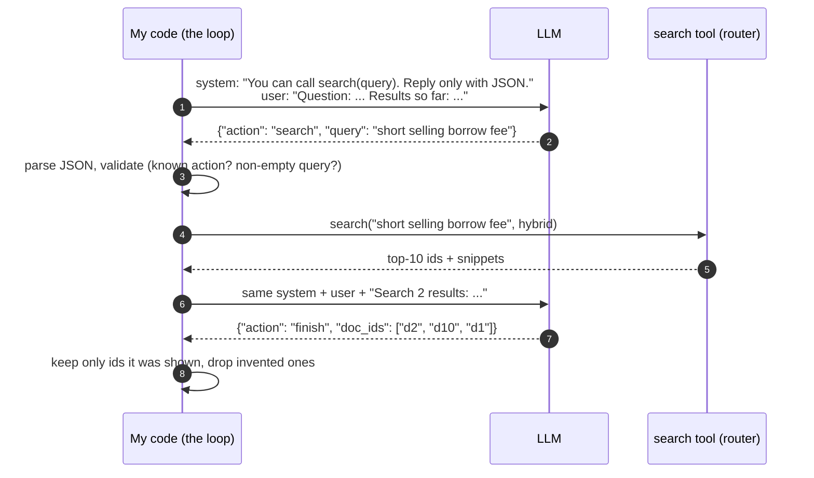
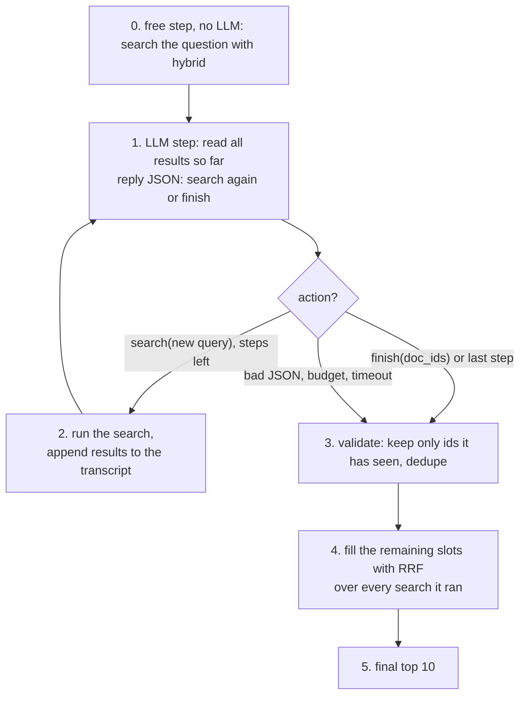
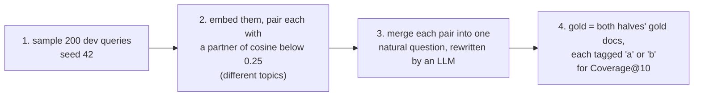
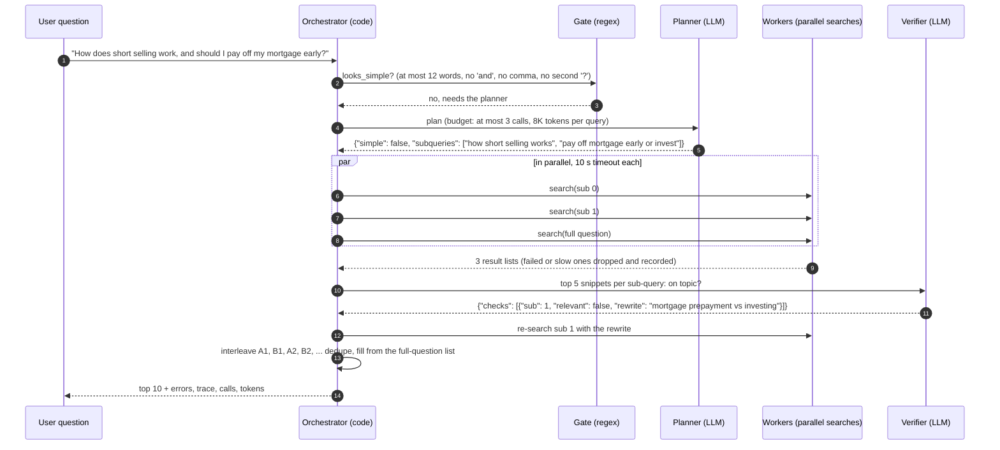
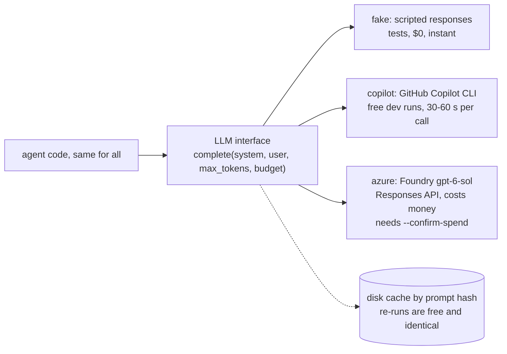

# Chapter 8: Part C: LLMs, tool calling, agents, multi-agent

An agent is a loop in my code around an LLM. In this chapter I show the single agent, the planner, workers and verifier
team, how I measured whether either one helps, and which queries I route to which.

## 8.1 What an LLM call is

An LLM (GPT, Claude, ...) is a function from text to text. Four facts about it drive every guardrail in this chapter:
you pay per token (a token is about 3/4 of a word), the whole prompt is re-sent and re-paid on every call, the output is
sometimes confidently wrong (an invented doc id, say), and it's slow. So I validate everything it returns and cache every
response, which also makes re-runs identical.

Cost is `input_tokens x price_in + output_tokens x price_out` (prices per 1M tokens). Input is everything I send: system
prompt, request, earlier results. I control its size, for example by cutting each passage to 200 characters
(`snippet_chars` in `src/agent/tools.py`). Output is what the model writes back, capped by `max_output_tokens` (planner
200, agent and verifier 250). Output is generated one token at a time, so it is usually priced 3 to 5 times higher.

An example from my dev run (`results/agent_eval_dev_copilot.json`, single agent, plain queries): 1.67 LLM calls, about
1,789 tokens and about $0.002 per query. With my prices ($1 per 1M input, $4 per 1M output, `src/config.py`) that solves
to roughly 1,720 input and 70 output tokens (my estimate, since the file stores only the total). So about 96% of the
tokens are input. For agents the bill is mostly prompt re-reading, which is why compact prompts, passing only ids and
snippets, and caching matter more than capping the answer. The prices are placeholders (I don't know the real
`gpt-6-sol` price). Override them with `PRICE_PER_1M_INPUT` and `PRICE_PER_1M_OUTPUT`.

## 8.2 Tool calling: the LLM asks, my code acts

The LLM can't search my index. It can only write text. So I describe a search tool in the prompt, the LLM replies with a
JSON request, my code runs the search, and I send the results back in the next prompt:



"Native function calling" in the OpenAI and Anthropic APIs is the same loop, with the provider enforcing the JSON schema.
I use a plain JSON-in-text protocol, so the same agent code works with any backend.

## 8.3 The single agent



The first search is free so the LLM starts from real results. The guardrails (`src/agent/single_agent.py`): at most 3 LLM
steps (the last one is forced to `finish`), a 12K token budget, invented ids dropped, and any error falls back to the
results gathered so far. The worst case is the plain search, never something worse. Every step re-sends the whole
transcript, so step 2's prompt is longer than step 1's and cost grows faster than the number of steps.

## 8.4 The test set: compound questions

On ordinary one-topic questions plain hybrid search is already good, so an agent has little to add. To find out when
agents help, I needed questions where plain search predictably fails: two needs in one question. `data/build_compound.py`
builds 100 of them from dev:



An example (`c000`): "Why might a share price not change at all for several days, and what are the steps to buying a
home?" Gold: `128888` (half a), `283141` and `390447` (half b). Plain search tends to fill the top 10 with one half, so
baseline Coverage@10 is 0.10. I set aside 10 rewrites for a human hand-check in `data/compound_review_sheet.md`; that
check is not done yet.

## 8.5 The multi-agent team

Every LLM call costs seconds and money, so I use one only where judgement is needed:

| role | LLM? | job |
|---|---|---|
| Orchestrator | no, plain Python | owns the budget, timeouts and the final 10 slots. Control flow I can unit-test |
| Gate | no (regex + length) | short single-clause question: skip the planner, 0 LLM calls |
| Planner | yes, 1 call | simple or compound? Up to 3 standalone sub-queries |
| Workers | no | one search per sub-query plus one for the full question, in parallel threads, 10 s timeout each |
| Verifier | yes, 1 batched call | sees the top 5 snippets per sub-query, may rewrite a drifted sub-query once |



I interleave instead of sorting by score because scores from different sub-queries aren't comparable. A score merge can
hand all 10 slots to the easy half. Interleaving guarantees both halves get about 5 slots each, at the price of keeping
only each half's top 5. Budgets are checked before each call by reserving the worst case (prompt plus max output), so
even parallel workers can't jointly overspend. When the budget runs out, the orchestrator skips the remaining LLM steps
and still returns results.

## 8.6 Did it help?

An agent costs 1 to 3 LLM calls per query, so it's only worth shipping if it measurably improves the queries it's used
on. I evaluated on 100 plain dev queries (seed 42) and the 100 compound ones, through the same search API.

### Dev run: claude-haiku-4.5 (free, via GitHub Copilot CLI)

`results/agent_eval_dev_copilot.json`. This is a dev run; the final numbers are the Azure run below.

| set | system | Recall@10 | MRR@10 | Coverage@10 | LLM calls / q | tokens / q |
|---|---|---|---|---|---|---|
| plain | baseline (no LLM) | 0.502 | 0.485 | n/a | 0 | 0 |
| plain | single agent | 0.494 | 0.432 | n/a | 1.67 | 1,789 |
| plain | multi-agent | 0.476 | 0.472 | n/a | 0.53 | 138 |
| compound | baseline | 0.204 | 0.365 | 0.10 | 0 | 0 |
| compound | single agent | 0.327 | 0.513 | 0.29 | 2.24 | 2,681 |
| compound | multi-agent | 0.335 | 0.493 | 0.26 | 2.00 | 940 |

On plain questions the agents didn't help: there was nothing to fix, and haiku's re-ordering lost some MRR. On compound
questions they helped a lot: recall went from 0.20 to about 0.33 and Coverage from 0.10 to 0.26 (multi) and 0.29
(single). The planner split all 100 compound questions and kept 91 of 100 plain ones simple (56 by the free gate). All of
multi's plain-set loss comes from the 9 wrongly split plain questions, whose recall fell from 0.70 to 0.40.

### Why multi-agent needs fewer calls and fewer tokens

Multi does more searches (3.38 per compound question vs 2.24) and still uses about a third of the tokens, because it gives
the LLM less to do and less to read: searching, the "ask the LLM at all?" decision and merging are plain code.

The workers use no LLM. In `src/agent/orchestrator.py` a worker is a function call in a thread pool that runs `search()`,
so each extra search costs 0 tokens. In the single agent, every search is chosen by an LLM call.

The single agent re-reads everything on every step. An LLM has no memory between calls, so `single_agent.py` rebuilds the
prompt each step: system prompt (about 194 tokens) plus question plus all search results so far (about 517 tokens per
search of 10 hits, measured as characters / 4). So call 1 sends about 740 input tokens, call 2 about 1,260 and call 3
about 1,780. 2.24 calls on average plus the replies comes to about 2,600, which matches the measured 2,681 tokens per
compound question.

The multi-agent flow has only two small LLM calls. The planner sees its instructions (118 tokens) and the question, with
no search results, about 200 tokens in total. The verifier sees its instructions (106) and the top 5 hits (not 10) of each
sub-question in one batched call, about 740. Together that's about 940, and the measured value is 940. The `Budget` cap
(`max_llm_calls=3`) is a safety net on top.

Most plain questions never reach the LLM. `looks_simple()` is a free check: at most 12 words and no sign of a second
question (no "and / also / plus / as well as / additionally / then / while", no comma or semicolon, not two question
marks). On the 100 plain questions, the gate answered 56 for free, the planner said "simple" for 35 (1 call each) and
wrongly split 9 (2 calls each), which averages to (35 + 9 x 2) / 100 = 0.53 calls. The single agent always makes at least
one. On the compound questions every multi-agent run used exactly 2 calls, and the verifier rewrote a sub-question in 36
of them (each rewrite is one more search, still 0 tokens).

Multi is cheap because its flow is fixed: plan once, search in parallel, verify once. The single agent is adaptive: it
reads results and decides what to search next, and pays for that in tokens. With haiku the fixed flow did as well on
compound questions (recall 0.335 vs 0.327) for about a third of the tokens. With a stronger model, the adaptive loop
starts paying off.

### Final run: Azure gpt-6-sol

Same 200 queries and the same code, only the LLM changed (`results/agent_eval.json`, reasoning effort `low`, search
through the single-node router, which gives the same quality as 3 shards). 0 errors, 394 s, about 655K tokens, $0.79 at
the placeholder prices ($1 / $4 per 1M input / output tokens). The dry-run estimate beforehand was $0.47.

| set | system | Recall@10 | MRR@10 | Coverage@10 | LLM calls / q | tokens / q | p50 / p95 s |
|---|---|---|---|---|---|---|---|
| plain | baseline (no LLM) | 0.502 | 0.485 | n/a | 0 | 0 | 0.06 / 0.08 |
| plain | single agent | 0.547 | 0.642 | n/a | 1.96 | 2,118 | 4.09 / 7.27 |
| plain | multi-agent | 0.481 | 0.466 | n/a | 0.51 | 130 | 0.03 / 3.59 |
| compound | baseline | 0.204 | 0.365 | 0.10 | 0 | 0 | 0.08 / 0.10 |
| compound | single agent | 0.400 | 0.609 | 0.40 | 2.70 | 3,380 | 5.75 / 9.28 |
| compound | multi-agent | 0.355 | 0.518 | 0.32 | 2.00 | 925 | 3.40 / 4.75 |

What changed against the haiku run:

- The single agent now wins on quality everywhere. On plain questions it improved recall on 7 queries and hurt it on 0,
  and moved the first relevant hit up on 30 (down on 3). Its last step picks the final 10 from everything it saw, which
  makes it an LLM reranker over 200-character snippets. haiku was a bad reranker (plain MRR 0.485 to 0.432). gpt-6-sol is
  a good one (0.485 to 0.642).
- The multi-agent barely moved (compound recall 0.335 to 0.355). Its LLM never ranks anything; it only splits the question
  and checks sub-results, so a smarter model can't improve a step it doesn't do.
- The token pattern held: multi used 925 tokens per compound question against single's 3,380 (3.7x), and its p95 (4.75 s)
  is about half of single's (9.28 s), because its flow is fixed at 2 calls.
- The single vs multi gap on compound questions is real but small at n = 100: recall +0.045 per query (bootstrap 95% CI
  +0.007 to +0.085), coverage +0.08 (CI +0.01 to +0.15).
- Multi's plain-set loss is again entirely false splits: 7 this time, whose recall fell from 0.82 to 0.51.

Which architecture is best depended on the model, so when I swap the model I re-run this eval before trusting the old
decision.

My routing decision:

- Plain questions (free gate or planner says simple) go to non-agentic hybrid search: about 30 ms and free. The single
  agent does improve them (+0.045 recall, +0.157 MRR) but costs about 4 s and 2K tokens each, so I offer it only as an
  opt-in "deep search".
- Compound questions go to the single agent when quality matters most (best recall and coverage, p95 about 9 s).
- Compound questions under a tight latency or cost budget go to the multi-agent (p95 about 5 s, about a quarter of the
  tokens, coverage 0.32 against the baseline's 0.10).

The next fix is to stop the false splits. I would also try multi-agent retrieval followed by one final rerank call by the
strong model, which could give single's ordering at multi's latency. Not built yet. Full write-up: `DESIGN.md` §7.

## 8.7 Three LLM backends and cost control

Real LLM calls cost money and are slow and non-deterministic, which is bad for tests. So the agent code talks to one
interface with three backends, and I spend money only on the final measurement:



The cost guards are `--dry-run` (estimate tokens and dollars with the fake LLM first), `--max-usd` (abort past a cap), a
per-query `Budget`, `max_output_tokens` on every call, snippets cut to about 200 characters, and the cache.

The code is in `src/agent/` (`llm.py`, `prompts.py`, `tools.py`, `single_agent.py`, `orchestrator.py`), the evaluation in
`scripts/agent_eval.py`, and `tests/test_agents.py` covers budgets, bad JSON, invented ids, worker failure and slot
allocation with the fake LLM.

```powershell
.\.venv\Scripts\python scripts\agent_eval.py --backend fake --limit 10              # free, instant plumbing check
.\.venv\Scripts\python scripts\agent_eval.py --backend copilot --limit 5 --workers 4 # free, slow (real LLM)
.\.venv\Scripts\python scripts\agent_eval.py --backend azure --dry-run              # estimate $ first
.\.venv\Scripts\python scripts\agent_eval.py --backend azure --confirm-spend --max-usd 2   # the real run
```

**Next:** [Chapter 9: how I built it, in order](09_rebuild_it_yourself.md)
