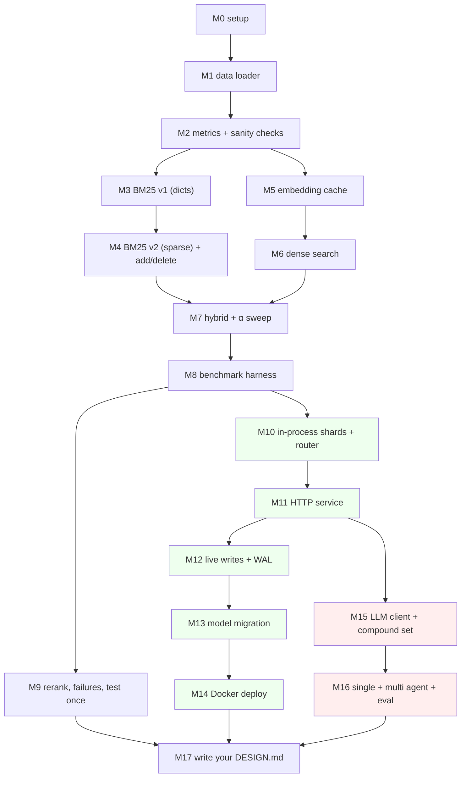
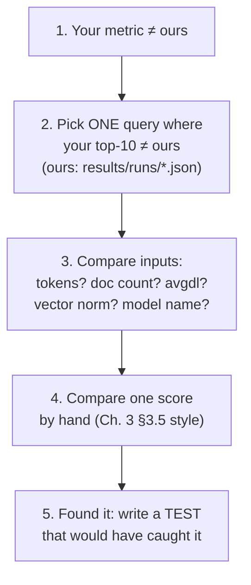

# Chapter 9: Rebuild it yourself: a step-by-step plan

> Goal: rebuild the whole project **by hand**, in your own repo, from an empty folder. Each milestone says what to build,
> **why**, the smallest skeleton to start from, how you know you're done (our numbers to match), and the bugs people usually hit.

> ⚙️ **Running the commands:** open a terminal in the repo root (the folder with `src/`) and use the venv's Python.
> Seeing `No module named 'src'`? You're in the wrong folder. See "Before you run ANY command" in the [guide README](README.md).

**Rules for yourself:**
1. Don't copy from `src/`. Look only *after* you're stuck for ~30 minutes, then close it and write your version.
2. Commit after every milestone with a message saying what you learned.
3. When your number differs from ours, **don't move on**. Find out why. That's where the learning is.

## The roadmap


Blue = Part A, green = Part B, red = Part C.

Suggested layout for your repo (mirror ours so you can compare):
```
my-fiqa/
  data/raw/fiqa/            (downloaded, gitignored)
  artifacts/                (embedding caches, gitignored)
  mine/
    data.py metrics.py bm25.py dense.py hybrid.py evaluate.py
    store.py shard_server.py router.py wal.py
    llm.py agent.py orchestrator.py
  scripts/  tests/  results/  DESIGN.md
```

---

## M0: Setup

> 🎯 **Why:** a reproducible environment means your numbers can be compared with ours (and anyone else's) later.

- `python -m venv .venv`; install **CPU** torch first: `pip install torch --index-url https://download.pytorch.org/whl/cpu`;
  then `pip install numpy scipy faiss-cpu snowballstemmer sentence-transformers fastapi uvicorn httpx psutil pytest openai python-dotenv`.
- `git init`; a `.gitignore` with `data/raw/`, `artifacts/`, `.env`, `.venv/`.
- **Done when:** `python -c "import torch, faiss, sentence_transformers; print('ok')"` prints `ok`.

## M1: Data loader (Ch. 1)

> 🎯 **Why:** every later step reads these three files. A silent bug here (wrong split, wrong id type) poisons every number after it.

```python
def load_corpus(d) -> dict[str, str]          # {doc_id: (title + " " + text).strip()}
def load_split(split, d) -> (queries, qrels)  # only queries present in qrels/{split}.tsv
```
- **Done when:** 57,638 docs; train/dev/test = 5,500 / 500 / 648 queries; 14,166 / 1,238 / 1,706 relevant pairs. Put these as `assert`s.
- **Bugs:** treating ids as ints (keep them strings); forgetting to skip the TSV header; loading all 6,648 queries for every split.

## M2: Metrics + sanity checks (Ch. 2)

> 🎯 **Why:** you'll make ~50 decisions by comparing these numbers. If the ruler is wrong, every decision is wrong.

```python
def recall_at_k(ranked, rel, k=10); def mrr_at_k(...); def ndcg_at_k(...); def coverage_at_k(ranked, halves, k=10)
def evaluate(run: dict[qid, list[docid]], qrels) -> dict
```
- **Done when:** toy 07's numbers (nDCG@5 = 0.613 / 0.501 / 0.000); oracle run → nDCG 1.0; random run → ≈ 0.
- **Bugs:** IDCG from retrieved docs only (must use all gold); duplicates counted twice; dividing by k instead of the number of gold docs.

## M3: BM25 v1 with plain dicts (Ch. 3)

> 🎯 **Why:** the simplest correct version first. It becomes the reference you test the fast version against.

```python
STOP = set("a an and are as at be but by for if in into is it no not of on or such that the their then there these they this to was will with".split())
def tokenize(t): return [stem(w) for w in re.findall(r"[a-z0-9]+", t.lower()) if w not in STOP]
index: dict[term, list[(doc_idx, tf)]]; doc_len: list[int]; avgdl; N
def search(query, k): scores = defaultdict(float); for t in set(tokenize(query)): idf = ln(1+(N-df+.5)/(df+.5)); for d, tf in index[t]: scores[d] += idf*tf*(k1+1)/(tf+k1*(1-b+b*doc_len[d]/avgdl))
```
- **Done when:** the doc 336018 example of Ch. 3 §3.5 scores **10.68**; dev **nDCG@10 = 0.264**, Recall@10 = 0.314.
- **Bugs:** different tokenizer for queries vs docs; counting a repeated query term twice; `log(N/df)` instead of Lucene's IDF.

## M4: BM25 v2, vectorised + live add/delete (Ch. 3)

> 🎯 **Why:** v1 takes tens of ms per query; v2 takes ~1 ms. Add/delete without a rebuild is required by Part B.

- A `scipy.sparse.csc_matrix` (docs × terms) of tf values; per query: `norm` for all docs in one numpy op, then
  `scores[rows] += ...` for each term's column; `np.argpartition` for the top-k.
- Live updates: new docs → a delta dict `{term: [(row, tf)]}`; deletes → an `alive[row] = False` mask; keep `df`, `N`, `total_len` correct.
- **Done when:** the same metrics as v1 on all 500 queries (assert identical top-10 lists), p50 ≈ 1–2 ms; add → searchable → delete → gone.

## M5: Embedding cache (Ch. 4)

> 🎯 **Why:** embedding 57K passages takes ~10 min on CPU. Do it once, store it, and every later experiment starts in seconds.

```python
m = SentenceTransformer("sentence-transformers/all-MiniLM-L6-v2", device="cpu"); m.max_seq_length = 256
E = m.encode(texts, batch_size=64, normalize_embeddings=True, show_progress_bar=True).astype("float32")
np.save("artifacts/emb_minilm.npy", E); json.dump({"ids": ids, "model": name, "max_seq": 256}, open("artifacts/emb_minilm.meta.json", "w"))
```
- **Done when:** shape (57638, 384), every row's norm ≈ 1.0, and the ids file has the same order as the rows.
- **Bugs:** the order of ids ≠ order of rows; forgetting `normalize_embeddings`; float64 (2× memory).

## M6: Dense search (Ch. 4)

> 🎯 **Why:** meaning search is the single biggest quality jump (+0.12 nDCG). It also teaches the offline/online split.

- v1: `scores = E @ q` + `argpartition`. v2: `faiss.IndexIDMap2(faiss.IndexFlatIP(384))`, `add_with_ids`, `search`, `remove_ids`.
- Then BGE: `BAAI/bge-small-en-v1.5`, with the query prefix `"Represent this sentence for searching relevant passages: "` on queries only.
- **Done when:** MiniLM dev **nDCG@10 ≈ 0.388**, BGE ≈ 0.398. Time the query encode (~8 ms) vs the search (~5 ms) separately.

## M7: Hybrid + α sweep (Ch. 5)

> 🎯 **Why:** the two retrievers fail on different queries; combining them is cheap quality. The sweep turns a guess into evidence.

- Top-100 from each → min-max → `α·dense + (1−α)·bm25`; also weighted RRF `w/(60+rank)`.
- **Done when:** linear α = 0.7 ≈ **0.419**; plain RRF ≈ 0.373 (below dense!); you have the full α table.

## M8: Benchmark harness (Ch. 2, 6)

> 🎯 **Why:** the assignment grades honest measurement: cold vs warm, percentiles, memory, strata. This harness produces all of it, for every config.

- Fresh process per config: cold = the first 20 dev queries; warm-up = 100 **train** queries; warm = all 500 dev; p50/p95 (nearest rank);
  peak RSS (`psutil`); stratified recall (query length < 5 / 5–15 / > 15 words; gold among the 10% longest docs).
- **Done when:** a `bench.json` + a table like Ch. 6 §6.3; hybrid warm p95 well under 50 ms.

## M9: Rerank ablation, failure analysis, test once (Ch. 5, 6)

> 🎯 **Why:** ablations show which ideas *don't* work (also a result). Failure analysis turns metrics into next steps. Test-once makes the final number honest.

- The cross-encoder `cross-encoder/ms-marco-MiniLM-L-6-v2` on the top-k for k = 10, 20 → nDCG + latency. (Ours: worse, and +300 ms.)
- List Recall@10 = 0 queries; find each gold doc's rank in BM25 and dense (depth 1000); write 3 cases with different causes and test one fix.
- Freeze everything → run test **once**. (Ours: 0.397.)

## M10: Shards + router, in one process (Ch. 7)

> 🎯 **Why:** get the *logic* of sharding right without network noise. If in-process sharding doesn't equal single node, HTTP won't either.

```python
shard_of = lambda doc_id, n: zlib.crc32(doc_id.encode()) % n
class Shard: stats(terms) -> (N, total_len, {t: df}); search(terms, global_stats, qvec, depth) -> (bm25_top, dense_top)
class Router: search(q): stats = sum(shard.stats(terms) ...); lists = [s.search(..., stats, ...)]; merge bm25 lists → top depth; merge dense → top depth; fuse
```
- **Done when:** for all 500 dev queries, 3-shard top-10 == single-node top-10 (BM25, dense, hybrid). Then use local stats and watch it differ.

## M11: The HTTP service (Ch. 7)

> 🎯 **Why:** real shards are separate processes. This adds network latency, timeouts and partial failures, which is what Part B is really about.

- Shard: FastAPI `POST /stats /search /docs`, `GET /health`. Router: FastAPI `/search` using **one persistent** `httpx.AsyncClient`,
  `asyncio.gather` + `asyncio.wait_for(timeout=0.5)`, and the `partial` / `missing_shards` fields.
- **Done when:** service metrics == single node; p50/p95 for 1 shard vs 3 shards (ours: 23 / 26 vs 29 / 41 ms); killing a shard returns `partial: true`.
- **Bugs:** a new HTTP client per request (+600 ms on Windows); embedding the query on every shard; JSON floats losing precision → tiny ranking differences.

## M12: Live writes + WAL (Ch. 7)

> 🎯 **Why:** the assignment requires updates while serving, searchable fast, safe under retries and crashes.

- `upsert(id, version, text)` / `delete(id, version)`: version check → embed outside the lock → write lock → re-check → WAL append + fsync →
  apply to BM25 + faiss → ack. Tombstones for deletes. On start-up: base + WAL replay. Truncate a torn last line on open.
- **Done when (as tests):** a retry is a no-op; an older version never wins; a delete is invisible in both indexes; a search right after the ack finds the doc;
  kill -9 → restart → acked writes present; crash mid-append → restart → write → restart → that write is still present.

## M13: Model migration (Ch. 7)

> 🎯 **Why:** upgrading the embedding model with zero downtime and an instant undo is a real production skill (and Part B3).

- Per shard: `{model: DenseIndex}`; `build_model(B)` = create + dual-write on (atomically), then a background backfill (throttled, skip docs whose
  version changed); the router's `active_model` persisted to disk; cutover only when all shards are ready; rollback = flip back; finalize = drop A.
- **Done when:** a load generator running through migrate → cutover → rollback reports **0 failed queries**, and docs written mid-migration are
  found with both models.

## M14: Docker deployment (Ch. 7)

> 🎯 **Why:** proves the system runs the same anywhere, enforces the 2 GB limit, and is how someone else would run your work.

- One image (python:3.11-slim, CPU torch, models baked in with `HF_HUB_OFFLINE=1`); compose: 3 shards (`mem_limit: 2g`, healthchecks) + router
  (`depends_on: service_healthy`) + bind mounts for data and artifacts; an `eval` service that runs your harness against `http://router:8000`.
- **Done when:** `docker compose up -d` → healthy; the eval inside the containers gives the same nDCG as native (ours: 0.4190 both).

## M15: LLM client + compound set (Ch. 8)

> 🎯 **Why:** a cached, budgeted, swappable LLM client keeps Part C cheap and testable. The compound set creates the situation agents should help with.

- `complete(system, user, max_tokens, budget)` with fake + real backends, a disk cache, token accounting and budget reservation.
- 100 compound questions: pair dissimilar dev queries (cosine < 0.25), merge them into one sentence, tag gold a/b.
- **Done when:** your fake backend drives all tests; a second identical real call is served from the cache (0 tokens).

## M16: Agents + evaluation (Ch. 8)

> 🎯 **Why:** the point of Part C isn't "build an agent", it's "decide, with evidence, when an agent is worth it".

- Single agent (free first search, ≤ 3 steps, validated ids, RRF fill). Multi-agent (gate → planner → parallel workers → verifier → interleave),
  with budgets and failure handling tested with the fake LLM.
- Evaluate baseline / single / multi on plain + compound: Recall, MRR, Coverage, calls, tokens, $, latency.
- **Done when:** a table like Ch. 8 §8.6 and a written routing decision. (Ours: compound recall 0.20 → ~0.33; plain: no gain → route.)

## M17: Write your DESIGN.md

> 🎯 **Why:** a design doc forces you to justify every choice with a number. If you can't, you don't understand it yet.

Answer, with *your* numbers: the chosen configuration and why; the benchmark table; cold vs warm; the architecture diagram; consistency
and freshness guarantees; migration and rollback; the agent decision; one counter-intuitive finding; three things that didn't work;
scaling to 100M (memory arithmetic, index type, what breaks first); production concerns. Then compare with ours.

---

## When you're stuck: a debugging ladder



Good luck, and enjoy it. Every bug you hit while rebuilding is one you'll recognise instantly at work.
