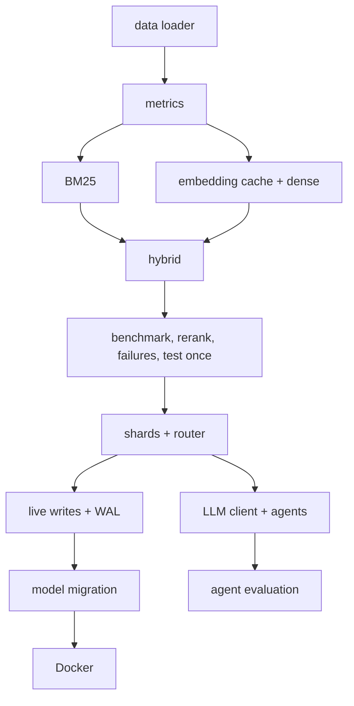

# Chapter 9: How I built it, in order

This is the order in which I built the system, and the check that told me each step was done. Each step depends on the
ones before it.

## 1. Data

I started with a loader for BEIR FiQA: `load_corpus` returns `{doc_id: title + text}`, and `load_split` returns the
queries and qrels of one split, keeping only queries that appear in that split's qrels. Doc ids stay strings. The check
was a set of asserts: 57,638 passages, 5,500 / 500 / 648 train / dev / test queries, and 14,166 / 1,238 / 1,706 relevant
pairs. A silent bug here would poison every number after it.

## 2. Metrics

Next came Recall@10, MRR@10, nDCG@10 and, later, Coverage@10 for the agents, plus an `evaluate(run, qrels)` that averages
them. I make most decisions by comparing these numbers, so I tested them first (`tests/test_metrics.py`): a perfect
ranking scores 1.0, IDCG is computed from all relevant docs and not only the retrieved ones, and repeated ids are not
counted twice.

## 3. BM25

I wrote BM25 twice. The first version used plain dicts and was easy to check by hand: the worked example in Chapter 3
scores doc 336018 at 10.68. The second uses a `scipy.sparse` matrix and numpy, supports adding and deleting docs without a
rebuild (Part B needs that), and I kept the dict version as the reference for it. Done when dev nDCG@10 was 0.2642 and
Recall@10 0.3135, with a p50 of 1.2 ms.

## 4. Dense search

Embedding all 57,638 passages takes minutes on CPU (567 s on this machine), so I did it once and saved the vectors to
`artifacts/emb_<model>.npy` with a metadata file holding the doc id of every row. Search is a faiss inner-product index
over normalised vectors. Done when MiniLM reached dev nDCG@10 0.3881 and bge-small 0.3981, and I had timed the query
encode (about 8 ms) separately from the faiss search (about 5 ms).

## 5. Hybrid

BM25 and dense fail on different queries, so I combined them: top 100 from each, min-max normalised, then
`0.7 x dense + 0.3 x bm25`. I also tried RRF. The alpha sweep picked 0.7, and done meant linear fusion at nDCG@10 0.4190
(R@10 0.4914, MRR 0.4872), with plain RRF at 0.3733, below dense alone.

## 6. Evaluation

The benchmark harness runs every configuration in a fresh process: 20 cold dev queries, 100 train queries to warm up,
then all 500 dev queries, with p50/p95 and peak memory (Chapter 6). Hybrid came out at 20.7 / 24.5 ms, well under the
50 ms limit. Then the ablations: a cross-encoder reranker on the top 10 gave nDCG 0.4058 at a p50 of 338.6 ms, worse and
much slower, so I left it out. I listed the 161 dev queries with Recall@10 = 0 and wrote up three with different causes
(`results/failures.md`). Last, with every choice frozen, I ran the test split once: nDCG@10 0.3968.

## 7. Shards and router

I built sharding inside one process first, to get the logic right without network noise: `crc32(doc_id) % 3`, a stats
phase that sums N and df across shards, and a router that merges shard lists before fusing. Then I moved the shards into
separate FastAPI processes behind an HTTP router with timeouts and the `partial` / `missing_shards` fields. Done when the
3-shard results matched single node exactly (0.0% difference for every strategy, `tests/test_store.py`) and a stopped
shard produced a partial result. Through HTTP, hybrid p50/p95 was 23.4 / 26.3 ms with 1 shard and 28.6 / 40.5 ms with 3.

## 8. Live writes

Writes came next: versioned upserts and deletes with tombstones, one read-write lock over both indexes, and a write-ahead
log with fsync before every apply. The integration tests were the check: a retry is a no-op, an older version never
wins, a search right after the ack finds the doc, and acked writes survive a kill and restart. A crash in the middle of
an append exposed a bug on the second restart, so there is now a test that recovers twice in a row. Later I added the
async apply mode and measured both (`results/write_load.json`): sync 57.8 writes/s with acks at 128 / 181 ms and zero
visible lag, async 94.2 writes/s with acks at 78 / 120 ms and visible lag p95 / max of 466 / 583 ms.

## 9. Model migration

Each shard holds one dense index per model, with dual-write while a new one is built, a throttled background backfill
that skips docs changed since its snapshot, and a router `active_model` that only flips when every shard is ready.
Done when the demo (`results/migration_demo.json`) ran migrate, backfill, cutover and rollback under load with 2,045
queries, 0 failed, and all 116 docs written during the run findable with both models.

## 10. Docker

One image (Python 3.11, CPU torch, models baked in) and a compose file with 3 shard containers capped at 2 GB, a router
that waits for healthy shards, and an `eval` service. Done when the evaluation inside the containers gave dev nDCG
0.4190, the same as native, with about 505 MiB per shard container.

## 11. Agents

I wrote the LLM client before any agent: one `complete()` interface with fake, Copilot CLI and Azure backends, a disk
cache, token accounting and a budget reserved before each call. The fake backend drives all the agent tests, so I could
build for free. Then the compound set (100 two-topic questions from dev), the single agent (free first search, at most
3 LLM steps, validated ids, RRF fill) and the multi-agent team (gate, planner, parallel workers, verifier, interleave),
each tested against budgets, bad JSON and failing workers with the fake LLM.

## 12. Agent evaluation

I ran the evaluation first with the free haiku backend as a dev run, then once on Azure gpt-6-sol for the final numbers
(`results/agent_eval.json`, $0.79 at placeholder prices). Done when I had the table in Chapter 8 §8.6 and a routing
decision backed by it: plain questions go to non-agentic hybrid search, the single agent is an opt-in "deep search", and
compound questions go to the single agent for quality (Recall@10 0.400, Coverage 0.40) or to the multi-agent team under a
latency or cost budget (p95 4.75 s, 925 tokens). The 10-question hand-check of the compound rewrites is still open.

Finally I wrote [`DESIGN.md`](../../DESIGN.md), justifying each choice with the numbers above.
