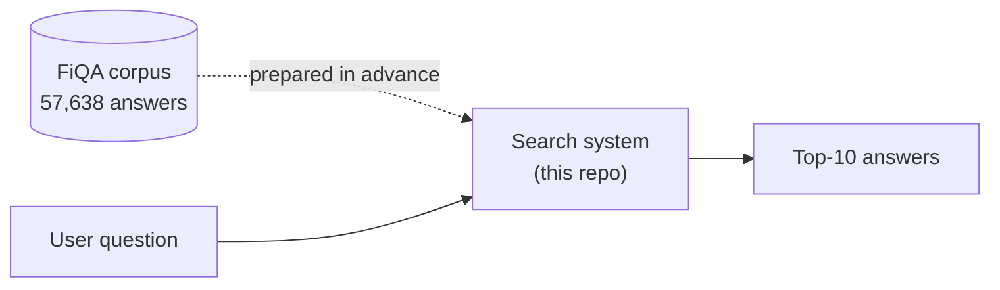
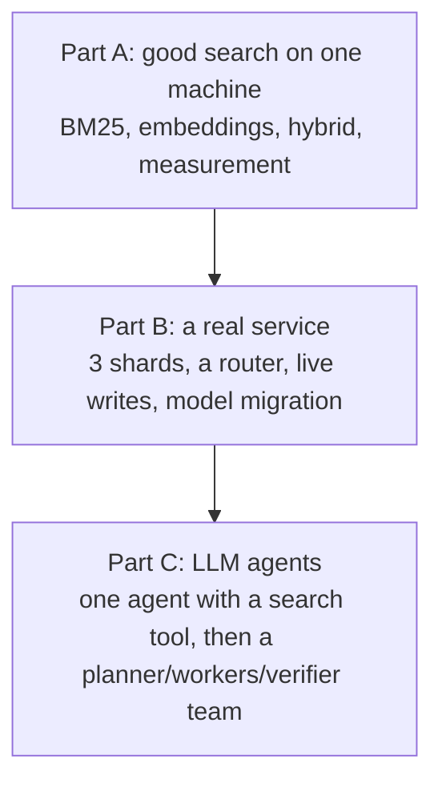

# From zero: how I built this search system

I'm Pranav, and I designed this system. This guide is me explaining it to you from scratch. I assume you know Python and
nothing about search: no BM25, no embeddings, no nDCG, no agents. I build it up one idea at a time, with hand-worked
examples on the real FiQA data.

`README.md` at the repo root tells you how to run the code, and `DESIGN.md` is written for a reader who already knows the
field. This guide is the slow version.

## The whole project on one page

People ask money questions ("Should I pay off my mortgage early?"), and I have 57,638 old answers written by other
people. For any new question, my system has to find the 10 best old answers, fast. Everything else in the repo is about
doing that well, at scale, and with an LLM in the loop.



The project has three parts, each built on the previous one:



## Running the commands

Every command assumes your terminal is in the repo root (the folder with `src/` and `docs/`) and uses the repo's venv:

```powershell
cd fiqa-agentic-retrieval      # the folder you cloned into
.\.venv\Scripts\Activate.ps1
$env:PYTHONIOENCODING = "utf-8"                            # lets Windows print symbols like α
python -c "import src, numpy, faiss; print('ready')"
```

If you see `No module named 'src'`, you started Python outside the repo root. If you see `No module named 'numpy'`, you're
using the system Python instead of the venv. A missing `data/raw/fiqa/corpus.jsonl` means you need
`python scripts/download_data.py` first.

## Chapters

Read them in order.

1. [The problem and the data](01_the_problem_and_the_data.md): what retrieval is, what is inside FiQA, and why I tune on dev and touch test once.
2. [Measuring quality and speed](02_measuring_quality_and_speed.md): Recall, MRR, nDCG, Coverage, p50/p95 latency and memory, each computed by hand.
3. [Keyword search with BM25](03_keyword_search_bm25.md): tokens, the inverted index, and one real BM25 score worked out by hand.
4. [Meaning search with embeddings](04_meaning_search_embeddings.md): what an embedding is, how MiniLM makes one, and how faiss searches them.
5. [Hybrid fusion and reranking](05_hybrid_and_reranking.md): why I combine BM25 and dense with linear fusion, and why I don't ship the reranker.
6. [Part A end to end](06_part_a_end_to_end.md): indexing, querying, evaluating, and reading the failures.
7. [Part B: the distributed service](07_part_b_distributed.md): shards, the router, live updates and the zero-downtime model migration.
8. [Part C: agents](08_part_c_agents.md): tool calling, the single agent, the multi-agent team, and whether they are worth it.
9. [How I built it, in order](09_rebuild_it_yourself.md): the order I built the pieces in, and why.

The topic docs in [`docs/topics/`](../topics/) (00 to 16) go deeper on each piece.
