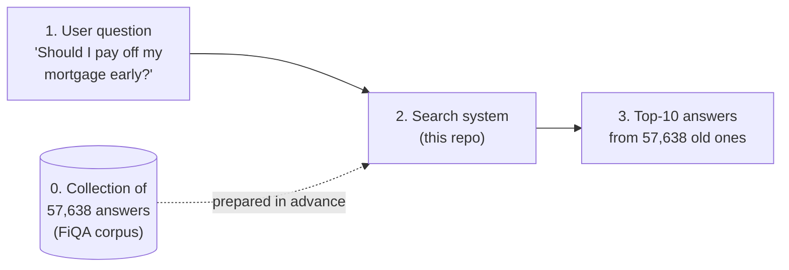
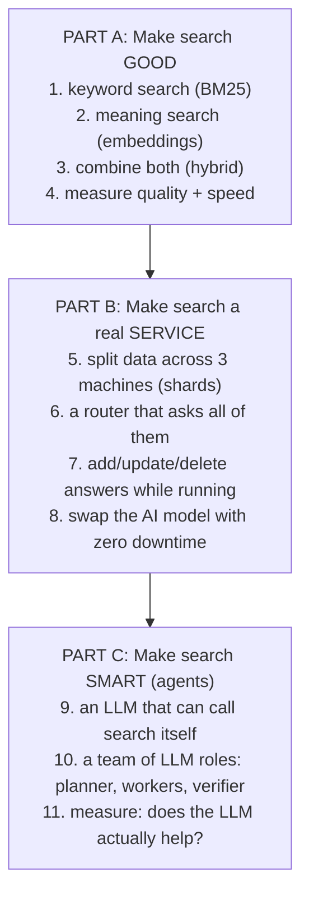
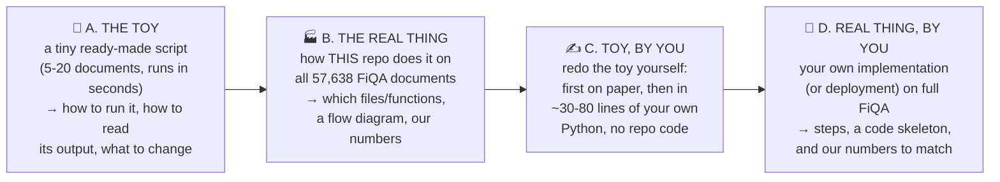
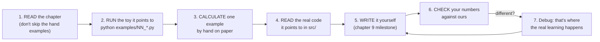

# From Zero: learn everything in this repo, then rebuild it yourself

**Who this is for:** you know how to program, but you have never heard of BM25, FiQA, MiniLM, nDCG,
embeddings, sharding or agents. That's fine. This guide starts from nothing and builds up, one idea at a time.
Every idea comes with a picture and a small example you can calculate by hand.

**Why a separate guide?** `README.md` tells you how to *run* the code, and `DESIGN.md` is written for a
reviewer who already knows the field. Neither *teaches*. This guide does.

> Reading tip: the diagrams are written in **Mermaid**. They render on GitHub, and in VS Code with the
> "Markdown Preview Mermaid Support" extension (open the file, press `Ctrl+Shift+V`).

---

## The whole project on one page

Imagine a website where people ask money questions ("Should I pay off my mortgage early?"), and you have
57,638 old answers written by other people. **Your job: for any new question, find the 10 best old answers,
fast.** That's the whole project. Everything else is about doing that *well*, *fast*, *at scale*, and
*smartly*.



The assignment has three parts. Each part adds a layer on top of the previous one:



---

## ⚙️ Before you run ANY command in this guide (read once)

Every command in these chapters assumes two things:

1. **Your terminal is in the repo root**: the folder that contains `src/`, `examples/`, `docs/` and `README.md`.
2. **You use the repo's virtual-environment Python** (`.venv`), which has all the packages installed.

```powershell
cd C:\path\to\fiqa-agentic-retrieval      # 1. go to the repo root (your path)
.\.venv\Scripts\Activate.ps1                               # 2. activate the venv: the prompt shows (.venv)
$env:PYTHONIOENCODING = "utf-8"                            # 3. lets Windows print symbols like α and →
python -c "import src, numpy, faiss; print('ready')"       # 4. check: must print 'ready'
```
(If you don't activate the venv, write `.\.venv\Scripts\python` instead of `python` everywhere.)

**Why the folder matters:** `from src.beir_data import ...` means "find a folder called `src` *in the current directory*
(or on `PYTHONPATH`)". Run Python from any other folder and you get:

| error you see | cause | fix |
|---|---|---|
| `ModuleNotFoundError: No module named 'src'` | Python was started outside the repo root | `cd` to the repo root (step 1), then run again |
| `ModuleNotFoundError: No module named 'numpy'` (or faiss, torch, ...) | you used the system Python, not the venv | activate the venv (step 2) or use `.\.venv\Scripts\python` |
| `FileNotFoundError: ... data/raw/fiqa/corpus.jsonl` | FiQA isn't downloaded yet | `python scripts/download_data.py` |
| `UnicodeEncodeError: 'charmap' codec can't encode` | Windows console encoding | step 3 |

**Interactive Python (REPL):** the same rule applies. Start `python` *from the repo root*, then type the imports:
```powershell
cd C:\path\to\fiqa-agentic-retrieval
.\.venv\Scripts\python
>>> from src.beir_data import load_corpus, load_split
```
**VS Code / Jupyter:** open the repo root as the folder (File → Open Folder) and select the `.venv` interpreter
(Ctrl+Shift+P → "Python: Select Interpreter").

## The chapters (read in order)

| # | Chapter | You will understand | Time |
|---|---|---|---|
| 1 | [The problem, the data (FiQA), the vocabulary](01_the_problem_and_the_data.md) | what "retrieval" is, what a corpus/query/qrel is, what FiQA and BEIR are | 1 h |
| 2 | [How we measure: Recall, MRR, nDCG, Coverage, latency, memory](02_measuring_quality_and_speed.md) | how to score a search system by hand | 2 h |
| 3 | [Keyword search: tokens, inverted index, TF-IDF, BM25](03_keyword_search_bm25.md) | how BM25 scores a document, computed by hand | 3 h |
| 4 | [Meaning search: embeddings, MiniLM, BGE, cosine, faiss](04_meaning_search_embeddings.md) | what a vector is, why it understands synonyms | 3 h |
| 5 | [Combining and re-ranking: hybrid fusion, RRF, cross-encoders](05_hybrid_and_reranking.md) | why 1 + 1 > 1 and how to add scores fairly | 2 h |
| 6 | [Part A end to end: indexing, querying, evaluating, failures](06_part_a_end_to_end.md) | the whole Part A pipeline and how to read the results | 2 h |
| 7 | [Part B: shards, router, live updates, model migration](07_part_b_distributed.md) | how one search becomes a distributed service | 4 h |
| 8 | [Part C: LLMs, tool calling, agents, multi-agent](08_part_c_agents.md) | what an "agent" really is (a loop!) | 3 h |
| 9 | [**Rebuild it yourself**: a step-by-step plan](09_rebuild_it_yourself.md) | 18 milestones (M0–M17), each with a goal, why, skeleton, and expected numbers | days |

Then go deeper with the topic docs (`docs/00`–`15`), toys (`examples/`), exercises and solutions
(`docs/solutions/`), and the [GLOSSARY](../GLOSSARY.md).

## How every chapter is organised (the same 4 parts at the end of each)

After explaining the idea (intuition → pictures → a hand-calculated example), **every chapter ends with the same
four sections**, so you always know where you are. Also, **every concept section starts with a
`🎯 Why we're doing this` box**: the problem that section solves, and which later decision depends on it. If you
only skim, read those boxes. Together they form the mental model of the whole project.



| part | what you do | what you need | how you know you succeeded |
|---|---|---|---|
| 🧸 A | run `python examples/NN_*.py`, read the narrated output, try the `TRY THIS` edits | this repo + venv | you can predict what the toy prints before running it |
| 🏭 B | read the pointed-to code, run the pointed-to command on the real data | the FiQA download + embedding cache | you can explain each step of the flow diagram in your own words |
| ✍️ C | paper first, then the ready-made stub in [`exercises/`](../../exercises/README.md); check with `python -m pytest exercises\chNN_*` (seconds), then `--full` (real FiQA, minutes) | plain Python (+ numpy) | toy: your numbers equal the toy's; `--full`: your code reproduces our real numbers. Answers in `exercises/solutions/` |
| 🔧 D | build your own version from scratch in your own repo | Python, numpy/scipy, sentence-transformers, faiss, (FastAPI, Docker) | your metrics are within ~0.005 of ours (quality) and similar order of magnitude (speed) |

**Chapter 9** strings all the 🔧 D parts together into one ordered build plan (18 milestones, M0–M17), so at the end you
have rebuilt the whole project by hand.

## How to study each chapter (the loop)



## The 30 words you'll meet (preview; all explained in the chapters)

| word | one-line meaning | chapter |
|---|---|---|
| retrieval | finding the right documents for a question | 1 |
| corpus | the collection of all documents you search over | 1 |
| query | the question | 1 |
| qrels | the answer key: which documents are correct for which query | 1 |
| FiQA | a public dataset of finance questions + answers (from StackExchange) | 1 |
| BEIR | a benchmark: 18 datasets in one standard format; FiQA is one of them | 1 |
| dev / test split | questions for tuning (dev) vs a final exam you take once (test) | 1 |
| Recall@10 | of the correct answers, what fraction made the top 10 | 2 |
| MRR | how high up the FIRST correct answer is | 2 |
| nDCG@10 | a score rewarding correct answers near the top | 2 |
| Coverage@10 | for two-part questions: did we find something for BOTH parts | 2 |
| p50 / p95 latency | the typical / the slow-ish response time | 2 |
| token | a piece of text (a word or part of a word) | 3, 8 |
| inverted index | a "word → which documents contain it" lookup table | 3 |
| TF, IDF | how often a word appears in a doc; how rare a word is overall | 3 |
| BM25 | the classic keyword scoring formula (used by Elasticsearch) | 3 |
| embedding | a list of numbers representing a text's meaning | 4 |
| MiniLM, BGE | two small AI models that turn text into embeddings | 4 |
| cosine similarity | how "same direction" two embeddings point | 4 |
| faiss | a library for fast nearest-vector search | 4 |
| hybrid / fusion | combining keyword and meaning search scores | 5 |
| RRF | a way to combine rankings using positions only | 5 |
| cross-encoder / reranker | a slower, more careful model that re-orders the top results | 5 |
| shard | one slice of the data, living on one machine/process | 7 |
| router | the front door: sends the query to all shards and merges results | 7 |
| WAL | write-ahead log: write the change to disk first so a crash can't lose it | 7 |
| blue/green migration | build the new version next to the old, then flip a switch | 7 |
| LLM | large language model (like GPT): text in, text out | 8 |
| tool calling | the LLM asks *your code* to run a function (e.g. search) | 8 |
| agent | a loop: LLM decides → your code acts → LLM sees result → repeat | 8 |
