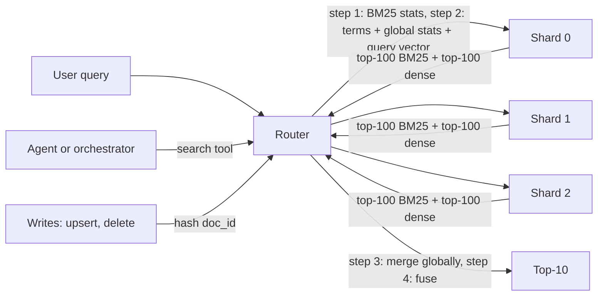

# 00 · RAG and retrieval primer

This is the map of my system. Every later doc zooms into one box of the diagram below.

## What I built

The corpus is 57,638 answers from a personal-finance forum (FiQA). For a question like "what is short selling?",
*retrieval* finds the few passages that answer it, quickly, and *RAG* (retrieval-augmented generation) hands them to an
LLM to write a grounded answer. I built the retrieval half properly, then used LLM *agents* to drive retrieval for
questions one search can't answer well.

BM25 matches the exact words you typed. Dense retrieval matches meaning, so "betting against stocks" still finds
passages about shorting. Hybrid merges both. Sharding splits the corpus across three processes, so a router asks all
three and merges. Agents rephrase the question, split it into parts and check the results.



Each shard has a BM25 index, a dense index, a doc store and a *WAL* (write-ahead log):

| Box | Code | Doc |
|---|---|---|
| tokenizer + BM25 | `src/retrieval/bm25.py` | [01](01_lexical_retrieval_bm25.md) |
| embeddings + vector index | `src/retrieval/dense.py` | [02](02_dense_retrieval.md), [03](03_vector_indexes.md) |
| fine-tuning the embedder | `scripts/finetune.py` | [17](17_fine_tuning.md) |
| metrics | `src/metrics.py` | [04](04_ir_metrics.md) |
| fusion | `src/retrieval/hybrid.py` | [05](05_hybrid_fusion.md), [16](16_ablations.md) |
| reranker | `src/retrieval/rerank.py` | [06](06_reranking.md) |
| eval harness | `src/eval.py` | [07](07_benchmarking_latency_memory.md) |
| router / shard | `src/service/router.py`, `shard_server.py`, `store.py` | [08](08_sharding_scatter_gather.md) |
| writes, WAL | `src/service/store.py`, `wal.py` | [09](09_live_updates_consistency.md) |
| model migration | `ShardStore.start_build`, `Router.cutover` | [10](10_model_migration.md) |
| LLM + agents | `src/agent/*` | [11](11_llm_tool_calling.md) to [14](14_agent_evaluation_cost.md) |
| cascade, semantic cache, web fallback | `src/agent/cascade.py`, `semantic_cache.py`, `src/service/websearch.py` | [18](18_llm_cost_and_fallback.md) |
| A2A service, agent memory | `src/a2a/`, `src/agent/memory.py` | [19](19_a2a_and_memory.md) |

Offline, `python -m src.index.build_index` embeds the corpus once per model (about 10 min for MiniLM, 18 min for
bge-small on 32 cores). Each shard loads its slice (`crc32(doc_id) % 3`), builds BM25 in seconds and copies its vectors
from that cache. Agents call the router through one tool, `search(query, strategy)`.

## The dataset: BEIR / FiQA

| split | queries | judged-relevant pairs | per query |
|---|---|---|---|
| train | 5,500 | 14,166 | 2.58 |
| dev | 500 | 1,238 | 2.48 |
| test | 648 | 1,706 | 2.63 |

Passages have a median of 90 words, p90 270, max 2,973 (`python -m src.beir_data`). The *qrels* say which passages are
relevant to each query; everything else counts as non-relevant even when it is a fine answer, which causes many false
failures (`results/failures.md`). I tune on dev only and ran test once at the end. `src/eval.py` refuses
`--split test` without `--final-test-run`, so I can't tune on test by accident.

## Embeddings vs a vector database (and why I didn't use one)

Embeddings are data; a vector database is software around that data, like a CSV file vs Postgres. My embeddings file,
`artifacts/emb_minilm.npy`, is a 57,638 × 384 float32 matrix (≈ 88 MB) plus a `.meta.json` mapping rows to doc ids.
On its own it can't answer a query, take a new document safely, delete one, or survive a crash mid-write. A vector DB
(Qdrant, Milvus, Weaviate, pgvector, Elasticsearch, Azure AI Search, Pinecone) adds that. Here is where I built each piece:

| Vector-DB feature | My hand-built version |
|---|---|
| storage of vectors and ids | `artifacts/emb_*.npy` + `.meta.json` (`src/index/build_index.py`) |
| nearest-neighbour index | faiss `IndexIDMap2(IndexFlatIP)` in RAM, exact search (`src/retrieval/dense.py`) |
| insert / update / delete while serving | versioned upserts, `remove_ids`, tombstones (`src/service/store.py`) |
| durability of acknowledged writes | write-ahead log + replay on restart (`src/service/wal.py`) |
| sharding + scatter-gather | `crc32(doc_id) % 3` shards + router (`src/service/router.py`) |
| several models at once | indexes keyed by `model_id`, blue/green cutover ([10](10_model_migration.md)) |
| network API | FastAPI `/search`, `/upsert`, `/delete` |
| metadata filters | not built (FiQA has no metadata worth filtering on) |

So the router plus 3 shards is a small vector DB with a BM25 index beside the vectors. I wanted to build
and explain sharding and live updates, and bugs like local IDF or fusing before merging ([08](08_sharding_scatter_gather.md))
stay invisible inside a product. I also wanted full control of hybrid search (global BM25 stats, merge then fuse). In
production I would use a real one for replication, backups, ANN indexes ([03](03_vector_indexes.md),
[15](15_scaling_to_100M.md)) and monitoring, and having built the pieces helps me size and debug it.

## Run it

```bash
python -m src.service.cluster --shards 3            # terminal 1: router + 3 shards, as local processes
python src/search.py --query "what is short selling?" --top-k 5   # terminal 2
```

`docker compose up -d` runs the same router + 3 shards in containers. `search.py` is an HTTP client for
`http://127.0.0.1:8000`, so run only one of the two setups: both routers want port 8000.

References: Thakur et al., *BEIR* (2021); Lewis et al., *Retrieval-Augmented Generation* (2020).
