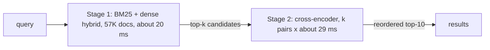

# 06 · Reranking: a second, slower opinion

Prerequisites: [02 dense retrieval](02_dense_retrieval.md), [05 hybrid fusion](05_hybrid_fusion.md).

## Bi-encoder vs cross-encoder

My MiniLM and BGE models are bi-encoders: they embed query and passage separately, so passage vectors are computed once
offline and search is a dot product, `score(q, d) = <E(q), E(d)>`. The query never sees the passage. A cross-encoder
feeds `[CLS] query [SEP] passage [SEP]` into one transformer, so every query token attends to every passage token and
it can notice that "not tax deductible" contradicts the question. Nothing can be precomputed:
`score(q, d) = w · CLS(Transformer([q ; d]))`, an unbounded logit, costs one full forward pass per (query, passage)
pair.

On this machine (4 threads) one pair of about 256 tokens takes about 29 ms on CPU:

- top-10: 10 × 29 ≈ 290 ms plus the 20 ms first stage, measured p50 339 ms
- top-20: ≈ 580 + 20, measured 621 ms, linear in k as expected
- the whole corpus: 57,638 × 29 ms ≈ 28 minutes per query, which is why a cross-encoder is never the first stage

Self-attention is O(L²) in sequence length, so a 512-token pair costs about 4× a 256-token pair. Long FiQA answers
hurt twice.



Stage 2 can only reorder what stage 1 found, so stage 1's Recall@k is the ceiling.

## How I implemented it

- `src/retrieval/rerank.py`: `get_reranker()` lazily loads `cross-encoder/ms-marco-MiniLM-L-6-v2` once per process
  behind a lock. `rerank(query, candidates, texts)` scores pairs in batches of 32 and sorts by logit, with ties broken
  on doc id.
- `src/service/router.py`: the `rerank_k` search parameter. The router fetches texts for the top-k from the shards
  (`fetch`) and reranks centrally, in a worker thread. It is off by default (`rerank_k=0`).
- `scripts/ablations.py --rerank --ks 10,20,50` runs the sweep and writes `results/ablation_rerank_minilm.json`.

I rejected reranking per shard, since each shard would see only its own candidates (the same bug class as fusing per
shard, [08](08_sharding_scatter_gather.md)). I also rejected adding CE logits to fused scores, because they are on
different scales. While building the sweep I hit two bugs: a 9 GB memory leak from creating an event loop per call
(fixed with one persistent loop) and multi-second first queries before I made the model a lazy singleton.

## Results (dev, stage 1 = MiniLM hybrid linear α = 0.7)

| rerank depth k | nDCG@10 | R@10 | MRR@10 | p50 | p95 |
|---|---|---|---|---|---|
| none | 0.4190 | 0.4914 | 0.4872 | 20.7 ms | 24.5 ms |
| 10 | 0.4058 | 0.4914 | 0.4688 | 338.6 ms | 366.8 ms |
| 20 | 0.3964 | 0.4829 | 0.4634 | 621.0 ms | 634.6 ms |
| 50 | 0.3771 | 0.4633 | 0.4444 | 1246.3 ms | 1366.6 ms |

I expected the reranker to help. It hurts here:

- At k = 10, R@10 is unchanged by construction (same 10 docs), yet nDCG falls, so the cross-encoder orders them worse.
- Deeper k lets it promote docs from ranks 11 to k above true answers, so recall falls too.
- ms-marco-MiniLM was trained on short Bing passages and web queries. FiQA answers are long, opinionated forum posts
  truncated to 256 tokens, which is a domain shift.

So I don't ship it: it costs over 300 ms for −0.013 nDCG at k = 10. A finance-tuned or larger reranker
(bge-reranker-base), interpolating `λ·CE + (1−λ)·fused` after normalising both, or chunk-level max scoring for long
answers might fix it. I haven't built any of these. Fixing stage 1 while comparing rerankers matters, because
different candidates mean a different ceiling.

```powershell
python scripts/ablations.py --model minilm --rerank --ks 10,20,50   # overwrites results/ablation_rerank_minilm.json
```

Reference: Nogueira & Cho, *Passage Re-ranking with BERT* (2019).
