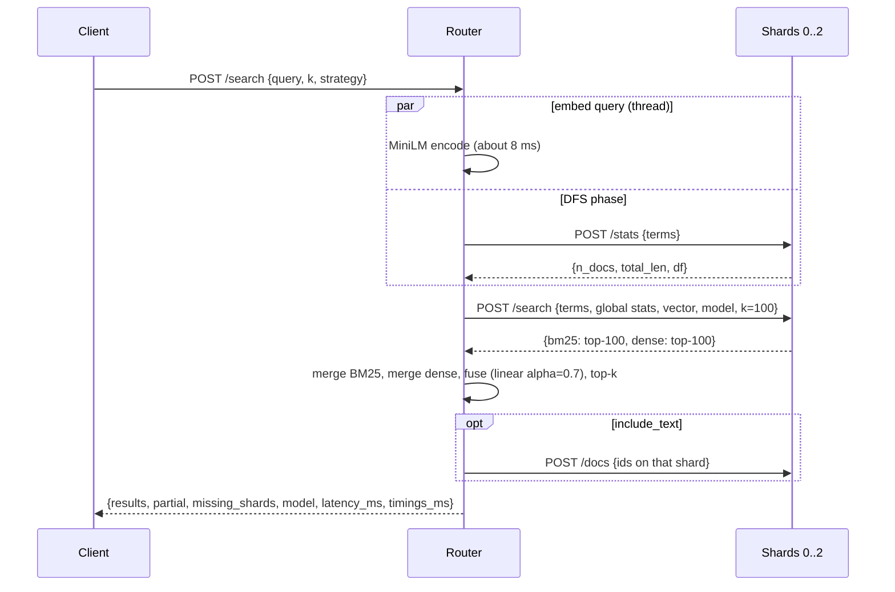

# 08 · Sharding and scatter-gather

Code: `src/service/router.py`, `src/service/shard_server.py`, `src/index/sharding.py`

I split the corpus across N shard processes, each a complete search engine for about 1/N of the docs. The router sends
every query to every shard, gathers the answers, merges them and returns the global top-k. This scales data size and
write throughput; every query still touches every shard.

## Three correctness rules

1. Each shard returns its local top-D when the router wants the global top-D. A doc that D others outrank on its own
   shard is also outranked globally, so the union always contains the answer.
2. Scores must be comparable. Dense cosine scores already are. BM25 scores are not, because IDF and avgdl depend on
   corpus statistics, so I added a DFS phase: the router gathers N, total length and df of the query terms from every
   shard and sends the summed global stats with the query.
3. Fusion happens after the global merge.



## How I built it

Docs go to shard `crc32(doc_id) % N` (`shard_of`). Python's `hash()` is salted per process, so writes would land on the
wrong shard. The 3 shards hold 19,167 / 19,254 / 19,217 docs. The router embeds the query once and ships the vector
instead of having 3 shards re-encode it. Every shard call has a timeout (`SHARD_TIMEOUT_S = 0.5`); with failure policy
`partial` (default) the router returns what arrived with `partial: true, missing_shards: [i]`, and with `fail` it returns
HTTP 503. Single node and sharded run the same `Router` code with a
`LocalShardClient` or an `HttpShardClient`, and shards differ only by env vars (`SHARD_ID`, `N_SHARDS`, `PORT`,
`STATE_DIR`). Writes are idempotent, so the router can retry them ([09](09_live_updates_consistency.md)).

## Results (`results/bench.json`)

The requirement was nDCG@10 within 1% of single node. The 3-shard results are identical (R@10 and MRR too), guarded by
`tests/test_store.py::test_sharded_router_equals_single_node`:

| strategy | single node nDCG@10 | 3 shards nDCG@10 |
|---|---|---|
| BM25 | 0.2642 | 0.2642 |
| dense (MiniLM) | 0.3881 | 0.3881 |
| hybrid linear α=0.7 | 0.4190 | 0.4190 |

Without DFS (shard-local stats, Elasticsearch's default `query_then_fetch`) BM25 nDCG@10 is 0.2653, the same within
noise, because hash sharding gives nearly identical df ratios per shard. It saves one round trip (6.8 vs 10.7 ms p50).
I kept DFS because it makes results exactly equal to single node, and local IDF error grows with skewed or small shards.

Sharding made latency worse: hybrid p50/p95 went from 23.4/26.3 ms on 1 shard to 28.6/40.5 ms on 3 (DESIGN.md §11). The
router waits for the slowest shard, so tails grow with shard count: if each shard is slow 1% of the time, a query over
100 shards is slow 63% of the time.

Every `/search` response has `timings_ms`, which splits `latency_ms` into phases. Typical hybrid values on 3 shards under
light load ([scenarios.md](../guides/scenarios.md) §4.1): DFS stats ~15 ms, embed wait 0 to 15 ms (the encoder overlaps the stats
phase), slowest shard compute ~4 to 5 ms, network and queueing ~8 to 12 ms, merge and fuse under 1 ms. The shards' own
work is a few ms; the rest is round trips.

```bash
python -c "import httpx; print(httpx.post('http://127.0.0.1:8000/search', json={'query': 'what is short selling?', 'k': 5}).json()['timings_ms'])"
```
