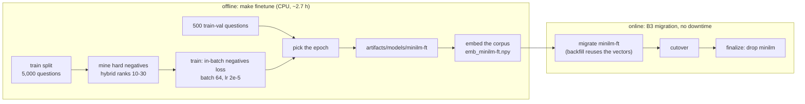

# 17 · Fine-tuning the embedding model on FiQA

all-MiniLM-L6-v2 was trained on a billion general sentence pairs, not on personal-finance forum answers. FiQA ships
5,500 training questions with labelled answers that nothing in the system used. Fine-tuning keeps training MiniLM on
those pairs, so a FiQA question ends up closer to its own answer than to passages that only look similar.

This note covers the offline path (training) and the online path (swapping the model in a running cluster), with the
numbers I measured. The code is `scripts/finetune.py` (`make finetune`); the comparison is `scripts/compare_runs.py`.



## 1. The idea in one toy example

An embedding model maps text to a vector; search ranks passages by cosine similarity to the query's vector. Suppose a
question and three passages get these similarities before training:

| | the right answer | a passage about the same topic that doesn't answer | an unrelated passage |
|---|---|---|---|
| before | 0.61 | **0.66** | 0.12 |
| after (goal) | **0.74** | 0.52 | 0.10 |

Before training the wrong passage wins. Training nudges the model's weights so that, over thousands of such
questions, the right answer moves up and the look-alike moves down. The unrelated passage barely matters: it was
already far away.

## 2. The training data

| piece | what it is | in this run |
|---|---|---|
| anchor | a train question | 5,000 questions (the other 500 train questions are held out as "train-val") |
| positive | one of its gold passages | one triple per gold passage: 12,818 triples |
| hard negative | a passage that looks relevant but isn't gold | taken from today's hybrid ranking, ranks 10 to 30 |

Why ranks 10 to 30, not 1 to 9: FiQA labels about 2.6 passages per question, and many unlabelled top hits are real
answers. Calling them "wrong" would teach the model to push good answers away. Further down the list, a non-gold hit
is far more likely to be wrong.

Leakage rules: dev and test questions are never trained on, and the 2,944 passages that are gold for any dev or test
question are never used as negatives.

## 3. The loss: in-batch negatives

A batch holds B questions, their B positives and B hard negatives. Score every question against all 2B passages:

```
S = 20 · q @ [positives; negatives]ᵀ        (B × 2B cosines; 20 = 1 / temperature)
loss = cross-entropy(S, target = column i for row i)
```

Row i's right answer is column i. Every other question's positive is a free extra negative, so with B = 64 each
question is compared with 127 wrong passages per step. This is `MultipleNegativesRankingLoss` from
sentence-transformers, written out by hand in `scripts/finetune.py` so each step is visible.

Toy, B = 2:

```
            pos0   pos1   neg0   neg1
S[0]   = [  15,     2,    11,     1 ]   softmax → most mass on pos0, some on neg0 (the hard one)
loss_0 = −log softmax(S[0])[0]          its gradient mostly pushes neg0 away from q0
```

One pitfall the code handles: two questions in a batch can share a gold passage, or the same question can appear
twice (once per gold passage). Treating the other copy as "wrong" would punish a right answer, so those cells are
masked to −∞ before the softmax (`in_batch_mask`).

## 4. Picking the epoch

Train-val nDCG@10 (dense only, 500 held-out train questions, a fixed 21,348-passage sub-corpus):

| epoch | mean loss | train-val nDCG@10 | time |
|---|---|---|---|
| 0 (base MiniLM) | | 0.4680 | |
| 1 | 1.632 | **0.4964** | 72 min |
| 2 | 1.352 | 0.4936 | 80 min |

The loss kept falling in epoch 2, but held-out quality didn't: the first sign of overfitting. The script keeps the best
epoch, so `minilm-ft` is the epoch-1 model. Dev wasn't used for this choice; it was saved for the go/no-go.

## 5. Results

Dev, 500 questions, same protocol as every other row (`results/bench.json`):

| configuration | nDCG@10 | R@10 | MRR@10 |
|---|---|---|---|
| dense MiniLM | 0.3881 | 0.4665 | 0.4532 |
| **dense MiniLM-ft** | **0.4280** | **0.5044** | **0.5017** |
| hybrid linear α = 0.7, MiniLM | 0.4190 | 0.4914 | 0.4872 |
| **hybrid linear α = 0.7, MiniLM-ft** | **0.4469** | **0.5141** | **0.5212** |
| the same through the router + 3 shards | 0.4469 | 0.5141 | 0.5212 |

α was re-swept for the new model (`results/ablation_fusion_minilm-ft.json`): linear fusion still peaks at α = 0.7
(0.4469; 0.4419 at 0.6 and 0.4434 at 0.8). RRF improved too (0.4338 at α = 0.9) but stays below linear.

Paired bootstrap, 10,000 resamples of the questions (`results/compare_*.json`):

| comparison | Δ nDCG@10 | 95% CI | questions better / worse |
|---|---|---|---|
| hybrid, dev | +0.0279 | +0.0160 to +0.0402 | 152 / 79 |
| dense, dev | +0.0399 | +0.0254 to +0.0545 | 167 / 82 |
| hybrid, **test** (648 questions, run once) | **+0.0390** | +0.0278 to +0.0507 | 197 / 93 |

On test, nDCG@10 went from 0.3968 to **0.4358**, R@10 from 0.4658 to 0.5013, MRR@10 from 0.4788 to 0.5163.

Two things I didn't expect:
- Long passages got better too. Recall@10 when a gold passage is among the 10% longest docs rose 0.464 → 0.496
  (hybrid, dev), although the 256-token truncation didn't change. My guess is that the model learned to put more
  weight on the part of a post it does read, which for an answer is usually where it answers.
- The gain on test (+0.039) is larger than on dev (+0.028). Nothing was tuned on dev except the go/no-go and α, which
  didn't move, so there is little dev optimism to lose.

Latency and memory don't change: it's the same architecture and size, only the weights differ. Under the same machine
load, local hybrid p50/p95 was 23.9/28.9 ms for MiniLM and 24.1/29.3 ms for MiniLM-ft.

## 6. The online path: just replacing the model

Nothing in the serving code changed except one registry line in `src/config.py`. The running Docker stack moved to the
new model with the existing zero-downtime migration (DESIGN.md §6.7):

```
make migrate  NEW_MODEL=minilm-ft     # build minilm-ft next to minilm, dual-write, backfill
make cutover  NEW_MODEL=minilm-ft     # queries switch at the router; minilm still kept up to date
make finalize OLD_MODEL=minilm        # drop minilm once you're sure (rollback no longer possible)
```

Measured on the Docker stack (`results/migration_minilm_ft_load.json`): the backfill took 6 s because it reused the
offline vectors (it re-embeds only docs whose text changed since the cache was built), and **426 queries ran during
the migration and cutover with 0 failures**. The dev eval through the Docker router then gave 0.4469 / 0.5141, the
same as single node. The router and shards persist the choice, so a restart keeps serving MiniLM-ft, and the Docker
tour passes against it (it follows whatever model the stack starts on).

The weights and the corpus vectors are a release asset, so nobody has to repeat the 2.7 h of training:

```
gh release download index-artifacts-v1 -p minilm_ft_artifacts.zip    # or download it from the release page
python -c "import zipfile; zipfile.ZipFile('minilm_ft_artifacts.zip').extractall('.')"
```

## 7. Pitfalls

| pitfall | what goes wrong | what I did |
|---|---|---|
| training on dev or test | the eval measures memory, not retrieval | train split only; dev/test gold banned as negatives |
| false negatives | a real but unlabelled answer is pushed away | negatives from ranks 10-30; in-batch shared golds masked |
| overfitting | training loss falls, held-out quality drops | pick the epoch on train-val (epoch 1 beat epoch 2) |
| a stale embedding cache | the retrained model keeps the same name, so old vectors would load silently | the cache records a hash of the weights and is rejected if they change |
| serving with a different max_seq_length | vectors computed differently at train and serve time | 256 in both |
| forgetting α | the best fusion weight can move with the model | re-swept; it stayed at 0.7 |

What I didn't do: check that the model still works outside finance (another BEIR set such as SciFact), and re-run the
agent evaluation; Part C's numbers were measured with MiniLM.
