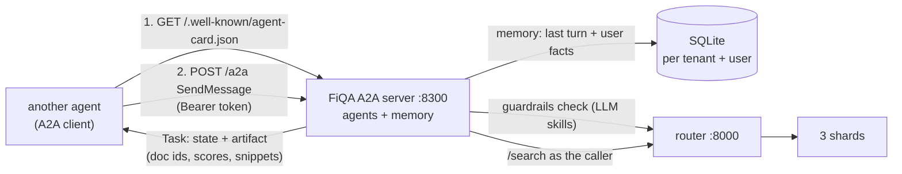

# 21 · Agents talking to agents (A2A)

Until now every agent in this repo was a Python function: `run_single_agent(question, llm, tool)`. When agents become
services, another agent has to **find** this agent, learn what it can do, and **call** it in a standard way. That is
the A2A protocol. This topic explains it with a toy you can run, then shows the A2A server and client I built, how to
use them, and what delegation over A2A measured. The memory the A2A server keeps per user is the next topic,
[22_agent_memory.md](22_agent_memory.md).

Code: `src/a2a/` (protocol, server, client) and `scripts/a2a_demo.py`.



## 1. A2A in four objects

A2A (Agent2Agent, version 1.0, https://a2a-protocol.org) is an open protocol for one agent to delegate work to
another without knowing how the other is built. Four objects carry it:

| object | what it is | here |
|---|---|---|
| agent card | a JSON document at `/.well-known/agent-card.json`: name, skills, the endpoint, the protocol version, how to authenticate | `agent_card()` in `src/a2a/server.py` |
| message | one turn: `role` (`ROLE_USER` / `ROLE_AGENT`) and `parts`; a part is text, a file or a JSON `data` object | the question, plus optional `{"remember": ...}` data |
| task | the unit of work: an id, a `contextId`, a `status.state`, `artifacts` (the output) and `history` | one search or agent run |
| artifact | the result, made of parts | doc ids, scores and snippets as JSON, plus a one-line text |

A task moves through states: `SUBMITTED` → `WORKING` → `COMPLETED`, or ends in `FAILED`, `CANCELED` or `REJECTED`;
`INPUT_REQUIRED` and `AUTH_REQUIRED` pause it. Tasks that belong to one conversation share a `contextId`.

How A2A relates to the other protocol people mention, MCP (Model Context Protocol): MCP connects a model to
**tools and data** (here, `search` would be an MCP tool). A2A connects an agent to **another agent**, which has its
own model, its own tools and its own judgement, and may take a while. An agent can use both: MCP for its tools,
A2A to hand a sub-problem to a specialist.

### Toy: a whole A2A exchange in-process

The server takes the search backend as a parameter, so a stub stands in for the router (no network, no LLM):

```python
from fastapi.testclient import TestClient
from src.a2a.server import create_app

def stub_search(token):                      # a fake retrieval service
    return lambda q, strategy, k: [{"doc_id": f"d{i}", "score": 1 / i, "text": f"passage {i} about {q}"} for i in range(1, k + 1)]

tc = TestClient(create_app(search_factory=stub_search, base_url="http://agent.example"))
req = {"jsonrpc": "2.0", "id": 1, "method": "SendMessage",
       "params": {"message": {"messageId": "m1", "role": "ROLE_USER", "parts": [{"text": "what is a roth ira?"}],
                              "metadata": {"skill": "retrieve", "k": 2}}}}
task = tc.post("/a2a", json=req, headers={"A2A-Version": "1.0"}).json()["result"]["task"]
print(task["status"]["state"], task["artifacts"][0]["parts"][0]["data"]["doc_ids"])
print(tc.post("/a2a", json=req).json()["error"]["message"])
```

```
TASK_STATE_COMPLETED ['d1', 'd2']
A2A version 0.3 is not supported; send the header A2A-Version: 1.0
```

The second line is the spec at work: a request without the `A2A-Version` header means version 0.3, and a 1.0
server must say it doesn't speak it rather than guess.

### What JSON-RPC adds

JSON-RPC 2.0 is the envelope: every request is `{"jsonrpc": "2.0", "id": ..., "method": ..., "params": ...}`, and
the answer has the same `id` and either `result` or `error`. Errors carry numbers a program can act on: -32601 for an
unknown method, -32602 for bad parameters, and A2A's own range from -32001 ("task not found") to -32009 ("version
not supported"). The HTTP status stays 200 for all of them; only a transport problem such as a bad token is an HTTP
error (401).

### Delegation

A2A becomes useful when one agent hands part of a job to another. `scripts/a2a_demo.py` has a coordinator that gets
a compound question, splits it into its parts with a rule, sends each part as its own task in one `contextId`, and
merges the answers. On the 100 compound questions, Coverage@10 (both halves of the question found) went from 0.11
as one task to 0.34 with delegation, without an LLM anywhere. The single agent, whose LLM can search again for the
part its first search missed, reaches 0.40.

### Things the protocol makes you decide

- **Who may see a task.** Here a task belongs to the token's tenant and user. For anyone else it doesn't exist:
  `GetTask` answers "not found", not "forbidden", so a stranger can't even learn that the id is real.
- **Waiting.** `SendMessage` blocks until the task is done unless the client asks for `returnImmediately`; then it
  polls `GetTask`. Streaming (Server-Sent Events) and push notifications are the other two options; this server
  declares both off in its card, and answers the methods with "unsupported".
- **Cancel races.** A cancel can arrive while the agent is still working. The worker attaches its result and marks
  the task completed in one locked step, and only if the task is not already finished, so the cancel wins (a test
  covers this).

## 2. Quick start

With the stack running (`docker compose up -d`):

| I want to | command |
|---|---|
| start the A2A server (fake LLM, free) | `python -m src.a2a.server --router http://localhost:8000` (port 8300) |
| start it with Azure for the LLM skills | add `--backend azure --confirm-spend` |
| read the agent card | `curl localhost:8300/.well-known/agent-card.json` or `python -m src.a2a.client --card` |
| ask a question | `python -m src.a2a.client "what is a roth ira?"` (skill `retrieve`) |
| ask with an LLM agent | `python -m src.a2a.client "should I pay off my mortgage early?" --skill single` |
| continue a conversation | add `--context <the contextId the first answer printed>` |
| run the end-to-end demo | `python scripts/a2a_demo.py` (starts its own A2A server) |

Server options and environment:

| option / variable | default | what it sets |
|---|---|---|
| `--router` / `ROUTER_URL` | `http://localhost:8000` | the retrieval service the agents search |
| `--port`, `--host` | 8300, 127.0.0.1 | where the A2A server listens |
| `--public-url` | `http://<host>:<port>` | the URL written into the agent card (set it behind a proxy) |
| `--backend` | `fake` | LLM for `single`, `multi`, `cascade`: `none`, `fake`, `copilot`, `azure` |
| `A2A_AGENT_URL`, `FIQA_TOKEN` | `http://localhost:8300`, none | defaults for the client |

## 3. The A2A server

`src/a2a/server.py` is a separate FastAPI service in front of the router. The router stays a retrieval API, and
the A2A server owns the LLM, the agents and their memory. It searches by calling the router's `/search` with the
caller's bearer token, so the tenant filter, PII redaction, guardrails and audit of
[17_security.md](17_security.md) apply to the agents unchanged.

**The agent card** (`GET /.well-known/agent-card.json`) names one interface, JSON-RPC at `/a2a` with protocol
version 1.0, a Bearer security scheme, and four skills:

| skill | what runs | LLM calls |
|---|---|---|
| `retrieve` (default) | hybrid search of the question | 0 |
| `single` | the single agent ([12_single_agent.md](12_single_agent.md)) | 1 to 3 |
| `multi` | planner, parallel workers, verifier ([13](13_multi_agent_orchestration.md)) | 0 to 2 (simple questions skip the planner) |
| `cascade` | cheap tier, escalating to the single agent ([19_llm_cost.md](19_llm_cost.md)) | 1 to 4 |

The card has `Cache-Control: max-age=300` and an `ETag`; a client that sends `If-None-Match` gets 304.

**JSON-RPC methods** (POST `/a2a`, header `A2A-Version: 1.0`):

| method | what it does |
|---|---|
| `SendMessage` | starts a task for the message's text. `metadata`: `skill`, `k` (1 to 50), `memory` (false opts out). `configuration.returnImmediately: true` returns at once in state WORKING; otherwise it waits for the result |
| `GetTask` | the task by id, with `historyLength` messages of history |
| `ListTasks` | the caller's tasks, filtered by `contextId` and `status`, paged with `pageSize` / `pageToken` |
| `CancelTask` | cancels a task that has not finished; a finished task answers -32002 |
| `SendStreamingMessage`, `SubscribeToTask`, `GetExtendedAgentCard` | -32004 (the card says streaming is off) |
| push-notification methods | -32003 |

**A task, step by step.**

1. The server identifies the caller from the token. With no token the caller is anonymous: it works, but gets no
   memory.
2. Memory stores any fact in the message ("I live in Canada"). It then builds the query to search: the last turn of
   the same `contextId` if the question is a follow-up, plus the user's country fact.
3. For LLM skills, the router's guardrails check the question first. A refused question becomes
   `TASK_STATE_REJECTED` and the LLM never sees it.
4. The skill runs. The task gets one artifact, `passages`, with a JSON part
   (`{"doc_ids": [...], "hits": [{"doc_id", "score", "snippet"}]}`) and a one-line text part. The task's
   `metadata` holds what memory changed (`memory.query_searched`, `turn_used`, `facts_used`), the LLM calls,
   the estimated cost and the latency.
5. Memory stores the turn, PII-redacted, under the task's `contextId`.

Errors from the router become task states: 401 is `TASK_STATE_AUTH_REQUIRED`; 403 and 429 are `TASK_STATE_REJECTED`;
anything else is `TASK_STATE_FAILED`, with the reason in the status message.

**Ownership.** A task belongs to the caller who created it (`tenant/user`, or `anonymous`). For anyone else,
`GetTask` and `CancelTask` answer -32001 "Task not found", exactly like a missing id, so the error doesn't reveal
that the task exists (spec section 3.3.2).

## 4. Calling it

With the client (it reads the card first and uses the interface the card names):

```python
from src.a2a.client import A2AClient, doc_ids

c = A2AClient("http://localhost:8300", token=None)            # token: scripts/mint_token.py, for memory
print(c.skills)                                               # ['retrieve', 'single', 'multi', 'cascade']
task = c.send("what is a roth ira?", skill="retrieve", k=5)
print(task["status"]["state"], doc_ids(task))                 # TASK_STATE_COMPLETED [...]
follow = c.send("can I withdraw from it early?", context_id=task["contextId"])
t = c.send("should I pay off my mortgage early?", skill="single", wait=False)   # returns at once
t = c.wait(t["id"])                                           # polls GetTask until it is done
```

Or raw JSON-RPC:

```bash
curl -X POST localhost:8300/a2a -H "Content-Type: application/json" -H "A2A-Version: 1.0" -d '{
  "jsonrpc": "2.0", "id": 1, "method": "SendMessage",
  "params": {"message": {"messageId": "m1", "role": "ROLE_USER",
                         "parts": [{"text": "what is a roth ira?"}], "metadata": {"skill": "retrieve", "k": 3}}}}'
```

The answer is `{"jsonrpc": "2.0", "id": 1, "result": {"task": {...}}}`: `id`, `contextId`,
`status.state = "TASK_STATE_COMPLETED"`, `artifacts[0].parts[0].data.doc_ids`, the message in `history`, and
`metadata`. Without the `A2A-Version` header the server answers -32009: the spec says a missing header means
version 0.3, which this server doesn't speak.

## 5. Results: delegation over A2A

`scripts/a2a_demo.py` (`results/a2a_demo.json`) runs a coordinator agent over the 100 compound questions. For each
question it sends the whole question as one A2A task, then splits it with the rule-based splitter
(`fake_policies.split_question`), sends each part as its own task in the same `contextId`, and fuses the parts'
results with reciprocal rank fusion. All tasks use the `retrieve` skill, so no LLM is involved.

| | Coverage@10 on the compound set |
|---|---|
| whole question, one task | 0.11 |
| split by the coordinator, one task per part (2.14 parts on average) | **0.34** |
| for comparison: the single agent / multi-agent in-process (`results/agent_eval.json`) | 0.40 / 0.32 |

314 A2A tasks took 21.1 s against the Docker router: about 67 ms a task, of which the router's search with passage
text is about 80 ms at p50 when measured on its own. (My first version made a new HTTP client per task and took
137 s; reusing one client per token fixed it.)

The rest of the demo, on the live stack:

- alice says "I live in Canada. What is the best account to save for retirement?"; her follow-up "can I take money
  out of it early?" is searched together with that question; in a new conversation "how are capital gains taxed?"
  is searched as "how are capital gains taxed? Canada";
- bob's `GetTask` on alice's task answers "Task not found", and his search of the same question has nothing added;
- `GET /memory` shows alice 4 entries (1 fact, 3 turns), and `DELETE /memory` removes all 4.

An Azure run through A2A (`results/a2a_llm_check.json`): the `cascade` skill completed "what is a roth ira?" with
4 LLM calls, $0.003. With the router's `guard_harmful` toggle set to `block`, the `single` skill answered a
structuring question with `TASK_STATE_REJECTED` "refused by the guardrails (structuring); no LLM call was made".

## 6. How it is checked

| what | where |
|---|---|
| card fields, ETag and 304; a retrieve task with its artifact; JSON-RPC errors (version, unknown method, bad params, bad JSON, batches, streaming, push); invalid token = 401 | `tests/test_a2a.py` |
| task ownership (bob and anonymous see "Task not found"); returnImmediately then poll; cancel, and a cancel that wins over a finishing task; a finished task can't take a new message; contextId mismatch | `tests/test_a2a.py` |
| LLM skill completes; guardrails refuse before any LLM call or search; no LLM configured = FAILED; router 401 / 403 / 429 / 500 = AUTH_REQUIRED / REJECTED / REJECTED / FAILED; concurrent tasks keep their own results | `tests/test_a2a.py` |
| A2A JSON shapes, client request shape | doctests in `src/a2a/protocol.py`, `src/a2a/client.py` |
| on the live stack and the real corpus | `scripts/a2a_demo.py` |

## 7. Pitfalls and what I would do next

- An agent card is a promise: if it says streaming is off, the streaming methods must refuse, not half-work.
- **Tasks live in the server's memory.** A restart loses them; production would keep them in a database, as memory
  already is.
- **No streaming or push notifications.** A long `multi` task can only be polled. SSE (`SendStreamingMessage`) is
  the next step for agents that take seconds.
- **The agent card is not signed.** A2A allows a JWS signature on the card, so a client can check it came from the
  claimed provider. Worth adding once the agent is reachable from outside one machine.
- **The A2A server is not in docker-compose.** It runs on the host next to the Docker router. A compose service
  under a profile would make it part of `docker compose up` without changing the default stack.
