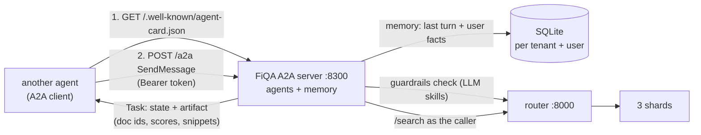
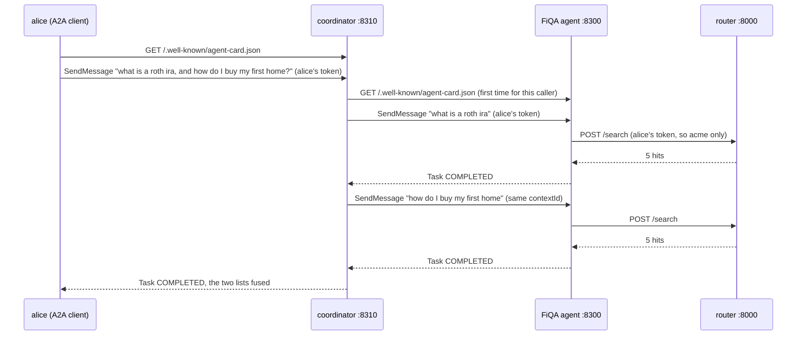
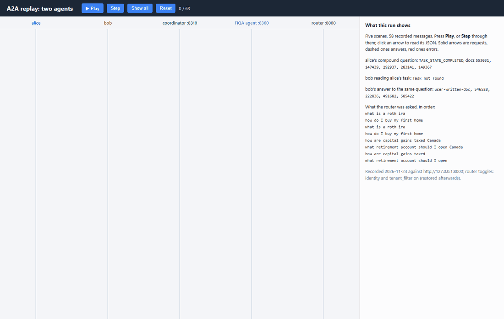
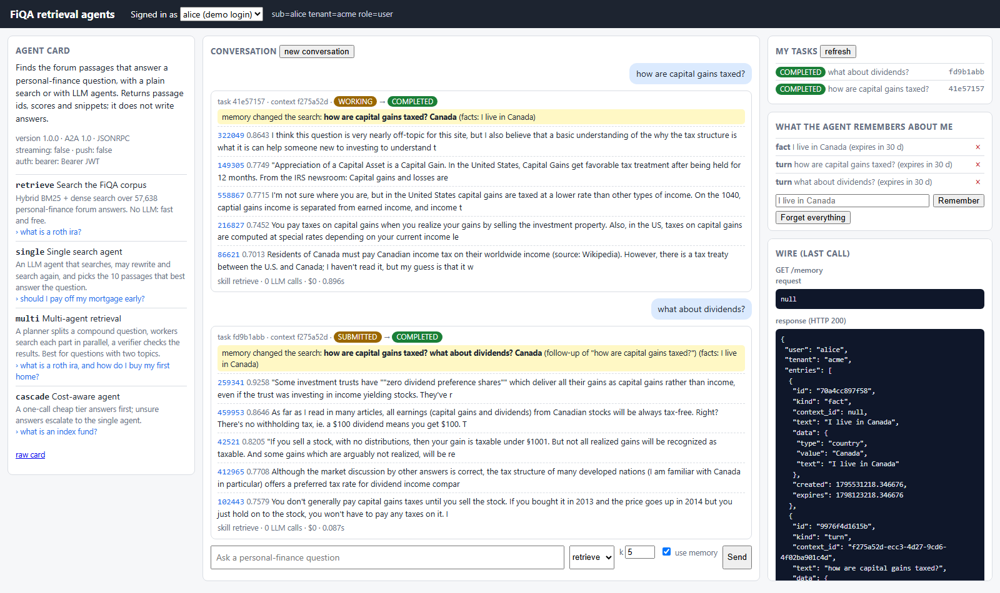
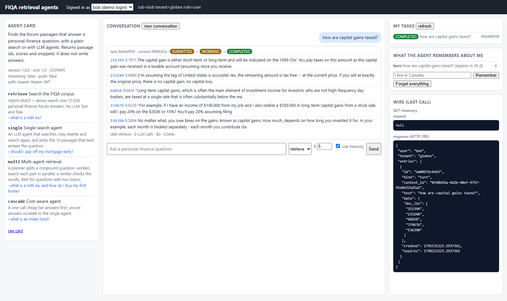

# 21 · Agents talking to agents (A2A)

Until now every agent in this repo was a Python function: `run_single_agent(question, llm, tool)`. When agents become
services, another agent has to **find** this agent, learn what it can do, and **call** it in a standard way. That is
the A2A protocol. This topic explains it with a toy you can run, then shows the A2A server and client I built, a
second agent that delegates to the first over A2A, what stays private between users when agents call agents, a
browser page to try it by hand, and what delegation over A2A measured. The memory the A2A server keeps per user is the next topic,
[22_agent_memory.md](22_agent_memory.md).

Code: `src/a2a/` (protocol, server, client, coordinator, the `ui.html` page), `scripts/a2a_demo.py` and
`scripts/a2a_two_agents.py`. Part B of [demo_security_a2a_memory.md](../guides/demo_security_a2a_memory.md) calls
both agents by hand with `curl`, with the output to expect.



## 1. A2A in four objects

A2A (Agent2Agent, version 1.0, https://a2a-protocol.org) is an open protocol for one agent to delegate work to
another without knowing how the other is built. Four objects carry it:

| object | what it is | here |
|---|---|---|
| agent card | a JSON document at `/.well-known/agent-card.json`: name, skills, the endpoint, the protocol version, how to authenticate | `agent_card()` in `src/a2a/server.py` |
| message | one turn: `role` (`ROLE_USER` / `ROLE_AGENT`) and `parts`; a part is text, a file or a JSON `data` object | the question, plus optional `{"remember": ...}` data |
| task | the unit of work: an id, a `contextId`, a `status.state`, `artifacts` (the output) and `history` | one search or agent run |
| artifact | the result, made of parts | doc ids, scores and snippets as JSON, plus a one-line text |

A task moves through states: `SUBMITTED` → `WORKING` → `COMPLETED`, or ends in `FAILED`, `CANCELED` or `REJECTED`;
`INPUT_REQUIRED` and `AUTH_REQUIRED` pause it. Tasks that belong to one conversation share a `contextId`.

How A2A relates to the other protocol people mention, MCP (Model Context Protocol): MCP connects a model to
**tools and data** (here, `search` would be an MCP tool). A2A connects an agent to **another agent**, which has its
own model, its own tools and its own judgement, and may take a while. An agent can use both: MCP for its tools,
A2A to hand a sub-problem to a specialist.

### Toy: a whole A2A exchange in-process

The server takes the search backend as a parameter, so a stub stands in for the router (no network, no LLM):

```python
from fastapi.testclient import TestClient
from src.a2a.server import create_app

def stub_search(token):                      # a fake retrieval service
    return lambda q, strategy, k: [{"doc_id": f"d{i}", "score": 1 / i, "text": f"passage {i} about {q}"} for i in range(1, k + 1)]

tc = TestClient(create_app(search_factory=stub_search, base_url="http://agent.example"))
req = {"jsonrpc": "2.0", "id": 1, "method": "SendMessage",
       "params": {"message": {"messageId": "m1", "role": "ROLE_USER", "parts": [{"text": "what is a roth ira?"}],
                              "metadata": {"skill": "retrieve", "k": 2}}}}
task = tc.post("/a2a", json=req, headers={"A2A-Version": "1.0"}).json()["result"]["task"]
print(task["status"]["state"], task["artifacts"][0]["parts"][0]["data"]["doc_ids"])
print(tc.post("/a2a", json=req).json()["error"]["message"])
```

```
TASK_STATE_COMPLETED ['d1', 'd2']
A2A version 0.3 is not supported; send the header A2A-Version: 1.0
```

The second line is the spec at work: a request without the `A2A-Version` header means version 0.3, and a 1.0
server must say it doesn't speak it rather than guess.

### What JSON-RPC adds

JSON-RPC 2.0 is the envelope: every request is `{"jsonrpc": "2.0", "id": ..., "method": ..., "params": ...}`, and
the answer has the same `id` and either `result` or `error`. Errors carry numbers a program can act on: -32601 for an
unknown method, -32602 for bad parameters, and A2A's own range from -32001 ("task not found") to -32009 ("version
not supported"). The HTTP status stays 200 for all of them; only a transport problem such as a bad token is an HTTP
error (401).

### Delegation

A2A becomes useful when one agent hands part of a job to another. `scripts/a2a_demo.py` has a coordinator that gets
a compound question, splits it into its parts with a rule, sends each part as its own task in one `contextId`, and
merges the answers. On the 100 compound questions, Coverage@10 (both halves of the question found) went from 0.11
as one task to 0.34 with delegation, without an LLM anywhere. The single agent, whose LLM can search again for the
part its first search missed, reaches 0.40. Section 5 turns the coordinator into an A2A agent of its own.

### Things the protocol makes you decide

- **Who may see a task.** Here a task belongs to the token's tenant and user. For anyone else it doesn't exist:
  `GetTask` answers "not found", not "forbidden", so a stranger can't even learn that the id is real.
- **Waiting.** `SendMessage` blocks until the task is done unless the client asks for `returnImmediately`; then it
  polls `GetTask`. Streaming (Server-Sent Events) and push notifications are the other two options; this server
  declares both off in its card, and answers the methods with "unsupported".
- **Cancel races.** A cancel can arrive while the agent is still working. The worker attaches its result and marks
  the task completed in one locked step, and only if the task is not already finished, so the cancel wins (a test
  covers this).

## 2. Quick start

With the stack running (`docker compose up -d`):

| I want to | command |
|---|---|
| start the A2A server (fake LLM, free) | `python -m src.a2a.server --router http://localhost:8000` (port 8300) |
| start it with Azure for the LLM skills | add `--backend azure --confirm-spend` |
| read the agent card | `curl localhost:8300/.well-known/agent-card.json` or `python -m src.a2a.client --card` |
| ask a question | `python -m src.a2a.client "what is a roth ira?"` (skill `retrieve`) |
| ask with an LLM agent | `python -m src.a2a.client "should I pay off my mortgage early?" --skill single` |
| continue a conversation | add `--context <the contextId the first answer printed>` |
| run the end-to-end demo | `python scripts/a2a_demo.py` (starts its own A2A server) |
| start the coordinator (a second agent, port 8310) | `python -m src.a2a.coordinator --agent http://127.0.0.1:8300` |
| record the two-agent replay | `python scripts/a2a_two_agents.py` (starts both agents itself; no LLM) |
| chat in a browser | `python -m src.a2a.server --router http://127.0.0.1:8000 --demo-logins`, then open `http://127.0.0.1:8300/ui` |

Server options and environment:

| option / variable | default | what it sets |
|---|---|---|
| `--router` / `ROUTER_URL` | `http://localhost:8000` | the retrieval service the agents search |
| `--port`, `--host` | 8300, 127.0.0.1 | where the A2A server listens |
| `--public-url` | `http://<host>:<port>` | the URL written into the agent card (set it behind a proxy) |
| `--backend` | `fake` | LLM for `single`, `multi`, `cascade`: `none`, `fake`, `copilot`, `azure` |
| `--memory-db` / `MEMORY_DB` | `a2a_memory.sqlite` | where memory is kept; `off` disables it, `:memory:` keeps it in RAM |
| `--demo-logins` | off | lets the `/ui` page sign in as alice or bob without a token (section 7) |
| `A2A_AGENT_URL`, `FIQA_TOKEN` | `http://localhost:8300`, none | defaults for the client |

## 3. The A2A server

`src/a2a/server.py` is a separate FastAPI service in front of the router. The router stays a retrieval API, and
the A2A server owns the LLM, the agents and their memory. It searches by calling the router's `/search` with the
caller's bearer token, so the tenant filter, PII redaction, guardrails and audit of
[17_security.md](17_security.md) apply to the agents unchanged.

**The agent card** (`GET /.well-known/agent-card.json`) names one interface, JSON-RPC at `/a2a` with protocol
version 1.0, a Bearer security scheme, and four skills:

| skill | what runs | LLM calls |
|---|---|---|
| `retrieve` (default) | hybrid search of the question | 0 |
| `single` | the single agent ([12_single_agent.md](12_single_agent.md)) | 1 to 3 |
| `multi` | planner, parallel workers, verifier ([13](13_multi_agent_orchestration.md)) | 0 to 2 (simple questions skip the planner) |
| `cascade` | cheap tier, escalating to the single agent ([19_llm_cost.md](19_llm_cost.md)) | 1 to 4 |

The card has `Cache-Control: max-age=300` and an `ETag`; a client that sends `If-None-Match` gets 304.

**JSON-RPC methods** (POST `/a2a`, header `A2A-Version: 1.0`):

| method | what it does |
|---|---|
| `SendMessage` | starts a task for the message's text. `metadata`: `skill`, `k` (1 to 50), `memory` (false opts out). `configuration.returnImmediately: true` returns at once in state WORKING; otherwise it waits for the result |
| `GetTask` | the task by id, with `historyLength` messages of history |
| `ListTasks` | the caller's tasks, filtered by `contextId` and `status`, paged with `pageSize` / `pageToken` |
| `CancelTask` | cancels a task that has not finished; a finished task answers -32002 |
| `SendStreamingMessage`, `SubscribeToTask`, `GetExtendedAgentCard` | -32004 (the card says streaming is off) |
| push-notification methods | -32003 |

**A task, step by step.**

1. The server identifies the caller from the token. With no token the caller is anonymous: it works, but gets no
   memory.
2. Memory stores any fact in the message ("I live in Canada"). It then builds the query to search: the last turn of
   the same `contextId` if the question is a follow-up, plus the user's country fact.
3. For LLM skills, the router's guardrails check the question first. A refused question becomes
   `TASK_STATE_REJECTED` and the LLM never sees it.
4. The skill runs. The task gets one artifact, `passages`, with a JSON part
   (`{"doc_ids": [...], "hits": [{"doc_id", "score", "snippet"}]}`) and a one-line text part. The task's
   `metadata` holds what memory changed (`memory.query_searched`, `turn_used`, `facts_used`), the LLM calls,
   the estimated cost and the latency.
5. Memory stores the turn, PII-redacted, under the task's `contextId`.

Errors from the router become task states: 401 is `TASK_STATE_AUTH_REQUIRED`; 403 and 429 are `TASK_STATE_REJECTED`;
anything else is `TASK_STATE_FAILED`, with the reason in the status message.

**Ownership.** A task belongs to the caller who created it (`tenant/user`, or `anonymous`). For anyone else,
`GetTask` and `CancelTask` answer -32001 "Task not found", exactly like a missing id, so the error doesn't reveal
that the task exists (spec section 3.3.2).

## 4. Calling it

With the client (it reads the card first and uses the interface the card names):

```python
from src.a2a.client import A2AClient, doc_ids

c = A2AClient("http://localhost:8300", token=None)            # token: scripts/mint_token.py, for memory
print(c.skills)                                               # ['retrieve', 'single', 'multi', 'cascade']
task = c.send("what is a roth ira?", skill="retrieve", k=5)
print(task["status"]["state"], doc_ids(task))                 # TASK_STATE_COMPLETED [...]
follow = c.send("can I withdraw from it early?", context_id=task["contextId"])
t = c.send("should I pay off my mortgage early?", skill="single", wait=False)   # returns at once
t = c.wait(t["id"])                                           # polls GetTask until it is done
```

Or raw JSON-RPC:

```bash
curl -X POST localhost:8300/a2a -H "Content-Type: application/json" -H "A2A-Version: 1.0" -d '{
  "jsonrpc": "2.0", "id": 1, "method": "SendMessage",
  "params": {"message": {"messageId": "m1", "role": "ROLE_USER",
                         "parts": [{"text": "what is a roth ira?"}], "metadata": {"skill": "retrieve", "k": 3}}}}'
```

The answer is `{"jsonrpc": "2.0", "id": 1, "result": {"task": {...}}}`: `id`, `contextId`,
`status.state = "TASK_STATE_COMPLETED"`, `artifacts[0].parts[0].data.doc_ids`, the message in `history`, and
`metadata`. Without the `A2A-Version` header the server answers -32009: the spec says a missing header means
version 0.3, which this server doesn't speak.

## 5. Two agents: a coordinator that is itself an A2A server

Section 8's delegation numbers come from a script playing the coordinator. `src/a2a/coordinator.py` makes the
coordinator a real agent: a second A2A server, on port 8310, with its own card, its own tasks and its own
`GetTask` / `ListTasks` / `CancelTask`. It knows nothing about finance. Its one skill, `delegate`, splits a compound
question into parts, asks the FiQA agent each part over A2A, and fuses the answers with reciprocal rank fusion.
It is built from the same `create_app` as the FiQA agent, with a different card and a search function that calls
another agent instead of the router.



### Toy: two agents in one process

Each agent is a FastAPI app, so two `TestClient`s can talk to each other without a network. The FiQA agent's search
is a stub that records what it was asked:

```python
from fastapi.testclient import TestClient
from scripts.mint_token import token_for
from src.a2a.client import A2AClient, doc_ids
from src.a2a.coordinator import create_coordinator_app
from src.a2a.server import create_app

asked = []
def stub_search(token):
    def fn(q, strategy, k):
        asked.append(q)
        return [{"doc_id": f"{q.split()[-1]}-{i}", "score": 1 / i, "text": f"passage about {q}"} for i in range(1, k + 1)]
    return fn

fiqa = TestClient(create_app(search_factory=stub_search, base_url="http://fiqa"))
coord = TestClient(create_coordinator_app("http://fiqa", base_url="http://coord", http_factory=lambda tok: fiqa))

alice = A2AClient("http://coord", token_for("alice"), http=coord)
print(alice.card["name"], alice.skills)
task = alice.send("what is a roth ira, and how do I buy my first home?", k=4)
print(task["status"]["state"], doc_ids(task))
print("the FiQA agent was asked:", asked)
print("alice's tasks on the FiQA agent:", len(A2AClient("http://fiqa", token_for("alice"), http=fiqa).list()["tasks"]))
print("bob's tasks on the FiQA agent:  ", len(A2AClient("http://fiqa", token_for("bob"), http=fiqa).list()["tasks"]))
```

```
FiQA coordinator ['delegate']
TASK_STATE_COMPLETED ['ira-1', 'home-1', 'ira-2', 'home-2']
the FiQA agent was asked: ['what is a roth ira', 'how do I buy my first home']
alice's tasks on the FiQA agent: 2
bob's tasks on the FiQA agent:   0
```

Reciprocal rank fusion interleaves the two lists: each part's first passage scores 1/61, each second passage 1/62,
so the answer covers both topics from the top. The two tasks the coordinator created on the FiQA agent belong to
alice, not to the coordinator, which is the next point.

### Whose identity the second agent sees

The coordinator calls the FiQA agent with the caller's own bearer token. The FiQA agent and the router therefore
see alice as alice: her tenant filter, her memory, her rate limit, her lines in the audit log. If the coordinator
used one token of its own, every user's delegated searches would run as the same identity, so the tenant filter
could not tell them apart and the FiQA agent would keep one shared memory for everybody.

Forwarding the user's token unchanged is the simple version. In production the coordinator would exchange it for
a narrower token made for this one hop (OAuth 2.0 token exchange, RFC 8693, often called "on-behalf-of"), so the
FiQA agent gets a token that names both the user and the coordinator, and a leaked token is only good for that
audience.

### The two-agent replay

`scripts/a2a_two_agents.py` starts both agents (on 8300 and 8310) against the running Docker router, records every
HTTP message between alice, bob, the coordinator, the FiQA agent and the router, and writes
[scenarios/SimpleScenarios/results/A2AReplay/replay.html](../../scenarios/SimpleScenarios/results/A2AReplay/replay.html):
a sequence diagram with one arrow per message. Play, Step or Show all; click an arrow to see the full JSON-RPC
request or response. It uses the `retrieve` skill only, so it makes no LLM calls. It switches the router's
`identity` and `tenant_filter` on for scene 4 and puts the toggles back afterwards.



| scene | what happens | what the recording shows |
|---|---|---|
| 1. Discovery | alice reads the coordinator's card | 3.3 ms; skills `['delegate']` |
| 2. Delegation | alice asks the compound question | 2 tasks on the FiQA agent, 2 router searches (107 and 53 ms), the fused answer after 1,124 ms |
| 3. Tasks are private | bob asks the coordinator for alice's task id, then lists his tasks | `-32001 Task not found`, and 0 tasks |
| 4. Tenants | bob asks the same question | the router answers with globex passages; alice's were acme |
| 5. Memory | alice tells the FiQA agent "I live in Canada", both ask a second compound question | alice's parts are searched as "how are capital gains taxed Canada" and "what retirement account should I open Canada"; bob's have nothing added; then alice's `DELETE /memory` removes her 5 entries |

The first question from each user took about 1.1 s (1,124 ms for alice, 1,115 ms for bob): the coordinator builds
one A2A client per caller, so it reads the FiQA agent's card and opens new connections the first time. The second
compound question, on warm clients, took 113 ms for alice and 125 ms for bob, of which the two router searches were
50 to 58 ms each.

## 6. What stays private between users when agents call agents

Every agent in the chain has to keep users apart on its own; the protocol does not do it for them. Each row is
enforced in one place, and the replay of section 5 shows it holding:

| what | where it is enforced | what the replay shows |
|---|---|---|
| a task | `TaskStore.get(task_id, owner)` in `src/a2a/server.py`: another owner's task looks exactly like a missing one | bob's `GetTask` on alice's task id answers `-32001 Task not found` |
| the task list | `TaskStore.mine(owner)` behind `ListTasks` | bob lists 0 tasks on the coordinator after alice created one |
| search results | the router's tenant filter, which sees the token the agents forward ([17_security.md](17_security.md)) | alice's parts return acme passages, bob's globex |
| memory | `MemoryStore` rows keyed by tenant and user; `/memory` only ever reads the caller's ([22_agent_memory.md](22_agent_memory.md)) | "Canada" is added to alice's searches and never to bob's |
| identity on the second hop | the coordinator forwards the caller's token (`delegating_search` in `src/a2a/coordinator.py`) | the FiQA agent's two tasks belong to alice; bob lists 0 there too (the toy above) |

An anonymous caller (no token) is its own owner, `anonymous`: it can use both agents, but gets no memory, and
the router's identity toggle decides whether it may search at all.

## 7. The browser page

The A2A server also serves one static page, `src/a2a/ui.html`, at `/ui`. It is an ordinary A2A client written in
plain JavaScript (one 276-line file with HTML and CSS), so it is also a readable example of the protocol from a browser:

```bash
python -m src.a2a.server --router http://127.0.0.1:8000 --demo-logins --memory-db :memory:
# open http://127.0.0.1:8300/ui
```

| panel | what it calls | what you see |
|---|---|---|
| agent card | `GET /.well-known/agent-card.json` | name, protocol version, binding, auth scheme, each skill with clickable examples |
| conversation | `SendMessage` with `returnImmediately: true`, then `GetTask` every 150 ms | each task's states as it moves (`SUBMITTED → WORKING → COMPLETED`), the passages, and a yellow line when memory changed the search |
| my tasks | `ListTasks` | only the signed-in user's tasks; click one to see its `GetTask` JSON |
| memory | `GET`, `POST`, `DELETE /memory` and `DELETE /memory/{id}` | each fact and turn kept about the user, with days until it expires, a delete button per entry and "Forget everything" |
| wire | (every call above) | the exact JSON request and response of the last call |

The "Signed in as" menu decides the bearer token. "Paste a token" takes one from
`python -m scripts.mint_token alice`. With `--demo-logins` the menu also offers alice and bob, and the page gets a
token from `POST /ui/login` without a password. That is a stand-in for an identity provider on a laptop: it hands
out a valid token to whoever asks, so it is off unless the flag is given, and it never issues an admin token. The
coordinator serves the same page at `http://127.0.0.1:8310/ui`, without demo logins (paste a token) and without
memory, which its memory panel says.

On the Docker stack with the router's identity and tenant filter on, alice first stored "I live in Canada", then
asked "how are capital gains taxed?" and "what about dividends?". Both searches had Canada added, and the second
was also searched with the first question, because it is a follow-up in the same conversation. All the doc ids are
odd, which is acme's half of the corpus:



Switching to bob in the same browser: his task list has only his own question, his memory has only his own turn,
the passages are globex's (even ids), and nothing about Canada was added:



## 8. Results: delegation over A2A

`scripts/a2a_demo.py` (`results/a2a_demo.json`) runs a coordinator agent over the 100 compound questions. For each
question it sends the whole question as one A2A task, then splits it with the rule-based splitter
(`fake_policies.split_question`), sends each part as its own task in the same `contextId`, and fuses the parts'
results with reciprocal rank fusion. All tasks use the `retrieve` skill, so no LLM is involved.

| | Coverage@10 on the compound set |
|---|---|
| whole question, one task | 0.11 |
| split by the coordinator, one task per part (2.14 parts on average) | **0.34** |
| for comparison: the single agent / multi-agent in-process (`results/agent_eval.json`) | 0.40 / 0.32 |

314 A2A tasks took 21.1 s against the Docker router: about 67 ms a task, of which the router's search with passage
text is about 80 ms at p50 when measured on its own. (My first version made a new HTTP client per task and took
137 s; reusing one client per token fixed it.)

The rest of the demo, on the live stack:

- alice says "I live in Canada. What is the best account to save for retirement?"; her follow-up "can I take money
  out of it early?" is searched together with that question; in a new conversation "how are capital gains taxed?"
  is searched as "how are capital gains taxed? Canada";
- bob's `GetTask` on alice's task answers "Task not found", and his search of the same question has nothing added;
- `GET /memory` shows alice 4 entries (1 fact, 3 turns), and `DELETE /memory` removes all 4.

An Azure run through A2A (`results/a2a_llm_check.json`): the `cascade` skill completed "what is a roth ira?" with
4 LLM calls, $0.003. With the router's `guard_harmful` toggle set to `block`, the `single` skill answered a
structuring question with `TASK_STATE_REJECTED` "refused by the guardrails (structuring); no LLM call was made".

## 9. How it is checked

| what | where |
|---|---|
| card fields, ETag and 304; a retrieve task with its artifact; JSON-RPC errors (version, unknown method, bad params, bad JSON, batches, streaming, push); invalid token = 401 | `tests/test_a2a.py` |
| task ownership (bob and anonymous see "Task not found"); returnImmediately then poll; cancel, and a cancel that wins over a finishing task; a finished task can't take a new message; contextId mismatch | `tests/test_a2a.py` |
| LLM skill completes; guardrails refuse before any LLM call or search; no LLM configured = FAILED; router 401 / 403 / 429 / 500 = AUTH_REQUIRED / REJECTED / REJECTED / FAILED; concurrent tasks keep their own results | `tests/test_a2a.py` |
| A2A JSON shapes, client request shape | doctests in `src/a2a/protocol.py`, `src/a2a/client.py` |
| the coordinator delegates each part as the caller; bob sees neither agent's tasks; the coordinator only accepts its own skill | `tests/test_a2a.py` (`test_coordinator_delegates_each_part_as_the_caller`) |
| `/ui` is served; demo logins are off by default, give bob a globex token when on, and never an admin token | `tests/test_a2a.py` (`test_ui_page_and_demo_logins_are_off_unless_asked_for`) |
| `split_question`, `rrf` | doctests in `src/a2a/coordinator.py` |
| on the live stack and the real corpus | `scripts/a2a_demo.py`, `scripts/a2a_two_agents.py` |

## 10. Pitfalls and what I would do next

- An agent card is a promise: if it says streaming is off, the streaming methods must refuse, not half-work.
- **Tasks live in the server's memory.** A restart loses them; production would keep them in a database, as memory
  already is.
- **No streaming or push notifications.** A long `multi` task can only be polled. SSE (`SendStreamingMessage`) is
  the next step for agents that take seconds.
- **The agent card is not signed.** A2A allows a JWS signature on the card, so a client can check it came from the
  claimed provider. Worth adding once the agent is reachable from outside one machine.
- **The A2A server is not in docker-compose.** It runs on the host next to the Docker router. A compose service
  under a profile would make it part of `docker compose up` without changing the default stack.
- **The coordinator forwards the user's token as it is.** Fine inside one machine; across services it should be
  exchanged for a token scoped to the FiQA agent (section 5).
- **The coordinator reads the FiQA agent's card once per caller,** so each user's first question pays for a card
  fetch and new connections (about 1.1 s in the replay against 113 to 125 ms warm). Caching the card once per
  process, honouring its `ETag`, would remove most of that.
- **`--demo-logins` hands out tokens to anyone who can reach the port.** It exists for a laptop demo; a shared
  server would send the page to a real login instead.
